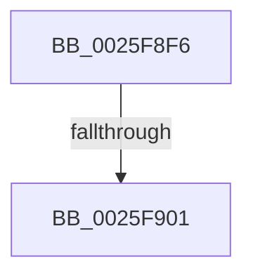

# sub_0025F8F6

- RVA: `0x0025F8F6`–`0x0025F912` (길이 `28` bytes)
- VA: `0x000000014025F8F6`
- 실행 섹션: `.text`
- PDB 이름 있음: `아니요`; PDB Function 태그: `아니요`
- unwind 정보 RVA: `0x000642AC`
- 디코드: `6`개 명령, `28/28` bytes 표시
- 미해석 바이트: `0` (있으면 어셈블리에 `.byte`로 보존)

> 이 문서는 커널 이미지의 기계어와 PDB 기호를 분석해 생성했습니다. 4번과 5번은 함수 원형과 자료형을 바이너리 사용 방식에서 추정한 C 해석이며 원본 소스 복구 결과는 아닙니다.

## 1. Dependencies

- 직접 호출 지점: **0**; 고유 호출 대상: **0**
- 직접 호출자로 확인된 함수: **0**
- RIP 상대 이미지 참조: **0**

### Outgoing calls
- 직접 디코드된 call 명령이 없습니다.

### Direct callers
- 이 함수 시작 RVA로 연결되는 직접 call은 확인되지 않았습니다. 간접 호출은 완전히 역산할 수 없습니다.

### Static image references
- 디코드된 RIP-relative 메모리 참조가 없습니다.

## 2. Other-region calls and transfers

- 다른 실행 섹션으로 향하는 call: **0**
- call이 아닌 외부 분기/꼬리 이동: **2**
  - `0x0025F8FB` → [sub_0025F532 + 0x19](Unknown_function_0025F532.md) (`tail-transfer`)
  - `0x0025F90D` → [sub_0025F532 + 0x28](Unknown_function_0025F532.md) (`tail-transfer`)

## 3. Assembly (complete function range)

```asm
0025F8F6  41 F6 46 01 08                  test byte ptr [r14 + 1], 8
0025F8FB  0F 85 4A FC FF FF               jne 0x14025f54b
0025F901  41 8B 46 04                     mov eax, dword ptr [r14 + 4]
0025F905  49 83 C6 08                     add r14, 8
0025F909  89 44 24 38                     mov dword ptr [rsp + 0x38], eax
0025F90D  E9 48 FC FF FF                  jmp 0x14025f55a
```

## 4. C-style interpretation (structured pseudocode)

```c
__int64 __fastcall sub_0025F8F6(void)
{
    __int64 v_r14;
    unsigned int v_stack_p38;

    v_r14 = (v_r14) + (8);
    v_stack_p38 = (unsigned int)((unsigned int)(*(unsigned int *)(v_r14 + 4)));
}
```

## 5. (Beta) C Style

```c
void sub_0025F8F6(void)
{
    int64_t local_r14;
    uint32_t v_stack_p38;

    local_r14 = (local_r14) + (8);
    v_stack_p38 = (uint32_t)((uint32_t)(*(uint32_t *)(local_r14 + 0x4)));
}
```

## 6. Execution-region graph

[열기: 2D/3D 그래프와 함수 탐색 컨트롤 패널](../../../control-panel.html?section=text&rva=0x0025F8F6&view=graph)

- 2D 그래프는 위에서 아래로 흐르고, 3D 그래프는 빈 공간을 드래그해 회전합니다. Shift+드래그는 이동, 휠은 확대·축소, 함수 노드 선택은 대상 보고서 이동입니다.

### Static fallback


