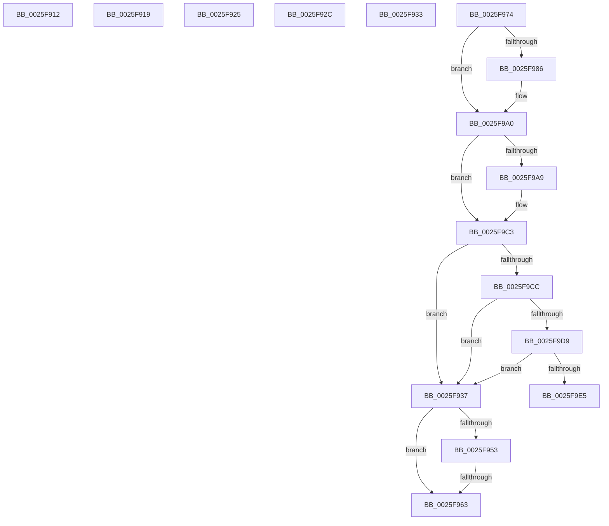

# sub_0025F912

- RVA: `0x0025F912`–`0x0025F9FF` (길이 `237` bytes)
- VA: `0x000000014025F912`
- 실행 섹션: `.text`
- PDB 이름 있음: `아니요`; PDB Function 태그: `아니요`
- unwind 정보 RVA: `0x000642C4`
- 디코드: `59`개 명령, `237/237` bytes 표시
- 미해석 바이트: `0` (있으면 어셈블리에 `.byte`로 보존)

> 이 문서는 커널 이미지의 기계어와 PDB 기호를 분석해 생성했습니다. 4번과 5번은 함수 원형과 자료형을 바이너리 사용 방식에서 추정한 C 해석이며 원본 소스 복구 결과는 아닙니다.

## 1. Dependencies

- 직접 호출 지점: **7**; 고유 호출 대상: **5**
- 직접 호출자로 확인된 함수: **0**
- RIP 상대 이미지 참조: **1**

### Outgoing calls
- `0x0025F937` → [ExpAllocateOwnerEntryForLegacyShim](../21/ExpAllocateOwnerEntryForLegacyShim_function_00213B50.md) (function, `0x00213B50`)
- `0x0025F94A` → [ExAcquireFastResourceShared](../21/ExAcquireFastResourceShared_function_00210F40.md) (function, `0x00210F40`)
- `0x0025F956` → [ExIsFastResourceHeldExclusive](../21/ExIsFastResourceHeldExclusive_function_00213450.md) (function, `0x00213450`)
- `0x0025F96A` → [ExFreePoolWithTag](../../poolcode/B8/ExFreePoolWithTag_function_00B82870.md) (function, `0x00B82870`)
- `0x0025F99A` → [KeBugCheckEx](../4F/KeBugCheckEx_function_004FD660.md) (function, `0x004FD660`)
- `0x0025F9BD` → [KeBugCheckEx](../4F/KeBugCheckEx_function_004FD660.md) (function, `0x004FD660`)
- `0x0025F9F9` → [KeBugCheckEx](../4F/KeBugCheckEx_function_004FD660.md) (function, `0x004FD660`)

### Direct callers
- 이 함수 시작 RVA로 연결되는 직접 call은 확인되지 않았습니다. 간접 호출은 완전히 역산할 수 없습니다.

### Static image references
- `0x0025F919` → RVA `0x00F05818` (`.data`; read)

## 2. Other-region calls and transfers

- 다른 실행 섹션으로 향하는 call: **1**
  - `0x0025F96A` → [ExFreePoolWithTag](../../poolcode/B8/ExFreePoolWithTag_function_00B82870.md) (`.text` → `POOLCODE`)
- call이 아닌 외부 분기/꼬리 이동: **7**
  - `0x0025F914` → [sub_0025F532 + 0xD1](Unknown_function_0025F532.md) (`tail-transfer`)
  - `0x0025F920` → [sub_0025F532 + 0xA1](Unknown_function_0025F532.md) (`tail-transfer`)
  - `0x0025F927` → [sub_0025F6D3 + 0x4C](Unknown_function_0025F6D3.md) (`tail-transfer`)
  - `0x0025F92E` → [sub_0025F800 + 0xA7](Unknown_function_0025F800.md) (`tail-transfer`)
  - `0x0025F935` → [sub_0025F800 + 0xDC](Unknown_function_0025F800.md) (`tail-transfer`)
  - `0x0025F95D` → [sub_0025F532 + 0x78](Unknown_function_0025F532.md) (`tail-transfer`)
  - `0x0025F96F` → [sub_0025F532 + 0x78](Unknown_function_0025F532.md) (`tail-transfer`)

## 3. Assembly (complete function range)

```asm
0025F912  8B C6                           mov eax, esi
0025F914  E9 EA FC FF FF                  jmp 0x14025f603
0025F919  4C 8B 2D F8 5E CA 00            mov r13, qword ptr [rip + 0xca5ef8]
0025F920  E9 AE FC FF FF                  jmp 0x14025f5d3
0025F925  8B D6                           mov edx, esi
0025F927  E9 F3 FD FF FF                  jmp 0x14025f71f
0025F92C  8B CE                           mov ecx, esi
0025F92E  E9 74 FF FF FF                  jmp 0x14025f8a7
0025F933  8B CE                           mov ecx, esi
0025F935  EB A5                           jmp 0x14025f8dc
0025F937  E8 14 42 FB FF                  call 0x140213b50
0025F93C  41 B0 01                        mov r8b, 1
0025F93F  48 89 44 24 50                  mov qword ptr [rsp + 0x50], rax
0025F944  48 8B D0                        mov rdx, rax
0025F947  49 8B CD                        mov rcx, r13
0025F94A  E8 F1 15 FB FF                  call 0x140210f40
0025F94F  84 C0                           test al, al
0025F951  74 10                           je 0x14025f963
0025F953  49 8B CD                        mov rcx, r13
0025F956  E8 F5 3A FB FF                  call 0x140213450
0025F95B  84 C0                           test al, al
0025F95D  0F 84 47 FC FF FF               je 0x14025f5aa
0025F963  48 8B 4C 24 50                  mov rcx, qword ptr [rsp + 0x50]
0025F968  33 D2                           xor edx, edx
0025F96A  E8 01 2F 92 00                  call 0x140b82870
0025F96F  E9 36 FC FF FF                  jmp 0x14025f5aa
0025F974  44 0F 20 C1                     mov rcx, cr8
0025F978  65 48 8B 14 25 88 01 00 00      mov rdx, qword ptr gs:[0x188]
0025F981  80 F9 01                        cmp cl, 1
0025F984  76 1A                           jbe 0x14025f9a0
0025F986  33 D2                           xor edx, edx
0025F988  44 0F B6 C1                     movzx r8d, cl
0025F98C  B9 C6 01 00 00                  mov ecx, 0x1c6
0025F991  48 89 74 24 20                  mov qword ptr [rsp + 0x20], rsi
0025F996  44 8D 4A 01                     lea r9d, [rdx + 1]
0025F99A  E8 C1 DC 29 00                  call 0x1404fd660
0025F99F  CC                              int3
0025F9A0  F6 82 C0 00 00 00 02            test byte ptr [rdx + 0xc0], 2
0025F9A7  74 1A                           je 0x14025f9c3
0025F9A9  45 33 C9                        xor r9d, r9d
0025F9AC  48 89 74 24 20                  mov qword ptr [rsp + 0x20], rsi
0025F9B1  45 33 C0                        xor r8d, r8d
0025F9B4  B9 C6 01 00 00                  mov ecx, 0x1c6
0025F9B9  41 8D 51 06                     lea edx, [r9 + 6]
0025F9BD  E8 9E DC 29 00                  call 0x1404fd660
0025F9C2  CC                              int3
0025F9C3  80 F9 01                        cmp cl, 1
0025F9C6  0F 83 6B FF FF FF               jae 0x14025f937
0025F9CC  F7 42 74 00 04 00 00            test dword ptr [rdx + 0x74], 0x400
0025F9D3  0F 85 5E FF FF FF               jne 0x14025f937
0025F9D9  39 B2 E4 01 00 00               cmp dword ptr [rdx + 0x1e4], esi
0025F9DF  0F 85 52 FF FF FF               jne 0x14025f937
0025F9E5  45 33 C9                        xor r9d, r9d
0025F9E8  48 89 74 24 20                  mov qword ptr [rsp + 0x20], rsi
0025F9ED  45 33 C0                        xor r8d, r8d
0025F9F0  B9 C6 01 00 00                  mov ecx, 0x1c6
0025F9F5  41 8D 51 07                     lea edx, [r9 + 7]
0025F9F9  E8 62 DC 29 00                  call 0x1404fd660
0025F9FE  CC                              int3
```

## 4. C-style interpretation (structured pseudocode)

```c
__int64 __fastcall sub_0025F912(void)
{
    unsigned __int64 v_stack_p20;
    unsigned __int64 v_stack_p50;
}
```

## 5. (Beta) C Style

```c
void sub_0025F912(void)
{
    uint64_t v_stack_p20;
    uint64_t v_stack_p50;
}
```

## 6. Execution-region graph

[열기: 2D/3D 그래프와 함수 탐색 컨트롤 패널](../../../control-panel.html?section=text&rva=0x0025F912&view=graph)

- 2D 그래프는 위에서 아래로 흐르고, 3D 그래프는 빈 공간을 드래그해 회전합니다. Shift+드래그는 이동, 휠은 확대·축소, 함수 노드 선택은 대상 보고서 이동입니다.

### Static fallback


