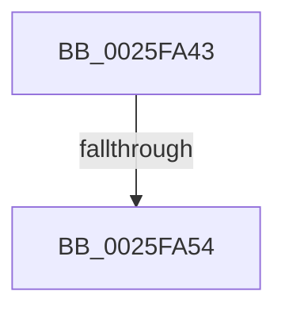

# sub_0025FA43

- RVA: `0x0025FA43`–`0x0025FA63` (길이 `32` bytes)
- VA: `0x000000014025FA43`
- 실행 섹션: `.text`
- PDB 이름 있음: `아니요`; PDB Function 태그: `아니요`
- unwind 정보 RVA: `0x000642F8`
- 디코드: `7`개 명령, `32/32` bytes 표시
- 미해석 바이트: `0` (있으면 어셈블리에 `.byte`로 보존)

> 이 문서는 커널 이미지의 기계어와 PDB 기호를 분석해 생성했습니다. 4번과 5번은 함수 원형과 자료형을 바이너리 사용 방식에서 추정한 C 해석이며 원본 소스 복구 결과는 아닙니다.

## 1. Dependencies

- 직접 호출 지점: **0**; 고유 호출 대상: **0**
- 직접 호출자로 확인된 함수: **0**
- RIP 상대 이미지 참조: **0**

### Outgoing calls
- 직접 디코드된 call 명령이 없습니다.

### Direct callers
- 이 함수 시작 RVA로 연결되는 직접 call은 확인되지 않았습니다. 간접 호출은 완전히 역산할 수 없습니다.

### Static image references
- 디코드된 RIP-relative 메모리 참조가 없습니다.

## 2. Other-region calls and transfers

- 다른 실행 섹션으로 향하는 call: **0**
- call이 아닌 외부 분기/꼬리 이동: **1**
  - `0x0025FA4E` → [sub_00261120](../26/Unknown_function_00261120.md) (`tail-transfer`)

## 3. Assembly (complete function range)

```asm
0025FA43  49 89 7B 10                     mov qword ptr [r11 + 0x10], rdi
0025FA47  4D 89 73 E0                     mov qword ptr [r11 - 0x20], r14
0025FA4B  F6 C1 01                        test cl, 1
0025FA4E  0F 85 CC 16 00 00               jne 0x140261120
0025FA54  65 4C 8B 34 25 88 01 00 00      mov r14, qword ptr gs:[0x188]
0025FA5D  48 8D 7B 60                     lea rdi, [rbx + 0x60]
0025FA61  33 C0                           xor eax, eax
```

## 4. C-style interpretation (structured pseudocode)

```c
__int64 __fastcall sub_0025FA43(unsigned __int8 a1)
{
    __int64 result;

    *(unsigned __int64 *)(v_r11 + 16) = v_rdi;
    *(unsigned __int64 *)(v_r11 - 32) = v_r14;
    result = 0;
    return result;
}
```

## 5. (Beta) C Style

```c
int64_t sub_0025FA43(uint8_t Arg1)
{
    int64_t result;

    *(uint64_t *)(local_r11 + 0x10) = local_rdi;
    *(uint64_t *)(local_r11 - 0x20) = local_r14;
    result = 0;
    return result;
}
```

## 6. Execution-region graph

[열기: 2D/3D 그래프와 함수 탐색 컨트롤 패널](../../../control-panel.html?section=text&rva=0x0025FA43&view=graph)

- 2D 그래프는 위에서 아래로 흐르고, 3D 그래프는 빈 공간을 드래그해 회전합니다. Shift+드래그는 이동, 휠은 확대·축소, 함수 노드 선택은 대상 보고서 이동입니다.

### Static fallback


