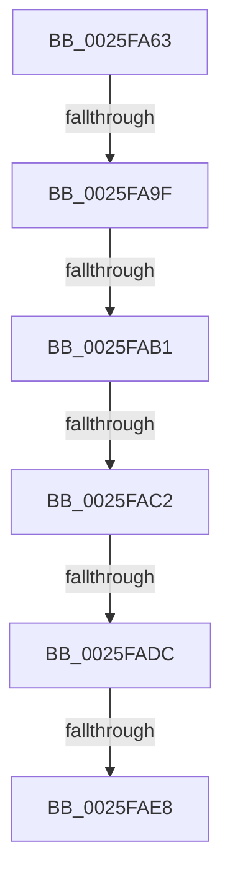

# sub_0025FA63

- RVA: `0x0025FA63`–`0x0025FAF3` (길이 `144` bytes)
- VA: `0x000000014025FA63`
- 실행 섹션: `.text`
- PDB 이름 있음: `아니요`; PDB Function 태그: `아니요`
- unwind 정보 RVA: `0x00064310`
- 디코드: `30`개 명령, `144/144` bytes 표시
- 미해석 바이트: `0` (있으면 어셈블리에 `.byte`로 보존)

> 이 문서는 커널 이미지의 기계어와 PDB 기호를 분석해 생성했습니다. 4번과 5번은 함수 원형과 자료형을 바이너리 사용 방식에서 추정한 C 해석이며 원본 소스 복구 결과는 아닙니다.

## 1. Dependencies

- 직접 호출 지점: **0**; 고유 호출 대상: **0**
- 직접 호출자로 확인된 함수: **0**
- RIP 상대 이미지 참조: **4**

### Outgoing calls
- 직접 디코드된 call 명령이 없습니다.

### Direct callers
- 이 함수 시작 RVA로 연결되는 직접 call은 확인되지 않았습니다. 간접 호출은 완전히 역산할 수 없습니다.

### Static image references
- `0x0025FA93` → RVA `0x00FC6D20` (`ALMOSTRO`; read)
- `0x0025FA9F` → RVA `0x00FC6B06` (`ALMOSTRO`; read)
- `0x0025FADC` → RVA `0x00EFAC10` (`.data`; read)
- `0x0025FAE8` → RVA `0x00FC6B04` (`ALMOSTRO`; read)

## 2. Other-region calls and transfers

- 다른 실행 섹션으로 향하는 call: **0**
- call이 아닌 외부 분기/꼬리 이동: **5**
  - `0x0025FA99` → [sub_00260117](../26/Unknown_function_00260117.md) (`tail-transfer`)
  - `0x0025FAAB` → [sub_0025FB3C](Unknown_function_0025FB3C.md) (`tail-transfer`)
  - `0x0025FABC` → [sub_0026025E + 0x2D](../26/Unknown_function_0026025E.md) (`tail-transfer`)
  - `0x0025FAD6` → [sub_0026025E](../26/Unknown_function_0026025E.md) (`tail-transfer`)
  - `0x0025FAE2` → [sub_0026025E](../26/Unknown_function_0026025E.md) (`tail-transfer`)

## 3. Assembly (complete function range)

```asm
0025FA63  4D 89 63 18                     mov qword ptr [r11 + 0x18], r12
0025FA67  0F 57 C0                        xorps xmm0, xmm0
0025FA6A  48 89 44 24 58                  mov qword ptr [rsp + 0x58], rax
0025FA6F  0F 11 44 24 48                  movups xmmword ptr [rsp + 0x48], xmm0
0025FA74  33 F6                           xor esi, esi
0025FA76  48 89 7C 24 50                  mov qword ptr [rsp + 0x50], rdi
0025FA7B  48 89 74 24 48                  mov qword ptr [rsp + 0x48], rsi
0025FA80  90                              nop
0025FA81  4D 89 7B D8                     mov qword ptr [r11 - 0x28], r15
0025FA85  45 0F 20 C4                     mov r12, cr8
0025FA89  41 BF 02 00 00 00               mov r15d, 2
0025FA8F  45 0F 22 C7                     mov cr8, r15
0025FA93  39 05 87 72 D6 00               cmp dword ptr [rip + 0xd67287], eax
0025FA99  0F 85 78 06 00 00               jne 0x140260117
0025FA9F  F6 05 60 70 D6 00 21            test byte ptr [rip + 0xd67060], 0x21
0025FAA6  44 88 64 24 58                  mov byte ptr [rsp + 0x58], r12b
0025FAAB  0F 85 8B 00 00 00               jne 0x14025fb3c
0025FAB1  48 8D 54 24 48                  lea rdx, [rsp + 0x48]
0025FAB6  48 87 17                        xchg qword ptr [rdi], rdx
0025FAB9  48 85 D2                        test rdx, rdx
0025FABC  0F 85 C9 07 00 00               jne 0x14026028b
0025FAC2  65 4C 8B 04 25 88 01 00 00      mov r8, qword ptr gs:[0x188]
0025FACB  0F B7 53 1A                     movzx edx, word ptr [rbx + 0x1a]
0025FACF  0F B7 CA                        movzx ecx, dx
0025FAD2  66 83 E1 01                     and cx, 1
0025FAD6  0F 85 82 07 00 00               jne 0x14026025e
0025FADC  39 35 2E B1 C9 00               cmp dword ptr [rip + 0xc9b12e], esi
0025FAE2  0F 85 76 07 00 00               jne 0x14026025e
0025FAE8  8B 05 16 70 D6 00               mov eax, dword ptr [rip + 0xd67016]
0025FAEE  25 00 00 02 00                  and eax, 0x20000
```

## 4. C-style interpretation (structured pseudocode)

```c
__int64 __fastcall sub_0025FA63(__int64 a1, __int64 a2, __int64 a3, __int64 a4, __int64 a5, __int64 a6, __int64 a7, __int64 a8, __int64 a9)
{
    __int64 result;
    __int64 v_rsi;
    unsigned __int64 v_stack_p48;
    unsigned __int64 v_stack_p50;
    unsigned __int64 v_stack_p58;

    *(unsigned __int64 *)(v_r11 + 24) = v_r12;
    v_stack_p58 = result;
    a9 = v_xmm0;
    v_rsi = 0;
    v_stack_p50 = v_rdi;
    v_stack_p48 = 0;
    *(unsigned __int64 *)(v_r11 - 40) = v_r15;
    v_stack_p58 = (unsigned __int8)(v_cr8);
    a1 = (unsigned __int16)(((unsigned __int16)(*(unsigned __int16 *)(v_rbx + 26))) & (1));
    result = (unsigned int)(((unsigned int)(*(unsigned int *)(v_rip + 14053398))) & (0x20000ULL));
    return result;
}
```

## 5. (Beta) C Style

```c
int64_t sub_0025FA63(int64_t Arg1, int64_t Arg2, int64_t Arg3, int64_t Arg4, uint64_t Arg5, uint64_t Arg6, uint64_t Arg7, uint64_t Arg8, int64_t Arg9)
{
    int64_t result;
    int64_t local_rsi;
    uint64_t v_stack_p48;
    uint64_t v_stack_p50;
    uint64_t v_stack_p58;

    *(uint64_t *)(local_r11 + 0x18) = local_r12;
    v_stack_p58 = result;
    Arg9 = v_xmm0;
    local_rsi = 0;
    v_stack_p50 = local_rdi;
    v_stack_p48 = 0;
    *(uint64_t *)(local_r11 - 0x28) = local_r15;
    v_stack_p58 = (uint8_t)(v_cr8);
    Arg1 = (uint16_t)(((uint16_t)(*(uint16_t *)(local_rbx + 0x1A))) & (1));
    result = (uint32_t)(((uint32_t)(*(uint32_t *)(v_rip + 0xD67016))) & (0x20000ULL));
    return result;
}
```

## 6. Execution-region graph

[열기: 2D/3D 그래프와 함수 탐색 컨트롤 패널](../../../control-panel.html?section=text&rva=0x0025FA63&view=graph)

- 2D 그래프는 위에서 아래로 흐르고, 3D 그래프는 빈 공간을 드래그해 회전합니다. Shift+드래그는 이동, 휠은 확대·축소, 함수 노드 선택은 대상 보고서 이동입니다.

### Static fallback


