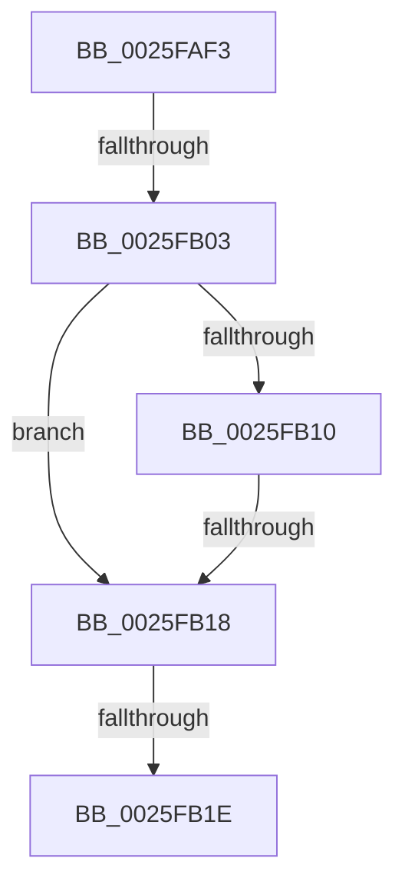

# sub_0025FAF3

- RVA: `0x0025FAF3`–`0x0025FB3C` (길이 `73` bytes)
- VA: `0x000000014025FAF3`
- 실행 섹션: `.text`
- PDB 이름 있음: `아니요`; PDB Function 태그: `아니요`
- unwind 정보 RVA: `0x00064328`
- 디코드: `18`개 명령, `73/73` bytes 표시
- 미해석 바이트: `0` (있으면 어셈블리에 `.byte`로 보존)

> 이 문서는 커널 이미지의 기계어와 PDB 기호를 분석해 생성했습니다. 4번과 5번은 함수 원형과 자료형을 바이너리 사용 방식에서 추정한 C 해석이며 원본 소스 복구 결과는 아닙니다.

## 1. Dependencies

- 직접 호출 지점: **1**; 고유 호출 대상: **1**
- 직접 호출자로 확인된 함수: **0**
- RIP 상대 이미지 참조: **1**

### Outgoing calls
- `0x0025FB36` → [KeBugCheckEx](../4F/KeBugCheckEx_function_004FD660.md) (function, `0x004FD660`)

### Direct callers
- 이 함수 시작 RVA로 연결되는 직접 call은 확인되지 않았습니다. 간접 호출은 완전히 역산할 수 없습니다.

### Static image references
- `0x0025FB10` → RVA `0x00EFAC10` (`.data`; read)

## 2. Other-region calls and transfers

- 다른 실행 섹션으로 향하는 call: **0**
- call이 아닌 외부 분기/꼬리 이동: **3**
  - `0x0025FAFD` → [sub_0025FB5C + 0x25E](Unknown_function_0025FB5C.md) (`tail-transfer`)
  - `0x0025FB16` → [sub_0025FB5C](Unknown_function_0025FB5C.md) (`tail-transfer`)
  - `0x0025FB1C` → [sub_0025FB5C](Unknown_function_0025FB5C.md) (`tail-transfer`)

## 3. Assembly (complete function range)

```asm
0025FAF3  4C 89 AC 24 68 01 00 00         mov qword ptr [rsp + 0x168], r13
0025FAFB  84 D2                           test dl, dl
0025FAFD  0F 89 B7 02 00 00               jns 0x14025fdba
0025FB03  48 89 75 90                     mov qword ptr [rbp - 0x70], rsi
0025FB07  89 44 24 60                     mov dword ptr [rsp + 0x60], eax
0025FB0B  66 85 C9                        test cx, cx
0025FB0E  75 08                           jne 0x14025fb18
0025FB10  39 35 FA B0 C9 00               cmp dword ptr [rip + 0xc9b0fa], esi
0025FB16  74 44                           je 0x14025fb5c
0025FB18  4C 39 73 30                     cmp qword ptr [rbx + 0x30], r14
0025FB1C  74 3E                           je 0x14025fb5c
0025FB1E  4C 8B 4B 10                     mov r9, qword ptr [rbx + 0x10]
0025FB22  4D 8B C6                        mov r8, r14
0025FB25  48 8B D3                        mov rdx, rbx
0025FB28  48 C7 44 24 20 01 00 00 00      mov qword ptr [rsp + 0x20], 1
0025FB31  B9 E3 00 00 00                  mov ecx, 0xe3
0025FB36  E8 25 DB 29 00                  call 0x1404fd660
0025FB3B  CC                              int3
```

## 4. C-style interpretation (structured pseudocode)

```c
__int64 __fastcall sub_0025FAF3(unsigned __int16 a1, unsigned __int8 a2)
{
    __int64 result;
    unsigned __int64 v_stack_p168;
    unsigned __int64 v_stack_p20;
    unsigned int v_stack_p60;

    v_stack_p168 = v_r13;
    *(unsigned __int64 *)(v_rbp - 112) = v_rsi;
    v_stack_p60 = (unsigned int)(result);
    if (a1 != 0) goto loc_0025FB18;
loc_0025FB18:
    v_stack_p20 = 1;
    result = KeBugCheckEx(227, v_rbx, v_r14, *(unsigned __int64 *)(v_rbx + 16));
    return result;
}
```

## 5. (Beta) C Style

```c
int64_t sub_0025FAF3(uint16_t Arg1, uint8_t Arg2)
{
    int64_t result;
    uint64_t v_stack_p168;
    uint64_t v_stack_p20;
    uint32_t v_stack_p60;

    v_stack_p168 = local_r13;
    *(uint64_t *)(local_rbp - 0x70) = local_rsi;
    v_stack_p60 = (uint32_t)(result);
    if (Arg1 != 0) goto loc_0025FB18;
loc_0025FB18:
    v_stack_p20 = 1;
    result = KeBugCheckEx(227, local_rbx, local_r14, *(uint64_t *)(local_rbx + 0x10));
    return result;
}
```

## 6. Execution-region graph

[열기: 2D/3D 그래프와 함수 탐색 컨트롤 패널](../../../control-panel.html?section=text&rva=0x0025FAF3&view=graph)

- 2D 그래프는 위에서 아래로 흐르고, 3D 그래프는 빈 공간을 드래그해 회전합니다. Shift+드래그는 이동, 휠은 확대·축소, 함수 노드 선택은 대상 보고서 이동입니다.

### Static fallback


