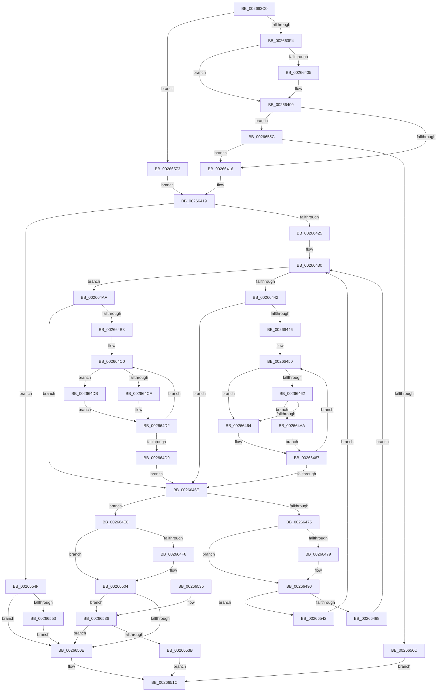

# B_TREE&lt;_SM_PAGE_KEY,SMKM_STORE_MGR&lt;SM_TRAITS&gt;::SMKM_FRONTEND_ENTRY,4096,B_TREE_DUMMY_NODE_POOL,B_TREE_KEY_COMPARATOR&lt;_SM_PAGE_KEY&gt; &gt;::BTreeInsert

- RVA: `0x002663C0`–`0x0026657D` (길이 `445` bytes)
- VA: `0x00000001402663C0`
- 실행 섹션: `.text`
- PDB 이름 있음: `예`; PDB Function 태그: `아니요`
- unwind 정보 RVA: `0x00064D44`
- 디코드: `136`개 명령, `445/445` bytes 표시
- 미해석 바이트: `0` (있으면 어셈블리에 `.byte`로 보존)

> 이 문서는 커널 이미지의 기계어와 PDB 기호를 분석해 생성했습니다. 4번과 5번은 함수 원형과 자료형을 바이너리 사용 방식에서 추정한 C 해석이며 원본 소스 복구 결과는 아닙니다.

## 1. Dependencies

- 직접 호출 지점: **2**; 고유 호출 대상: **2**
- 직접 호출자로 확인된 함수: **1**
- RIP 상대 이미지 참조: **0**

### Outgoing calls
- `0x00266517` → [B_TREE<_SM_PAGE_KEY,SMKM_STORE_MGR<SM_TRAITS>::SMKM_FRONTEND_ENTRY,4096,B_TREE_DUMMY_NODE_POOL,B_TREE_KEY_COMPARATOR<_SM_PAGE_KEY> >::BTreeInsertEx](B_TREE__SM_PAGE_KEY_SMKM_STORE_MGR_SM_TRAITS_SMKM_FRONTEND_ENTRY_4096_B_TREE_DUMMY_NODE_POOL_B_TREE__function_00266590.md) (function, `0x00266590`)
- `0x0026655F` → [SmArrayGrow](../3A/SmArrayGrow_function_003AC6C8.md) (function, `0x003AC6C8`)

### Direct callers
- [SMKM_STORE_MGR&lt;SM_TRAITS&gt;::SmFeAddInitiate](SMKM_STORE_MGR_SM_TRAITS_SmFeAddInitiate_function_0026618C.md) at `0x002662CB`

### Static image references
- 디코드된 RIP-relative 메모리 참조가 없습니다.

## 2. Other-region calls and transfers

- 다른 실행 섹션으로 향하는 call: **0**
- 별도 외부 분기/꼬리 이동을 확인하지 못했습니다.

## 3. Assembly (complete function range)

```asm
002663C0  48 89 5C 24 08                  mov qword ptr [rsp + 8], rbx
002663C5  48 89 6C 24 10                  mov qword ptr [rsp + 0x10], rbp
002663CA  48 89 74 24 18                  mov qword ptr [rsp + 0x18], rsi
002663CF  57                              push rdi
002663D0  41 56                           push r14
002663D2  41 57                           push r15
002663D4  48 83 EC 20                     sub rsp, 0x20
002663D8  8B 1A                           mov ebx, dword ptr [rdx]
002663DA  4D 8D 58 08                     lea r11, [r8 + 8]
002663DE  33 FF                           xor edi, edi
002663E0  49 8B F0                        mov rsi, r8
002663E3  41 83 78 18 FF                  cmp dword ptr [r8 + 0x18], -1
002663E8  4C 8B FA                        mov r15, rdx
002663EB  4C 8B F1                        mov r14, rcx
002663EE  0F 84 7F 01 00 00               je 0x140266573
002663F4  41 89 78 18                     mov dword ptr [r8 + 0x18], edi
002663F8  8D 6F 01                        lea ebp, [rdi + 1]
002663FB  48 8B 01                        mov rax, qword ptr [rcx]
002663FE  8B CF                           mov ecx, edi
00266400  48 85 C0                        test rax, rax
00266403  74 04                           je 0x140266409
00266405  0F B6 48 02                     movzx ecx, byte ptr [rax + 2]
00266409  49 83 C0 1C                     add r8, 0x1c
0026640D  41 39 08                        cmp dword ptr [r8], ecx
00266410  0F 82 46 01 00 00               jb 0x14026655c
00266416  4C 8B 1E                        mov r11, qword ptr [rsi]
00266419  4D 8B 16                        mov r10, qword ptr [r14]
0026641C  4D 85 D2                        test r10, r10
0026641F  0F 84 2A 01 00 00               je 0x14026654f
00266425  66 66 66 0F 1F 84 00 00 00 00 00  nop word ptr [rax + rax]
00266430  41 8B 0A                        mov ecx, dword ptr [r10]
00266433  BA FF FF FF FF                  mov edx, 0xffffffff
00266438  0F B7 C1                        movzx eax, cx
0026643B  C1 E9 18                        shr ecx, 0x18
0026643E  84 C9                           test cl, cl
00266440  75 6D                           jne 0x1402664af
00266442  85 C0                           test eax, eax
00266444  74 28                           je 0x14026646e
00266446  66 66 0F 1F 84 00 00 00 00 00   nop word ptr [rax + rax]
00266450  8D 0C 10                        lea ecx, [rax + rdx]
00266453  D1 E9                           shr ecx, 1
00266455  44 8B C9                        mov r9d, ecx
00266458  48 03 C9                        add rcx, rcx
0026645B  41 39 5C CA 10                  cmp dword ptr [r10 + rcx*8 + 0x10], ebx
00266460  72 02                           jb 0x140266464
00266462  75 46                           jne 0x1402664aa
00266464  41 8B D1                        mov edx, r9d
00266467  8D 4A 01                        lea ecx, [rdx + 1]
0026646A  3B C8                           cmp ecx, eax
0026646C  75 E2                           jne 0x140266450
0026646E  41 80 7A 03 00                  cmp byte ptr [r10 + 3], 0
00266473  75 6B                           jne 0x1402664e0
00266475  85 ED                           test ebp, ebp
00266477  74 17                           je 0x140266490
00266479  8B C8                           mov ecx, eax
0026647B  48 FF C1                        inc rcx
0026647E  4D 89 13                        mov qword ptr [r11], r10
00266481  48 C1 E1 04                     shl rcx, 4
00266485  49 03 CA                        add rcx, r10
00266488  49 89 4B 08                     mov qword ptr [r11 + 8], rcx
0026648C  49 83 C3 10                     add r11, 0x10
00266490  85 C0                           test eax, eax
00266492  0F 84 AA 00 00 00               je 0x140266542
00266498  FF C8                           dec eax
0026649A  48 C1 E0 04                     shl rax, 4
0026649E  48 83 C0 18                     add rax, 0x18
002664A2  49 03 C2                        add rax, r10
002664A5  4C 8B 10                        mov r10, qword ptr [rax]
002664A8  EB 86                           jmp 0x140266430
002664AA  41 8B C1                        mov eax, r9d
002664AD  EB B8                           jmp 0x140266467
002664AF  85 C0                           test eax, eax
002664B1  74 BB                           je 0x14026646e
002664B3  0F 1F 40 00                     nop dword ptr [rax]
002664B7  66 0F 1F 84 00 00 00 00 00      nop word ptr [rax + rax]
002664C0  8D 0C 10                        lea ecx, [rax + rdx]
002664C3  D1 E9                           shr ecx, 1
002664C5  44 8B C1                        mov r8d, ecx
002664C8  41 39 5C CA 10                  cmp dword ptr [r10 + rcx*8 + 0x10], ebx
002664CD  72 0C                           jb 0x1402664db
002664CF  41 8B C0                        mov eax, r8d
002664D2  8D 4A 01                        lea ecx, [rdx + 1]
002664D5  3B C8                           cmp ecx, eax
002664D7  75 E7                           jne 0x1402664c0
002664D9  EB 93                           jmp 0x14026646e
002664DB  41 8B D0                        mov edx, r8d
002664DE  EB F2                           jmp 0x1402664d2
002664E0  44 8B C0                        mov r8d, eax
002664E3  49 83 C0 02                     add r8, 2
002664E7  4D 89 13                        mov qword ptr [r11], r10
002664EA  4F 8D 04 C2                     lea r8, [r10 + r8*8]
002664EE  4D 89 43 08                     mov qword ptr [r11 + 8], r8
002664F2  85 ED                           test ebp, ebp
002664F4  74 0E                           je 0x140266504
002664F6  4C 2B 1E                        sub r11, qword ptr [rsi]
002664F9  49 C1 FB 04                     sar r11, 4
002664FD  41 FF C3                        inc r11d
00266500  44 89 5E 18                     mov dword ptr [rsi + 0x18], r11d
00266504  41 8B 0A                        mov ecx, dword ptr [r10]
00266507  0F B7 D1                        movzx edx, cx
0026650A  3B C2                           cmp eax, edx
0026650C  72 28                           jb 0x140266536
0026650E  4D 8B C7                        mov r8, r15
00266511  48 8B D6                        mov rdx, rsi
00266514  49 8B CE                        mov rcx, r14
00266517  E8 74 00 00 00                  call 0x140266590
0026651C  48 8B 5C 24 40                  mov rbx, qword ptr [rsp + 0x40]
00266521  48 8B 6C 24 48                  mov rbp, qword ptr [rsp + 0x48]
00266526  48 8B 74 24 50                  mov rsi, qword ptr [rsp + 0x50]
0026652B  48 83 C4 20                     add rsp, 0x20
0026652F  41 5F                           pop r15
00266531  41 5E                           pop r14
00266533  5F                              pop rdi
00266534  C3                              ret
00266535  CC                              int3
00266536  41 39 18                        cmp dword ptr [r8], ebx
00266539  75 D3                           jne 0x14026650e
0026653B  B8 54 01 00 C0                  mov eax, 0xc0000154
00266540  EB DA                           jmp 0x14026651c
00266542  49 8D 42 08                     lea rax, [r10 + 8]
00266546  4D 8B 52 08                     mov r10, qword ptr [r10 + 8]
0026654A  E9 E1 FE FF FF                  jmp 0x140266430
0026654F  85 ED                           test ebp, ebp
00266551  75 BB                           jne 0x14026650e
00266553  49 89 3B                        mov qword ptr [r11], rdi
00266556  49 89 7B 08                     mov qword ptr [r11 + 8], rdi
0026655A  EB B2                           jmp 0x14026650e
0026655C  4C 8B CE                        mov r9, rsi
0026655F  E8 64 61 14 00                  call 0x1403ac6c8
00266564  85 C0                           test eax, eax
00266566  0F 85 AA FE FF FF               jne 0x140266416
0026656C  B8 9A 00 00 C0                  mov eax, 0xc000009a
00266571  EB A9                           jmp 0x14026651c
00266573  49 89 3B                        mov qword ptr [r11], rdi
00266576  8B EF                           mov ebp, edi
00266578  E9 9C FE FF FF                  jmp 0x140266419
```

## 4. C-style interpretation (structured pseudocode)

```c
__int64 __fastcall B_TREE__SM_PAGE_KEY_SMKM_STORE_MGR_SM_TRAITS___SMKM_FRONTEND_ENTRY_4096_B_TREE_DUMMY_NODE_POOL_B_TRE(__int64 a1, __int64 a2, __int64 a3)
{
    __int64 result;
    __int64 v_r11;
    __int64 v_rdi;
    __int64 v_rsp;
    unsigned __int64 v_stack_p10;
    unsigned __int64 v_stack_p18;
    unsigned __int64 v_stack_p8;

    v_stack_p8 = v_rbx;
    v_stack_p10 = v_rbp;
    v_stack_p18 = v_rsi;
    v_rsp = (v_rsp) - (32);
    v_rdi = 0;
    if ((*(unsigned int *)(a3 + 24)) == -1) goto loc_00266573;
    *(unsigned int *)(a3 + 24) = 0;
    if (*(unsigned __int64 *)(a1) != 0) {
        a1 = *(unsigned __int8 *)(*(unsigned __int64 *)(a1) + 2);
    }
    a3 = (a3) + (28);
    if ((*(unsigned int *)(a3)) < ((unsigned int)(a1))) goto loc_0026655C;
loc_00266416:
loc_00266419:
    if (*(unsigned __int64 *)(a1) == 0) goto loc_0026654F;
loc_00266430:
    a1 = (unsigned int)(((unsigned int)(*(unsigned int *)(*(unsigned __int64 *)(a1)))) >> (24));
    if ((unsigned __int8)(a1) != 0) goto loc_002664AF;
    if ((unsigned int)((unsigned __int16)((unsigned int)(*(unsigned int *)(*(unsigned __int64 *)(a1))))) == 0) goto loc_0026646E;
loc_00266450:
    a1 = (unsigned int)(((unsigned __int16)((unsigned int)(*(unsigned int *)(*(unsigned __int64 *)(a1)))) + (unsigned int)(0xFFFFFFFFULL) * 1) >> (1));
    a1 = (a1) + (a1);
    if ((*(unsigned int *)(*(unsigned __int64 *)(a1) + a1 * 8 + 16)) < ((unsigned int)((unsigned int)(*(unsigned int *)(a2))))) goto loc_00266464;
    if ((*(unsigned int *)(*(unsigned __int64 *)(a1) + a1 * 8 + 16)) != ((unsigned int)((unsigned int)(*(unsigned int *)(a2))))) goto loc_002664AA;
loc_00266464:
loc_00266467:
    if (((unsigned int)((unsigned int)((unsigned int)((unsigned int)((unsigned int)(a1)))) + 1)) != ((unsigned int)((unsigned __int16)((unsigned int)(*(unsigned int *)(*(unsigned __int64 *)(a1))))))) goto loc_00266450;
loc_0026646E:
    if ((*(unsigned __int8 *)(*(unsigned __int64 *)(a1) + 3)) != 0) goto loc_002664E0;
    v_r11 = *(unsigned __int64 *)(a3);
    if ((unsigned int)(v_rdi + 1) != 0) {
        a1 = (unsigned int)((unsigned __int16)((unsigned int)(*(unsigned int *)(*(unsigned __int64 *)(a1)))));
        a1 = (a1) + 1;
        *(unsigned __int64 *)(*(unsigned __int64 *)(a3)) = *(unsigned __int64 *)(a1);
        a1 = (a1) << (4);
        a1 = (a1) + (*(unsigned __int64 *)(a1));
        *(unsigned __int64 *)(*(unsigned __int64 *)(a3) + 8) = a1;
        v_r11 = (*(unsigned __int64 *)(a3)) + (16);
    }
    if ((unsigned int)((unsigned __int16)((unsigned int)(*(unsigned int *)(*(unsigned __int64 *)(a1))))) == 0) goto loc_00266542;
    result = (unsigned int)(((unsigned __int16)((unsigned int)(*(unsigned int *)(*(unsigned __int64 *)(a1))))) - 1);
    result = (result) << (4);
    result = (result) + (24);
    result = (result) + (*(unsigned __int64 *)(a1));
    goto loc_00266430;
loc_002664AA:
    goto loc_00266467;
loc_002664AF:
    if ((unsigned int)((unsigned int)((unsigned int)((unsigned int)((unsigned int)(a1))))) == 0) goto loc_0026646E;
loc_002664C0:
    a1 = (unsigned int)(((unsigned int)((unsigned int)((unsigned int)((unsigned int)(a1)))) + (unsigned int)((unsigned int)((unsigned int)((unsigned int)(a1)))) * 1) >> (1));
    if ((*(unsigned int *)(*(unsigned __int64 *)(result) + a1 * 8 + 16)) < ((unsigned int)((unsigned int)(*(unsigned int *)(a2))))) goto loc_002664DB;
loc_002664D2:
    if (((unsigned int)((unsigned int)((unsigned int)((unsigned int)((unsigned int)(a1)))) + 1)) != ((unsigned int)((unsigned int)((unsigned int)((unsigned int)((unsigned int)(a1))))))) goto loc_002664C0;
    goto loc_0026646E;
loc_002664DB:
    goto loc_002664D2;
loc_002664E0:
    a3 = ((unsigned int)((unsigned int)((unsigned int)((unsigned int)((unsigned int)((unsigned int)(a1))))))) + (2);
    *(unsigned __int64 *)(v_r11) = *(unsigned __int64 *)(result);
    *(unsigned __int64 *)(v_r11 + 8) = *(unsigned __int64 *)(result) + a3 * 8;
    if ((unsigned int)(v_rdi + 1) != 0) {
        v_r11 = (v_r11) - (*(unsigned __int64 *)(a3));
        v_r11 = (v_r11) >> (4);
        v_r11 = (unsigned int)((v_r11) + 1);
        *(unsigned int *)(a3 + 24) = (unsigned int)(v_r11);
    }
    if (((unsigned int)((unsigned int)((unsigned int)((unsigned int)((unsigned int)(a1)))))) < ((unsigned int)((unsigned __int16)((unsigned int)(*(unsigned int *)(*(unsigned __int64 *)(result))))))) goto loc_00266536;
loc_0026650E:
    result = B_TREE__SM_PAGE_KEY_SMKM_STORE_MGR_SM_TRAITS___SMKM_FRONTEND_ENTRY_4096_B_TREE_DUMMY_NODE_POOL_B_TRE(a1, a3, a2, (unsigned int)((unsigned int)(a1)));
loc_0026651C:
    v_rsp = (v_rsp) + (32);
    return result;
loc_00266536:
    if ((*(unsigned int *)(a2)) != ((unsigned int)(v_stack_p8))) goto loc_0026650E;
    goto loc_0026651C;
loc_00266542:
    goto loc_00266430;
loc_0026654F:
    if ((unsigned int)(v_stack_p10) != 0) goto loc_0026650E;
    *(unsigned __int64 *)(v_r11) = 0;
    *(unsigned __int64 *)(v_r11 + 8) = 0;
    goto loc_0026650E;
loc_0026655C:
    result = SmArrayGrow(a1, a3, a2, v_stack_p18);
    if ((unsigned int)(result) != 0) goto loc_00266416;
    goto loc_0026651C;
loc_00266573:
    *(unsigned __int64 *)(v_r11) = 0;
    goto loc_00266419;
}
```

## 5. (Beta) C Style

```c
int64_t B_TREE__SM_PAGE_KEY_SMKM_STORE_MGR_SM_TRAITS___SMKM_FRONTEND_ENTRY_4096_B_TREE_DUMMY_NODE_POOL_B_TRE(void *Arg1, void *Arg2, void *Arg3)
{
    uint8_t *arg1 = (uint8_t *)Arg1;
    uint8_t *arg2 = (uint8_t *)Arg2;
    uint8_t *arg3 = (uint8_t *)Arg3;

    int64_t result;
    int64_t local_r11;
    int64_t local_rdi;
    int64_t local_rsp;
    uint64_t v_stack_p10;
    uint64_t v_stack_p18;
    uint64_t v_stack_p8;

    v_stack_p8 = local_rbx;
    v_stack_p10 = local_rbp;
    v_stack_p18 = local_rsi;
    local_rsp = (local_rsp) - (32);
    local_rdi = 0;
    if ((*(uint32_t *)(arg3 + 0x18)) == -1) goto loc_00266573;
    *(uint32_t *)(arg3 + 0x18) = 0;
    if (*(uint64_t *)(arg1) != 0) {
        Arg1 = *(uint8_t *)(*(uint64_t *)(arg1) + 0x2);
    }
    Arg3 = (Arg3) + (28);
    if ((*(uint32_t *)(arg3)) < ((uint32_t)(Arg1))) goto loc_0026655C;
loc_00266416:
loc_00266419:
    if (*(uint64_t *)(arg1) == 0) goto loc_0026654F;
loc_00266430:
    Arg1 = (uint32_t)(((uint32_t)(*(uint32_t *)(*(uint64_t *)(arg1)))) >> (24));
    if ((uint8_t)(Arg1) != 0) goto loc_002664AF;
    if ((uint32_t)((uint16_t)((uint32_t)(*(uint32_t *)(*(uint64_t *)(arg1))))) == 0) goto loc_0026646E;
loc_00266450:
    Arg1 = (uint32_t)(((uint16_t)((uint32_t)(*(uint32_t *)(*(uint64_t *)(arg1)))) + (uint32_t)(0xFFFFFFFFULL) * 1) >> (1));
    Arg1 = (Arg1) + (Arg1);
    if ((*(uint32_t *)(*(uint64_t *)(arg1) + arg1 * 8 + 0x10)) < ((uint32_t)((uint32_t)(*(uint32_t *)(arg2))))) goto loc_00266464;
    if ((*(uint32_t *)(*(uint64_t *)(arg1) + arg1 * 8 + 0x10)) != ((uint32_t)((uint32_t)(*(uint32_t *)(arg2))))) goto loc_002664AA;
loc_00266464:
loc_00266467:
    if (((uint32_t)((uint32_t)((uint32_t)((uint32_t)((uint32_t)(Arg1)))) + 1)) != ((uint32_t)((uint16_t)((uint32_t)(*(uint32_t *)(*(uint64_t *)(arg1))))))) goto loc_00266450;
loc_0026646E:
    if ((*(uint8_t *)(*(uint64_t *)(arg1) + 0x3)) != 0) goto loc_002664E0;
    local_r11 = *(uint64_t *)(arg3);
    if ((uint32_t)(local_rdi + 1) != 0) {
        Arg1 = (uint32_t)((uint16_t)((uint32_t)(*(uint32_t *)(*(uint64_t *)(arg1)))));
        Arg1 = (Arg1) + 1;
        *(uint64_t *)(*(uint64_t *)(arg3)) = *(uint64_t *)(arg1);
        Arg1 = (Arg1) << (4);
        Arg1 = (Arg1) + (*(uint64_t *)(arg1));
        *(void **)(*(uint64_t *)(arg3) + 0x8) = Arg1;
        local_r11 = (*(uint64_t *)(arg3)) + (16);
    }
    if ((uint32_t)((uint16_t)((uint32_t)(*(uint32_t *)(*(uint64_t *)(arg1))))) == 0) goto loc_00266542;
    result = (uint32_t)(((uint16_t)((uint32_t)(*(uint32_t *)(*(uint64_t *)(arg1))))) - 1);
    result = (result) << (4);
    result = (result) + (24);
    result = (result) + (*(uint64_t *)(arg1));
    goto loc_00266430;
loc_002664AA:
    goto loc_00266467;
loc_002664AF:
    if ((uint32_t)((uint32_t)((uint32_t)((uint32_t)((uint32_t)(Arg1))))) == 0) goto loc_0026646E;
loc_002664C0:
    Arg1 = (uint32_t)(((uint32_t)((uint32_t)((uint32_t)((uint32_t)(Arg1)))) + (uint32_t)((uint32_t)((uint32_t)((uint32_t)(Arg1)))) * 1) >> (1));
    if ((*(uint32_t *)(*(uint64_t *)(result) + arg1 * 8 + 0x10)) < ((uint32_t)((uint32_t)(*(uint32_t *)(arg2))))) goto loc_002664DB;
loc_002664D2:
    if (((uint32_t)((uint32_t)((uint32_t)((uint32_t)((uint32_t)(Arg1)))) + 1)) != ((uint32_t)((uint32_t)((uint32_t)((uint32_t)((uint32_t)(Arg1))))))) goto loc_002664C0;
    goto loc_0026646E;
loc_002664DB:
    goto loc_002664D2;
loc_002664E0:
    Arg3 = ((uint32_t)((uint32_t)((uint32_t)((uint32_t)((uint32_t)((uint32_t)(Arg1))))))) + (2);
    *(uint64_t *)(local_r11) = *(uint64_t *)(result);
    *(uint64_t *)(local_r11 + 0x8) = *(uint64_t *)(result) + Arg3 * 8;
    if ((uint32_t)(local_rdi + 1) != 0) {
        local_r11 = (local_r11) - (*(uint64_t *)(arg3));
        local_r11 = (local_r11) >> (4);
        local_r11 = (uint32_t)((local_r11) + 1);
        *(uint32_t *)(arg3 + 0x18) = (uint32_t)(local_r11);
    }
    if (((uint32_t)((uint32_t)((uint32_t)((uint32_t)((uint32_t)(Arg1)))))) < ((uint32_t)((uint16_t)((uint32_t)(*(uint32_t *)(*(uint64_t *)(result))))))) goto loc_00266536;
loc_0026650E:
    result = B_TREE__SM_PAGE_KEY_SMKM_STORE_MGR_SM_TRAITS___SMKM_FRONTEND_ENTRY_4096_B_TREE_DUMMY_NODE_POOL_B_TRE(Arg1, Arg3, Arg2, (uint32_t)((uint32_t)(Arg1)));
loc_0026651C:
    local_rsp = (local_rsp) + (32);
    return result;
loc_00266536:
    if ((*(uint32_t *)(arg2)) != ((uint32_t)(v_stack_p8))) goto loc_0026650E;
    goto loc_0026651C;
loc_00266542:
    goto loc_00266430;
loc_0026654F:
    if ((uint32_t)(v_stack_p10) != 0) goto loc_0026650E;
    *(uint64_t *)(local_r11) = 0;
    *(uint64_t *)(local_r11 + 0x8) = 0;
    goto loc_0026650E;
loc_0026655C:
    result = SmArrayGrow(Arg1, Arg3, Arg2, v_stack_p18);
    if ((uint32_t)(result) != 0) goto loc_00266416;
    goto loc_0026651C;
loc_00266573:
    *(uint64_t *)(local_r11) = 0;
    goto loc_00266419;
}
```

### 관측된 메모리 오프셋

구조체 형식이 확인되지 않은 접근은 인자 기준의 오프셋으로만 기록했습니다.

| 기준 인자 | 오프셋 표현 | 폭 (bit) | 접근 |
|---|---:|---:|---|
| `Arg1` | `+ 0x0` | `64` | `R` |
| `Arg2` | `+ 0x0` | `32` | `R` |
| `Arg3` | `+ 0x0` | `32` | `R` |
| `Arg3` | `+ 0x0` | `64` | `R` |
| `Arg3` | `+ 0x0` | `64` | `W` |
| `Arg3` | `+ 0x8` | `64` | `R` |
| `Arg3` | `+ 0x18` | `32` | `R` |
| `Arg3` | `+ 0x18` | `32` | `W` |

## 6. Execution-region graph

[열기: 2D/3D 그래프와 함수 탐색 컨트롤 패널](../../../control-panel.html?section=text&rva=0x002663C0&view=graph)

- 2D 그래프는 위에서 아래로 흐르고, 3D 그래프는 빈 공간을 드래그해 회전합니다. Shift+드래그는 이동, 휠은 확대·축소, 함수 노드 선택은 대상 보고서 이동입니다.

### Static fallback


