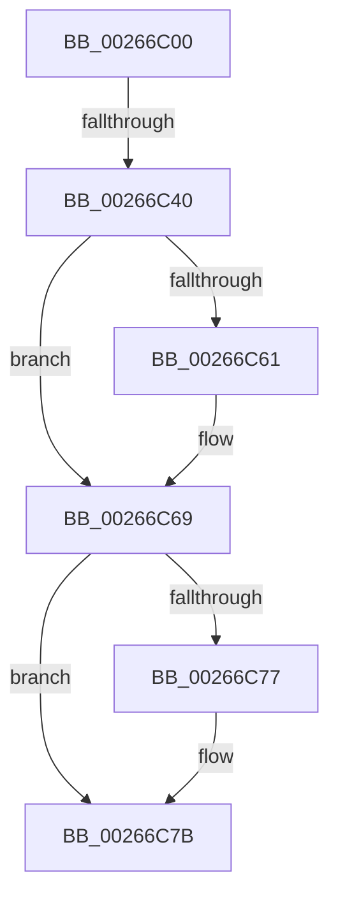

# B_TREE&lt;_SM_PAGE_KEY,SMKM_STORE_MGR&lt;SM_TRAITS&gt;::SMKM_FRONTEND_ENTRY,4096,B_TREE_DUMMY_NODE_POOL,B_TREE_KEY_COMPARATOR&lt;_SM_PAGE_KEY&gt; &gt;::BTreeDeleteEx

- RVA: `0x00266C00`–`0x00266C89` (길이 `137` bytes)
- VA: `0x0000000140266C00`
- 실행 섹션: `.text`
- PDB 이름 있음: `예`; PDB Function 태그: `예`
- unwind 정보 RVA: `0x00064E90`
- 디코드: `38`개 명령, `137/137` bytes 표시
- 미해석 바이트: `0` (있으면 어셈블리에 `.byte`로 보존)

> 이 문서는 커널 이미지의 기계어와 PDB 기호를 분석해 생성했습니다. 4번과 5번은 함수 원형과 자료형을 바이너리 사용 방식에서 추정한 C 해석이며 원본 소스 복구 결과는 아닙니다.

## 1. Dependencies

- 직접 호출 지점: **1**; 고유 호출 대상: **1**
- 직접 호출자로 확인된 함수: **5**
- RIP 상대 이미지 참조: **0**

### Outgoing calls
- `0x00266C64` → [memcpy](../6C/memcpy_function_006C6840.md) (function, `0x006C6840`)

### Direct callers
- [SMKM_STORE_MGR&lt;SM_TRAITS&gt;::SmFeEvictComplete](SMKM_STORE_MGR_SM_TRAITS_SmFeEvictComplete_function_00266854.md) at `0x0026696C`
- [SMKM_STORE_MGR&lt;SM_TRAITS&gt;::SmFeDeleteEntry](SMKM_STORE_MGR_SM_TRAITS_SmFeDeleteEntry_function_00266B70.md) at `0x00266BC5`
- [B_TREE&lt;_SM_PAGE_KEY,SMKM_STORE_MGR&lt;SM_TRAITS&gt;::SMKM_FRONTEND_ENTRY,4096,B_TREE_DUMMY_NODE_POOL,B_TREE_KEY_COMPARATOR&lt;_SM_PAGE_KEY&gt; &gt;::BTreeMergeNodes](B_TREE__SM_PAGE_KEY_SMKM_STORE_MGR_SM_TRAITS_SMKM_FRONTEND_ENTRY_4096_B_TREE_DUMMY_NODE_POOL_B_TREE__function_002674CC.md) at `0x00267571`
- [SMKM_STORE_MGR&lt;SM_TRAITS&gt;::SmFeAddComplete](../2D/SMKM_STORE_MGR_SM_TRAITS_SmFeAddComplete_function_002DFEE0.md) at `0x002E0258`
- [sub_002E0678](../2E/Unknown_function_002E0678.md) at `0x002E06E1`

### Static image references
- 디코드된 RIP-relative 메모리 참조가 없습니다.

## 2. Other-region calls and transfers

- 다른 실행 섹션으로 향하는 call: **0**
- call이 아닌 외부 분기/꼬리 이동: **2**
  - `0x00266C3A` → [sub_00266D9A](Unknown_function_00266D9A.md) (`tail-transfer`)
  - `0x00266C83` → [sub_00266DB4](Unknown_function_00266DB4.md) (`tail-transfer`)

## 3. Assembly (complete function range)

```asm
00266C00  48 89 5C 24 10                  mov qword ptr [rsp + 0x10], rbx
00266C05  48 89 6C 24 18                  mov qword ptr [rsp + 0x18], rbp
00266C0A  48 89 74 24 20                  mov qword ptr [rsp + 0x20], rsi
00266C0F  57                              push rdi
00266C10  41 56                           push r14
00266C12  41 57                           push r15
00266C14  48 83 EC 20                     sub rsp, 0x20
00266C18  8B 72 18                        mov esi, dword ptr [rdx + 0x18]
00266C1B  4C 8B F1                        mov r14, rcx
00266C1E  FF CE                           dec esi
00266C20  4C 8B FA                        mov r15, rdx
00266C23  48 C1 E6 04                     shl rsi, 4
00266C27  48 03 32                        add rsi, qword ptr [rdx]
00266C2A  48 8B 1E                        mov rbx, qword ptr [rsi]
00266C2D  48 8B 4E 08                     mov rcx, qword ptr [rsi + 8]
00266C31  80 7B 03 00                     cmp byte ptr [rbx + 3], 0
00266C35  8B 03                           mov eax, dword ptr [rbx]
00266C37  0F B7 F8                        movzx edi, ax
00266C3A  0F 84 5A 01 00 00               je 0x140266d9a
00266C40  48 8D 3C FD 08 00 00 00         lea rdi, [rdi*8 + 8]
00266C48  BD FF 00 00 00                  mov ebp, 0xff
00266C4D  B8 08 00 00 00                  mov eax, 8
00266C52  48 2B F9                        sub rdi, rcx
00266C55  48 8D 14 01                     lea rdx, [rcx + rax]
00266C59  48 03 FB                        add rdi, rbx
00266C5C  48 85 FF                        test rdi, rdi
00266C5F  74 08                           je 0x140266c69
00266C61  4C 8B C7                        mov r8, rdi
00266C64  E8 D7 FB 45 00                  call 0x1406c6840
00266C69  B8 FF FF 00 00                  mov eax, 0xffff
00266C6E  66 01 03                        add word ptr [rbx], ax
00266C71  80 7B 03 00                     cmp byte ptr [rbx + 3], 0
00266C75  74 04                           je 0x140266c7b
00266C77  49 FF 4E 08                     dec qword ptr [r14 + 8]
00266C7B  8B 0B                           mov ecx, dword ptr [rbx]
00266C7D  0F B7 C1                        movzx eax, cx
00266C80  49 39 1E                        cmp qword ptr [r14], rbx
00266C83  0F 84 2B 01 00 00               je 0x140266db4
```

## 4. C-style interpretation (structured pseudocode)

```c
__int64 __fastcall B_TREE__SM_PAGE_KEY_SMKM_STORE_MGR_SM_TRAITS___SMKM_FRONTEND_ENTRY_4096_B_TREE_DUMMY_NODE_POOL_B_TRE(__int64 a1, __int64 a2)
{
    __int64 result;
    __int64 v_rdi;
    __int64 v_rsi;
    __int64 v_rsp;
    unsigned __int64 v_stack_p10;
    unsigned __int64 v_stack_p18;
    unsigned __int64 v_stack_p20;

    v_stack_p10 = v_rbx;
    v_stack_p18 = v_rbp;
    v_stack_p20 = v_rsi;
    v_rsp = (v_rsp) - (32);
    v_rsi = (unsigned int)(((unsigned int)(*(unsigned int *)(a2 + 24))) - 1);
    v_rsi = (v_rsi) << (4);
    v_rsi = (v_rsi) + (*(unsigned __int64 *)(a2));
    v_rdi = ((unsigned __int16)((unsigned int)(*(unsigned int *)(*(unsigned __int64 *)(v_rsi)))) * 8 + 8) - (*(unsigned __int64 *)(v_rsi + 8));
    v_rdi = (v_rdi) + (*(unsigned __int64 *)(v_rsi));
    result = 8;
    if (v_rdi != 0) {
        a3 = v_rdi;
        result = memcpy(*(unsigned __int64 *)(v_rsi + 8), *(unsigned __int64 *)(v_rsi + 8) + 8 * 1, a3, a4);
    }
    if ((*(unsigned __int8 *)(*(unsigned __int64 *)(v_rsi) + 3)) != 0) {
    }
}
```

## 5. (Beta) C Style

```c
int64_t B_TREE__SM_PAGE_KEY_SMKM_STORE_MGR_SM_TRAITS___SMKM_FRONTEND_ENTRY_4096_B_TREE_DUMMY_NODE_POOL_B_TRE(void *Arg1, void *Arg2)
{
    uint8_t *arg1 = (uint8_t *)Arg1;
    uint8_t *arg2 = (uint8_t *)Arg2;

    int64_t result;
    int64_t local_rdi;
    int64_t local_rsi;
    int64_t local_rsp;
    uint64_t v_stack_p10;
    uint64_t v_stack_p18;
    uint64_t v_stack_p20;

    v_stack_p10 = local_rbx;
    v_stack_p18 = local_rbp;
    v_stack_p20 = local_rsi;
    local_rsp = (local_rsp) - (32);
    local_rsi = (uint32_t)(((uint32_t)(*(uint32_t *)(arg2 + 0x18))) - 1);
    local_rsi = (local_rsi) << (4);
    local_rsi = (local_rsi) + (*(uint64_t *)(arg2));
    local_rdi = ((uint16_t)((uint32_t)(*(uint32_t *)(*(uint64_t *)(local_rsi)))) * 8 + 8) - (*(uint64_t *)(local_rsi + 0x8));
    local_rdi = (local_rdi) + (*(uint64_t *)(local_rsi));
    result = 8;
    if (local_rdi != 0) {
        a3 = local_rdi;
        result = memcpy(*(uint64_t *)(local_rsi + 0x8), *(uint64_t *)(local_rsi + 0x8) + 8 * 1, a3, a4);
    }
    if ((*(uint8_t *)(*(uint64_t *)(local_rsi) + 0x3)) != 0) {
    }
}
```

### 관측된 메모리 오프셋

구조체 형식이 확인되지 않은 접근은 인자 기준의 오프셋으로만 기록했습니다.

| 기준 인자 | 오프셋 표현 | 폭 (bit) | 접근 |
|---|---:|---:|---|
| `Arg1` | `+ 0x0` | `64` | `R` |
| `Arg1` | `+ 0x8` | `64` | `R/W` |
| `Arg2` | `+ 0x0` | `64` | `R` |
| `Arg2` | `+ 0x18` | `32` | `R` |

## 6. Execution-region graph

[열기: 2D/3D 그래프와 함수 탐색 컨트롤 패널](../../../control-panel.html?section=text&rva=0x00266C00&view=graph)

- 2D 그래프는 위에서 아래로 흐르고, 3D 그래프는 빈 공간을 드래그해 회전합니다. Shift+드래그는 이동, 휠은 확대·축소, 함수 노드 선택은 대상 보고서 이동입니다.

### Static fallback


