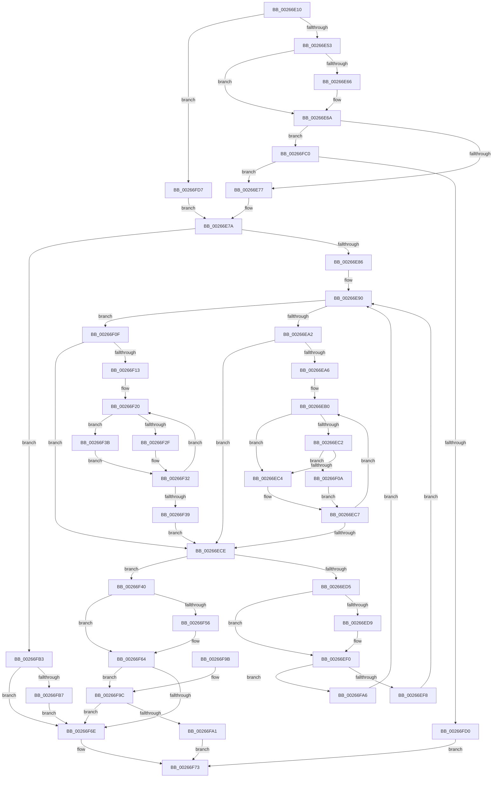

# B_TREE&lt;_SM_PAGE_KEY,SMKM_STORE_MGR&lt;SM_TRAITS&gt;::SMKM_FRONTEND_ENTRY,4096,B_TREE_DUMMY_NODE_POOL,B_TREE_KEY_COMPARATOR&lt;_SM_PAGE_KEY&gt; &gt;::BTreeSearchKey

- RVA: `0x00266E10`–`0x00266FE2` (길이 `466` bytes)
- VA: `0x0000000140266E10`
- 실행 섹션: `.text`
- PDB 이름 있음: `예`; PDB Function 태그: `아니요`
- unwind 정보 RVA: `0x00064F50`
- 디코드: `136`개 명령, `466/466` bytes 표시
- 미해석 바이트: `0` (있으면 어셈블리에 `.byte`로 보존)

> 이 문서는 커널 이미지의 기계어와 PDB 기호를 분석해 생성했습니다. 4번과 5번은 함수 원형과 자료형을 바이너리 사용 방식에서 추정한 C 해석이며 원본 소스 복구 결과는 아닙니다.

## 1. Dependencies

- 직접 호출 지점: **2**; 고유 호출 대상: **2**
- 직접 호출자로 확인된 함수: **10**
- RIP 상대 이미지 참조: **1**

### Outgoing calls
- `0x00266F7B` → [_security_check_cookie](../6A/_security_check_cookie_function_006AC640.md) (function, `0x006AC640`)
- `0x00266FC3` → [SmArrayGrow](../3A/SmArrayGrow_function_003AC6C8.md) (function, `0x003AC6C8`)

### Direct callers
- [SMKM_STORE_MGR&lt;SM_TRAITS&gt;::SmFeAddInitiate](SMKM_STORE_MGR_SM_TRAITS_SmFeAddInitiate_function_0026618C.md) at `0x00266251`
- [SMKM_STORE_MGR&lt;SM_TRAITS&gt;::SmFeEvictComplete](SMKM_STORE_MGR_SM_TRAITS_SmFeEvictComplete_function_00266854.md) at `0x002668E8`
- [SMKM_STORE_MGR&lt;SM_TRAITS&gt;::SmFeCheckPresent](../34/SMKM_STORE_MGR_SM_TRAITS_SmFeCheckPresent_function_0034C574.md) at `0x0034C60E`
- [SMKM_STORE_MGR&lt;SM_TRAITS&gt;::SmFeStoreDelete](../3B/SMKM_STORE_MGR_SM_TRAITS_SmFeStoreDelete_function_003B12F0.md) at `0x003B13EF`
- [SMKM_STORE_MGR&lt;SM_TRAITS&gt;::SmFeSetEvictFailed](../60/SMKM_STORE_MGR_SM_TRAITS_SmFeSetEvictFailed_function_0060C7A4.md) at `0x0060C82E`
- [SMKM_STORE_MGR&lt;SM_TRAITS&gt;::SmFeStoreEvictKeys](../61/SMKM_STORE_MGR_SM_TRAITS_SmFeStoreEvictKeys_function_0061041C.md) at `0x006104B8`
- [sub_006D8EAE](../6D/Unknown_function_006D8EAE.md) at `0x006D8EB9`
- [sub_006D8EE4](../6D/Unknown_function_006D8EE4.md) at `0x006D8EF4`
- [sub_006DDF40](../6D/Unknown_function_006DDF40.md) at `0x006DDF4F`
- [sub_006DDF7C](../6D/Unknown_function_006DDF7C.md) at `0x006DDF8B`

### Static image references
- `0x00266E2A` → RVA `0x00E0A740` (`.data`; read)

## 2. Other-region calls and transfers

- 다른 실행 섹션으로 향하는 call: **0**
- 별도 외부 분기/꼬리 이동을 확인하지 못했습니다.

## 3. Assembly (complete function range)

```asm
00266E10  48 89 5C 24 08                  mov qword ptr [rsp + 8], rbx
00266E15  48 89 6C 24 10                  mov qword ptr [rsp + 0x10], rbp
00266E1A  48 89 74 24 18                  mov qword ptr [rsp + 0x18], rsi
00266E1F  48 89 7C 24 20                  mov qword ptr [rsp + 0x20], rdi
00266E24  41 56                           push r14
00266E26  48 83 EC 30                     sub rsp, 0x30
00266E2A  48 8B 05 0F 39 BA 00            mov rax, qword ptr [rip + 0xba390f]
00266E31  48 33 C4                        xor rax, rsp
00266E34  48 89 44 24 20                  mov qword ptr [rsp + 0x20], rax
00266E39  45 33 F6                        xor r14d, r14d
00266E3C  4D 8D 58 08                     lea r11, [r8 + 8]
00266E40  41 83 78 18 FF                  cmp dword ptr [r8 + 0x18], -1
00266E45  49 8B F0                        mov rsi, r8
00266E48  8B DA                           mov ebx, edx
00266E4A  48 8B F9                        mov rdi, rcx
00266E4D  0F 84 84 01 00 00               je 0x140266fd7
00266E53  45 89 70 18                     mov dword ptr [r8 + 0x18], r14d
00266E57  41 8D 6E 01                     lea ebp, [r14 + 1]
00266E5B  48 8B 01                        mov rax, qword ptr [rcx]
00266E5E  41 8B CE                        mov ecx, r14d
00266E61  48 85 C0                        test rax, rax
00266E64  74 04                           je 0x140266e6a
00266E66  0F B6 48 02                     movzx ecx, byte ptr [rax + 2]
00266E6A  49 83 C0 1C                     add r8, 0x1c
00266E6E  41 39 08                        cmp dword ptr [r8], ecx
00266E71  0F 82 49 01 00 00               jb 0x140266fc0
00266E77  4C 8B 1E                        mov r11, qword ptr [rsi]
00266E7A  4C 8B 17                        mov r10, qword ptr [rdi]
00266E7D  4D 85 D2                        test r10, r10
00266E80  0F 84 2D 01 00 00               je 0x140266fb3
00266E86  66 66 0F 1F 84 00 00 00 00 00   nop word ptr [rax + rax]
00266E90  41 8B 0A                        mov ecx, dword ptr [r10]
00266E93  BA FF FF FF FF                  mov edx, 0xffffffff
00266E98  0F B7 C1                        movzx eax, cx
00266E9B  C1 E9 18                        shr ecx, 0x18
00266E9E  84 C9                           test cl, cl
00266EA0  75 6D                           jne 0x140266f0f
00266EA2  85 C0                           test eax, eax
00266EA4  74 28                           je 0x140266ece
00266EA6  66 66 0F 1F 84 00 00 00 00 00   nop word ptr [rax + rax]
00266EB0  8D 0C 10                        lea ecx, [rax + rdx]
00266EB3  D1 E9                           shr ecx, 1
00266EB5  44 8B C9                        mov r9d, ecx
00266EB8  48 03 C9                        add rcx, rcx
00266EBB  41 39 5C CA 10                  cmp dword ptr [r10 + rcx*8 + 0x10], ebx
00266EC0  72 02                           jb 0x140266ec4
00266EC2  75 46                           jne 0x140266f0a
00266EC4  41 8B D1                        mov edx, r9d
00266EC7  8D 4A 01                        lea ecx, [rdx + 1]
00266ECA  3B C8                           cmp ecx, eax
00266ECC  75 E2                           jne 0x140266eb0
00266ECE  41 80 7A 03 00                  cmp byte ptr [r10 + 3], 0
00266ED3  75 6B                           jne 0x140266f40
00266ED5  85 ED                           test ebp, ebp
00266ED7  74 17                           je 0x140266ef0
00266ED9  8B C8                           mov ecx, eax
00266EDB  48 FF C1                        inc rcx
00266EDE  4D 89 13                        mov qword ptr [r11], r10
00266EE1  48 C1 E1 04                     shl rcx, 4
00266EE5  49 03 CA                        add rcx, r10
00266EE8  49 89 4B 08                     mov qword ptr [r11 + 8], rcx
00266EEC  49 83 C3 10                     add r11, 0x10
00266EF0  85 C0                           test eax, eax
00266EF2  0F 84 AE 00 00 00               je 0x140266fa6
00266EF8  FF C8                           dec eax
00266EFA  48 C1 E0 04                     shl rax, 4
00266EFE  48 83 C0 18                     add rax, 0x18
00266F02  49 03 C2                        add rax, r10
00266F05  4C 8B 10                        mov r10, qword ptr [rax]
00266F08  EB 86                           jmp 0x140266e90
00266F0A  41 8B C1                        mov eax, r9d
00266F0D  EB B8                           jmp 0x140266ec7
00266F0F  85 C0                           test eax, eax
00266F11  74 BB                           je 0x140266ece
00266F13  0F 1F 40 00                     nop dword ptr [rax]
00266F17  66 0F 1F 84 00 00 00 00 00      nop word ptr [rax + rax]
00266F20  8D 0C 10                        lea ecx, [rax + rdx]
00266F23  D1 E9                           shr ecx, 1
00266F25  44 8B C1                        mov r8d, ecx
00266F28  41 39 5C CA 10                  cmp dword ptr [r10 + rcx*8 + 0x10], ebx
00266F2D  72 0C                           jb 0x140266f3b
00266F2F  41 8B C0                        mov eax, r8d
00266F32  8D 4A 01                        lea ecx, [rdx + 1]
00266F35  3B C8                           cmp ecx, eax
00266F37  75 E7                           jne 0x140266f20
00266F39  EB 93                           jmp 0x140266ece
00266F3B  41 8B D0                        mov edx, r8d
00266F3E  EB F2                           jmp 0x140266f32
00266F40  44 8B C0                        mov r8d, eax
00266F43  49 83 C0 02                     add r8, 2
00266F47  4D 89 13                        mov qword ptr [r11], r10
00266F4A  4F 8D 04 C2                     lea r8, [r10 + r8*8]
00266F4E  4D 89 43 08                     mov qword ptr [r11 + 8], r8
00266F52  85 ED                           test ebp, ebp
00266F54  74 0E                           je 0x140266f64
00266F56  4C 2B 1E                        sub r11, qword ptr [rsi]
00266F59  49 C1 FB 04                     sar r11, 4
00266F5D  41 FF C3                        inc r11d
00266F60  44 89 5E 18                     mov dword ptr [rsi + 0x18], r11d
00266F64  41 8B 0A                        mov ecx, dword ptr [r10]
00266F67  0F B7 D1                        movzx edx, cx
00266F6A  3B C2                           cmp eax, edx
00266F6C  72 2E                           jb 0x140266f9c
00266F6E  B8 25 02 00 C0                  mov eax, 0xc0000225
00266F73  48 8B 4C 24 20                  mov rcx, qword ptr [rsp + 0x20]
00266F78  48 33 CC                        xor rcx, rsp
00266F7B  E8 C0 56 44 00                  call 0x1406ac640
00266F80  48 8B 5C 24 40                  mov rbx, qword ptr [rsp + 0x40]
00266F85  48 8B 6C 24 48                  mov rbp, qword ptr [rsp + 0x48]
00266F8A  48 8B 74 24 50                  mov rsi, qword ptr [rsp + 0x50]
00266F8F  48 8B 7C 24 58                  mov rdi, qword ptr [rsp + 0x58]
00266F94  48 83 C4 30                     add rsp, 0x30
00266F98  41 5E                           pop r14
00266F9A  C3                              ret
00266F9B  CC                              int3
00266F9C  41 39 18                        cmp dword ptr [r8], ebx
00266F9F  75 CD                           jne 0x140266f6e
00266FA1  41 8B C6                        mov eax, r14d
00266FA4  EB CD                           jmp 0x140266f73
00266FA6  49 8D 42 08                     lea rax, [r10 + 8]
00266FAA  4D 8B 52 08                     mov r10, qword ptr [r10 + 8]
00266FAE  E9 DD FE FF FF                  jmp 0x140266e90
00266FB3  85 ED                           test ebp, ebp
00266FB5  75 B7                           jne 0x140266f6e
00266FB7  4D 89 33                        mov qword ptr [r11], r14
00266FBA  4D 89 73 08                     mov qword ptr [r11 + 8], r14
00266FBE  EB AE                           jmp 0x140266f6e
00266FC0  4C 8B CE                        mov r9, rsi
00266FC3  E8 00 57 14 00                  call 0x1403ac6c8
00266FC8  85 C0                           test eax, eax
00266FCA  0F 85 A7 FE FF FF               jne 0x140266e77
00266FD0  B8 9A 00 00 C0                  mov eax, 0xc000009a
00266FD5  EB 9C                           jmp 0x140266f73
00266FD7  4D 89 33                        mov qword ptr [r11], r14
00266FDA  41 8B EE                        mov ebp, r14d
00266FDD  E9 98 FE FF FF                  jmp 0x140266e7a
```

## 4. C-style interpretation (structured pseudocode)

```c
__int64 __fastcall B_TREE__SM_PAGE_KEY_SMKM_STORE_MGR_SM_TRAITS___SMKM_FRONTEND_ENTRY_4096_B_TREE_DUMMY_NODE_POOL_B_TRE(__int64 a1, int a2, __int64 a3)
{
    __int64 result;
    __int64 v_r11;
    __int64 v_r14;
    __int64 v_rsp;
    unsigned __int64 v_stack_m18;
    unsigned __int64 v_stack_p10;
    unsigned __int64 v_stack_p18;
    unsigned __int64 v_stack_p20;
    unsigned __int64 v_stack_p8;

    v_stack_p8 = v_rbx;
    v_stack_p10 = v_rbp;
    v_stack_p18 = v_rsi;
    v_stack_p20 = v_rdi;
    v_rsp = (v_rsp) - (48);
    result = (*(unsigned __int64 *)(v_rip + 12204303)) ^ (v_rsp);
    v_stack_m18 = result;
    v_r14 = 0;
    if ((*(unsigned int *)(a3 + 24)) == -1) goto loc_00266FD7;
    *(unsigned int *)(a3 + 24) = 0;
    if (*(unsigned __int64 *)(a1) != 0) {
        a1 = *(unsigned __int8 *)(*(unsigned __int64 *)(a1) + 2);
    }
    a3 = (a3) + (28);
    if ((*(unsigned int *)(a3)) < ((unsigned int)(a1))) goto loc_00266FC0;
loc_00266E77:
loc_00266E7A:
    if (*(unsigned __int64 *)(a1) == 0) goto loc_00266FB3;
loc_00266E90:
    a1 = (unsigned int)(((unsigned int)(*(unsigned int *)(*(unsigned __int64 *)(a1)))) >> (24));
    if ((unsigned __int8)(a1) != 0) goto loc_00266F0F;
    if ((unsigned int)((unsigned __int16)((unsigned int)(*(unsigned int *)(*(unsigned __int64 *)(a1))))) == 0) goto loc_00266ECE;
loc_00266EB0:
    a1 = (unsigned int)(((unsigned __int16)((unsigned int)(*(unsigned int *)(*(unsigned __int64 *)(a1)))) + (unsigned int)(0xFFFFFFFFULL) * 1) >> (1));
    a1 = (a1) + (a1);
    if ((*(unsigned int *)(*(unsigned __int64 *)(a1) + a1 * 8 + 16)) < ((unsigned int)((unsigned int)(a2)))) goto loc_00266EC4;
    if ((*(unsigned int *)(*(unsigned __int64 *)(a1) + a1 * 8 + 16)) != ((unsigned int)((unsigned int)(a2)))) goto loc_00266F0A;
loc_00266EC4:
loc_00266EC7:
    if (((unsigned int)((unsigned int)((unsigned int)((unsigned int)((unsigned int)(a1)))) + 1)) != ((unsigned int)((unsigned __int16)((unsigned int)(*(unsigned int *)(*(unsigned __int64 *)(a1))))))) goto loc_00266EB0;
loc_00266ECE:
    if ((*(unsigned __int8 *)(*(unsigned __int64 *)(a1) + 3)) != 0) goto loc_00266F40;
    v_r11 = *(unsigned __int64 *)(a3);
    if ((unsigned int)(v_r14 + 1) != 0) {
        a1 = (unsigned int)((unsigned __int16)((unsigned int)(*(unsigned int *)(*(unsigned __int64 *)(a1)))));
        a1 = (a1) + 1;
        *(unsigned __int64 *)(*(unsigned __int64 *)(a3)) = *(unsigned __int64 *)(a1);
        a1 = (a1) << (4);
        a1 = (a1) + (*(unsigned __int64 *)(a1));
        *(unsigned __int64 *)(*(unsigned __int64 *)(a3) + 8) = a1;
        v_r11 = (*(unsigned __int64 *)(a3)) + (16);
    }
    if ((unsigned int)((unsigned __int16)((unsigned int)(*(unsigned int *)(*(unsigned __int64 *)(a1))))) == 0) goto loc_00266FA6;
    result = (unsigned int)(((unsigned __int16)((unsigned int)(*(unsigned int *)(*(unsigned __int64 *)(a1))))) - 1);
    result = (result) << (4);
    result = (result) + (24);
    result = (result) + (*(unsigned __int64 *)(a1));
    goto loc_00266E90;
loc_00266F0A:
    goto loc_00266EC7;
loc_00266F0F:
    if ((unsigned int)((unsigned int)((unsigned int)((unsigned int)((unsigned int)(a1))))) == 0) goto loc_00266ECE;
loc_00266F20:
    a1 = (unsigned int)(((unsigned int)((unsigned int)((unsigned int)((unsigned int)(a1)))) + (unsigned int)((unsigned int)((unsigned int)((unsigned int)(a1)))) * 1) >> (1));
    if ((*(unsigned int *)(*(unsigned __int64 *)(result) + a1 * 8 + 16)) < ((unsigned int)((unsigned int)(a2)))) goto loc_00266F3B;
loc_00266F32:
    if (((unsigned int)((unsigned int)((unsigned int)((unsigned int)((unsigned int)(a1)))) + 1)) != ((unsigned int)((unsigned int)((unsigned int)((unsigned int)((unsigned int)(a1))))))) goto loc_00266F20;
    goto loc_00266ECE;
loc_00266F3B:
    goto loc_00266F32;
loc_00266F40:
    a3 = ((unsigned int)((unsigned int)((unsigned int)((unsigned int)((unsigned int)((unsigned int)(a1))))))) + (2);
    *(unsigned __int64 *)(v_r11) = *(unsigned __int64 *)(result);
    *(unsigned __int64 *)(v_r11 + 8) = *(unsigned __int64 *)(result) + a3 * 8;
    if ((unsigned int)(v_r14 + 1) != 0) {
        v_r11 = (v_r11) - (*(unsigned __int64 *)(a3));
        v_r11 = (v_r11) >> (4);
        v_r11 = (unsigned int)((v_r11) + 1);
        *(unsigned int *)(a3 + 24) = (unsigned int)(v_r11);
    }
    if (((unsigned int)((unsigned int)((unsigned int)((unsigned int)((unsigned int)(a1)))))) < ((unsigned int)((unsigned __int16)((unsigned int)(*(unsigned int *)(*(unsigned __int64 *)(result))))))) goto loc_00266F9C;
loc_00266F6E:
loc_00266F73:
    a1 = (v_stack_m18) ^ (v_rsp);
    result = _security_check_cookie(a1, (unsigned __int16)((unsigned int)(*(unsigned int *)(*(unsigned __int64 *)(result)))), *(unsigned __int64 *)(result) + a3 * 8, (unsigned int)((unsigned int)(a1)));
    v_rsp = (v_rsp) + (48);
    return result;
loc_00266F9C:
    if ((*(unsigned int *)(*(unsigned __int64 *)(result) + a3 * 8)) != ((unsigned int)(v_stack_p8))) goto loc_00266F6E;
    goto loc_00266F73;
loc_00266FA6:
    goto loc_00266E90;
loc_00266FB3:
    if ((unsigned int)(v_stack_p10) != 0) goto loc_00266F6E;
    *(unsigned __int64 *)(v_r11) = 0;
    *(unsigned __int64 *)(v_r11 + 8) = 0;
    goto loc_00266F6E;
loc_00266FC0:
    result = SmArrayGrow(a1, (unsigned __int16)((unsigned int)(*(unsigned int *)(*(unsigned __int64 *)(result)))), *(unsigned __int64 *)(result) + a3 * 8, v_stack_p18);
    if ((unsigned int)(result) != 0) goto loc_00266E77;
    goto loc_00266F73;
loc_00266FD7:
    *(unsigned __int64 *)(v_r11) = 0;
    goto loc_00266E7A;
}
```

## 5. (Beta) C Style

```c
int64_t B_TREE__SM_PAGE_KEY_SMKM_STORE_MGR_SM_TRAITS___SMKM_FRONTEND_ENTRY_4096_B_TREE_DUMMY_NODE_POOL_B_TRE(void *Arg1, int32_t Arg2, void *Arg3)
{
    uint8_t *arg1 = (uint8_t *)Arg1;
    uint8_t *arg3 = (uint8_t *)Arg3;

    int64_t result;
    int64_t local_r11;
    int64_t local_r14;
    int64_t local_rsp;
    uint64_t v_stack_m18;
    uint64_t v_stack_p10;
    uint64_t v_stack_p18;
    uint64_t v_stack_p20;
    uint64_t v_stack_p8;

    v_stack_p8 = local_rbx;
    v_stack_p10 = local_rbp;
    v_stack_p18 = local_rsi;
    v_stack_p20 = local_rdi;
    local_rsp = (local_rsp) - (48);
    result = (*(uint64_t *)(v_rip + 0xBA390F)) ^ (local_rsp);
    v_stack_m18 = result;
    local_r14 = 0;
    if ((*(uint32_t *)(arg3 + 0x18)) == -1) goto loc_00266FD7;
    *(uint32_t *)(arg3 + 0x18) = 0;
    if (*(uint64_t *)(arg1) != 0) {
        Arg1 = *(uint8_t *)(*(uint64_t *)(arg1) + 0x2);
    }
    Arg3 = (Arg3) + (28);
    if ((*(uint32_t *)(arg3)) < ((uint32_t)(Arg1))) goto loc_00266FC0;
loc_00266E77:
loc_00266E7A:
    if (*(uint64_t *)(arg1) == 0) goto loc_00266FB3;
loc_00266E90:
    Arg1 = (uint32_t)(((uint32_t)(*(uint32_t *)(*(uint64_t *)(arg1)))) >> (24));
    if ((uint8_t)(Arg1) != 0) goto loc_00266F0F;
    if ((uint32_t)((uint16_t)((uint32_t)(*(uint32_t *)(*(uint64_t *)(arg1))))) == 0) goto loc_00266ECE;
loc_00266EB0:
    Arg1 = (uint32_t)(((uint16_t)((uint32_t)(*(uint32_t *)(*(uint64_t *)(arg1)))) + (uint32_t)(0xFFFFFFFFULL) * 1) >> (1));
    Arg1 = (Arg1) + (Arg1);
    if ((*(uint32_t *)(*(uint64_t *)(arg1) + arg1 * 8 + 0x10)) < ((uint32_t)((uint32_t)(Arg2)))) goto loc_00266EC4;
    if ((*(uint32_t *)(*(uint64_t *)(arg1) + arg1 * 8 + 0x10)) != ((uint32_t)((uint32_t)(Arg2)))) goto loc_00266F0A;
loc_00266EC4:
loc_00266EC7:
    if (((uint32_t)((uint32_t)((uint32_t)((uint32_t)((uint32_t)(Arg1)))) + 1)) != ((uint32_t)((uint16_t)((uint32_t)(*(uint32_t *)(*(uint64_t *)(arg1))))))) goto loc_00266EB0;
loc_00266ECE:
    if ((*(uint8_t *)(*(uint64_t *)(arg1) + 0x3)) != 0) goto loc_00266F40;
    local_r11 = *(uint64_t *)(arg3);
    if ((uint32_t)(local_r14 + 1) != 0) {
        Arg1 = (uint32_t)((uint16_t)((uint32_t)(*(uint32_t *)(*(uint64_t *)(arg1)))));
        Arg1 = (Arg1) + 1;
        *(uint64_t *)(*(uint64_t *)(arg3)) = *(uint64_t *)(arg1);
        Arg1 = (Arg1) << (4);
        Arg1 = (Arg1) + (*(uint64_t *)(arg1));
        *(void **)(*(uint64_t *)(arg3) + 0x8) = Arg1;
        local_r11 = (*(uint64_t *)(arg3)) + (16);
    }
    if ((uint32_t)((uint16_t)((uint32_t)(*(uint32_t *)(*(uint64_t *)(arg1))))) == 0) goto loc_00266FA6;
    result = (uint32_t)(((uint16_t)((uint32_t)(*(uint32_t *)(*(uint64_t *)(arg1))))) - 1);
    result = (result) << (4);
    result = (result) + (24);
    result = (result) + (*(uint64_t *)(arg1));
    goto loc_00266E90;
loc_00266F0A:
    goto loc_00266EC7;
loc_00266F0F:
    if ((uint32_t)((uint32_t)((uint32_t)((uint32_t)((uint32_t)(Arg1))))) == 0) goto loc_00266ECE;
loc_00266F20:
    Arg1 = (uint32_t)(((uint32_t)((uint32_t)((uint32_t)((uint32_t)(Arg1)))) + (uint32_t)((uint32_t)((uint32_t)((uint32_t)(Arg1)))) * 1) >> (1));
    if ((*(uint32_t *)(*(uint64_t *)(result) + arg1 * 8 + 0x10)) < ((uint32_t)((uint32_t)(Arg2)))) goto loc_00266F3B;
loc_00266F32:
    if (((uint32_t)((uint32_t)((uint32_t)((uint32_t)((uint32_t)(Arg1)))) + 1)) != ((uint32_t)((uint32_t)((uint32_t)((uint32_t)((uint32_t)(Arg1))))))) goto loc_00266F20;
    goto loc_00266ECE;
loc_00266F3B:
    goto loc_00266F32;
loc_00266F40:
    Arg3 = ((uint32_t)((uint32_t)((uint32_t)((uint32_t)((uint32_t)((uint32_t)(Arg1))))))) + (2);
    *(uint64_t *)(local_r11) = *(uint64_t *)(result);
    *(uint64_t *)(local_r11 + 0x8) = *(uint64_t *)(result) + Arg3 * 8;
    if ((uint32_t)(local_r14 + 1) != 0) {
        local_r11 = (local_r11) - (*(uint64_t *)(arg3));
        local_r11 = (local_r11) >> (4);
        local_r11 = (uint32_t)((local_r11) + 1);
        *(uint32_t *)(arg3 + 0x18) = (uint32_t)(local_r11);
    }
    if (((uint32_t)((uint32_t)((uint32_t)((uint32_t)((uint32_t)(Arg1)))))) < ((uint32_t)((uint16_t)((uint32_t)(*(uint32_t *)(*(uint64_t *)(result))))))) goto loc_00266F9C;
loc_00266F6E:
loc_00266F73:
    Arg1 = (v_stack_m18) ^ (local_rsp);
    result = _security_check_cookie(Arg1, (uint16_t)((uint32_t)(*(uint32_t *)(*(uint64_t *)(result)))), *(uint64_t *)(result) + Arg3 * 8, (uint32_t)((uint32_t)(Arg1)));
    local_rsp = (local_rsp) + (48);
    return result;
loc_00266F9C:
    if ((*(uint32_t *)(*(uint64_t *)(result) + arg3 * 8)) != ((uint32_t)(v_stack_p8))) goto loc_00266F6E;
    goto loc_00266F73;
loc_00266FA6:
    goto loc_00266E90;
loc_00266FB3:
    if ((uint32_t)(v_stack_p10) != 0) goto loc_00266F6E;
    *(uint64_t *)(local_r11) = 0;
    *(uint64_t *)(local_r11 + 0x8) = 0;
    goto loc_00266F6E;
loc_00266FC0:
    result = SmArrayGrow(Arg1, (uint16_t)((uint32_t)(*(uint32_t *)(*(uint64_t *)(result)))), *(uint64_t *)(result) + Arg3 * 8, v_stack_p18);
    if ((uint32_t)(result) != 0) goto loc_00266E77;
    goto loc_00266F73;
loc_00266FD7:
    *(uint64_t *)(local_r11) = 0;
    goto loc_00266E7A;
}
```

### 관측된 메모리 오프셋

구조체 형식이 확인되지 않은 접근은 인자 기준의 오프셋으로만 기록했습니다.

| 기준 인자 | 오프셋 표현 | 폭 (bit) | 접근 |
|---|---:|---:|---|
| `Arg1` | `+ 0x0` | `64` | `R` |
| `Arg3` | `+ 0x0` | `32` | `R` |
| `Arg3` | `+ 0x0` | `64` | `R` |
| `Arg3` | `+ 0x0` | `64` | `W` |
| `Arg3` | `+ 0x8` | `64` | `R` |
| `Arg3` | `+ 0x18` | `32` | `R` |
| `Arg3` | `+ 0x18` | `32` | `W` |

## 6. Execution-region graph

[열기: 2D/3D 그래프와 함수 탐색 컨트롤 패널](../../../control-panel.html?section=text&rva=0x00266E10&view=graph)

- 2D 그래프는 위에서 아래로 흐르고, 3D 그래프는 빈 공간을 드래그해 회전합니다. Shift+드래그는 이동, 휠은 확대·축소, 함수 노드 선택은 대상 보고서 이동입니다.

### Static fallback


