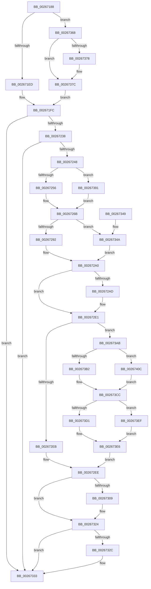

# B_TREE&lt;_SM_PAGE_KEY,SMKM_STORE_MGR&lt;SM_TRAITS&gt;::SMKM_FRONTEND_ENTRY,4096,B_TREE_DUMMY_NODE_POOL,B_TREE_KEY_COMPARATOR&lt;_SM_PAGE_KEY&gt; &gt;::BTreeRedistribute

- RVA: `0x00267188`–`0x00267422` (길이 `666` bytes)
- VA: `0x0000000140267188`
- 실행 섹션: `.text`
- PDB 이름 있음: `예`; PDB Function 태그: `아니요`
- unwind 정보 RVA: `0x00064F88`
- 디코드: `184`개 명령, `666/666` bytes 표시
- 미해석 바이트: `0` (있으면 어셈블리에 `.byte`로 보존)

> 이 문서는 커널 이미지의 기계어와 PDB 기호를 분석해 생성했습니다. 4번과 5번은 함수 원형과 자료형을 바이너리 사용 방식에서 추정한 C 해석이며 원본 소스 복구 결과는 아닙니다.

## 1. Dependencies

- 직접 호출 지점: **3**; 고유 호출 대상: **1**
- 직접 호출자로 확인된 함수: **2**
- RIP 상대 이미지 참조: **0**

### Outgoing calls
- `0x002672C4` → [memcpy](../6C/memcpy_function_006C6840.md) (function, `0x006C6840`)
- `0x002672F8` → [memcpy](../6C/memcpy_function_006C6840.md) (function, `0x006C6840`)
- `0x0026731F` → [memcpy](../6C/memcpy_function_006C6840.md) (function, `0x006C6840`)

### Direct callers
- [sub_00266668](Unknown_function_00266668.md) at `0x00266693`
- [sub_00266CC3](Unknown_function_00266CC3.md) at `0x00266CFF`

### Static image references
- 디코드된 RIP-relative 메모리 참조가 없습니다.

## 2. Other-region calls and transfers

- 다른 실행 섹션으로 향하는 call: **0**
- 별도 외부 분기/꼬리 이동을 확인하지 못했습니다.

## 3. Assembly (complete function range)

```asm
00267188  4C 8B DC                        mov r11, rsp
0026718B  49 89 4B 08                     mov qword ptr [r11 + 8], rcx
0026718F  53                              push rbx
00267190  55                              push rbp
00267191  56                              push rsi
00267192  57                              push rdi
00267193  41 54                           push r12
00267195  41 55                           push r13
00267197  41 56                           push r14
00267199  41 57                           push r15
0026719B  48 83 EC 38                     sub rsp, 0x38
0026719F  8B 4A 18                        mov ecx, dword ptr [rdx + 0x18]
002671A2  41 BA 01 00 00 00               mov r10d, 1
002671A8  41 2B CA                        sub ecx, r10d
002671AB  48 C1 E1 04                     shl rcx, 4
002671AF  48 03 0A                        add rcx, qword ptr [rdx]
002671B2  45 8D 7A 0F                     lea r15d, [r10 + 0xf]
002671B6  4C 8B 09                        mov r9, qword ptr [rcx]
002671B9  48 8B 51 F0                     mov rdx, qword ptr [rcx - 0x10]
002671BD  48 8B 71 F8                     mov rsi, qword ptr [rcx - 8]
002671C1  41 8A 41 03                     mov al, byte ptr [r9 + 3]
002671C5  F6 D8                           neg al
002671C7  B8 FF 00 00 00                  mov eax, 0xff
002671CC  45 1B C0                        sbb r8d, r8d
002671CF  44 23 C0                        and r8d, eax
002671D2  44 03 C0                        add r8d, eax
002671D5  8B 02                           mov eax, dword ptr [rdx]
002671D7  0F B7 C8                        movzx ecx, ax
002671DA  49 03 CA                        add rcx, r10
002671DD  48 C1 E1 04                     shl rcx, 4
002671E1  48 03 CA                        add rcx, rdx
002671E4  48 3B F1                        cmp rsi, rcx
002671E7  0F 84 7B 01 00 00               je 0x140267368
002671ED  4D 89 4B 10                     mov qword ptr [r11 + 0x10], r9
002671F1  48 8D 46 08                     lea rax, [rsi + 8]
002671F5  49 8D 4B 08                     lea rcx, [r11 + 8]
002671F9  45 33 D2                        xor r10d, r10d
002671FC  48 8B 00                        mov rax, qword ptr [rax]
002671FF  4C 0B D0                        or r10, rax
00267202  48 89 01                        mov qword ptr [rcx], rax
00267205  4C 8B A4 24 80 00 00 00         mov r12, qword ptr [rsp + 0x80]
0026720D  B8 FF FF 00 00                  mov eax, 0xffff
00267212  4C 89 54 24 20                  mov qword ptr [rsp + 0x20], r10
00267217  4C 8B 94 24 88 00 00 00         mov r10, qword ptr [rsp + 0x88]
0026721F  45 8B 0C 24                     mov r9d, dword ptr [r12]
00267223  44 23 C8                        and r9d, eax
00267226  41 8B 12                        mov edx, dword ptr [r10]
00267229  23 D0                           and edx, eax
0026722B  42 8D 0C 0A                     lea ecx, [rdx + r9]
0026722F  41 3B C8                        cmp ecx, r8d
00267232  0F 82 FB 00 00 00               jb 0x140267333
00267238  42 8D 04 45 FF FF FF FF         lea eax, [r8*2 - 1]
00267240  3B C8                           cmp ecx, eax
00267242  0F 83 EB 00 00 00               jae 0x140267333
00267248  D1 E9                           shr ecx, 1
0026724A  4D 8B C2                        mov r8, r10
0026724D  41 3B D1                        cmp edx, r9d
00267250  0F 87 3B 01 00 00               ja 0x140267391
00267256  8B F9                           mov edi, ecx
00267258  4C 89 94 24 90 00 00 00         mov qword ptr [rsp + 0x90], r10
00267260  2B FA                           sub edi, edx
00267262  49 8B DC                        mov rbx, r12
00267265  4D 8B F2                        mov r14, r10
00267268  44 8B DA                        mov r11d, edx
0026726B  44 3B CA                        cmp r9d, edx
0026726E  44 89 9C 24 80 00 00 00         mov dword ptr [rsp + 0x80], r11d
00267276  45 8B EB                        mov r13d, r11d
00267279  1B C0                           sbb eax, eax
0026727B  23 C1                           and eax, ecx
0026727D  80 7B 03 00                     cmp byte ptr [rbx + 3], 0
00267281  44 8B C8                        mov r9d, eax
00267284  4C 89 8C 24 98 00 00 00         mov qword ptr [rsp + 0x98], r9
0026728C  0F 84 B8 00 00 00               je 0x14026734a
00267292  41 BF 08 00 00 00               mov r15d, 8
00267298  48 8D 2C C3                     lea rbp, [rbx + rax*8]
0026729C  4F 8D 2C EE                     lea r13, [r14 + r13*8]
002672A0  49 83 C5 10                     add r13, 0x10
002672A4  48 83 C5 10                     add rbp, 0x10
002672A8  49 3B D8                        cmp rbx, r8
002672AB  75 34                           jne 0x1402672e1
002672AD  41 8B 06                        mov eax, dword ptr [r14]
002672B0  8B CF                           mov ecx, edi
002672B2  41 0F AF CF                     imul ecx, r15d
002672B6  49 8B D5                        mov rdx, r13
002672B9  44 0F B7 C0                     movzx r8d, ax
002672BD  45 0F AF C7                     imul r8d, r15d
002672C1  49 03 CD                        add rcx, r13
002672C4  E8 77 F5 45 00                  call 0x1406c6840
002672C9  4C 8B 94 24 88 00 00 00         mov r10, qword ptr [rsp + 0x88]
002672D1  44 8B 9C 24 80 00 00 00         mov r11d, dword ptr [rsp + 0x80]
002672D9  4C 8B 8C 24 98 00 00 00         mov r9, qword ptr [rsp + 0x98]
002672E1  80 7B 03 00                     cmp byte ptr [rbx + 3], 0
002672E5  0F 84 C0 00 00 00               je 0x1402673ab
002672EB  44 8B C7                        mov r8d, edi
002672EE  45 0F AF C7                     imul r8d, r15d
002672F2  48 8B D5                        mov rdx, rbp
002672F5  49 8B CD                        mov rcx, r13
002672F8  E8 43 F5 45 00                  call 0x1406c6840
002672FD  66 41 01 3E                     add word ptr [r14], di
00267301  66 29 3B                        sub word ptr [rbx], di
00267304  49 3B DC                        cmp rbx, r12
00267307  75 1B                           jne 0x140267324
00267309  8B 03                           mov eax, dword ptr [rbx]
0026730B  48 8B CD                        mov rcx, rbp
0026730E  41 0F AF FF                     imul edi, r15d
00267312  44 0F B7 C0                     movzx r8d, ax
00267316  45 0F AF C7                     imul r8d, r15d
0026731A  8B D7                           mov edx, edi
0026731C  48 03 D5                        add rdx, rbp
0026731F  E8 1C F5 45 00                  call 0x1406c6840
00267324  41 80 7C 24 03 00               cmp byte ptr [r12 + 3], 0
0026732A  74 07                           je 0x140267333
0026732C  41 8B 4C 24 10                  mov ecx, dword ptr [r12 + 0x10]
00267331  89 0E                           mov dword ptr [rsi], ecx
00267333  48 8B 44 24 20                  mov rax, qword ptr [rsp + 0x20]
00267338  48 83 C4 38                     add rsp, 0x38
0026733C  41 5F                           pop r15
0026733E  41 5E                           pop r14
00267340  41 5D                           pop r13
00267342  41 5C                           pop r12
00267344  5F                              pop rdi
00267345  5E                              pop rsi
00267346  5D                              pop rbp
00267347  5B                              pop rbx
00267348  C3                              ret
00267349  CC                              int3
0026734A  4C 8B 84 24 90 00 00 00         mov r8, qword ptr [rsp + 0x90]
00267352  49 8B E9                        mov rbp, r9
00267355  48 C1 E5 04                     shl rbp, 4
00267359  48 03 EB                        add rbp, rbx
0026735C  49 C1 E5 04                     shl r13, 4
00267360  4D 03 EE                        add r13, r14
00267363  E9 38 FF FF FF                  jmp 0x1402672a0
00267368  49 2B F7                        sub rsi, r15
0026736B  48 8D 42 10                     lea rax, [rdx + 0x10]
0026736F  48 3B F0                        cmp rsi, rax
00267372  48 8D 46 F8                     lea rax, [rsi - 8]
00267376  77 04                           ja 0x14026737c
00267378  48 8D 42 08                     lea rax, [rdx + 8]
0026737C  48 8D 8C 24 88 00 00 00         lea rcx, [rsp + 0x88]
00267384  4C 89 8C 24 80 00 00 00         mov qword ptr [rsp + 0x80], r9
0026738C  E9 6B FE FF FF                  jmp 0x1402671fc
00267391  49 8B DA                        mov rbx, r10
00267394  45 33 DB                        xor r11d, r11d
00267397  8B FA                           mov edi, edx
00267399  48 89 9C 24 90 00 00 00         mov qword ptr [rsp + 0x90], rbx
002673A1  2B F9                           sub edi, ecx
002673A3  4D 8B F4                        mov r14, r12
002673A6  E9 C0 FE FF FF                  jmp 0x14026726b
002673AB  8B 16                           mov edx, dword ptr [rsi]
002673AD  49 3B DA                        cmp rbx, r10
002673B0  74 5A                           je 0x14026740c
002673B2  41 8B CB                        mov ecx, r11d
002673B5  48 03 C9                        add rcx, rcx
002673B8  41 89 54 CE 10                  mov dword ptr [r14 + rcx*8 + 0x10], edx
002673BD  48 8B 43 08                     mov rax, qword ptr [rbx + 8]
002673C1  49 89 44 CE 18                  mov qword ptr [r14 + rcx*8 + 0x18], rax
002673C6  41 8B C7                        mov eax, r15d
002673C9  4C 03 E8                        add r13, rax
002673CC  49 3B DA                        cmp rbx, r10
002673CF  74 1E                           je 0x1402673ef
002673D1  8D 57 FF                        lea edx, [rdi - 1]
002673D4  48 03 D2                        add rdx, rdx
002673D7  8B 44 D3 10                     mov eax, dword ptr [rbx + rdx*8 + 0x10]
002673DB  89 06                           mov dword ptr [rsi], eax
002673DD  48 8B 44 D3 18                  mov rax, qword ptr [rbx + rdx*8 + 0x18]
002673E2  48 89 43 08                     mov qword ptr [rbx + 8], rax
002673E6  44 8D 47 FF                     lea r8d, [rdi - 1]
002673EA  E9 FF FE FF FF                  jmp 0x1402672ee
002673EF  41 8B C9                        mov ecx, r9d
002673F2  48 03 C9                        add rcx, rcx
002673F5  8B 44 CB 10                     mov eax, dword ptr [rbx + rcx*8 + 0x10]
002673F9  89 06                           mov dword ptr [rsi], eax
002673FB  48 8B 44 CB 18                  mov rax, qword ptr [rbx + rcx*8 + 0x18]
00267400  49 89 46 08                     mov qword ptr [r14 + 8], rax
00267404  41 8B C7                        mov eax, r15d
00267407  48 03 E8                        add rbp, rax
0026740A  EB DA                           jmp 0x1402673e6
0026740C  8D 4F FF                        lea ecx, [rdi - 1]
0026740F  48 03 C9                        add rcx, rcx
00267412  41 89 54 CE 10                  mov dword ptr [r14 + rcx*8 + 0x10], edx
00267417  49 8B 46 08                     mov rax, qword ptr [r14 + 8]
0026741B  49 89 44 CE 18                  mov qword ptr [r14 + rcx*8 + 0x18], rax
00267420  EB AA                           jmp 0x1402673cc
```

## 4. C-style interpretation (structured pseudocode)

```c
__int64 __fastcall B_TREE__SM_PAGE_KEY_SMKM_STORE_MGR_SM_TRAITS___SMKM_FRONTEND_ENTRY_4096_B_TREE_DUMMY_NODE_POOL_B_TRE(__int64 a1, __int64 a2, int a3)
{
    __int64 result;
    __int64 v_r10;
    __int64 v_r11;
    __int64 v_r13;
    __int64 v_rbp;
    __int64 v_rdi;
    __int64 v_rsi;
    __int64 v_rsp;
    unsigned __int64 v_stack_m58;
    unsigned __int64 v_stack_p10;
    unsigned __int64 v_stack_p18;
    unsigned __int64 v_stack_p20;
    unsigned __int64 v_stack_p8;
    unsigned __int64 v_stack_p80;
    unsigned __int64 v_stack_p88;
    unsigned __int64 v_stack_p90;

    *(unsigned __int64 *)(v_rsp + 8) = a1;
    v_rsp = (v_rsp) - (56);
    a1 = (unsigned int)(((unsigned int)(*(unsigned int *)(a2 + 24))) - (1));
    a1 = (a1) << (4);
    a1 = (a1) + (*(unsigned __int64 *)(a2));
    result = (unsigned __int8)(-(*(unsigned __int8 *)(*(unsigned __int64 *)(a1) + 3)));
    a3 = (unsigned int)((a3) & (255));
    a3 = (unsigned int)((a3) + (255));
    a1 = ((unsigned __int16)((unsigned int)(*(unsigned int *)(*(unsigned __int64 *)(a1 - 16))))) + (1);
    a1 = (a1) << (4);
    a1 = (a1) + (*(unsigned __int64 *)(a1 - 16));
    if ((*(unsigned __int64 *)(a1 - 8)) == a1) goto loc_00267368;
    *(unsigned __int64 *)(v_rsp + 16) = *(unsigned __int64 *)(a1);
    v_r10 = 0;
loc_002671FC:
    v_r10 = (v_r10) | (*(unsigned __int64 *)(*(unsigned __int64 *)(a1 - 8) + 8));
    *(unsigned __int64 *)(v_rsp + 8) = *(unsigned __int64 *)(*(unsigned __int64 *)(a1 - 8) + 8);
    v_stack_m58 = v_r10;
    a4 = (unsigned int)(((unsigned int)(*(unsigned int *)(v_stack_p8))) & ((unsigned int)((unsigned int)(0xFFFFULL))));
    a2 = (unsigned int)(((unsigned int)(*(unsigned int *)(v_stack_p10))) & ((unsigned int)((unsigned int)(0xFFFFULL))));
    if (((unsigned int)(a2 + a4 * 1)) < a3) goto loc_00267333;
    if (((unsigned int)(a2 + a4 * 1)) >= ((unsigned int)(a3 * 2 - 1))) goto loc_00267333;
    a1 = (unsigned int)((a2 + a4 * 1) >> (1));
    if (((unsigned int)(a2)) > ((unsigned int)(a4))) goto loc_00267391;
    v_stack_p18 = v_stack_p10;
    v_rdi = (unsigned int)(((unsigned int)((unsigned int)(a1))) - ((unsigned int)(a2)));
loc_0026726B:
    v_stack_p8 = (unsigned int)((unsigned int)((unsigned int)(a2)));
    result = (unsigned int)((a3 * 2 - 1) & ((unsigned int)(a1)));
    v_stack_p20 = (unsigned int)((unsigned int)(result));
    if ((*(unsigned __int8 *)(v_stack_p8 + 3)) == 0) goto loc_0026734A;
loc_002672A0:
    v_r13 = (v_stack_p10 + (unsigned int)((unsigned int)((unsigned int)((unsigned int)(a2)))) * 8) + (16);
    v_rbp = (v_stack_p8 + result * 8) + (16);
    v_r10 = v_stack_p10;
    v_r11 = (unsigned int)((unsigned int)(a2));
    if (v_stack_p8 == v_stack_p10) {
        result = *(unsigned int *)(v_stack_p10);
        a1 = (unsigned int)(v_rdi);
        a1 = (unsigned int)((a1) * (8));
        a2 = v_r13;
        a3 = (unsigned __int16)(result);
        a3 = (unsigned int)((a3) * (8));
        a1 = (a1) + (v_r13);
        result = memcpy(a1, a2, a3, (unsigned int)((unsigned int)(result)));
        v_r10 = v_stack_p10;
        v_r11 = v_stack_p8;
        a4 = v_stack_p20;
    }
    if ((*(unsigned __int8 *)(v_stack_p8 + 3)) == 0) goto loc_002673AB;
loc_002672EE:
    a3 = (unsigned int)(((unsigned int)((unsigned int)(v_rdi))) * (8));
    result = memcpy(v_r13, v_rbp, a3, a4);
    if (v_stack_p8 == v_stack_p8) {
        result = *(unsigned int *)(v_stack_p8);
        a1 = v_rbp;
        v_rdi = (unsigned int)((v_rdi) * (8));
        a3 = (unsigned __int16)(result);
        a3 = (unsigned int)((a3) * (8));
        a2 = (unsigned int)(v_rdi);
        a2 = (a2) + (v_rbp);
        result = memcpy(a1, a2, a3, a4);
    }
    if ((*(unsigned __int8 *)(v_stack_p8 + 3)) != 0) {
        a1 = *(unsigned int *)(v_stack_p8 + 16);
        *(unsigned int *)(*(unsigned __int64 *)(a1 - 8)) = (unsigned int)(a1);
    }
    v_rsp = (v_rsp) + (56);
    return v_stack_m58;
loc_0026734A:
    v_rbp = (a4) << (4);
    v_rbp = (v_rbp) + (v_stack_p8);
    v_r13 = (v_r13) << (4);
    v_r13 = (v_r13) + (v_stack_p10);
    goto loc_002672A0;
loc_00267368:
    v_rsi = (*(unsigned __int64 *)(a1 - 8)) - (8);
    result = v_rsi - 8;
    if (v_rsi <= (a2 + 16)) {
        result = a2 + 8;
    }
    v_stack_p80 = a4;
    goto loc_002671FC;
loc_00267391:
    v_r11 = 0;
    v_stack_p90 = v_r10;
    v_rdi = (unsigned int)(((unsigned int)((unsigned int)(a2))) - ((unsigned int)(v_stack_p88)));
    goto loc_0026726B;
loc_002673AB:
    if (v_r10 == v_r10) goto loc_0026740C;
    a1 = (0) + (0);
    *(unsigned int *)(v_stack_p8 + a1 * 8 + 16) = (unsigned int)((unsigned int)(*(unsigned int *)(v_rsi)));
    *(unsigned __int64 *)(v_stack_p8 + a1 * 8 + 24) = *(unsigned __int64 *)(v_r10 + 8);
    v_r13 = (v_r13) + (8);
loc_002673CC:
    if (v_r10 == v_r10) goto loc_002673EF;
    a2 = (v_rdi - 1) + (v_rdi - 1);
    *(unsigned int *)(v_rsi) = (unsigned int)((unsigned int)(*(unsigned int *)(v_r10 + a2 * 8 + 16)));
    *(unsigned __int64 *)(v_r10 + 8) = *(unsigned __int64 *)(v_r10 + a2 * 8 + 24);
loc_002673E6:
    goto loc_002672EE;
loc_002673EF:
    a1 = ((unsigned int)((unsigned int)(a4))) + ((unsigned int)((unsigned int)(a4)));
    *(unsigned int *)(v_rsi) = (unsigned int)((unsigned int)(*(unsigned int *)(v_r10 + a1 * 8 + 16)));
    *(unsigned __int64 *)(v_stack_p8 + 8) = *(unsigned __int64 *)(v_r10 + a1 * 8 + 24);
    v_rbp = (v_rbp) + (8);
    goto loc_002673E6;
loc_0026740C:
    a1 = (v_rdi - 1) + (v_rdi - 1);
    *(unsigned int *)(v_stack_p8 + a1 * 8 + 16) = (unsigned int)(a2);
    *(unsigned __int64 *)(v_stack_p8 + a1 * 8 + 24) = *(unsigned __int64 *)(v_stack_p8 + 8);
    goto loc_002673CC;
}
```

## 5. (Beta) C Style

```c
int64_t B_TREE__SM_PAGE_KEY_SMKM_STORE_MGR_SM_TRAITS___SMKM_FRONTEND_ENTRY_4096_B_TREE_DUMMY_NODE_POOL_B_TRE(int64_t Arg1, void *Arg2, int32_t Arg3)
{
    uint8_t *arg2 = (uint8_t *)Arg2;

    int64_t result;
    int64_t local_r10;
    int64_t local_r11;
    int64_t local_r13;
    int64_t local_rbp;
    int64_t local_rdi;
    int64_t local_rsi;
    int64_t local_rsp;
    uint64_t v_stack_m58;
    uint64_t v_stack_p10;
    uint64_t v_stack_p18;
    uint64_t v_stack_p20;
    uint64_t v_stack_p8;
    uint64_t v_stack_p80;
    uint64_t v_stack_p88;
    uint64_t v_stack_p90;

    *(uint64_t *)(local_rsp + 0x8) = Arg1;
    local_rsp = (local_rsp) - (56);
    Arg1 = (uint32_t)(((uint32_t)(*(uint32_t *)(arg2 + 0x18))) - (1));
    Arg1 = (Arg1) << (4);
    Arg1 = (Arg1) + (*(uint64_t *)(arg2));
    result = (uint8_t)(-(*(uint8_t *)(*(uint64_t *)(Arg1) + 0x3)));
    Arg3 = (uint32_t)((Arg3) & (255));
    Arg3 = (uint32_t)((Arg3) + (255));
    Arg1 = ((uint16_t)((uint32_t)(*(uint32_t *)(*(uint64_t *)(Arg1 - 0x10))))) + (1);
    Arg1 = (Arg1) << (4);
    Arg1 = (Arg1) + (*(uint64_t *)(Arg1 - 0x10));
    if ((*(uint64_t *)(Arg1 - 0x8)) == Arg1) goto loc_00267368;
    *(uint64_t *)(local_rsp + 0x10) = *(uint64_t *)(Arg1);
    local_r10 = 0;
loc_002671FC:
    local_r10 = (local_r10) | (*(uint64_t *)(*(uint64_t *)(Arg1 - 0x8) + 0x8));
    *(uint64_t *)(local_rsp + 0x8) = *(uint64_t *)(*(uint64_t *)(Arg1 - 0x8) + 0x8);
    v_stack_m58 = local_r10;
    a4 = (uint32_t)(((uint32_t)(*(uint32_t *)(v_stack_p8))) & ((uint32_t)((uint32_t)(0xFFFFULL))));
    Arg2 = (uint32_t)(((uint32_t)(*(uint32_t *)(v_stack_p10))) & ((uint32_t)((uint32_t)(0xFFFFULL))));
    if (((uint32_t)(Arg2 + a4 * 1)) < Arg3) goto loc_00267333;
    if (((uint32_t)(Arg2 + a4 * 1)) >= ((uint32_t)(Arg3 * 2 - 1))) goto loc_00267333;
    Arg1 = (uint32_t)((Arg2 + a4 * 1) >> (1));
    if (((uint32_t)(Arg2)) > ((uint32_t)(a4))) goto loc_00267391;
    v_stack_p18 = v_stack_p10;
    local_rdi = (uint32_t)(((uint32_t)((uint32_t)(Arg1))) - ((uint32_t)(Arg2)));
loc_0026726B:
    v_stack_p8 = (uint32_t)((uint32_t)((uint32_t)(Arg2)));
    result = (uint32_t)((Arg3 * 2 - 1) & ((uint32_t)(Arg1)));
    v_stack_p20 = (uint32_t)((uint32_t)(result));
    if ((*(uint8_t *)(v_stack_p8 + 0x3)) == 0) goto loc_0026734A;
loc_002672A0:
    local_r13 = (v_stack_p10 + (uint32_t)((uint32_t)((uint32_t)((uint32_t)(Arg2)))) * 8) + (16);
    local_rbp = (v_stack_p8 + result * 8) + (16);
    local_r10 = v_stack_p10;
    local_r11 = (uint32_t)((uint32_t)(Arg2));
    if (v_stack_p8 == v_stack_p10) {
        result = *(uint32_t *)(v_stack_p10);
        Arg1 = (uint32_t)(local_rdi);
        Arg1 = (uint32_t)((Arg1) * (8));
        Arg2 = local_r13;
        Arg3 = (uint16_t)(result);
        Arg3 = (uint32_t)((Arg3) * (8));
        Arg1 = (Arg1) + (local_r13);
        result = memcpy(Arg1, Arg2, Arg3, (uint32_t)((uint32_t)(result)));
        local_r10 = v_stack_p10;
        local_r11 = v_stack_p8;
        a4 = v_stack_p20;
    }
    if ((*(uint8_t *)(v_stack_p8 + 0x3)) == 0) goto loc_002673AB;
loc_002672EE:
    Arg3 = (uint32_t)(((uint32_t)((uint32_t)(local_rdi))) * (8));
    result = memcpy(local_r13, local_rbp, Arg3, a4);
    if (v_stack_p8 == v_stack_p8) {
        result = *(uint32_t *)(v_stack_p8);
        Arg1 = local_rbp;
        local_rdi = (uint32_t)((local_rdi) * (8));
        Arg3 = (uint16_t)(result);
        Arg3 = (uint32_t)((Arg3) * (8));
        Arg2 = (uint32_t)(local_rdi);
        Arg2 = (Arg2) + (local_rbp);
        result = memcpy(Arg1, Arg2, Arg3, a4);
    }
    if ((*(uint8_t *)(v_stack_p8 + 0x3)) != 0) {
        Arg1 = *(uint32_t *)(v_stack_p8 + 0x10);
        *(uint32_t *)(*(uint64_t *)(Arg1 - 0x8)) = (uint32_t)(Arg1);
    }
    local_rsp = (local_rsp) + (56);
    return v_stack_m58;
loc_0026734A:
    local_rbp = (a4) << (4);
    local_rbp = (local_rbp) + (v_stack_p8);
    local_r13 = (local_r13) << (4);
    local_r13 = (local_r13) + (v_stack_p10);
    goto loc_002672A0;
loc_00267368:
    local_rsi = (*(uint64_t *)(Arg1 - 0x8)) - (8);
    result = local_rsi - 8;
    if (local_rsi <= (Arg2 + 16)) {
        result = Arg2 + 8;
    }
    v_stack_p80 = a4;
    goto loc_002671FC;
loc_00267391:
    local_r11 = 0;
    v_stack_p90 = local_r10;
    local_rdi = (uint32_t)(((uint32_t)((uint32_t)(Arg2))) - ((uint32_t)(v_stack_p88)));
    goto loc_0026726B;
loc_002673AB:
    if (local_r10 == local_r10) goto loc_0026740C;
    Arg1 = (0) + (0);
    *(uint32_t *)(v_stack_p8 + Arg1 * 8 + 0x10) = (uint32_t)((uint32_t)(*(uint32_t *)(local_rsi)));
    *(uint64_t *)(v_stack_p8 + Arg1 * 8 + 0x18) = *(uint64_t *)(local_r10 + 0x8);
    local_r13 = (local_r13) + (8);
loc_002673CC:
    if (local_r10 == local_r10) goto loc_002673EF;
    Arg2 = (local_rdi - 1) + (local_rdi - 1);
    *(uint32_t *)(local_rsi) = (uint32_t)((uint32_t)(*(uint32_t *)(local_r10 + arg2 * 8 + 0x10)));
    *(uint64_t *)(local_r10 + 0x8) = *(uint64_t *)(local_r10 + arg2 * 8 + 0x18);
loc_002673E6:
    goto loc_002672EE;
loc_002673EF:
    Arg1 = ((uint32_t)((uint32_t)(a4))) + ((uint32_t)((uint32_t)(a4)));
    *(uint32_t *)(local_rsi) = (uint32_t)((uint32_t)(*(uint32_t *)(local_r10 + Arg1 * 8 + 0x10)));
    *(uint64_t *)(v_stack_p8 + 0x8) = *(uint64_t *)(local_r10 + Arg1 * 8 + 0x18);
    local_rbp = (local_rbp) + (8);
    goto loc_002673E6;
loc_0026740C:
    Arg1 = (local_rdi - 1) + (local_rdi - 1);
    *(uint32_t *)(v_stack_p8 + Arg1 * 8 + 0x10) = (uint32_t)(Arg2);
    *(uint64_t *)(v_stack_p8 + Arg1 * 8 + 0x18) = *(uint64_t *)(v_stack_p8 + 0x8);
    goto loc_002673CC;
}
```

### 관측된 메모리 오프셋

구조체 형식이 확인되지 않은 접근은 인자 기준의 오프셋으로만 기록했습니다.

| 기준 인자 | 오프셋 표현 | 폭 (bit) | 접근 |
|---|---:|---:|---|
| `Arg2` | `+ 0x0` | `64` | `R` |
| `Arg2` | `+ 0x18` | `32` | `R` |

## 6. Execution-region graph

[열기: 2D/3D 그래프와 함수 탐색 컨트롤 패널](../../../control-panel.html?section=text&rva=0x00267188&view=graph)

- 2D 그래프는 위에서 아래로 흐르고, 3D 그래프는 빈 공간을 드래그해 회전합니다. Shift+드래그는 이동, 휠은 확대·축소, 함수 노드 선택은 대상 보고서 이동입니다.

### Static fallback


