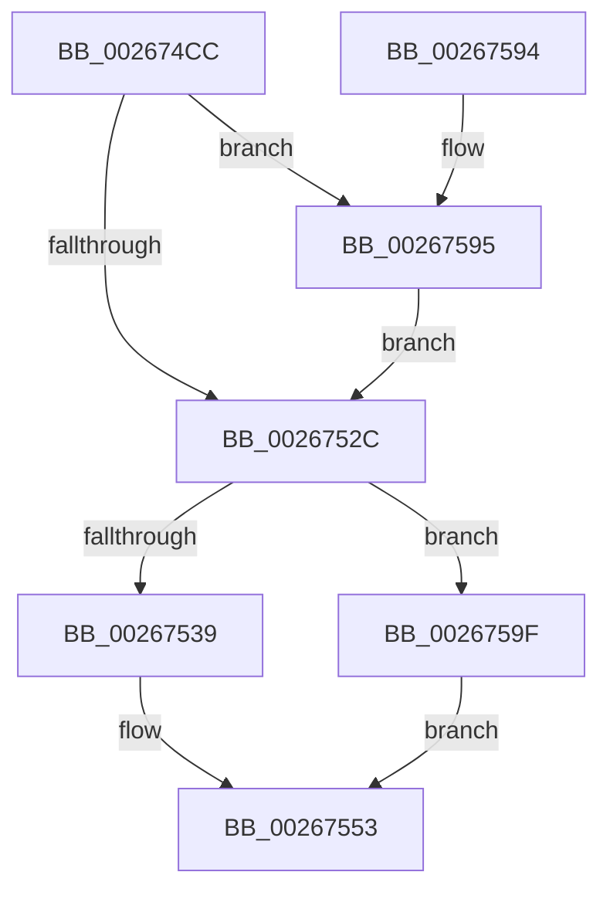

# B_TREE&lt;_SM_PAGE_KEY,SMKM_STORE_MGR&lt;SM_TRAITS&gt;::SMKM_FRONTEND_ENTRY,4096,B_TREE_DUMMY_NODE_POOL,B_TREE_KEY_COMPARATOR&lt;_SM_PAGE_KEY&gt; &gt;::BTreeMergeNodes

- RVA: `0x002674CC`–`0x002675CB` (길이 `255` bytes)
- VA: `0x00000001402674CC`
- 실행 섹션: `.text`
- PDB 이름 있음: `예`; PDB Function 태그: `아니요`
- unwind 정보 RVA: `0x00065004`
- 디코드: `76`개 명령, `255/255` bytes 표시
- 미해석 바이트: `0` (있으면 어셈블리에 `.byte`로 보존)

> 이 문서는 커널 이미지의 기계어와 PDB 기호를 분석해 생성했습니다. 4번과 5번은 함수 원형과 자료형을 바이너리 사용 방식에서 추정한 C 해석이며 원본 소스 복구 결과는 아닙니다.

## 1. Dependencies

- 직접 호출 지점: **3**; 고유 호출 대상: **3**
- 직접 호출자로 확인된 함수: **1**
- RIP 상대 이미지 참조: **0**

### Outgoing calls
- `0x00267553` → [memcpy](../6C/memcpy_function_006C6840.md) (function, `0x006C6840`)
- `0x00267563` → [ExFreePoolWithTag](../../poolcode/B8/ExFreePoolWithTag_function_00B82870.md) (function, `0x00B82870`)
- `0x00267571` → [B_TREE<_SM_PAGE_KEY,SMKM_STORE_MGR<SM_TRAITS>::SMKM_FRONTEND_ENTRY,4096,B_TREE_DUMMY_NODE_POOL,B_TREE_KEY_COMPARATOR<_SM_PAGE_KEY> >::BTreeDeleteEx](B_TREE__SM_PAGE_KEY_SMKM_STORE_MGR_SM_TRAITS_SMKM_FRONTEND_ENTRY_4096_B_TREE_DUMMY_NODE_POOL_B_TREE__function_00266C00.md) (function, `0x00266C00`)

### Direct callers
- [sub_00266CC3](Unknown_function_00266CC3.md) at `0x00266D28`

### Static image references
- 디코드된 RIP-relative 메모리 참조가 없습니다.

## 2. Other-region calls and transfers

- 다른 실행 섹션으로 향하는 call: **1**
  - `0x00267563` → [ExFreePoolWithTag](../../poolcode/B8/ExFreePoolWithTag_function_00B82870.md) (`.text` → `POOLCODE`)
- 별도 외부 분기/꼬리 이동을 확인하지 못했습니다.

## 3. Assembly (complete function range)

```asm
002674CC  48 8B C4                        mov rax, rsp
002674CF  48 89 58 08                     mov qword ptr [rax + 8], rbx
002674D3  48 89 68 10                     mov qword ptr [rax + 0x10], rbp
002674D7  48 89 70 18                     mov qword ptr [rax + 0x18], rsi
002674DB  48 89 78 20                     mov qword ptr [rax + 0x20], rdi
002674DF  41 56                           push r14
002674E1  48 83 EC 20                     sub rsp, 0x20
002674E5  48 8B EA                        mov rbp, rdx
002674E8  4D 8B C8                        mov r9, r8
002674EB  8B 52 18                        mov edx, dword ptr [rdx + 0x18]
002674EE  4C 8B F1                        mov r14, rcx
002674F1  FF CA                           dec edx
002674F3  49 8B D9                        mov rbx, r9
002674F6  48 C1 E2 04                     shl rdx, 4
002674FA  49 8B C9                        mov rcx, r9
002674FD  48 03 55 00                     add rdx, qword ptr [rbp]
00267501  41 83 E0 01                     and r8d, 1
00267505  48 8B 02                        mov rax, qword ptr [rdx]
00267508  48 0F 45 D8                     cmovne rbx, rax
0026750C  48 83 E1 FE                     and rcx, 0xfffffffffffffffe
00267510  4D 85 C0                        test r8, r8
00267513  48 8B F9                        mov rdi, rcx
00267516  48 0F 44 F8                     cmove rdi, rax
0026751A  49 0F 44 C9                     cmove rcx, r9
0026751E  8B 07                           mov eax, dword ptr [rdi]
00267520  0F B7 F0                        movzx esi, ax
00267523  48 8B 42 F8                     mov rax, qword ptr [rdx - 8]
00267527  48 3B F9                        cmp rdi, rcx
0026752A  74 69                           je 0x140267595
0026752C  80 7F 03 00                     cmp byte ptr [rdi + 3], 0
00267530  48 8D 53 10                     lea rdx, [rbx + 0x10]
00267534  48 8B CE                        mov rcx, rsi
00267537  74 66                           je 0x14026759f
00267539  48 8B 43 08                     mov rax, qword ptr [rbx + 8]
0026753D  48 89 47 08                     mov qword ptr [rdi + 8], rax
00267541  8B 03                           mov eax, dword ptr [rbx]
00267543  44 0F B7 C0                     movzx r8d, ax
00267547  49 C1 E0 03                     shl r8, 3
0026754B  48 83 C1 02                     add rcx, 2
0026754F  48 8D 0C CF                     lea rcx, [rdi + rcx*8]
00267553  E8 E8 F2 45 00                  call 0x1406c6840
00267558  66 03 33                        add si, word ptr [rbx]
0026755B  33 D2                           xor edx, edx
0026755D  48 8B CB                        mov rcx, rbx
00267560  66 89 37                        mov word ptr [rdi], si
00267563  E8 08 B3 91 00                  call 0x140b82870
00267568  FF 4D 18                        dec dword ptr [rbp + 0x18]
0026756B  48 8B D5                        mov rdx, rbp
0026756E  49 8B CE                        mov rcx, r14
00267571  E8 8A F6 FF FF                  call 0x140266c00
00267576  FF 45 18                        inc dword ptr [rbp + 0x18]
00267579  48 8B 6C 24 38                  mov rbp, qword ptr [rsp + 0x38]
0026757E  48 8B 5C 24 30                  mov rbx, qword ptr [rsp + 0x30]
00267583  48 8B 74 24 40                  mov rsi, qword ptr [rsp + 0x40]
00267588  48 8B 7C 24 48                  mov rdi, qword ptr [rsp + 0x48]
0026758D  48 83 C4 20                     add rsp, 0x20
00267591  41 5E                           pop r14
00267593  C3                              ret
00267594  CC                              int3
00267595  48 83 E8 10                     sub rax, 0x10
00267599  48 89 42 F8                     mov qword ptr [rdx - 8], rax
0026759D  EB 8D                           jmp 0x14026752c
0026759F  8B 00                           mov eax, dword ptr [rax]
002675A1  48 03 C9                        add rcx, rcx
002675A4  FF C6                           inc esi
002675A6  89 44 CF 10                     mov dword ptr [rdi + rcx*8 + 0x10], eax
002675AA  48 8B 43 08                     mov rax, qword ptr [rbx + 8]
002675AE  48 89 44 CF 18                  mov qword ptr [rdi + rcx*8 + 0x18], rax
002675B3  8B 03                           mov eax, dword ptr [rbx]
002675B5  8B CE                           mov ecx, esi
002675B7  48 FF C1                        inc rcx
002675BA  44 0F B7 C0                     movzx r8d, ax
002675BE  49 C1 E0 04                     shl r8, 4
002675C2  48 C1 E1 04                     shl rcx, 4
002675C6  48 03 CF                        add rcx, rdi
002675C9  EB 88                           jmp 0x140267553
```

## 4. C-style interpretation (structured pseudocode)

```c
__int64 __fastcall B_TREE__SM_PAGE_KEY_SMKM_STORE_MGR_SM_TRAITS___SMKM_FRONTEND_ENTRY_4096_B_TREE_DUMMY_NODE_POOL_B_TRE(__int64 a1, __int64 a2, __int64 a3)
{
    __int64 result;
    __int64 v_rsi;
    __int64 v_rsp;
    unsigned __int64 v_stack_p10;
    unsigned __int64 v_stack_p18;
    unsigned __int64 v_stack_p20;
    unsigned __int64 v_stack_p8;

    *(unsigned __int64 *)(v_rsp + 8) = v_rbx;
    *(unsigned __int64 *)(v_rsp + 16) = v_rbp;
    *(unsigned __int64 *)(v_rsp + 24) = v_rsi;
    *(unsigned __int64 *)(v_rsp + 32) = v_rdi;
    v_rsp = (v_rsp) - (32);
    a2 = (unsigned int)(((unsigned int)(*(unsigned int *)(a2 + 24))) - 1);
    a2 = (a2) << (4);
    a2 = (a2) + (*(unsigned __int64 *)(a2));
    a3 = (unsigned int)((a3) & (1));
    if (condition_is_not_equal) { a3 = *(unsigned __int64 *)(a2); }
    a1 = (a3) & (-2);
    if (a3 == 0) {
        a1 = *(unsigned __int64 *)(a2);
        a1 = a3;
    }
    if (a1 == a1) goto loc_00267595;
loc_0026752C:
    if ((*(unsigned __int8 *)(a1 + 3)) == 0) goto loc_0026759F;
    *(unsigned __int64 *)(a1 + 8) = *(unsigned __int64 *)(a3 + 8);
    a3 = ((unsigned __int16)((unsigned int)(*(unsigned int *)(a3)))) << (3);
    a1 = ((unsigned __int16)((unsigned int)(*(unsigned int *)(a1)))) + (2);
loc_00267553:
    result = memcpy(a1 + a1 * 8, a3 + 16, a3, a3);
    v_rsi = (unsigned __int16)(((unsigned __int16)((unsigned int)(*(unsigned int *)(a1)))) + (*(unsigned __int16 *)(a3)));
    a2 = 0;
    *(unsigned __int16 *)(a1) = (unsigned __int16)(v_rsi);
    result = ExFreePoolWithTag(a3, a2, a3, a3);
    result = B_TREE__SM_PAGE_KEY_SMKM_STORE_MGR_SM_TRAITS___SMKM_FRONTEND_ENTRY_4096_B_TREE_DUMMY_NODE_POOL_B_TRE(a1, 0, a3, a3);
    v_rsp = (v_rsp) + (32);
    return result;
loc_00267595:
    result = (result) - (16);
    *(unsigned __int64 *)(0 - 8) = result;
    goto loc_0026752C;
loc_0026759F:
    a1 = (a1) + (a1);
    v_rsi = (unsigned int)((v_stack_p18) + 1);
    *(unsigned int *)(v_stack_p20 + a1 * 8 + 16) = (unsigned int)((unsigned int)(*(unsigned int *)(result)));
    *(unsigned __int64 *)(v_stack_p20 + a1 * 8 + 24) = *(unsigned __int64 *)(v_stack_p8 + 8);
    a1 = ((unsigned int)((unsigned int)(v_rsi))) + 1;
    a3 = ((unsigned __int16)((unsigned int)(*(unsigned int *)(v_stack_p8)))) << (4);
    a1 = (a1) << (4);
    a1 = (a1) + (v_stack_p20);
    goto loc_00267553;
}
```

## 5. (Beta) C Style

```c
int64_t B_TREE__SM_PAGE_KEY_SMKM_STORE_MGR_SM_TRAITS___SMKM_FRONTEND_ENTRY_4096_B_TREE_DUMMY_NODE_POOL_B_TRE(int64_t Arg1, void *Arg2, int64_t Arg3)
{
    uint8_t *arg2 = (uint8_t *)Arg2;

    int64_t result;
    int64_t local_rsi;
    int64_t local_rsp;
    uint64_t v_stack_p10;
    uint64_t v_stack_p18;
    uint64_t v_stack_p20;
    uint64_t v_stack_p8;

    *(uint64_t *)(local_rsp + 0x8) = local_rbx;
    *(uint64_t *)(local_rsp + 0x10) = local_rbp;
    *(uint64_t *)(local_rsp + 0x18) = local_rsi;
    *(uint64_t *)(local_rsp + 0x20) = local_rdi;
    local_rsp = (local_rsp) - (32);
    Arg2 = (uint32_t)(((uint32_t)(*(uint32_t *)(arg2 + 0x18))) - 1);
    Arg2 = (Arg2) << (4);
    Arg2 = (Arg2) + (*(uint64_t *)(arg2));
    Arg3 = (uint32_t)((Arg3) & (1));
    if (condition_is_not_equal) { Arg3 = *(uint64_t *)(arg2); }
    Arg1 = (Arg3) & (-2);
    if (Arg3 == 0) {
        Arg1 = *(uint64_t *)(arg2);
        Arg1 = Arg3;
    }
    if (Arg1 == Arg1) goto loc_00267595;
loc_0026752C:
    if ((*(uint8_t *)(Arg1 + 0x3)) == 0) goto loc_0026759F;
    *(uint64_t *)(Arg1 + 0x8) = *(uint64_t *)(Arg3 + 0x8);
    Arg3 = ((uint16_t)((uint32_t)(*(uint32_t *)(Arg3)))) << (3);
    Arg1 = ((uint16_t)((uint32_t)(*(uint32_t *)(Arg1)))) + (2);
loc_00267553:
    result = memcpy(Arg1 + Arg1 * 8, Arg3 + 16, Arg3, Arg3);
    local_rsi = (uint16_t)(((uint16_t)((uint32_t)(*(uint32_t *)(Arg1)))) + (*(uint16_t *)(Arg3)));
    Arg2 = 0;
    *(uint16_t *)(Arg1) = (uint16_t)(local_rsi);
    result = ExFreePoolWithTag(Arg3, Arg2, Arg3, Arg3);
    result = B_TREE__SM_PAGE_KEY_SMKM_STORE_MGR_SM_TRAITS___SMKM_FRONTEND_ENTRY_4096_B_TREE_DUMMY_NODE_POOL_B_TRE(Arg1, 0, Arg3, Arg3);
    local_rsp = (local_rsp) + (32);
    return result;
loc_00267595:
    result = (result) - (16);
    *(uint64_t *)(0 - 0x8) = result;
    goto loc_0026752C;
loc_0026759F:
    Arg1 = (Arg1) + (Arg1);
    local_rsi = (uint32_t)((v_stack_p18) + 1);
    *(uint32_t *)(v_stack_p20 + Arg1 * 8 + 0x10) = (uint32_t)((uint32_t)(*(uint32_t *)(result)));
    *(uint64_t *)(v_stack_p20 + Arg1 * 8 + 0x18) = *(uint64_t *)(v_stack_p8 + 0x8);
    Arg1 = ((uint32_t)((uint32_t)(local_rsi))) + 1;
    Arg3 = ((uint16_t)((uint32_t)(*(uint32_t *)(v_stack_p8)))) << (4);
    Arg1 = (Arg1) << (4);
    Arg1 = (Arg1) + (v_stack_p20);
    goto loc_00267553;
}
```

### 관측된 메모리 오프셋

구조체 형식이 확인되지 않은 접근은 인자 기준의 오프셋으로만 기록했습니다.

| 기준 인자 | 오프셋 표현 | 폭 (bit) | 접근 |
|---|---:|---:|---|
| `Arg2` | `+ 0x0` | `64` | `R` |
| `Arg2` | `+ 0x18` | `32` | `R` |
| `Arg2` | `+ 0x18` | `32` | `R/W` |

## 6. Execution-region graph

[열기: 2D/3D 그래프와 함수 탐색 컨트롤 패널](../../../control-panel.html?section=text&rva=0x002674CC&view=graph)

- 2D 그래프는 위에서 아래로 흐르고, 3D 그래프는 빈 공간을 드래그해 회전합니다. Shift+드래그는 이동, 휠은 확대·축소, 함수 노드 선택은 대상 보고서 이동입니다.

### Static fallback


