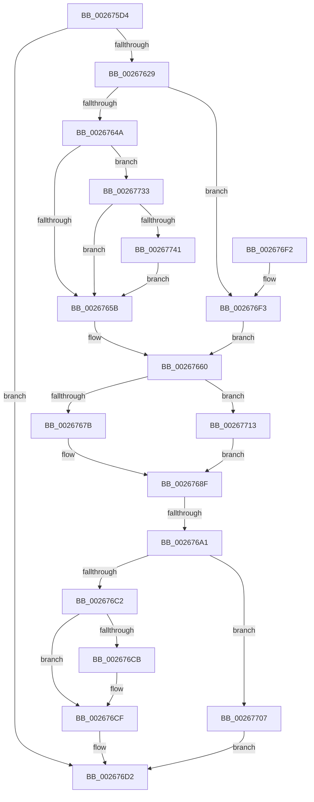

# B_TREE&lt;_SM_PAGE_KEY,SMKM_STORE_MGR&lt;SM_TRAITS&gt;::SMKM_FRONTEND_ENTRY,4096,B_TREE_DUMMY_NODE_POOL,B_TREE_KEY_COMPARATOR&lt;_SM_PAGE_KEY&gt; &gt;::BTreeSplitChild

- RVA: `0x002675D4`–`0x0026774C` (길이 `376` bytes)
- VA: `0x00000001402675D4`
- 실행 섹션: `.text`
- PDB 이름 있음: `예`; PDB Function 태그: `예`
- unwind 정보 RVA: `0x00065020`
- 디코드: `106`개 명령, `376/376` bytes 표시
- 미해석 바이트: `0` (있으면 어셈블리에 `.byte`로 보존)

> 이 문서는 커널 이미지의 기계어와 PDB 기호를 분석해 생성했습니다. 4번과 5번은 함수 원형과 자료형을 바이너리 사용 방식에서 추정한 C 해석이며 원본 소스 복구 결과는 아닙니다.

## 1. Dependencies

- 직접 호출 지점: **5**; 고유 호출 대상: **4**
- 직접 호출자로 확인된 함수: **1**
- RIP 상대 이미지 참조: **0**

### Outgoing calls
- `0x00267618` → [B_TREE<_SM_PAGE_KEY,SMKM_STORE_MGR<SM_TRAITS>::SMKM_FRONTEND_ENTRY,4096,B_TREE_DUMMY_NODE_POOL,B_TREE_KEY_COMPARATOR<_SM_PAGE_KEY> >::BTreeNewNode](B_TREE__SM_PAGE_KEY_SMKM_STORE_MGR_SM_TRAITS_SMKM_FRONTEND_ENTRY_4096_B_TREE_DUMMY_NODE_POOL_B_TREE__function_0026788C.md) (function, `0x0026788C`)
- `0x0026768A` → [memcpy](../6C/memcpy_function_006C6840.md) (function, `0x006C6840`)
- `0x002676B0` → [B_TREE<_SM_PAGE_KEY,SMKM_STORE_MGR<SM_TRAITS>::SMKM_FRONTEND_ENTRY,4096,B_TREE_DUMMY_NODE_POOL,B_TREE_KEY_COMPARATOR<_SM_PAGE_KEY> >::BTreeInsertEx](B_TREE__SM_PAGE_KEY_SMKM_STORE_MGR_SM_TRAITS_SMKM_FRONTEND_ENTRY_4096_B_TREE_DUMMY_NODE_POOL_B_TREE__function_00266590.md) (function, `0x00266590`)
- `0x0026770C` → [ExFreePoolWithTag](../../poolcode/B8/ExFreePoolWithTag_function_00B82870.md) (function, `0x00B82870`)
- `0x00267721` → [memcpy](../6C/memcpy_function_006C6840.md) (function, `0x006C6840`)

### Direct callers
- [sub_00266668](Unknown_function_00266668.md) at `0x002666C7`

### Static image references
- 디코드된 RIP-relative 메모리 참조가 없습니다.

## 2. Other-region calls and transfers

- 다른 실행 섹션으로 향하는 call: **1**
  - `0x0026770C` → [ExFreePoolWithTag](../../poolcode/B8/ExFreePoolWithTag_function_00B82870.md) (`.text` → `POOLCODE`)
- call이 아닌 외부 분기/꼬리 이동: **1**
  - `0x0026769B` → [sub_006D8F30](../6D/Unknown_function_006D8F30.md) (`tail-transfer`)

## 3. Assembly (complete function range)

```asm
002675D4  48 8B C4                        mov rax, rsp
002675D7  48 89 58 10                     mov qword ptr [rax + 0x10], rbx
002675DB  48 89 68 18                     mov qword ptr [rax + 0x18], rbp
002675DF  48 89 70 20                     mov qword ptr [rax + 0x20], rsi
002675E3  48 89 48 08                     mov qword ptr [rax + 8], rcx
002675E7  57                              push rdi
002675E8  41 54                           push r12
002675EA  41 55                           push r13
002675EC  41 56                           push r14
002675EE  41 57                           push r15
002675F0  48 83 EC 30                     sub rsp, 0x30
002675F4  44 8B 6A 18                     mov r13d, dword ptr [rdx + 0x18]
002675F8  4C 8B FA                        mov r15, rdx
002675FB  33 F6                           xor esi, esi
002675FD  44 8D 66 01                     lea r12d, [rsi + 1]
00267601  45 2B EC                        sub r13d, r12d
00267604  49 C1 E5 04                     shl r13, 4
00267608  4C 03 2A                        add r13, qword ptr [rdx]
0026760B  49 8B 7D 00                     mov rdi, qword ptr [r13]
0026760F  44 0F B6 47 02                  movzx r8d, byte ptr [rdi + 2]
00267614  0F B6 57 03                     movzx edx, byte ptr [rdi + 3]
00267618  E8 6F 02 00 00                  call 0x14026788c
0026761D  4C 8B F0                        mov r14, rax
00267620  48 85 C0                        test rax, rax
00267623  0F 84 A9 00 00 00               je 0x1402676d2
00267629  89 74 24 24                     mov dword ptr [rsp + 0x24], esi
0026762D  48 89 44 24 28                  mov qword ptr [rsp + 0x28], rax
00267632  8B 07                           mov eax, dword ptr [rdi]
00267634  8B E8                           mov ebp, eax
00267636  D1 ED                           shr ebp, 1
00267638  81 E5 FF 7F 00 00               and ebp, 0x7fff
0026763E  8B DD                           mov ebx, ebp
00267640  40 38 77 03                     cmp byte ptr [rdi + 3], sil
00267644  0F 84 A9 00 00 00               je 0x1402676f3
0026764A  48 8D 57 10                     lea rdx, [rdi + 0x10]
0026764E  48 8D 14 EA                     lea rdx, [rdx + rbp*8]
00267652  41 84 C4                        test r12b, al
00267655  0F 85 D8 00 00 00               jne 0x140267733
0026765B  8B 02                           mov eax, dword ptr [rdx]
0026765D  48 8B DE                        mov rbx, rsi
00267660  89 44 24 20                     mov dword ptr [rsp + 0x20], eax
00267664  49 8D 4E 10                     lea rcx, [r14 + 0x10]
00267668  8B 07                           mov eax, dword ptr [rdi]
0026766A  44 0F B7 E0                     movzx r12d, ax
0026766E  44 2B E5                        sub r12d, ebp
00267671  40 38 77 03                     cmp byte ptr [rdi + 3], sil
00267675  0F 84 98 00 00 00               je 0x140267713
0026767B  48 8B 47 08                     mov rax, qword ptr [rdi + 8]
0026767F  45 8B C4                        mov r8d, r12d
00267682  49 C1 E0 03                     shl r8, 3
00267686  49 89 46 08                     mov qword ptr [r14 + 8], rax
0026768A  E8 B1 F1 45 00                  call 0x1406c6840
0026768F  48 8B 44 24 60                  mov rax, qword ptr [rsp + 0x60]
00267694  66 45 89 26                     mov word ptr [r14], r12w
00267698  48 39 38                        cmp qword ptr [rax], rdi
0026769B  0F 84 8F 18 47 00               je 0x1406d8f30
002676A1  41 FF 4F 18                     dec dword ptr [r15 + 0x18]
002676A5  4C 8D 44 24 20                  lea r8, [rsp + 0x20]
002676AA  49 8B D7                        mov rdx, r15
002676AD  48 8B C8                        mov rcx, rax
002676B0  E8 DB EE FF FF                  call 0x140266590
002676B5  B9 01 00 00 00                  mov ecx, 1
002676BA  41 01 4F 18                     add dword ptr [r15 + 0x18], ecx
002676BE  85 C0                           test eax, eax
002676C0  78 45                           js 0x140267707
002676C2  66 89 2F                        mov word ptr [rdi], bp
002676C5  40 38 77 03                     cmp byte ptr [rdi + 3], sil
002676C9  74 04                           je 0x1402676cf
002676CB  4C 89 77 08                     mov qword ptr [rdi + 8], r14
002676CF  49 8B F6                        mov rsi, r14
002676D2  48 8B 5C 24 68                  mov rbx, qword ptr [rsp + 0x68]
002676D7  48 8B C6                        mov rax, rsi
002676DA  48 8B 74 24 78                  mov rsi, qword ptr [rsp + 0x78]
002676DF  48 8B 6C 24 70                  mov rbp, qword ptr [rsp + 0x70]
002676E4  48 83 C4 30                     add rsp, 0x30
002676E8  41 5F                           pop r15
002676EA  41 5E                           pop r14
002676EC  41 5D                           pop r13
002676EE  41 5C                           pop r12
002676F0  5F                              pop rdi
002676F1  C3                              ret
002676F2  CC                              int3
002676F3  48 FF C3                        inc rbx
002676F6  48 8B D6                        mov rdx, rsi
002676F9  48 C1 E3 04                     shl rbx, 4
002676FD  48 03 DF                        add rbx, rdi
00267700  8B 03                           mov eax, dword ptr [rbx]
00267702  E9 59 FF FF FF                  jmp 0x140267660
00267707  33 D2                           xor edx, edx
00267709  49 8B CE                        mov rcx, r14
0026770C  E8 5F B1 91 00                  call 0x140b82870
00267711  EB BF                           jmp 0x1402676d2
00267713  41 FF CC                        dec r12d
00267716  48 8D 53 10                     lea rdx, [rbx + 0x10]
0026771A  45 8B C4                        mov r8d, r12d
0026771D  49 C1 E0 04                     shl r8, 4
00267721  E8 1A F1 45 00                  call 0x1406c6840
00267726  48 8B 43 08                     mov rax, qword ptr [rbx + 8]
0026772A  49 89 46 08                     mov qword ptr [r14 + 8], rax
0026772E  E9 5C FF FF FF                  jmp 0x14026768f
00267733  48 8D 42 08                     lea rax, [rdx + 8]
00267737  49 3B 45 08                     cmp rax, qword ptr [r13 + 8]
0026773B  0F 83 1A FF FF FF               jae 0x14026765b
00267741  48 8B D0                        mov rdx, rax
00267744  41 03 EC                        add ebp, r12d
00267747  E9 0F FF FF FF                  jmp 0x14026765b
```

## 4. C-style interpretation (structured pseudocode)

```c
__int64 __fastcall B_TREE__SM_PAGE_KEY_SMKM_STORE_MGR_SM_TRAITS___SMKM_FRONTEND_ENTRY_4096_B_TREE_DUMMY_NODE_POOL_B_TRE(__int64 a1, __int64 a2)
{
    __int64 result;
    __int64 v_r12;
    __int64 v_r13;
    __int64 v_rbp;
    __int64 v_rbx;
    __int64 v_rsi;
    __int64 v_rsp;
    unsigned __int64 v_stack_m30;
    unsigned int v_stack_m34;
    unsigned int v_stack_m38;
    unsigned __int64 v_stack_p10;
    unsigned __int64 v_stack_p18;
    unsigned __int64 v_stack_p20;
    unsigned __int64 v_stack_p8;

    *(unsigned __int64 *)(v_rsp + 16) = v_rbx;
    *(unsigned __int64 *)(v_rsp + 24) = v_rbp;
    *(unsigned __int64 *)(v_rsp + 32) = v_rsi;
    *(unsigned __int64 *)(v_rsp + 8) = a1;
    v_rsp = (v_rsp) - (48);
    v_rsi = 0;
    v_r13 = (unsigned int)(((unsigned int)(*(unsigned int *)(a2 + 24))) - ((unsigned int)(v_rsi + 1)));
    v_r13 = (v_r13) << (4);
    v_r13 = (v_r13) + (*(unsigned __int64 *)(a2));
    result = B_TREE__SM_PAGE_KEY_SMKM_STORE_MGR_SM_TRAITS___SMKM_FRONTEND_ENTRY_4096_B_TREE_DUMMY_NODE_POOL_B_TRE(a1, *(unsigned __int8 *)(*(unsigned __int64 *)(v_r13) + 3), *(unsigned __int8 *)(*(unsigned __int64 *)(v_r13) + 2), a4);
    if (result == 0) goto loc_002676D2;
    v_stack_m34 = 0;
    v_stack_m30 = result;
    v_rbp = (unsigned int)(((unsigned int)((unsigned int)((unsigned int)(*(unsigned int *)(*(unsigned __int64 *)(v_r13)))))) >> (1));
    v_rbp = (unsigned int)((v_rbp) & (0x7FFFULL));
    if ((*(unsigned __int8 *)(*(unsigned __int64 *)(v_r13) + 3)) == 0) goto loc_002676F3;
    if ((((unsigned __int8)(v_rsi + 1)) & ((unsigned __int8)((unsigned int)(*(unsigned int *)(*(unsigned __int64 *)(v_r13)))))) != 0) goto loc_00267733;
loc_0026765B:
loc_00267660:
    v_stack_m38 = (unsigned int)((unsigned int)(*(unsigned int *)(*(unsigned __int64 *)(v_r13) + 16 + v_rbp * 8)));
    v_r12 = (unsigned int)(((unsigned __int16)((unsigned int)(*(unsigned int *)(*(unsigned __int64 *)(v_r13))))) - ((unsigned int)(v_rbp)));
    if ((*(unsigned __int8 *)(*(unsigned __int64 *)(v_r13) + 3)) == 0) goto loc_00267713;
    a3 = ((unsigned int)((unsigned int)(v_r12))) << (3);
    *(unsigned __int64 *)(result + 8) = *(unsigned __int64 *)(*(unsigned __int64 *)(v_r13) + 8);
    result = memcpy(result + 16, *(unsigned __int64 *)(v_r13) + 16 + v_rbp * 8, a3, a4);
loc_0026768F:
    *(unsigned __int16 *)(result) = (unsigned __int16)(v_r12);
    result = B_TREE__SM_PAGE_KEY_SMKM_STORE_MGR_SM_TRAITS___SMKM_FRONTEND_ENTRY_4096_B_TREE_DUMMY_NODE_POOL_B_TRE(v_stack_p8, a2, v_stack_m38, a4);
    if (sign_flag) goto loc_00267707;
    *(unsigned __int16 *)(*(unsigned __int64 *)(v_r13)) = (unsigned __int16)(v_rbp);
    if ((*(unsigned __int8 *)(*(unsigned __int64 *)(v_r13) + 3)) != 0) {
        *(unsigned __int64 *)(*(unsigned __int64 *)(v_r13) + 8) = result;
    }
loc_002676D2:
    v_rsp = (v_rsp) + (48);
    return result;
loc_002676F3:
    v_rbx = (v_stack_p10) + 1;
    v_rbx = (v_rbx) << (4);
    v_rbx = (v_rbx) + (*(unsigned __int64 *)(v_r13));
    goto loc_00267660;
loc_00267707:
    a2 = 0;
    result = ExFreePoolWithTag(result, a2, v_stack_m38, a4);
    goto loc_002676D2;
loc_00267713:
    v_r12 = (unsigned int)((v_r12) - 1);
    a3 = ((unsigned int)((unsigned int)(v_r12))) << (4);
    result = memcpy(result, v_rbx + 16, a3, a4);
    *(unsigned __int64 *)(result + 8) = *(unsigned __int64 *)(v_rbx + 8);
    goto loc_0026768F;
loc_00267733:
    if ((v_rbx + 16 + 8) >= (*(unsigned __int64 *)(v_r13 + 8))) goto loc_0026765B;
    v_rbp = (unsigned int)((v_stack_p18) + ((unsigned int)(v_r12)));
    goto loc_0026765B;
}
```

## 5. (Beta) C Style

```c
int64_t B_TREE__SM_PAGE_KEY_SMKM_STORE_MGR_SM_TRAITS___SMKM_FRONTEND_ENTRY_4096_B_TREE_DUMMY_NODE_POOL_B_TRE(int64_t Arg1, void *Arg2)
{
    uint8_t *arg2 = (uint8_t *)Arg2;

    int64_t result;
    int64_t local_r12;
    int64_t local_r13;
    int64_t local_rbp;
    int64_t local_rbx;
    int64_t local_rsi;
    int64_t local_rsp;
    uint64_t v_stack_m30;
    uint32_t v_stack_m34;
    uint32_t v_stack_m38;
    uint64_t v_stack_p10;
    uint64_t v_stack_p18;
    uint64_t v_stack_p20;
    uint64_t v_stack_p8;

    *(uint64_t *)(local_rsp + 0x10) = local_rbx;
    *(uint64_t *)(local_rsp + 0x18) = local_rbp;
    *(uint64_t *)(local_rsp + 0x20) = local_rsi;
    *(uint64_t *)(local_rsp + 0x8) = Arg1;
    local_rsp = (local_rsp) - (48);
    local_rsi = 0;
    local_r13 = (uint32_t)(((uint32_t)(*(uint32_t *)(arg2 + 0x18))) - ((uint32_t)(local_rsi + 1)));
    local_r13 = (local_r13) << (4);
    local_r13 = (local_r13) + (*(uint64_t *)(arg2));
    result = B_TREE__SM_PAGE_KEY_SMKM_STORE_MGR_SM_TRAITS___SMKM_FRONTEND_ENTRY_4096_B_TREE_DUMMY_NODE_POOL_B_TRE(Arg1, *(uint8_t *)(*(uint64_t *)(local_r13) + 0x3), *(uint8_t *)(*(uint64_t *)(local_r13) + 0x2), a4);
    if (result == 0) goto loc_002676D2;
    v_stack_m34 = 0;
    v_stack_m30 = result;
    local_rbp = (uint32_t)(((uint32_t)((uint32_t)((uint32_t)(*(uint32_t *)(*(uint64_t *)(local_r13)))))) >> (1));
    local_rbp = (uint32_t)((local_rbp) & (0x7FFFULL));
    if ((*(uint8_t *)(*(uint64_t *)(local_r13) + 0x3)) == 0) goto loc_002676F3;
    if ((((uint8_t)(local_rsi + 1)) & ((uint8_t)((uint32_t)(*(uint32_t *)(*(uint64_t *)(local_r13)))))) != 0) goto loc_00267733;
loc_0026765B:
loc_00267660:
    v_stack_m38 = (uint32_t)((uint32_t)(*(uint32_t *)(*(uint64_t *)(local_r13) + 0x10 + local_rbp * 8)));
    local_r12 = (uint32_t)(((uint16_t)((uint32_t)(*(uint32_t *)(*(uint64_t *)(local_r13))))) - ((uint32_t)(local_rbp)));
    if ((*(uint8_t *)(*(uint64_t *)(local_r13) + 0x3)) == 0) goto loc_00267713;
    a3 = ((uint32_t)((uint32_t)(local_r12))) << (3);
    *(uint64_t *)(result + 0x8) = *(uint64_t *)(*(uint64_t *)(local_r13) + 0x8);
    result = memcpy(result + 16, *(uint64_t *)(local_r13) + 16 + local_rbp * 8, a3, a4);
loc_0026768F:
    *(uint16_t *)(result) = (uint16_t)(local_r12);
    result = B_TREE__SM_PAGE_KEY_SMKM_STORE_MGR_SM_TRAITS___SMKM_FRONTEND_ENTRY_4096_B_TREE_DUMMY_NODE_POOL_B_TRE(v_stack_p8, Arg2, v_stack_m38, a4);
    if (sign_flag) goto loc_00267707;
    *(uint16_t *)(*(uint64_t *)(local_r13)) = (uint16_t)(local_rbp);
    if ((*(uint8_t *)(*(uint64_t *)(local_r13) + 0x3)) != 0) {
        *(uint64_t *)(*(uint64_t *)(local_r13) + 0x8) = result;
    }
loc_002676D2:
    local_rsp = (local_rsp) + (48);
    return result;
loc_002676F3:
    local_rbx = (v_stack_p10) + 1;
    local_rbx = (local_rbx) << (4);
    local_rbx = (local_rbx) + (*(uint64_t *)(local_r13));
    goto loc_00267660;
loc_00267707:
    Arg2 = 0;
    result = ExFreePoolWithTag(result, Arg2, v_stack_m38, a4);
    goto loc_002676D2;
loc_00267713:
    local_r12 = (uint32_t)((local_r12) - 1);
    a3 = ((uint32_t)((uint32_t)(local_r12))) << (4);
    result = memcpy(result, local_rbx + 16, a3, a4);
    *(uint64_t *)(result + 0x8) = *(uint64_t *)(local_rbx + 0x8);
    goto loc_0026768F;
loc_00267733:
    if ((local_rbx + 16 + 8) >= (*(uint64_t *)(local_r13 + 0x8))) goto loc_0026765B;
    local_rbp = (uint32_t)((v_stack_p18) + ((uint32_t)(local_r12)));
    goto loc_0026765B;
}
```

### 관측된 메모리 오프셋

구조체 형식이 확인되지 않은 접근은 인자 기준의 오프셋으로만 기록했습니다.

| 기준 인자 | 오프셋 표현 | 폭 (bit) | 접근 |
|---|---:|---:|---|
| `Arg2` | `+ 0x0` | `64` | `R` |
| `Arg2` | `+ 0x18` | `32` | `R` |
| `Arg2` | `+ 0x18` | `32` | `R/W` |

## 6. Execution-region graph

[열기: 2D/3D 그래프와 함수 탐색 컨트롤 패널](../../../control-panel.html?section=text&rva=0x002675D4&view=graph)

- 2D 그래프는 위에서 아래로 흐르고, 3D 그래프는 빈 공간을 드래그해 회전합니다. Shift+드래그는 이동, 휠은 확대·축소, 함수 노드 선택은 대상 보고서 이동입니다.

### Static fallback


