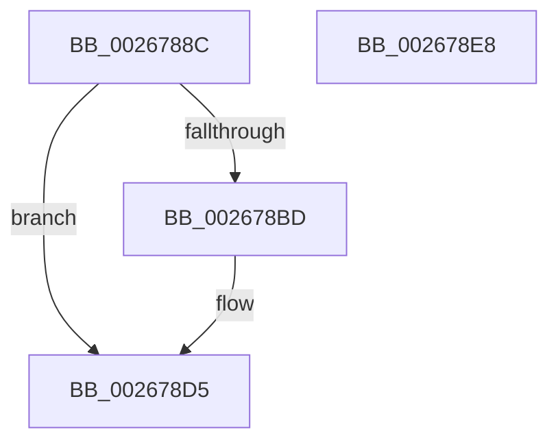

# B_TREE&lt;_SM_PAGE_KEY,SMKM_STORE_MGR&lt;SM_TRAITS&gt;::SMKM_FRONTEND_ENTRY,4096,B_TREE_DUMMY_NODE_POOL,B_TREE_KEY_COMPARATOR&lt;_SM_PAGE_KEY&gt; &gt;::BTreeNewNode

- RVA: `0x0026788C`–`0x002678E9` (길이 `93` bytes)
- VA: `0x000000014026788C`
- 실행 섹션: `.text`
- PDB 이름 있음: `예`; PDB Function 태그: `아니요`
- unwind 정보 RVA: `0x00060BC4`
- 디코드: `26`개 명령, `93/93` bytes 표시
- 미해석 바이트: `0` (있으면 어셈블리에 `.byte`로 보존)

> 이 문서는 커널 이미지의 기계어와 PDB 기호를 분석해 생성했습니다. 4번과 5번은 함수 원형과 자료형을 바이너리 사용 방식에서 추정한 C 해석이며 원본 소스 복구 결과는 아닙니다.

## 1. Dependencies

- 직접 호출 지점: **2**; 고유 호출 대상: **2**
- 직접 호출자로 확인된 함수: **3**
- RIP 상대 이미지 참조: **0**

### Outgoing calls
- `0x002678B0` → [ExAllocatePool2](../../poolcode/B8/ExAllocatePool2_function_00B820F0.md) (function, `0x00B820F0`)
- `0x002678C8` → [memset](../6C/memset_function_006C6C40.md) (function, `0x006C6C40`)

### Direct callers
- [sub_0026675B](Unknown_function_0026675B.md) at `0x00266763`
- [B_TREE&lt;_SM_PAGE_KEY,SMKM_STORE_MGR&lt;SM_TRAITS&gt;::SMKM_FRONTEND_ENTRY,4096,B_TREE_DUMMY_NODE_POOL,B_TREE_KEY_COMPARATOR&lt;_SM_PAGE_KEY&gt; &gt;::BTreeSplitChild](B_TREE__SM_PAGE_KEY_SMKM_STORE_MGR_SM_TRAITS_SMKM_FRONTEND_ENTRY_4096_B_TREE_DUMMY_NODE_POOL_B_TREE__function_002675D4.md) at `0x00267618`
- [sub_006D8F30](../6D/Unknown_function_006D8F30.md) at `0x006D8F3A`

### Static image references
- 디코드된 RIP-relative 메모리 참조가 없습니다.

## 2. Other-region calls and transfers

- 다른 실행 섹션으로 향하는 call: **1**
  - `0x002678B0` → [ExAllocatePool2](../../poolcode/B8/ExAllocatePool2_function_00B820F0.md) (`.text` → `POOLCODE`)
- 별도 외부 분기/꼬리 이동을 확인하지 못했습니다.

## 3. Assembly (complete function range)

```asm
0026788C  48 89 5C 24 08                  mov qword ptr [rsp + 8], rbx
00267891  48 89 74 24 10                  mov qword ptr [rsp + 0x10], rsi
00267896  57                              push rdi
00267897  48 83 EC 20                     sub rsp, 0x20
0026789B  41 8B F8                        mov edi, r8d
0026789E  8B F2                           mov esi, edx
002678A0  BA 00 10 00 00                  mov edx, 0x1000
002678A5  41 B8 73 6D 42 74               mov r8d, 0x74426d73
002678AB  B9 40 00 00 00                  mov ecx, 0x40
002678B0  E8 3B A8 91 00                  call 0x140b820f0
002678B5  48 8B D8                        mov rbx, rax
002678B8  48 85 C0                        test rax, rax
002678BB  74 18                           je 0x1402678d5
002678BD  33 D2                           xor edx, edx
002678BF  41 B8 00 10 00 00               mov r8d, 0x1000
002678C5  48 8B C8                        mov rcx, rax
002678C8  E8 73 F3 45 00                  call 0x1406c6c40
002678CD  40 88 7B 02                     mov byte ptr [rbx + 2], dil
002678D1  40 88 73 03                     mov byte ptr [rbx + 3], sil
002678D5  48 8B 74 24 38                  mov rsi, qword ptr [rsp + 0x38]
002678DA  48 8B C3                        mov rax, rbx
002678DD  48 8B 5C 24 30                  mov rbx, qword ptr [rsp + 0x30]
002678E2  48 83 C4 20                     add rsp, 0x20
002678E6  5F                              pop rdi
002678E7  C3                              ret
002678E8  CC                              int3
```

## 4. C-style interpretation (structured pseudocode)

```c
__int64 __fastcall B_TREE__SM_PAGE_KEY_SMKM_STORE_MGR_SM_TRAITS___SMKM_FRONTEND_ENTRY_4096_B_TREE_DUMMY_NODE_POOL_B_TRE(__int64 a1, int a2, int a3)
{
    __int64 result;
    __int64 v_rsp;
    unsigned __int64 v_stack_p10;
    unsigned __int64 v_stack_p8;

    v_stack_p8 = v_rbx;
    v_stack_p10 = v_rsi;
    v_rsp = (v_rsp) - (32);
    result = ExAllocatePool2(64, (unsigned int)(0x1000ULL), (unsigned int)(0x74426D73ULL), a4);
    if (result != 0) {
        a2 = 0;
        a3 = 0x1000ULL;
        a1 = result;
        result = memset(a1, a2, a3, a4);
        *(unsigned __int8 *)(result + 2) = (unsigned __int8)((unsigned int)(a3));
        *(unsigned __int8 *)(result + 3) = (unsigned __int8)((unsigned int)(a2));
    }
    v_rsp = (v_rsp) + (32);
    return result;
}
```

## 5. (Beta) C Style

```c
int64_t B_TREE__SM_PAGE_KEY_SMKM_STORE_MGR_SM_TRAITS___SMKM_FRONTEND_ENTRY_4096_B_TREE_DUMMY_NODE_POOL_B_TRE(int64_t Arg1, int32_t Arg2, int32_t Arg3)
{
    int64_t result;
    int64_t local_rsp;
    uint64_t v_stack_p10;
    uint64_t v_stack_p8;

    v_stack_p8 = local_rbx;
    v_stack_p10 = local_rsi;
    local_rsp = (local_rsp) - (32);
    result = ExAllocatePool2(64, (uint32_t)(0x1000ULL), (uint32_t)(0x74426D73ULL), a4);
    if (result != 0) {
        Arg2 = 0;
        Arg3 = 0x1000ULL;
        Arg1 = result;
        result = memset(Arg1, Arg2, Arg3, a4);
        *(uint8_t *)(result + 0x2) = (uint8_t)((uint32_t)(Arg3));
        *(uint8_t *)(result + 0x3) = (uint8_t)((uint32_t)(Arg2));
    }
    local_rsp = (local_rsp) + (32);
    return result;
}
```

## 6. Execution-region graph

[열기: 2D/3D 그래프와 함수 탐색 컨트롤 패널](../../../control-panel.html?section=text&rva=0x0026788C&view=graph)

- 2D 그래프는 위에서 아래로 흐르고, 3D 그래프는 빈 공간을 드래그해 회전합니다. Shift+드래그는 이동, 휠은 확대·축소, 함수 노드 선택은 대상 보고서 이동입니다.

### Static fallback


