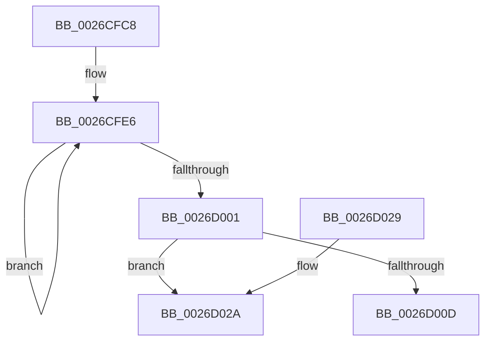

# CcCalculateVacbLevelLockCount

- RVA: `0x0026CFC8`–`0x0026D03D` (길이 `117` bytes)
- VA: `0x000000014026CFC8`
- 실행 섹션: `.text`
- PDB 이름 있음: `예`; PDB Function 태그: `예`
- unwind 정보 RVA: `0x00065624`
- 디코드: `33`개 명령, `117/117` bytes 표시
- 미해석 바이트: `0` (있으면 어셈블리에 `.byte`로 보존)

> 이 문서는 커널 이미지의 기계어와 PDB 기호를 분석해 생성했습니다. 4번과 5번은 함수 원형과 자료형을 바이너리 사용 방식에서 추정한 C 해석이며 원본 소스 복구 결과는 아닙니다.

## 1. Dependencies

- 직접 호출 지점: **1**; 고유 호출 대상: **1**
- 직접 호출자로 확인된 함수: **1**
- RIP 상대 이미지 참조: **0**

### Outgoing calls
- `0x0026D016` → [VacbLevelReference](VacbLevelReference_function_0026DCA0.md) (function, `0x0026DCA0`)

### Direct callers
- [CcExtendVacbArray](CcExtendVacbArray_function_0026DCD0.md) at `0x0026E160`

### Static image references
- 디코드된 RIP-relative 메모리 참조가 없습니다.

## 2. Other-region calls and transfers

- 다른 실행 섹션으로 향하는 call: **0**
- call이 아닌 외부 분기/꼬리 이동: **1**
  - `0x0026D038` → [sub_006D9D1A](../6D/Unknown_function_006D9D1A.md) (`tail-transfer`)

## 3. Assembly (complete function range)

```asm
0026CFC8  48 89 5C 24 08                  mov qword ptr [rsp + 8], rbx
0026CFCD  57                              push rdi
0026CFCE  48 83 EC 20                     sub rsp, 0x20
0026CFD2  45 33 DB                        xor r11d, r11d
0026CFD5  48 8B D9                        mov rbx, rcx
0026CFD8  45 8B CB                        mov r9d, r11d
0026CFDB  48 8B FA                        mov rdi, rdx
0026CFDE  4C 8B D2                        mov r10, rdx
0026CFE1  B9 80 00 00 00                  mov ecx, 0x80
0026CFE6  4D 8B 02                        mov r8, qword ptr [r10]
0026CFE9  41 8D 41 01                     lea eax, [r9 + 1]
0026CFED  4D 85 C0                        test r8, r8
0026CFF0  4D 8D 52 08                     lea r10, [r10 + 8]
0026CFF4  41 0F 44 C1                     cmove eax, r9d
0026CFF8  44 8B C8                        mov r9d, eax
0026CFFB  48 83 E9 01                     sub rcx, 1
0026CFFF  75 E5                           jne 0x14026cfe6
0026D001  F7 83 98 00 00 00 00 02 00 00   test dword ptr [rbx + 0x98], 0x200
0026D00B  75 1D                           jne 0x14026d02a
0026D00D  45 33 C0                        xor r8d, r8d
0026D010  48 8B D7                        mov rdx, rdi
0026D013  48 8B CB                        mov rcx, rbx
0026D016  E8 85 0C 00 00                  call 0x14026dca0
0026D01B  48 8B 5C 24 30                  mov rbx, qword ptr [rsp + 0x30]
0026D020  44 89 08                        mov dword ptr [rax], r9d
0026D023  48 83 C4 20                     add rsp, 0x20
0026D027  5F                              pop rdi
0026D028  C3                              ret
0026D029  CC                              int3
0026D02A  49 8B 52 08                     mov rdx, qword ptr [r10 + 8]
0026D02E  41 B8 FD 02 00 00               mov r8d, 0x2fd
0026D034  48 83 EA 10                     sub rdx, 0x10
0026D038  E9 DD CC 46 00                  jmp 0x1406d9d1a
```

## 4. C-style interpretation (structured pseudocode)

```c
__int64 __fastcall CcCalculateVacbLevelLockCount(__int64 a1, __int64 a2)
{
    __int64 result;
    __int64 v_r11;
    __int64 v_rsp;
    unsigned __int64 v_stack_p8;

    v_stack_p8 = v_rbx;
    v_rsp = (v_rsp) - (32);
    v_r11 = 0;
loc_0026CFE6:
    result = 0 + 1;
    if (*(unsigned __int64 *)(a2) == 0) { result = 0; }
    a1 = (128) - (1);
    if (condition_is_not_equal) goto loc_0026CFE6;
    if (((*(unsigned int *)(a1 + 152)) & (512)) != 0) goto loc_0026D02A;
    a3 = 0;
    result = VacbLevelReference(a1, a2, a3, (unsigned int)((unsigned int)(result)));
    *(unsigned int *)(result) = (unsigned int)((unsigned int)((unsigned int)(result)));
    v_rsp = (v_rsp) + (32);
    return result;
loc_0026D02A:
    a2 = (*(unsigned __int64 *)(a2 + 8 + 8)) - (16);
}
```

## 5. (Beta) C Style

```c
int64_t CcCalculateVacbLevelLockCount(void *Arg1, void *Arg2)
{
    uint8_t *arg1 = (uint8_t *)Arg1;
    uint8_t *arg2 = (uint8_t *)Arg2;

    int64_t result;
    int64_t local_r11;
    int64_t local_rsp;
    uint64_t v_stack_p8;

    v_stack_p8 = local_rbx;
    local_rsp = (local_rsp) - (32);
    local_r11 = 0;
loc_0026CFE6:
    result = 0 + 1;
    if (*(uint64_t *)(arg2) == 0) { result = 0; }
    Arg1 = (128) - (1);
    if (condition_is_not_equal) goto loc_0026CFE6;
    if (((*(uint32_t *)(arg1 + 0x98)) & (512)) != 0) goto loc_0026D02A;
    a3 = 0;
    result = VacbLevelReference(Arg1, Arg2, a3, (uint32_t)((uint32_t)(result)));
    *(uint32_t *)(result) = (uint32_t)((uint32_t)((uint32_t)(result)));
    local_rsp = (local_rsp) + (32);
    return result;
loc_0026D02A:
    Arg2 = (*(uint64_t *)(arg2 + 0x8 + 0x8)) - (16);
}
```

### 관측된 메모리 오프셋

구조체 형식이 확인되지 않은 접근은 인자 기준의 오프셋으로만 기록했습니다.

| 기준 인자 | 오프셋 표현 | 폭 (bit) | 접근 |
|---|---:|---:|---|
| `Arg1` | `+ 0x98` | `32` | `R` |
| `Arg2` | `+ 0x0` | `64` | `R` |
| `Arg2` | `+ 0x8` | `64` | `R` |

## 6. Execution-region graph

[열기: 2D/3D 그래프와 함수 탐색 컨트롤 패널](../../../control-panel.html?section=text&rva=0x0026CFC8&view=graph)

- 2D 그래프는 위에서 아래로 흐르고, 3D 그래프는 빈 공간을 드래그해 회전합니다. Shift+드래그는 이동, 휠은 확대·축소, 함수 노드 선택은 대상 보고서 이동입니다.

### Static fallback


