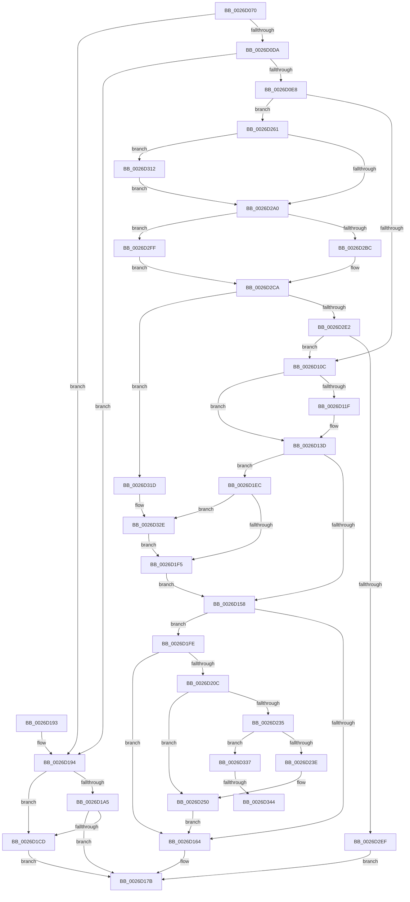

# CcSetFileSizesEx

- RVA: `0x0026D070`–`0x0026D352` (길이 `738` bytes)
- VA: `0x000000014026D070`
- 실행 섹션: `.text`
- PDB 이름 있음: `예`; PDB Function 태그: `예`
- unwind 정보 RVA: `0x00065644`
- 디코드: `196`개 명령, `738/738` bytes 표시
- 미해석 바이트: `0` (있으면 어셈블리에 `.byte`로 보존)

> 이 문서는 커널 이미지의 기계어와 PDB 기호를 분석해 생성했습니다. 4번과 5번은 함수 원형과 자료형을 바이너리 사용 방식에서 추정한 C 해석이며 원본 소스 복구 결과는 아닙니다.

## 1. Dependencies

- 직접 호출 지점: **25**; 고유 호출 대상: **12**
- 직접 호출자로 확인된 함수: **1**
- RIP 상대 이미지 참조: **1**

### Outgoing calls
- `0x0026D0C5` → [KeAcquireInStackQueuedSpinLock](../27/KeAcquireInStackQueuedSpinLock_function_002757A0.md) (function, `0x002757A0`)
- `0x0026D0FD` → [KeAcquireInStackQueuedSpinLock](../27/KeAcquireInStackQueuedSpinLock_function_002757A0.md) (function, `0x002757A0`)
- `0x0026D123` → [KeReleaseInStackQueuedSpinLock](../34/KeReleaseInStackQueuedSpinLock_function_00342CE0.md) (function, `0x00342CE0`)
- `0x0026D12C` → [KeReleaseInStackQueuedSpinLock](../34/KeReleaseInStackQueuedSpinLock_function_00342CE0.md) (function, `0x00342CE0`)
- `0x0026D138` → [KeAcquireInStackQueuedSpinLock](../27/KeAcquireInStackQueuedSpinLock_function_002757A0.md) (function, `0x002757A0`)
- `0x0026D16B` → [CcDecrementOpenCount](../38/CcDecrementOpenCount_function_0038B75C.md) (function, `0x0038B75C`)
- `0x0026D174` → [KeReleaseInStackQueuedSpinLock](../34/KeReleaseInStackQueuedSpinLock_function_00342CE0.md) (function, `0x00342CE0`)
- `0x0026D198` → [KeReleaseInStackQueuedSpinLock](../34/KeReleaseInStackQueuedSpinLock_function_00342CE0.md) (function, `0x00342CE0`)
- `0x0026D1C1` → [MmFlushSection](../23/MmFlushSection_function_002375E4.md) (function, `0x002375E4`)
- `0x0026D1DA` → [CcPurgeCacheSection](../38/CcPurgeCacheSection_function_0038B130.md) (function, `0x0038B130`)
- `0x0026D210` → [KeReleaseInStackQueuedSpinLock](../34/KeReleaseInStackQueuedSpinLock_function_00342CE0.md) (function, `0x00342CE0`)
- `0x0026D22C` → [CcUnmapVacbArray](../38/CcUnmapVacbArray_function_0038AEAC.md) (function, `0x0038AEAC`)
- `0x0026D245` → [CcPurgeAndClearCacheSection](../38/CcPurgeAndClearCacheSection_function_0038A614.md) (function, `0x0038A614`)
- `0x0026D257` → [KeAcquireInStackQueuedSpinLock](../27/KeAcquireInStackQueuedSpinLock_function_002757A0.md) (function, `0x002757A0`)
- `0x0026D273` → [KeReleaseInStackQueuedSpinLock](../34/KeReleaseInStackQueuedSpinLock_function_00342CE0.md) (function, `0x00342CE0`)
- `0x0026D27C` → [KeReleaseInStackQueuedSpinLock](../34/KeReleaseInStackQueuedSpinLock_function_00342CE0.md) (function, `0x00342CE0`)
- `0x0026D2B1` → [MmExtendSection](../../page/98/MmExtendSection_function_00982C38.md) (function, `0x00982C38`)
- `0x0026D2C3` → [CcExtendVacbArray](CcExtendVacbArray_function_0026DCD0.md) (function, `0x0026DCD0`)
- `0x0026D2D1` → [KeAcquireInStackQueuedSpinLock](../27/KeAcquireInStackQueuedSpinLock_function_002757A0.md) (function, `0x002757A0`)
- `0x0026D2D9` → [CcDecrementOpenCount](../38/CcDecrementOpenCount_function_0038B75C.md) (function, `0x0038B75C`)
- `0x0026D2F3` → [KeReleaseInStackQueuedSpinLock](../34/KeReleaseInStackQueuedSpinLock_function_00342CE0.md) (function, `0x00342CE0`)
- `0x0026D301` → [FsRtlIsNtstatusExpected](FsRtlIsNtstatusExpected_function_0026D390.md) (function, `0x0026D390`)
- `0x0026D321` → [KeReleaseInStackQueuedSpinLock](../34/KeReleaseInStackQueuedSpinLock_function_00342CE0.md) (function, `0x00342CE0`)
- `0x0026D328` → [RtlRaiseStatus](../2F/RtlRaiseStatus_function_002F6A50.md) (function, `0x002F6A50`)
- `0x0026D347` → [CcDeleteMbcb](../38/CcDeleteMbcb_function_0038C088.md) (function, `0x0038C088`)

### Direct callers
- [CcSetFileSizes](CcSetFileSizes_function_0026D050.md) at `0x0026D054`

### Static image references
- `0x0026D09E` → RVA `0x00E11CC0` (`.data`; read)

## 2. Other-region calls and transfers

- 다른 실행 섹션으로 향하는 call: **1**
  - `0x0026D2B1` → [MmExtendSection](../../page/98/MmExtendSection_function_00982C38.md) (`.text` → `PAGE`)
- call이 아닌 외부 분기/꼬리 이동: **2**
  - `0x0026D33E` → [sub_006D9D44](../6D/Unknown_function_006D9D44.md) (`tail-transfer`)
  - `0x0026D34D` → [sub_006D9D44](../6D/Unknown_function_006D9D44.md) (`tail-transfer`)

## 3. Assembly (complete function range)

```asm
0026D070  48 89 5C 24 18                  mov qword ptr [rsp + 0x18], rbx
0026D075  55                              push rbp
0026D076  56                              push rsi
0026D077  57                              push rdi
0026D078  41 54                           push r12
0026D07A  41 55                           push r13
0026D07C  41 56                           push r14
0026D07E  41 57                           push r15
0026D080  48 8B EC                        mov rbp, rsp
0026D083  48 83 EC 70                     sub rsp, 0x70
0026D087  4C 8B 22                        mov r12, qword ptr [rdx]
0026D08A  0F 57 C0                        xorps xmm0, xmm0
0026D08D  48 8B 5A 08                     mov rbx, qword ptr [rdx + 8]
0026D091  33 C0                           xor eax, eax
0026D093  4C 8B 79 28                     mov r15, qword ptr [rcx + 0x28]
0026D097  0F 57 C9                        xorps xmm1, xmm1
0026D09A  48 8B 7A 10                     mov rdi, qword ptr [rdx + 0x10]
0026D09E  48 8D 0D 1B 4C BA 00            lea rcx, [rip + 0xba4c1b]
0026D0A5  48 8D 55 E8                     lea rdx, [rbp - 0x18]
0026D0A9  48 89 45 F8                     mov qword ptr [rbp - 8], rax
0026D0AD  0F 11 45 C0                     movups xmmword ptr [rbp - 0x40], xmm0
0026D0B1  48 89 45 E0                     mov qword ptr [rbp - 0x20], rax
0026D0B5  0F 11 4D E8                     movups xmmword ptr [rbp - 0x18], xmm1
0026D0B9  4C 89 65 40                     mov qword ptr [rbp + 0x40], r12
0026D0BD  0F 11 45 D0                     movups xmmword ptr [rbp - 0x30], xmm0
0026D0C1  48 89 5D 48                     mov qword ptr [rbp + 0x48], rbx
0026D0C5  E8 D6 86 00 00                  call 0x1402757a0
0026D0CA  49 8B 77 08                     mov rsi, qword ptr [r15 + 8]
0026D0CE  41 B5 01                        mov r13b, 1
0026D0D1  48 85 F6                        test rsi, rsi
0026D0D4  0F 84 BA 00 00 00               je 0x14026d194
0026D0DA  48 83 BE B0 00 00 00 00         cmp qword ptr [rsi + 0xb0], 0
0026D0E2  0F 84 AC 00 00 00               je 0x14026d194
0026D0E8  4C 8B B6 18 02 00 00            mov r14, qword ptr [rsi + 0x218]
0026D0EF  48 8D 55 D0                     lea rdx, [rbp - 0x30]
0026D0F3  49 81 C6 00 03 00 00            add r14, 0x300
0026D0FA  49 8B CE                        mov rcx, r14
0026D0FD  E8 9E 86 00 00                  call 0x1402757a0
0026D102  4C 3B 66 20                     cmp r12, qword ptr [rsi + 0x20]
0026D106  0F 8F 55 01 00 00               jg 0x14026d261
0026D10C  8B 46 04                        mov eax, dword ptr [rsi + 4]
0026D10F  FF C0                           inc eax
0026D111  89 46 04                        mov dword ptr [rsi + 4], eax
0026D114  FF 86 20 02 00 00               inc dword ptr [rsi + 0x220]
0026D11A  45 84 ED                        test r13b, r13b
0026D11D  74 1E                           je 0x14026d13d
0026D11F  48 8D 4D D0                     lea rcx, [rbp - 0x30]
0026D123  E8 B8 5B 0D 00                  call 0x140342ce0
0026D128  48 8D 4D E8                     lea rcx, [rbp - 0x18]
0026D12C  E8 AF 5B 0D 00                  call 0x140342ce0
0026D131  48 8D 55 D0                     lea rdx, [rbp - 0x30]
0026D135  49 8B CE                        mov rcx, r14
0026D138  E8 63 86 00 00                  call 0x1402757a0
0026D13D  48 8B 46 28                     mov rax, qword ptr [rsi + 0x28]
0026D141  48 B9 FF FF FF FF FF FF FF 7F   movabs rcx, 0x7fffffffffffffff
0026D14B  48 8B 5D 48                     mov rbx, qword ptr [rbp + 0x48]
0026D14F  48 3B C1                        cmp rax, rcx
0026D152  0F 85 94 00 00 00               jne 0x14026d1ec
0026D158  33 FF                           xor edi, edi
0026D15A  48 3B 5E 08                     cmp rbx, qword ptr [rsi + 8]
0026D15E  0F 8C 9A 00 00 00               jl 0x14026d1fe
0026D164  48 8B CE                        mov rcx, rsi
0026D167  48 89 5E 08                     mov qword ptr [rsi + 8], rbx
0026D16B  E8 EC E5 11 00                  call 0x14038b75c
0026D170  48 8D 4D D0                     lea rcx, [rbp - 0x30]
0026D174  E8 67 5B 0D 00                  call 0x140342ce0
0026D179  8B C7                           mov eax, edi
0026D17B  48 8B 9C 24 C0 00 00 00         mov rbx, qword ptr [rsp + 0xc0]
0026D183  48 83 C4 70                     add rsp, 0x70
0026D187  41 5F                           pop r15
0026D189  41 5E                           pop r14
0026D18B  41 5D                           pop r13
0026D18D  41 5C                           pop r12
0026D18F  5F                              pop rdi
0026D190  5E                              pop rsi
0026D191  5D                              pop rbp
0026D192  C3                              ret
0026D193  CC                              int3
0026D194  48 8D 4D E8                     lea rcx, [rbp - 0x18]
0026D198  E8 43 5B 0D 00                  call 0x140342ce0
0026D19D  F7 C3 FF 0F 00 00               test ebx, 0xfff
0026D1A3  74 28                           je 0x14026d1cd
0026D1A5  83 64 24 28 00                  and dword ptr [rsp + 0x28], 0
0026D1AA  48 8D 45 C0                     lea rax, [rbp - 0x40]
0026D1AE  45 33 C9                        xor r9d, r9d
0026D1B1  48 89 44 24 20                  mov qword ptr [rsp + 0x20], rax
0026D1B6  48 8D 55 48                     lea rdx, [rbp + 0x48]
0026D1BA  49 8B CF                        mov rcx, r15
0026D1BD  45 8D 41 01                     lea r8d, [r9 + 1]
0026D1C1  E8 1E A4 FC FF                  call 0x1402375e4
0026D1C6  8B 45 C0                        mov eax, dword ptr [rbp - 0x40]
0026D1C9  85 C0                           test eax, eax
0026D1CB  78 AE                           js 0x14026d17b
0026D1CD  45 33 C9                        xor r9d, r9d
0026D1D0  48 8D 55 48                     lea rdx, [rbp + 0x48]
0026D1D4  45 33 C0                        xor r8d, r8d
0026D1D7  49 8B CF                        mov rcx, r15
0026D1DA  E8 51 DF 11 00                  call 0x14038b130
0026D1DF  F6 D8                           neg al
0026D1E1  1B C0                           sbb eax, eax
0026D1E3  F7 D0                           not eax
0026D1E5  25 35 04 00 C0                  and eax, 0xc0000435
0026D1EA  EB 8F                           jmp 0x14026d17b
0026D1EC  48 3B D8                        cmp rbx, rax
0026D1EF  0F 8C 39 01 00 00               jl 0x14026d32e
0026D1F5  48 89 7E 30                     mov qword ptr [rsi + 0x30], rdi
0026D1F9  E9 5A FF FF FF                  jmp 0x14026d158
0026D1FE  8B 86 98 00 00 00               mov eax, dword ptr [rsi + 0x98]
0026D204  A8 04                           test al, 4
0026D206  0F 85 58 FF FF FF               jne 0x14026d164
0026D20C  48 8D 4D D0                     lea rcx, [rbp - 0x30]
0026D210  E8 CB 5A 0D 00                  call 0x140342ce0
0026D215  45 33 C9                        xor r9d, r9d
0026D218  40 88 7C 24 28                  mov byte ptr [rsp + 0x28], dil
0026D21D  45 33 C0                        xor r8d, r8d
0026D220  40 88 7C 24 20                  mov byte ptr [rsp + 0x20], dil
0026D225  48 8D 55 48                     lea rdx, [rbp + 0x48]
0026D229  48 8B CE                        mov rcx, rsi
0026D22C  E8 7B DC 11 00                  call 0x14038aeac
0026D231  84 C0                           test al, al
0026D233  74 1B                           je 0x14026d250
0026D235  48 85 DB                        test rbx, rbx
0026D238  0F 84 F9 00 00 00               je 0x14026d337
0026D23E  48 8D 55 48                     lea rdx, [rbp + 0x48]
0026D242  48 8B CE                        mov rcx, rsi
0026D245  E8 CA D3 11 00                  call 0x14038a614
0026D24A  48 8B 5D 48                     mov rbx, qword ptr [rbp + 0x48]
0026D24E  8B F8                           mov edi, eax
0026D250  48 8D 55 D0                     lea rdx, [rbp - 0x30]
0026D254  49 8B CE                        mov rcx, r14
0026D257  E8 44 85 00 00                  call 0x1402757a0
0026D25C  E9 03 FF FF FF                  jmp 0x14026d164
0026D261  8B 46 04                        mov eax, dword ptr [rsi + 4]
0026D264  48 8D 4D D0                     lea rcx, [rbp - 0x30]
0026D268  FF C0                           inc eax
0026D26A  89 46 04                        mov dword ptr [rsi + 4], eax
0026D26D  FF 86 20 02 00 00               inc dword ptr [rsi + 0x220]
0026D273  E8 68 5A 0D 00                  call 0x140342ce0
0026D278  48 8D 4D E8                     lea rcx, [rbp - 0x18]
0026D27C  E8 5F 5A 0D 00                  call 0x140342ce0
0026D281  8B 96 60 02 00 00               mov edx, dword ptr [rsi + 0x260]
0026D287  45 32 ED                        xor r13b, r13b
0026D28A  8D 4A FF                        lea ecx, [rdx - 1]
0026D28D  8B C1                           mov eax, ecx
0026D28F  F7 D1                           not ecx
0026D291  48 01 45 40                     add qword ptr [rbp + 0x40], rax
0026D295  21 4D 40                        and dword ptr [rbp + 0x40], ecx
0026D298  81 FA 00 00 40 00               cmp edx, 0x400000
0026D29E  72 72                           jb 0x14026d312
0026D2A0  48 8B 8E B0 00 00 00            mov rcx, qword ptr [rsi + 0xb0]
0026D2A7  48 8D 55 40                     lea rdx, [rbp + 0x40]
0026D2AB  41 B8 01 00 00 00               mov r8d, 1
0026D2B1  E8 82 59 71 00                  call 0x140982c38
0026D2B6  8B D8                           mov ebx, eax
0026D2B8  85 C0                           test eax, eax
0026D2BA  78 43                           js 0x14026d2ff
0026D2BC  48 8B 55 40                     mov rdx, qword ptr [rbp + 0x40]
0026D2C0  48 8B CE                        mov rcx, rsi
0026D2C3  E8 08 0A 00 00                  call 0x14026dcd0
0026D2C8  8B D8                           mov ebx, eax
0026D2CA  48 8D 55 D0                     lea rdx, [rbp - 0x30]
0026D2CE  49 8B CE                        mov rcx, r14
0026D2D1  E8 CA 84 00 00                  call 0x1402757a0
0026D2D6  48 8B CE                        mov rcx, rsi
0026D2D9  E8 7E E4 11 00                  call 0x14038b75c
0026D2DE  85 DB                           test ebx, ebx
0026D2E0  78 3B                           js 0x14026d31d
0026D2E2  49 8B 77 08                     mov rsi, qword ptr [r15 + 8]
0026D2E6  48 85 F6                        test rsi, rsi
0026D2E9  0F 85 1D FE FF FF               jne 0x14026d10c
0026D2EF  48 8D 4D D0                     lea rcx, [rbp - 0x30]
0026D2F3  E8 E8 59 0D 00                  call 0x140342ce0
0026D2F8  33 C0                           xor eax, eax
0026D2FA  E9 7C FE FF FF                  jmp 0x14026d17b
0026D2FF  8B CB                           mov ecx, ebx
0026D301  E8 8A 00 00 00                  call 0x14026d390
0026D306  84 C0                           test al, al
0026D308  B9 EC 00 00 C0                  mov ecx, 0xc00000ec
0026D30D  0F 44 D9                        cmove ebx, ecx
0026D310  EB B8                           jmp 0x14026d2ca
0026D312  8D 04 12                        lea eax, [rdx + rdx]
0026D315  89 86 60 02 00 00               mov dword ptr [rsi + 0x260], eax
0026D31B  EB 83                           jmp 0x14026d2a0
0026D31D  48 8D 4D D0                     lea rcx, [rbp - 0x30]
0026D321  E8 BA 59 0D 00                  call 0x140342ce0
0026D326  8B CB                           mov ecx, ebx
0026D328  E8 23 97 08 00                  call 0x1402f6a50
0026D32D  CC                              int3
0026D32E  48 89 5E 28                     mov qword ptr [rsi + 0x28], rbx
0026D332  E9 BE FE FF FF                  jmp 0x14026d1f5
0026D337  48 39 BE A8 00 00 00            cmp qword ptr [rsi + 0xa8], rdi
0026D33E  0F 84 00 CA 46 00               je 0x1406d9d44
0026D344  48 8B CE                        mov rcx, rsi
0026D347  E8 3C ED 11 00                  call 0x14038c088
0026D34C  90                              nop
0026D34D  E9 F2 C9 46 00                  jmp 0x1406d9d44
```

## 4. C-style interpretation (structured pseudocode)

```c
__int64 __fastcall CcSetFileSizesEx(__int64 a1, __int64 a2, __int64 a3, int a4)
{
    __int64 result;
    __int64 v_r13;
    __int64 v_r14;
    __int64 v_rbx;
    __int64 v_rdi;
    __int64 v_rsp;
    unsigned __int64 v_stack_m40;
    unsigned __int64 v_stack_m50;
    unsigned __int64 v_stack_m58;
    unsigned __int64 v_stack_m68;
    unsigned __int64 v_stack_m78;
    unsigned __int64 v_stack_p10;
    unsigned __int64 v_stack_p18;
    unsigned __int64 v_stack_p20;
    unsigned int v_stack_p28;
    unsigned __int64 v_stack_p8;

    v_stack_p18 = v_rbx;
    v_rsp = (v_rsp) - (112);
    result = 0;
    v_stack_m40 = 0;
    v_stack_m78 = v_xmm0;
    v_stack_m58 = 0;
    v_stack_m50 = v_xmm1;
    v_stack_p8 = *(unsigned __int64 *)(a2);
    v_stack_m68 = v_xmm0;
    v_stack_p10 = *(unsigned __int64 *)(a2 + 8);
    result = KeAcquireInStackQueuedSpinLock(v_rip + 12209179, v_stack_m50, a3, a4);
    if (*(unsigned __int64 *)(*(unsigned __int64 *)(a1 + 40) + 8) == 0) goto loc_0026D194;
    if ((*(unsigned __int64 *)(*(unsigned __int64 *)(*(unsigned __int64 *)(a1 + 40) + 8) + 176)) == 0) goto loc_0026D194;
    v_r14 = (*(unsigned __int64 *)(*(unsigned __int64 *)(*(unsigned __int64 *)(a1 + 40) + 8) + 536)) + (768);
    result = KeAcquireInStackQueuedSpinLock(v_r14, v_stack_m68, a3, a4);
    if ((*(unsigned __int64 *)(a2)) > (*(unsigned __int64 *)(*(unsigned __int64 *)(*(unsigned __int64 *)(a1 + 40) + 8) + 32))) goto loc_0026D261;
loc_0026D10C:
    result = (unsigned int)(((unsigned int)(*(unsigned int *)(*(unsigned __int64 *)(*(unsigned __int64 *)(a1 + 40) + 8) + 4))) + 1);
    *(unsigned int *)(*(unsigned __int64 *)(*(unsigned __int64 *)(a1 + 40) + 8) + 4) = (unsigned int)(result);
    if (1 != 0) {
        a1 = v_stack_m68;
        result = KeReleaseInStackQueuedSpinLock(a1, v_stack_m68, a3, a4);
        a1 = v_stack_m50;
        result = KeReleaseInStackQueuedSpinLock(a1, v_stack_m68, a3, a4);
        a2 = v_stack_m68;
        a1 = v_r14;
        result = KeAcquireInStackQueuedSpinLock(a1, a2, a3, a4);
    }
    if ((*(unsigned __int64 *)(*(unsigned __int64 *)(*(unsigned __int64 *)(a1 + 40) + 8) + 40)) != a1) goto loc_0026D1EC;
loc_0026D158:
    v_rdi = 0;
    if (v_stack_p10 < (*(unsigned __int64 *)(*(unsigned __int64 *)(*(unsigned __int64 *)(a1 + 40) + 8) + 8))) goto loc_0026D1FE;
loc_0026D164:
    *(unsigned __int64 *)(*(unsigned __int64 *)(*(unsigned __int64 *)(a1 + 40) + 8) + 8) = v_stack_p10;
    result = CcDecrementOpenCount(*(unsigned __int64 *)(*(unsigned __int64 *)(a1 + 40) + 8), a2, a3, a4);
    result = KeReleaseInStackQueuedSpinLock(v_stack_m68, a2, a3, a4);
loc_0026D17B:
    v_rsp = (v_rsp) + (112);
    return 0;
loc_0026D194:
    result = KeReleaseInStackQueuedSpinLock(v_stack_m50, a2, a3, a4);
    if ((((unsigned int)(v_stack_p18)) & (0xFFFULL)) == 0) goto loc_0026D1CD;
    a4 = 0;
    v_stack_p20 = v_stack_m78;
    result = MmFlushSection(*(unsigned __int64 *)(a1 + 40), v_stack_p10, a4 + 1, a4);
    if (sign_flag) goto loc_0026D17B;
loc_0026D1CD:
    a4 = 0;
    a3 = 0;
    result = CcPurgeCacheSection(*(unsigned __int64 *)(a1 + 40), v_stack_p10, a3, a4);
    result = (unsigned __int8)(-(result));
    result = (unsigned int)(~(result));
    result = (unsigned int)((result) & (0xC0000435ULL));
    goto loc_0026D17B;
loc_0026D1EC:
    if (v_stack_p18 < result) goto loc_0026D32E;
loc_0026D1F5:
    *(unsigned __int64 *)(*(unsigned __int64 *)(*(unsigned __int64 *)(a1 + 40) + 8) + 48) = 0;
    goto loc_0026D158;
loc_0026D1FE:
    if ((((unsigned __int8)((unsigned int)(*(unsigned int *)(*(unsigned __int64 *)(*(unsigned __int64 *)(a1 + 40) + 8) + 152)))) & (4)) != 0) goto loc_0026D164;
    result = KeReleaseInStackQueuedSpinLock(v_stack_m68, v_stack_p10, a3, a4);
    a4 = 0;
    v_stack_p28 = 0;
    a3 = 0;
    v_stack_p20 = 0;
    result = CcUnmapVacbArray(*(unsigned __int64 *)(*(unsigned __int64 *)(a1 + 40) + 8), v_stack_p10, a3, a4);
    if ((unsigned __int8)(result) == 0) goto loc_0026D250;
    if (v_stack_p18 == 0) goto loc_0026D337;
    result = CcPurgeAndClearCacheSection(*(unsigned __int64 *)(*(unsigned __int64 *)(a1 + 40) + 8), v_stack_p10, a3, a4);
loc_0026D250:
    result = KeAcquireInStackQueuedSpinLock(v_r14, v_stack_m68, a3, a4);
    goto loc_0026D164;
loc_0026D261:
    result = (unsigned int)(((unsigned int)(*(unsigned int *)(*(unsigned __int64 *)(*(unsigned __int64 *)(a1 + 40) + 8) + 4))) + 1);
    *(unsigned int *)(*(unsigned __int64 *)(*(unsigned __int64 *)(a1 + 40) + 8) + 4) = (unsigned int)(result);
    result = KeReleaseInStackQueuedSpinLock(v_stack_m68, v_stack_m68, a3, a4);
    result = KeReleaseInStackQueuedSpinLock(v_stack_m50, v_stack_m68, a3, a4);
    v_r13 = 0;
    a1 = (unsigned int)(~((unsigned int)(*(unsigned int *)(*(unsigned __int64 *)(*(unsigned __int64 *)(a1 + 40) + 8) + 608)) - 1));
    if (((unsigned int)((unsigned int)(*(unsigned int *)(*(unsigned __int64 *)(*(unsigned __int64 *)(a1 + 40) + 8) + 608)))) < 0x400000ULL) goto loc_0026D312;
loc_0026D2A0:
    result = MmExtendSection(*(unsigned __int64 *)(*(unsigned __int64 *)(*(unsigned __int64 *)(a1 + 40) + 8) + 176), v_stack_p8, 1, a4);
    if (sign_flag) goto loc_0026D2FF;
    result = CcExtendVacbArray(*(unsigned __int64 *)(*(unsigned __int64 *)(a1 + 40) + 8), v_stack_p8, 1, a4);
loc_0026D2CA:
    result = KeAcquireInStackQueuedSpinLock(v_r14, v_stack_m68, 1, a4);
    result = CcDecrementOpenCount(*(unsigned __int64 *)(*(unsigned __int64 *)(a1 + 40) + 8), v_stack_m68, 1, a4);
    if (sign_flag) goto loc_0026D31D;
    if (*(unsigned __int64 *)(*(unsigned __int64 *)(a1 + 40) + 8) != 0) goto loc_0026D10C;
    result = KeReleaseInStackQueuedSpinLock(v_stack_m68, v_stack_m68, 1, a4);
    result = 0;
    goto loc_0026D17B;
loc_0026D2FF:
    result = FsRtlIsNtstatusExpected((unsigned int)((unsigned int)((unsigned int)((unsigned int)(result)))), v_stack_m68, 1, a4);
    v_rbx = (unsigned int)((unsigned int)(result));
    if ((unsigned __int8)(result) == 0) { v_rbx = (unsigned int)((unsigned int)(0xC00000ECULL)); }
    goto loc_0026D2CA;
loc_0026D312:
    *(unsigned int *)(*(unsigned __int64 *)(*(unsigned __int64 *)(a1 + 40) + 8) + 608) = (unsigned int)(v_stack_m68 + v_stack_m68 * 1);
    goto loc_0026D2A0;
loc_0026D31D:
    result = KeReleaseInStackQueuedSpinLock(v_stack_m68, v_stack_m68, 1, a4);
    result = RtlRaiseStatus((unsigned int)((unsigned int)(v_rbx)), v_stack_m68, 1, a4);
loc_0026D32E:
    *(unsigned __int64 *)(*(unsigned __int64 *)(*(unsigned __int64 *)(a1 + 40) + 8) + 40) = v_rbx;
    goto loc_0026D1F5;
loc_0026D337:
    result = CcDeleteMbcb(*(unsigned __int64 *)(*(unsigned __int64 *)(a1 + 40) + 8), v_stack_m68, 1, a4);
}
```

## 5. (Beta) C Style

```c
int64_t CcSetFileSizesEx(void *Arg1, void *Arg2, int64_t Arg3, int32_t Arg4)
{
    uint8_t *arg1 = (uint8_t *)Arg1;
    uint8_t *arg2 = (uint8_t *)Arg2;

    int64_t result;
    int64_t local_r13;
    int64_t local_r14;
    int64_t local_rbx;
    int64_t local_rdi;
    int64_t local_rsp;
    uint64_t v_stack_m40;
    uint64_t v_stack_m50;
    uint64_t v_stack_m58;
    uint64_t v_stack_m68;
    uint64_t v_stack_m78;
    uint64_t v_stack_p10;
    uint64_t v_stack_p18;
    uint64_t v_stack_p20;
    uint32_t v_stack_p28;
    uint64_t v_stack_p8;

    v_stack_p18 = local_rbx;
    local_rsp = (local_rsp) - (112);
    result = 0;
    v_stack_m40 = 0;
    v_stack_m78 = v_xmm0;
    v_stack_m58 = 0;
    v_stack_m50 = v_xmm1;
    v_stack_p8 = *(uint64_t *)(arg2);
    v_stack_m68 = v_xmm0;
    v_stack_p10 = *(uint64_t *)(arg2 + 0x8);
    result = KeAcquireInStackQueuedSpinLock(v_rip + 12209179, v_stack_m50, Arg3, Arg4);
    if (*(uint64_t *)(*(uint64_t *)(arg1 + 0x28) + 0x8) == 0) goto loc_0026D194;
    if ((*(uint64_t *)(*(uint64_t *)(*(uint64_t *)(arg1 + 0x28) + 0x8) + 0xB0)) == 0) goto loc_0026D194;
    local_r14 = (*(uint64_t *)(*(uint64_t *)(*(uint64_t *)(arg1 + 0x28) + 0x8) + 0x218)) + (768);
    result = KeAcquireInStackQueuedSpinLock(local_r14, v_stack_m68, Arg3, Arg4);
    if ((*(uint64_t *)(arg2)) > (*(uint64_t *)(*(uint64_t *)(*(uint64_t *)(arg1 + 0x28) + 0x8) + 0x20))) goto loc_0026D261;
loc_0026D10C:
    result = (uint32_t)(((uint32_t)(*(uint32_t *)(*(uint64_t *)(*(uint64_t *)(arg1 + 0x28) + 0x8) + 0x4))) + 1);
    *(uint32_t *)(*(uint64_t *)(*(uint64_t *)(arg1 + 0x28) + 0x8) + 0x4) = (uint32_t)(result);
    if (1 != 0) {
        Arg1 = v_stack_m68;
        result = KeReleaseInStackQueuedSpinLock(Arg1, v_stack_m68, Arg3, Arg4);
        Arg1 = v_stack_m50;
        result = KeReleaseInStackQueuedSpinLock(Arg1, v_stack_m68, Arg3, Arg4);
        Arg2 = v_stack_m68;
        Arg1 = local_r14;
        result = KeAcquireInStackQueuedSpinLock(Arg1, Arg2, Arg3, Arg4);
    }
    if ((*(uint64_t *)(*(uint64_t *)(*(uint64_t *)(arg1 + 0x28) + 0x8) + 0x28)) != Arg1) goto loc_0026D1EC;
loc_0026D158:
    local_rdi = 0;
    if (v_stack_p10 < (*(uint64_t *)(*(uint64_t *)(*(uint64_t *)(arg1 + 0x28) + 0x8) + 0x8))) goto loc_0026D1FE;
loc_0026D164:
    *(uint64_t *)(*(uint64_t *)(*(uint64_t *)(arg1 + 0x28) + 0x8) + 0x8) = v_stack_p10;
    result = CcDecrementOpenCount(*(uint64_t *)(*(uint64_t *)(arg1 + 0x28) + 0x8), Arg2, Arg3, Arg4);
    result = KeReleaseInStackQueuedSpinLock(v_stack_m68, Arg2, Arg3, Arg4);
loc_0026D17B:
    local_rsp = (local_rsp) + (112);
    return 0;
loc_0026D194:
    result = KeReleaseInStackQueuedSpinLock(v_stack_m50, Arg2, Arg3, Arg4);
    if ((((uint32_t)(v_stack_p18)) & (0xFFFULL)) == 0) goto loc_0026D1CD;
    Arg4 = 0;
    v_stack_p20 = v_stack_m78;
    result = MmFlushSection(*(uint64_t *)(arg1 + 0x28), v_stack_p10, Arg4 + 1, Arg4);
    if (sign_flag) goto loc_0026D17B;
loc_0026D1CD:
    Arg4 = 0;
    Arg3 = 0;
    result = CcPurgeCacheSection(*(uint64_t *)(arg1 + 0x28), v_stack_p10, Arg3, Arg4);
    result = (uint8_t)(-(result));
    result = (uint32_t)(~(result));
    result = (uint32_t)((result) & (0xC0000435ULL));
    goto loc_0026D17B;
loc_0026D1EC:
    if (v_stack_p18 < result) goto loc_0026D32E;
loc_0026D1F5:
    *(uint64_t *)(*(uint64_t *)(*(uint64_t *)(arg1 + 0x28) + 0x8) + 0x30) = 0;
    goto loc_0026D158;
loc_0026D1FE:
    if ((((uint8_t)((uint32_t)(*(uint32_t *)(*(uint64_t *)(*(uint64_t *)(arg1 + 0x28) + 0x8) + 0x98)))) & (4)) != 0) goto loc_0026D164;
    result = KeReleaseInStackQueuedSpinLock(v_stack_m68, v_stack_p10, Arg3, Arg4);
    Arg4 = 0;
    v_stack_p28 = 0;
    Arg3 = 0;
    v_stack_p20 = 0;
    result = CcUnmapVacbArray(*(uint64_t *)(*(uint64_t *)(arg1 + 0x28) + 0x8), v_stack_p10, Arg3, Arg4);
    if ((uint8_t)(result) == 0) goto loc_0026D250;
    if (v_stack_p18 == 0) goto loc_0026D337;
    result = CcPurgeAndClearCacheSection(*(uint64_t *)(*(uint64_t *)(arg1 + 0x28) + 0x8), v_stack_p10, Arg3, Arg4);
loc_0026D250:
    result = KeAcquireInStackQueuedSpinLock(local_r14, v_stack_m68, Arg3, Arg4);
    goto loc_0026D164;
loc_0026D261:
    result = (uint32_t)(((uint32_t)(*(uint32_t *)(*(uint64_t *)(*(uint64_t *)(arg1 + 0x28) + 0x8) + 0x4))) + 1);
    *(uint32_t *)(*(uint64_t *)(*(uint64_t *)(arg1 + 0x28) + 0x8) + 0x4) = (uint32_t)(result);
    result = KeReleaseInStackQueuedSpinLock(v_stack_m68, v_stack_m68, Arg3, Arg4);
    result = KeReleaseInStackQueuedSpinLock(v_stack_m50, v_stack_m68, Arg3, Arg4);
    local_r13 = 0;
    Arg1 = (uint32_t)(~((uint32_t)(*(uint32_t *)(*(uint64_t *)(*(uint64_t *)(arg1 + 0x28) + 0x8) + 0x260)) - 1));
    if (((uint32_t)((uint32_t)(*(uint32_t *)(*(uint64_t *)(*(uint64_t *)(arg1 + 0x28) + 0x8) + 0x260)))) < 0x400000ULL) goto loc_0026D312;
loc_0026D2A0:
    result = MmExtendSection(*(uint64_t *)(*(uint64_t *)(*(uint64_t *)(arg1 + 0x28) + 0x8) + 0xB0), v_stack_p8, 1, Arg4);
    if (sign_flag) goto loc_0026D2FF;
    result = CcExtendVacbArray(*(uint64_t *)(*(uint64_t *)(arg1 + 0x28) + 0x8), v_stack_p8, 1, Arg4);
loc_0026D2CA:
    result = KeAcquireInStackQueuedSpinLock(local_r14, v_stack_m68, 1, Arg4);
    result = CcDecrementOpenCount(*(uint64_t *)(*(uint64_t *)(arg1 + 0x28) + 0x8), v_stack_m68, 1, Arg4);
    if (sign_flag) goto loc_0026D31D;
    if (*(uint64_t *)(*(uint64_t *)(arg1 + 0x28) + 0x8) != 0) goto loc_0026D10C;
    result = KeReleaseInStackQueuedSpinLock(v_stack_m68, v_stack_m68, 1, Arg4);
    result = 0;
    goto loc_0026D17B;
loc_0026D2FF:
    result = FsRtlIsNtstatusExpected((uint32_t)((uint32_t)((uint32_t)((uint32_t)(result)))), v_stack_m68, 1, Arg4);
    local_rbx = (uint32_t)((uint32_t)(result));
    if ((uint8_t)(result) == 0) { local_rbx = (uint32_t)((uint32_t)(0xC00000ECULL)); }
    goto loc_0026D2CA;
loc_0026D312:
    *(uint32_t *)(*(uint64_t *)(*(uint64_t *)(arg1 + 0x28) + 0x8) + 0x260) = (uint32_t)(v_stack_m68 + v_stack_m68 * 1);
    goto loc_0026D2A0;
loc_0026D31D:
    result = KeReleaseInStackQueuedSpinLock(v_stack_m68, v_stack_m68, 1, Arg4);
    result = RtlRaiseStatus((uint32_t)((uint32_t)(local_rbx)), v_stack_m68, 1, Arg4);
loc_0026D32E:
    *(uint64_t *)(*(uint64_t *)(*(uint64_t *)(arg1 + 0x28) + 0x8) + 0x28) = local_rbx;
    goto loc_0026D1F5;
loc_0026D337:
    result = CcDeleteMbcb(*(uint64_t *)(*(uint64_t *)(arg1 + 0x28) + 0x8), v_stack_m68, 1, Arg4);
}
```

### 관측된 메모리 오프셋

구조체 형식이 확인되지 않은 접근은 인자 기준의 오프셋으로만 기록했습니다.

| 기준 인자 | 오프셋 표현 | 폭 (bit) | 접근 |
|---|---:|---:|---|
| `Arg1` | `+ 0x28` | `64` | `R` |
| `Arg2` | `+ 0x0` | `64` | `R` |
| `Arg2` | `+ 0x8` | `64` | `R` |
| `Arg2` | `+ 0x10` | `64` | `R` |

## 6. Execution-region graph

[열기: 2D/3D 그래프와 함수 탐색 컨트롤 패널](../../../control-panel.html?section=text&rva=0x0026D070&view=graph)

- 2D 그래프는 위에서 아래로 흐르고, 3D 그래프는 빈 공간을 드래그해 회전합니다. Shift+드래그는 이동, 휠은 확대·축소, 함수 노드 선택은 대상 보고서 이동입니다.

### Static fallback


