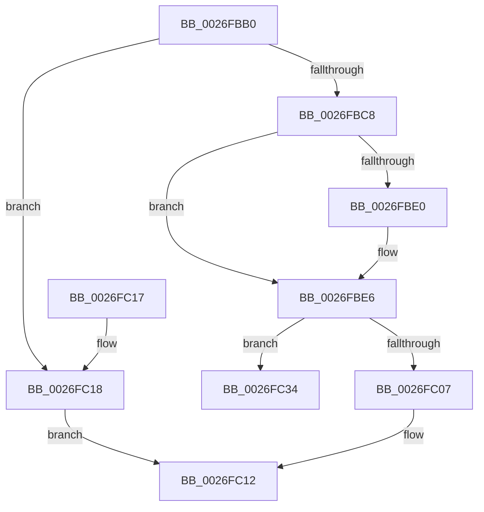

# CcSetVacbInFreeList

- RVA: `0x0026FBB0`–`0x0026FC52` (길이 `162` bytes)
- VA: `0x000000014026FBB0`
- 실행 섹션: `.text`
- PDB 이름 있음: `예`; PDB Function 태그: `아니요`
- unwind 정보 RVA: `0x00065954`
- 디코드: `42`개 명령, `162/162` bytes 표시
- 미해석 바이트: `0` (있으면 어셈블리에 `.byte`로 보존)

> 이 문서는 커널 이미지의 기계어와 PDB 기호를 분석해 생성했습니다. 4번과 5번은 함수 원형과 자료형을 바이너리 사용 방식에서 추정한 C 해석이며 원본 소스 복구 결과는 아닙니다.

## 1. Dependencies

- 직접 호출 지점: **2**; 고유 호출 대상: **2**
- 직접 호출자로 확인된 함수: **5**
- RIP 상대 이미지 참조: **4**

### Outgoing calls
- `0x0026FC22` → [CcSetVacbIntoList](CcSetVacbIntoList_function_0026E524.md) (function, `0x0026E524`)
- `0x0026FC4C` → [KeBugCheckEx](../4F/KeBugCheckEx_function_004FD660.md) (function, `0x004FD660`)

### Direct callers
- [CcUnmapInactiveViewsInternal](../27/CcUnmapInactiveViewsInternal_function_0027174C.md) at `0x00271AB1`
- [CcGetVacbMiss](../27/CcGetVacbMiss_function_00272900.md) at `0x00272CB5`
- [CcUnmapVacbArray](../38/CcUnmapVacbArray_function_0038AEAC.md) at `0x0038B03A`
- [CcInitializePartitionVacbs](../57/CcInitializePartitionVacbs_function_0057EB60.md) at `0x0057EC1B`
- [CcInitializePartitionVacbs](../57/CcInitializePartitionVacbs_function_0057EB60.md) at `0x0057EC3C`
- [CcUninitializePartitionVacbs](../57/CcUninitializePartitionVacbs_function_0057EC70.md) at `0x0057ECD9`

### Static image references
- `0x0026FBB4` → RVA `0x00E65B8C` (`.data`; read/write)
- `0x0026FBC8` → RVA `0x00F8F4C0` (`.data`; read)
- `0x0026FBF1` → RVA `0x00F8F4C0` (`.data`; write)
- `0x0026FC0C` → RVA `0x00F8F4A8` (`.data`; read/write)

## 2. Other-region calls and transfers

- 다른 실행 섹션으로 향하는 call: **0**
- 별도 외부 분기/꼬리 이동을 확인하지 못했습니다.

## 3. Assembly (complete function range)

```asm
0026FBB0  48 83 EC 38                     sub rsp, 0x38
0026FBB4  FF 0D D2 5F BF 00               dec dword ptr [rip + 0xbf5fd2]
0026FBBA  45 33 DB                        xor r11d, r11d
0026FBBD  4C 8B CA                        mov r9, rdx
0026FBC0  4C 8B D1                        mov r10, rcx
0026FBC3  45 84 C0                        test r8b, r8b
0026FBC6  75 50                           jne 0x14026fc18
0026FBC8  48 8B 0D F1 F8 D1 00            mov rcx, qword ptr [rip + 0xd1f8f1]
0026FBCF  48 8D 42 10                     lea rax, [rdx + 0x10]
0026FBD3  48 8D 15 E6 F8 D1 00            lea rdx, [rip + 0xd1f8e6]
0026FBDA  48 39 51 08                     cmp qword ptr [rcx + 8], rdx
0026FBDE  74 06                           je 0x14026fbe6
0026FBE0  41 8D 4B 03                     lea ecx, [r11 + 3]
0026FBE4  CD 29                           int 0x29
0026FBE6  48 89 08                        mov qword ptr [rax], rcx
0026FBE9  48 89 50 08                     mov qword ptr [rax + 8], rdx
0026FBED  48 89 41 08                     mov qword ptr [rcx + 8], rax
0026FBF1  48 89 05 C8 F8 D1 00            mov qword ptr [rip + 0xd1f8c8], rax
0026FBF8  49 8B 49 20                     mov rcx, qword ptr [r9 + 0x20]
0026FBFC  4D 89 59 08                     mov qword ptr [r9 + 8], r11
0026FC00  8B 41 04                        mov eax, dword ptr [rcx + 4]
0026FC03  85 C0                           test eax, eax
0026FC05  74 2D                           je 0x14026fc34
0026FC07  FF C8                           dec eax
0026FC09  89 41 04                        mov dword ptr [rcx + 4], eax
0026FC0C  FF 05 96 F8 D1 00               inc dword ptr [rip + 0xd1f896]
0026FC12  48 83 C4 38                     add rsp, 0x38
0026FC16  C3                              ret
0026FC17  CC                              int3
0026FC18  48 8D 91 D0 04 00 00            lea rdx, [rcx + 0x4d0]
0026FC1F  49 8B C9                        mov rcx, r9
0026FC22  E8 FD E8 FF FF                  call 0x14026e524
0026FC27  4D 89 59 08                     mov qword ptr [r9 + 8], r11
0026FC2B  41 FF 82 E0 04 00 00            inc dword ptr [r10 + 0x4e0]
0026FC32  EB DE                           jmp 0x14026fc12
0026FC34  45 33 C9                        xor r9d, r9d
0026FC37  4C 89 5C 24 20                  mov qword ptr [rsp + 0x20], r11
0026FC3C  BA A5 01 00 00                  mov edx, 0x1a5
0026FC41  49 C7 C0 20 04 00 C0            mov r8, 0xffffffffc0000420
0026FC48  41 8D 49 34                     lea ecx, [r9 + 0x34]
0026FC4C  E8 0F DA 28 00                  call 0x1404fd660
0026FC51  CC                              int3
```

## 4. C-style interpretation (structured pseudocode)

```c
__int64 __fastcall CcSetVacbInFreeList(__int64 a1, __int64 a2, unsigned __int8 a3)
{
    __int64 result;
    __int64 v_r11;
    __int64 v_rsp;
    unsigned __int64 v_stack_p20;

    v_rsp = (v_rsp) - (56);
    v_r11 = 0;
    if (a3 != 0) goto loc_0026FC18;
    if ((*(unsigned __int64 *)(*(unsigned __int64 *)(v_rip + 13760753) + 8)) != (v_rip + 13760742)) {
        a1 = v_r11 + 3;
    }
    *(unsigned __int64 *)(a2 + 16) = a1;
    *(unsigned __int64 *)(a2 + 16 + 8) = v_rip + 13760742;
    *(unsigned __int64 *)(a1 + 8) = a2 + 16;
    *(unsigned __int64 *)(v_rip + 13760712) = a2 + 16;
    *(unsigned __int64 *)(a2 + 8) = 0;
    if ((unsigned int)((unsigned int)(*(unsigned int *)(*(unsigned __int64 *)(a2 + 32) + 4))) == 0) goto loc_0026FC34;
    result = (unsigned int)(((unsigned int)(*(unsigned int *)(*(unsigned __int64 *)(a2 + 32) + 4))) - 1);
    *(unsigned int *)(*(unsigned __int64 *)(a2 + 32) + 4) = (unsigned int)(result);
loc_0026FC12:
    v_rsp = (v_rsp) + (56);
    return result;
loc_0026FC18:
    result = CcSetVacbIntoList(a2, *(unsigned __int64 *)(a2 + 32) + 1232, a3, a2);
    *(unsigned __int64 *)(a2 + 8) = 0;
    goto loc_0026FC12;
loc_0026FC34:
    a4 = 0;
    v_stack_p20 = 0;
    result = KeBugCheckEx(a4 + 52, 421, 0xFFFFFFFFC0000420ULL, a4);
    return result;
}
```

## 5. (Beta) C Style

```c
int64_t CcSetVacbInFreeList(void *Arg1, void *Arg2, uint8_t Arg3)
{
    uint8_t *arg1 = (uint8_t *)Arg1;
    uint8_t *arg2 = (uint8_t *)Arg2;

    int64_t result;
    int64_t local_r11;
    int64_t local_rsp;
    uint64_t v_stack_p20;

    local_rsp = (local_rsp) - (56);
    local_r11 = 0;
    if (Arg3 != 0) goto loc_0026FC18;
    if ((*(uint64_t *)(*(uint64_t *)(v_rip + 0xD1F8F1) + 0x8)) != (v_rip + 13760742)) {
        Arg1 = local_r11 + 3;
    }
    *(void **)(arg2 + 0x10) = Arg1;
    *(uint64_t *)(arg2 + 0x10 + 0x8) = v_rip + 13760742;
    *(void **)(arg1 + 0x8) = Arg2 + 16;
    *(void **)(v_rip + 0xD1F8C8) = Arg2 + 16;
    *(uint64_t *)(arg2 + 0x8) = 0;
    if ((uint32_t)((uint32_t)(*(uint32_t *)(*(uint64_t *)(arg2 + 0x20) + 0x4))) == 0) goto loc_0026FC34;
    result = (uint32_t)(((uint32_t)(*(uint32_t *)(*(uint64_t *)(arg2 + 0x20) + 0x4))) - 1);
    *(uint32_t *)(*(uint64_t *)(arg2 + 0x20) + 0x4) = (uint32_t)(result);
loc_0026FC12:
    local_rsp = (local_rsp) + (56);
    return result;
loc_0026FC18:
    result = CcSetVacbIntoList(Arg2, *(uint64_t *)(arg2 + 0x20) + 1232, Arg3, Arg2);
    *(uint64_t *)(arg2 + 0x8) = 0;
    goto loc_0026FC12;
loc_0026FC34:
    a4 = 0;
    v_stack_p20 = 0;
    result = KeBugCheckEx(a4 + 52, 421, 0xFFFFFFFFC0000420ULL, a4);
    return result;
}
```

### 관측된 메모리 오프셋

구조체 형식이 확인되지 않은 접근은 인자 기준의 오프셋으로만 기록했습니다.

| 기준 인자 | 오프셋 표현 | 폭 (bit) | 접근 |
|---|---:|---:|---|
| `Arg1` | `+ 0x4D0` | `64` | `R` |
| `Arg2` | `+ 0x0` | `64` | `W` |
| `Arg2` | `+ 0x8` | `64` | `W` |
| `Arg2` | `+ 0x10` | `64` | `R` |
| `Arg2` | `+ 0x20` | `64` | `R` |

## 6. Execution-region graph

[열기: 2D/3D 그래프와 함수 탐색 컨트롤 패널](../../../control-panel.html?section=text&rva=0x0026FBB0&view=graph)

- 2D 그래프는 위에서 아래로 흐르고, 3D 그래프는 빈 공간을 드래그해 회전합니다. Shift+드래그는 이동, 휠은 확대·축소, 함수 노드 선택은 대상 보고서 이동입니다.

### Static fallback


