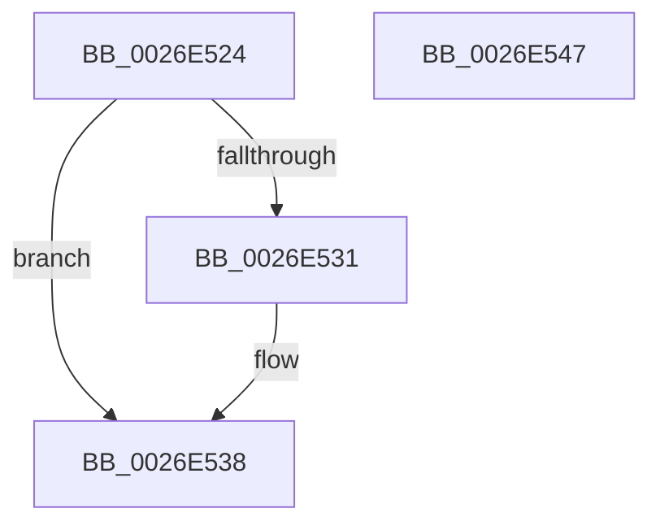

# CcSetVacbIntoList

- RVA: `0x0026E524`–`0x0026E548` (길이 `36` bytes)
- VA: `0x000000014026E524`
- 실행 섹션: `.text`
- PDB 이름 있음: `예`; PDB Function 태그: `아니요`
- unwind 정보 RVA: `0x000DB714`
- 디코드: `12`개 명령, `36/36` bytes 표시
- 미해석 바이트: `0` (있으면 어셈블리에 `.byte`로 보존)

> 이 문서는 커널 이미지의 기계어와 PDB 기호를 분석해 생성했습니다. 4번과 5번은 함수 원형과 자료형을 바이너리 사용 방식에서 추정한 C 해석이며 원본 소스 복구 결과는 아닙니다.

## 1. Dependencies

- 직접 호출 지점: **0**; 고유 호출 대상: **0**
- 직접 호출자로 확인된 함수: **2**
- RIP 상대 이미지 참조: **0**

### Outgoing calls
- 직접 디코드된 call 명령이 없습니다.

### Direct callers
- [CcSetVacbInFreeList](CcSetVacbInFreeList_function_0026FBB0.md) at `0x0026FC22`
- [CcGetVacbMiss](../27/CcGetVacbMiss_function_00272900.md) at `0x00272FE8`

### Static image references
- 디코드된 RIP-relative 메모리 참조가 없습니다.

## 2. Other-region calls and transfers

- 다른 실행 섹션으로 향하는 call: **0**
- 별도 외부 분기/꼬리 이동을 확인하지 못했습니다.

## 3. Assembly (complete function range)

```asm
0026E524  48 8B 02                        mov rax, qword ptr [rdx]
0026E527  48 83 C1 10                     add rcx, 0x10
0026E52B  48 39 50 08                     cmp qword ptr [rax + 8], rdx
0026E52F  74 07                           je 0x14026e538
0026E531  B9 03 00 00 00                  mov ecx, 3
0026E536  CD 29                           int 0x29
0026E538  48 89 01                        mov qword ptr [rcx], rax
0026E53B  48 89 51 08                     mov qword ptr [rcx + 8], rdx
0026E53F  48 89 48 08                     mov qword ptr [rax + 8], rcx
0026E543  48 89 0A                        mov qword ptr [rdx], rcx
0026E546  C3                              ret
0026E547  CC                              int3
```

## 4. C-style interpretation (structured pseudocode)

```c
__int64 __fastcall CcSetVacbIntoList(__int64 a1, __int64 a2)
{
    a1 = (a1) + (16);
    if ((*(unsigned __int64 *)(*(unsigned __int64 *)(a2) + 8)) != a2) {
        a1 = 3;
    }
    *(unsigned __int64 *)(a1) = *(unsigned __int64 *)(a2);
    *(unsigned __int64 *)(a1 + 8) = a2;
    *(unsigned __int64 *)(*(unsigned __int64 *)(a2) + 8) = a1;
    *(unsigned __int64 *)(a2) = a1;
    return *(unsigned __int64 *)(a2);
}
```

## 5. (Beta) C Style

```c
int64_t CcSetVacbIntoList(int64_t Arg1, void *Arg2)
{
    uint8_t *arg2 = (uint8_t *)Arg2;

    Arg1 = (Arg1) + (16);
    if ((*(uint64_t *)(*(uint64_t *)(arg2) + 0x8)) != Arg2) {
        Arg1 = 3;
    }
    *(uint64_t *)(Arg1) = *(uint64_t *)(arg2);
    *(void **)(Arg1 + 0x8) = Arg2;
    *(uint64_t *)(*(uint64_t *)(arg2) + 0x8) = Arg1;
    *(uint64_t *)(arg2) = Arg1;
    return *(uint64_t *)(arg2);
}
```

### 관측된 메모리 오프셋

구조체 형식이 확인되지 않은 접근은 인자 기준의 오프셋으로만 기록했습니다.

| 기준 인자 | 오프셋 표현 | 폭 (bit) | 접근 |
|---|---:|---:|---|
| `Arg2` | `+ 0x0` | `64` | `R` |
| `Arg2` | `+ 0x0` | `64` | `W` |

## 6. Execution-region graph

[열기: 2D/3D 그래프와 함수 탐색 컨트롤 패널](../../../control-panel.html?section=text&rva=0x0026E524&view=graph)

- 2D 그래프는 위에서 아래로 흐르고, 3D 그래프는 빈 공간을 드래그해 회전합니다. Shift+드래그는 이동, 휠은 확대·축소, 함수 노드 선택은 대상 보고서 이동입니다.

### Static fallback


