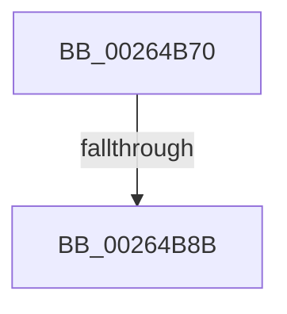

# ExAcquireAutoExpandPushLockExclusive

- RVA: `0x00264B70`–`0x00264BA3` (길이 `51` bytes)
- VA: `0x0000000140264B70`
- 실행 섹션: `.text`
- PDB 이름 있음: `예`; PDB Function 태그: `아니요`
- unwind 정보 RVA: `0x00064960`
- 디코드: `16`개 명령, `51/51` bytes 표시
- 미해석 바이트: `0` (있으면 어셈블리에 `.byte`로 보존)

> 이 문서는 커널 이미지의 기계어와 PDB 기호를 분석해 생성했습니다. 4번과 5번은 함수 원형과 자료형을 바이너리 사용 방식에서 추정한 C 해석이며 원본 소스 복구 결과는 아닙니다.

## 1. Dependencies

- 직접 호출 지점: **1**; 고유 호출 대상: **1**
- 직접 호출자로 확인된 함수: **4**
- RIP 상대 이미지 참조: **0**

### Outgoing calls
- `0x00264B9D` → [KeBugCheckEx](../4F/KeBugCheckEx_function_004FD660.md) (function, `0x004FD660`)

### Direct callers
- [sub_00264587](Unknown_function_00264587.md) at `0x002645BE`
- [MiLockLoaderEntry](../2A/MiLockLoaderEntry_function_002A3EE0.md) at `0x002A3F55`
- [MiLockAweVadsExclusive](../4B/MiLockAweVadsExclusive_function_004BDEE4.md) at `0x004BDF0A`
- [MiLockAwePagesExclusive](../68/MiLockAwePagesExclusive_function_00689080.md) at `0x00689092`

### Static image references
- 디코드된 RIP-relative 메모리 참조가 없습니다.

## 2. Other-region calls and transfers

- 다른 실행 섹션으로 향하는 call: **0**
- call이 아닌 외부 분기/꼬리 이동: **1**
  - `0x00264B89` → [sub_00264BA3](Unknown_function_00264BA3.md) (`tail-transfer`)

## 3. Assembly (complete function range)

```asm
00264B70  41 54                           push r12
00264B72  41 55                           push r13
00264B74  41 57                           push r15
00264B76  48 83 EC 50                     sub rsp, 0x50
00264B7A  45 33 E4                        xor r12d, r12d
00264B7D  4C 8B F9                        mov r15, rcx
00264B80  45 8B EC                        mov r13d, r12d
00264B83  F7 C2 F8 FF FF FF               test edx, 0xfffffff8
00264B89  74 18                           je 0x140264ba3
00264B8B  4C 8B C1                        mov r8, rcx
00264B8E  8B D2                           mov edx, edx
00264B90  B9 52 01 00 00                  mov ecx, 0x152
00264B95  4C 89 64 24 20                  mov qword ptr [rsp + 0x20], r12
00264B9A  45 33 C9                        xor r9d, r9d
00264B9D  E8 BE 8A 29 00                  call 0x1404fd660
00264BA2  CC                              int3
```

## 4. C-style interpretation (structured pseudocode)

```c
__int64 __fastcall ExAcquireAutoExpandPushLockExclusive(__int64 a1, int a2, __int64 a3, int a4)
{
    __int64 result;
    __int64 v_r12;
    __int64 v_rsp;
    unsigned __int64 v_stack_m48;

    v_rsp = (v_rsp) - (80);
    v_r12 = 0;
    v_stack_m48 = 0;
    a4 = 0;
    result = KeBugCheckEx(338, (unsigned int)(a2), a1, a4);
    return result;
}
```

## 5. (Beta) C Style

```c
int64_t ExAcquireAutoExpandPushLockExclusive(int64_t Arg1, int32_t Arg2, int64_t Arg3, int32_t Arg4)
{
    int64_t result;
    int64_t local_r12;
    int64_t local_rsp;
    uint64_t v_stack_m48;

    local_rsp = (local_rsp) - (80);
    local_r12 = 0;
    v_stack_m48 = 0;
    Arg4 = 0;
    result = KeBugCheckEx(338, (uint32_t)(Arg2), Arg1, Arg4);
    return result;
}
```

## 6. Execution-region graph

[열기: 2D/3D 그래프와 함수 탐색 컨트롤 패널](../../../control-panel.html?section=text&rva=0x00264B70&view=graph)

- 2D 그래프는 위에서 아래로 흐르고, 3D 그래프는 빈 공간을 드래그해 회전합니다. Shift+드래그는 이동, 휠은 확대·축소, 함수 노드 선택은 대상 보고서 이동입니다.

### Static fallback


