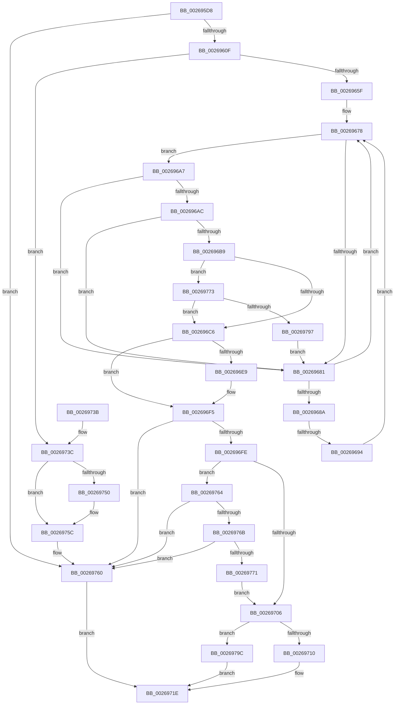

# ExProtectPoolEx

- RVA: `0x002695D8`–`0x002697A6` (길이 `462` bytes)
- VA: `0x00000001402695D8`
- 실행 섹션: `.text`
- PDB 이름 있음: `예`; PDB Function 태그: `예`
- unwind 정보 RVA: `0x00065350`
- 디코드: `118`개 명령, `462/462` bytes 표시
- 미해석 바이트: `0` (있으면 어셈블리에 `.byte`로 보존)

> 이 문서는 커널 이미지의 기계어와 PDB 기호를 분석해 생성했습니다. 4번과 5번은 함수 원형과 자료형을 바이너리 사용 방식에서 추정한 C 해석이며 원본 소스 복구 결과는 아닙니다.

## 1. Dependencies

- 직접 호출 지점: **6**; 고유 호출 대상: **4**
- 직접 호출자로 확인된 함수: **10**
- RIP 상대 이미지 참조: **4**

### Outgoing calls
- `0x00269631` → [ExAcquireSpinLockShared](../24/ExAcquireSpinLockShared_function_0024DCE0.md) (function, `0x0024DCE0`)
- `0x002696DB` → [ExReleaseSpinLockSharedFromDpcLevel](../24/ExReleaseSpinLockSharedFromDpcLevel_function_0024A590.md) (function, `0x0024A590`)
- `0x002696F0` → [KiLowerIrqlProcessIrqlFlags](../4F/KiLowerIrqlProcessIrqlFlags_function_004F5698.md) (function, `0x004F5698`)
- `0x00269719` → [MmProtectPool](MmProtectPool_function_002697AC.md) (function, `0x002697AC`)
- `0x00269743` → [ExReleaseSpinLockSharedFromDpcLevel](../24/ExReleaseSpinLockSharedFromDpcLevel_function_0024A590.md) (function, `0x0024A590`)
- `0x00269757` → [KiLowerIrqlProcessIrqlFlags](../4F/KiLowerIrqlProcessIrqlFlags_function_004F5698.md) (function, `0x004F5698`)

### Direct callers
- [CmpProtectPoolEx](CmpProtectPoolEx_function_00267AA8.md) at `0x00267AAC`
- [CmpProtectPool](CmpProtectPool_function_00267BB8.md) at `0x00267BC5`
- [SmHpChunkUnprotect](SmHpChunkUnprotect_function_002687A0.md) at `0x0026884A`
- [SmHpChunkUnprotect](SmHpChunkUnprotect_function_002687A0.md) at `0x00268867`
- [sub_002689C7](Unknown_function_002689C7.md) at `0x00268AA2`
- [ST_STORE&lt;SM_TRAITS&gt;::StDmPageRecordUnprotect](ST_STORE_SM_TRAITS_StDmPageRecordUnprotect_function_00268B30.md) at `0x00268CCB`
- [sub_00268EBD](Unknown_function_00268EBD.md) at `0x00268EEE`
- [sub_002691F9](Unknown_function_002691F9.md) at `0x0026922A`
- [SmHpUnprotectListNeighbors](SmHpUnprotectListNeighbors_function_002692A4.md) at `0x0026940A`
- [SmHpUnprotectListNeighbors](SmHpUnprotectListNeighbors_function_002692A4.md) at `0x00269444`
- [SmHpBufferProtectEx](SmHpBufferProtectEx_function_002694C0.md) at `0x0026954B`
- [SmHpBufferProtectEx](SmHpBufferProtectEx_function_002694C0.md) at `0x00269568`
- [SmHpChunkHeapProtect](../3A/SmHpChunkHeapProtect_function_003AFD8C.md) at `0x003AFE4E`
- [SmHpChunkHeapProtect](../3A/SmHpChunkHeapProtect_function_003AFD8C.md) at `0x003AFE65`

### Static image references
- `0x00269624` → RVA `0x00EFACF8` (`.data`; read)
- `0x00269636` → RVA `0x00EFED38` (`.data`; read)
- `0x0026963D` → RVA `0x00EFED30` (`.data`; read)
- `0x002696E0` → RVA `0x00FC6D20` (`ALMOSTRO`; read)

## 2. Other-region calls and transfers

- 다른 실행 섹션으로 향하는 call: **0**
- call이 아닌 외부 분기/꼬리 이동: **1**
  - `0x0026968E` → [sub_006D9208](../6D/Unknown_function_006D9208.md) (`tail-transfer`)

## 3. Assembly (complete function range)

```asm
002695D8  48 89 5C 24 08                  mov qword ptr [rsp + 8], rbx
002695DD  48 89 6C 24 18                  mov qword ptr [rsp + 0x18], rbp
002695E2  48 89 74 24 20                  mov qword ptr [rsp + 0x20], rsi
002695E7  57                              push rdi
002695E8  41 54                           push r12
002695EA  41 55                           push r13
002695EC  41 56                           push r14
002695EE  41 57                           push r15
002695F0  48 83 EC 20                     sub rsp, 0x20
002695F4  48 8B C1                        mov rax, rcx
002695F7  45 8B F9                        mov r15d, r9d
002695FA  48 0B C2                        or rax, rdx
002695FD  4D 8B E8                        mov r13, r8
00269600  48 8B EA                        mov rbp, rdx
00269603  48 A9 FF 0F 00 00               test rax, 0xfff
00269609  0F 85 51 01 00 00               jne 0x140269760
0026960F  48 C1 E9 0C                     shr rcx, 0xc
00269613  45 33 E4                        xor r12d, r12d
00269616  4C 21 64 24 58                  and qword ptr [rsp + 0x58], r12
0026961B  33 F6                           xor esi, esi
0026961D  48 69 D9 5F 9E 00 00            imul rbx, rcx, 0x9e5f
00269624  48 8D 0D CD 16 C9 00            lea rcx, [rip + 0xc916cd]
0026962B  41 BE 80 00 00 00               mov r14d, 0x80
00269631  E8 AA 46 FE FF                  call 0x14024dce0
00269636  4C 8B 0D FB 56 C9 00            mov r9, qword ptr [rip + 0xc956fb]
0026963D  4C 8B 05 EC 56 C9 00            mov r8, qword ptr [rip + 0xc956ec]
00269644  0F B6 F8                        movzx edi, al
00269647  48 8B C3                        mov rax, rbx
0026964A  48 C1 E8 20                     shr rax, 0x20
0026964E  33 C3                           xor eax, ebx
00269650  41 8D 51 FF                     lea edx, [r9 - 1]
00269654  23 C2                           and eax, edx
00269656  4D 85 C0                        test r8, r8
00269659  0F 84 DD 00 00 00               je 0x14026973c
0026965F  49 C1 E1 05                     shl r9, 5
00269663  48 8D 5D FF                     lea rbx, [rbp - 1]
00269667  44 8B D8                        mov r11d, eax
0026966A  4D 03 C8                        add r9, r8
0026966D  49 C1 E3 05                     shl r11, 5
00269671  49 03 DD                        add rbx, r13
00269674  4B 8D 14 03                     lea rdx, [r11 + r8]
00269678  4C 8B 02                        mov r8, qword ptr [rdx]
0026967B  41 F6 C0 01                     test r8b, 1
0026967F  74 26                           je 0x1402696a7
00269681  48 83 C2 20                     add rdx, 0x20
00269685  49 3B D1                        cmp rdx, r9
00269688  72 EE                           jb 0x140269678
0026968A  41 83 FC 01                     cmp r12d, 1
0026968E  0F 84 74 FB 46 00               je 0x1406d9208
00269694  48 8B 15 95 56 C9 00            mov rdx, qword ptr [rip + 0xc95695]
0026969B  41 BC 01 00 00 00               mov r12d, 1
002696A1  4D 8D 0C 13                     lea r9, [r11 + rdx]
002696A5  EB D1                           jmp 0x140269678
002696A7  49 3B E8                        cmp rbp, r8
002696AA  72 D5                           jb 0x140269681
002696AC  4C 8B 52 10                     mov r10, qword ptr [rdx + 0x10]
002696B0  4B 8D 0C 02                     lea rcx, [r10 + r8]
002696B4  48 3B D9                        cmp rbx, rcx
002696B7  73 C8                           jae 0x140269681
002696B9  41 F7 C2 FF 0F 00 00            test r10d, 0xfff
002696C0  0F 85 AD 00 00 00               jne 0x140269773
002696C6  44 8B 72 0C                     mov r14d, dword ptr [rdx + 0xc]
002696CA  49 8B D8                        mov rbx, r8
002696CD  49 C1 EE 08                     shr r14, 8
002696D1  49 8B F2                        mov rsi, r10
002696D4  48 8D 0D 1D 16 C9 00            lea rcx, [rip + 0xc9161d]
002696DB  E8 B0 0E FE FF                  call 0x14024a590
002696E0  83 3D 39 D6 D5 00 00            cmp dword ptr [rip + 0xd5d639], 0
002696E7  74 0C                           je 0x1402696f5
002696E9  44 0F 20 C1                     mov rcx, cr8
002696ED  40 8A D7                        mov dl, dil
002696F0  E8 A3 BF 28 00                  call 0x1404f5698
002696F5  44 0F 22 C7                     mov cr8, rdi
002696F9  48 85 DB                        test rbx, rbx
002696FC  74 62                           je 0x140269760
002696FE  81 E6 FF 0F 00 00               and esi, 0xfff
00269704  75 5E                           jne 0x140269764
00269706  41 83 FF FF                     cmp r15d, -1
0026970A  0F 84 8C 00 00 00               je 0x14026979c
00269710  45 8B C7                        mov r8d, r15d
00269713  49 8B D5                        mov rdx, r13
00269716  48 8B CD                        mov rcx, rbp
00269719  E8 8E 00 00 00                  call 0x1402697ac
0026971E  48 8B 5C 24 50                  mov rbx, qword ptr [rsp + 0x50]
00269723  48 8B 6C 24 60                  mov rbp, qword ptr [rsp + 0x60]
00269728  48 8B 74 24 68                  mov rsi, qword ptr [rsp + 0x68]
0026972D  48 83 C4 20                     add rsp, 0x20
00269731  41 5F                           pop r15
00269733  41 5E                           pop r14
00269735  41 5D                           pop r13
00269737  41 5C                           pop r12
00269739  5F                              pop rdi
0026973A  C3                              ret
0026973B  CC                              int3
0026973C  48 8D 0D B5 15 C9 00            lea rcx, [rip + 0xc915b5]
00269743  E8 48 0E FE FF                  call 0x14024a590
00269748  39 35 D2 D5 D5 00               cmp dword ptr [rip + 0xd5d5d2], esi
0026974E  74 0C                           je 0x14026975c
00269750  44 0F 20 C1                     mov rcx, cr8
00269754  40 8A D7                        mov dl, dil
00269757  E8 3C BF 28 00                  call 0x1404f5698
0026975C  44 0F 22 C7                     mov cr8, rdi
00269760  33 C0                           xor eax, eax
00269762  EB BA                           jmp 0x14026971e
00269764  49 0F BA E6 0A                  bt r14, 0xa
00269769  73 F5                           jae 0x140269760
0026976B  48 83 FE 10                     cmp rsi, 0x10
0026976F  77 EF                           ja 0x140269760
00269771  EB 93                           jmp 0x140269706
00269773  48 81 C1 FF 0F 00 00            add rcx, 0xfff
0026977A  48 8D 83 FF 0F 00 00            lea rax, [rbx + 0xfff]
00269781  48 81 E1 00 F0 FF FF            and rcx, 0xfffffffffffff000
00269788  48 25 00 F0 FF FF               and rax, 0xfffffffffffff000
0026978E  48 3B C1                        cmp rax, rcx
00269791  0F 82 2F FF FF FF               jb 0x1402696c6
00269797  E9 E5 FE FF FF                  jmp 0x140269681
0026979C  B8 01 00 00 00                  mov eax, 1
002697A1  E9 78 FF FF FF                  jmp 0x14026971e
```

## 4. C-style interpretation (structured pseudocode)

```c
__int64 __fastcall ExProtectPoolEx(__int64 a1, __int64 a2, __int64 a3, int a4)
{
    __int64 result;
    __int64 v_r11;
    __int64 v_r12;
    __int64 v_r14;
    __int64 v_rbx;
    __int64 v_rsi;
    __int64 v_rsp;
    unsigned __int64 v_stack_p10;
    unsigned __int64 v_stack_p18;
    unsigned __int64 v_stack_p20;
    unsigned __int64 v_stack_p8;

    v_stack_p8 = v_rbx;
    v_stack_p18 = v_rbp;
    v_stack_p20 = v_rsi;
    v_rsp = (v_rsp) - (32);
    result = (a1) | (a2);
    if (((result) & (0xFFFULL)) != 0) goto loc_00269760;
    a1 = (a1) >> (12);
    v_r12 = 0;
    v_rsi = 0;
    v_rbx = (v_rbx) * (a1);
    result = ExAcquireSpinLockShared(v_rip + 13178573, a2, a3, a4);
    result = (v_rbx) >> (32);
    result = (unsigned int)((result) ^ ((unsigned int)(v_rbx)));
    result = (unsigned int)((result) & ((unsigned int)(*(unsigned __int64 *)(v_rip + 13195003) - 1)));
    if (*(unsigned __int64 *)(v_rip + 13194988) == 0) goto loc_0026973C;
    a4 = (*(unsigned __int64 *)(v_rip + 13195003)) << (5);
    a4 = (a4) + (*(unsigned __int64 *)(v_rip + 13194988));
    v_r11 = ((unsigned int)((unsigned int)(result))) << (5);
    v_rbx = (a2 - 1) + (a3);
loc_00269678:
    if ((((unsigned __int8)(*(unsigned __int64 *)(v_r11 + *(unsigned __int64 *)(v_rip + 13194988) * 1))) & (1)) == 0) goto loc_002696A7;
loc_00269681:
    a2 = (v_r11 + *(unsigned __int64 *)(v_rip + 13194988) * 1) + (32);
    if (a2 < a4) goto loc_00269678;
    goto loc_00269678;
loc_002696A7:
    if (a2 < (*(unsigned __int64 *)(v_r11 + *(unsigned __int64 *)(v_rip + 13194988) * 1))) goto loc_00269681;
    if (v_rbx >= (*(unsigned __int64 *)(*(unsigned __int64 *)(v_rip + 13194901) + 16) + *(unsigned __int64 *)(v_r11 + *(unsigned __int64 *)(v_rip + 13194988) * 1) * 1)) goto loc_00269681;
    if ((((unsigned int)(*(unsigned __int64 *)(*(unsigned __int64 *)(v_rip + 13194901) + 16))) & (0xFFFULL)) != 0) goto loc_00269773;
loc_002696C6:
    v_r14 = ((unsigned int)(*(unsigned int *)(*(unsigned __int64 *)(v_rip + 13194901) + 12))) >> (8);
    result = ExReleaseSpinLockSharedFromDpcLevel(v_rip + 13178397, *(unsigned __int64 *)(v_rip + 13194901), *(unsigned __int64 *)(v_r11 + *(unsigned __int64 *)(v_rip + 13194988) * 1), v_r11 + *(unsigned __int64 *)(v_rip + 13194901) * 1);
    if ((*(unsigned int *)(v_rip + 14014009)) != 0) {
        a1 = v_cr8;
        a2 = (unsigned __int8)((unsigned __int8)(result));
        result = KiLowerIrqlProcessIrqlFlags(a1, a2, *(unsigned __int64 *)(v_r11 + *(unsigned __int64 *)(v_rip + 13194988) * 1), v_r11 + *(unsigned __int64 *)(v_rip + 13194901) * 1);
    }
    if (*(unsigned __int64 *)(v_r11 + *(unsigned __int64 *)(v_rip + 13194988) * 1) == 0) goto loc_00269760;
    v_rsi = (unsigned int)((*(unsigned __int64 *)(*(unsigned __int64 *)(v_rip + 13194901) + 16)) & (0xFFFULL));
    if (condition_is_not_equal) goto loc_00269764;
loc_00269706:
    if (((unsigned int)((unsigned int)(a4))) == -1) goto loc_0026979C;
    result = MmProtectPool(a2, a3, (unsigned int)((unsigned int)((unsigned int)(a4))), v_r11 + *(unsigned __int64 *)(v_rip + 13194901) * 1);
loc_0026971E:
    v_rsp = (v_rsp) + (32);
    return result;
loc_0026973C:
    result = ExReleaseSpinLockSharedFromDpcLevel(v_rip + 13178293, a3, (unsigned int)((unsigned int)((unsigned int)(a4))), v_r11 + *(unsigned __int64 *)(v_rip + 13194901) * 1);
    if ((*(unsigned int *)(v_rip + 14013906)) != ((unsigned int)(v_stack_p20))) {
        a1 = (unsigned __int8)(result);
        a2 = (unsigned __int8)((unsigned __int8)(result));
        result = KiLowerIrqlProcessIrqlFlags(a1, a2, (unsigned int)((unsigned int)((unsigned int)(a4))), v_r11 + *(unsigned __int64 *)(v_rip + 13194901) * 1);
    }
loc_00269760:
    result = 0;
    goto loc_0026971E;
loc_00269764:
    if (condition_is_above_or_equal) goto loc_00269760;
    if (v_stack_p20 > 16) goto loc_00269760;
    goto loc_00269706;
loc_00269773:
    a1 = (a1) + (0xFFFULL);
    a1 = (a1) & (0xFFFFFFFFFFFFF000ULL);
    result = (v_stack_p8 + 4095) & (0xFFFFFFFFFFFFF000ULL);
    if (result < a1) goto loc_002696C6;
    goto loc_00269681;
loc_0026979C:
    goto loc_0026971E;
}
```

## 5. (Beta) C Style

```c
int64_t ExProtectPoolEx(int64_t Arg1, void *Arg2, int64_t Arg3, int32_t Arg4)
{
    uint8_t *arg2 = (uint8_t *)Arg2;

    int64_t result;
    int64_t local_r11;
    int64_t local_r12;
    int64_t local_r14;
    int64_t local_rbx;
    int64_t local_rsi;
    int64_t local_rsp;
    uint64_t v_stack_p10;
    uint64_t v_stack_p18;
    uint64_t v_stack_p20;
    uint64_t v_stack_p8;

    v_stack_p8 = local_rbx;
    v_stack_p18 = local_rbp;
    v_stack_p20 = local_rsi;
    local_rsp = (local_rsp) - (32);
    result = (Arg1) | (Arg2);
    if (((result) & (0xFFFULL)) != 0) goto loc_00269760;
    Arg1 = (Arg1) >> (12);
    local_r12 = 0;
    local_rsi = 0;
    local_rbx = (local_rbx) * (Arg1);
    result = ExAcquireSpinLockShared(v_rip + 13178573, Arg2, Arg3, Arg4);
    result = (local_rbx) >> (32);
    result = (uint32_t)((result) ^ ((uint32_t)(local_rbx)));
    result = (uint32_t)((result) & ((uint32_t)(*(uint64_t *)(v_rip + 0xC956FB) - 1)));
    if (*(uint64_t *)(v_rip + 0xC956EC) == 0) goto loc_0026973C;
    Arg4 = (*(uint64_t *)(v_rip + 0xC956FB)) << (5);
    Arg4 = (Arg4) + (*(uint64_t *)(v_rip + 0xC956EC));
    local_r11 = ((uint32_t)((uint32_t)(result))) << (5);
    local_rbx = (Arg2 - 1) + (Arg3);
loc_00269678:
    if ((((uint8_t)(*(uint64_t *)(local_r11 + *(uint64_t *)(v_rip + 0xC956EC) * 1))) & (1)) == 0) goto loc_002696A7;
loc_00269681:
    Arg2 = (local_r11 + *(uint64_t *)(v_rip + 0xC956EC) * 1) + (32);
    if (Arg2 < Arg4) goto loc_00269678;
    goto loc_00269678;
loc_002696A7:
    if (Arg2 < (*(uint64_t *)(local_r11 + *(uint64_t *)(v_rip + 0xC956EC) * 1))) goto loc_00269681;
    if (local_rbx >= (*(uint64_t *)(*(uint64_t *)(v_rip + 0xC95695) + 0x10) + *(uint64_t *)(local_r11 + *(uint64_t *)(v_rip + 0xC956EC) * 1) * 1)) goto loc_00269681;
    if ((((uint32_t)(*(uint64_t *)(*(uint64_t *)(v_rip + 0xC95695) + 0x10))) & (0xFFFULL)) != 0) goto loc_00269773;
loc_002696C6:
    local_r14 = ((uint32_t)(*(uint32_t *)(*(uint64_t *)(v_rip + 0xC95695) + 0xC))) >> (8);
    result = ExReleaseSpinLockSharedFromDpcLevel(v_rip + 13178397, *(uint64_t *)(v_rip + 0xC95695), *(uint64_t *)(local_r11 + *(uint64_t *)(v_rip + 0xC956EC) * 1), local_r11 + *(uint64_t *)(v_rip + 0xC95695) * 1);
    if ((*(uint32_t *)(v_rip + 0xD5D639)) != 0) {
        Arg1 = v_cr8;
        Arg2 = (uint8_t)((uint8_t)(result));
        result = KiLowerIrqlProcessIrqlFlags(Arg1, Arg2, *(uint64_t *)(local_r11 + *(uint64_t *)(v_rip + 0xC956EC) * 1), local_r11 + *(uint64_t *)(v_rip + 0xC95695) * 1);
    }
    if (*(uint64_t *)(local_r11 + *(uint64_t *)(v_rip + 0xC956EC) * 1) == 0) goto loc_00269760;
    local_rsi = (uint32_t)((*(uint64_t *)(*(uint64_t *)(v_rip + 0xC95695) + 0x10)) & (0xFFFULL));
    if (condition_is_not_equal) goto loc_00269764;
loc_00269706:
    if (((uint32_t)((uint32_t)(Arg4))) == -1) goto loc_0026979C;
    result = MmProtectPool(Arg2, Arg3, (uint32_t)((uint32_t)((uint32_t)(Arg4))), local_r11 + *(uint64_t *)(v_rip + 0xC95695) * 1);
loc_0026971E:
    local_rsp = (local_rsp) + (32);
    return result;
loc_0026973C:
    result = ExReleaseSpinLockSharedFromDpcLevel(v_rip + 13178293, Arg3, (uint32_t)((uint32_t)((uint32_t)(Arg4))), local_r11 + *(uint64_t *)(v_rip + 0xC95695) * 1);
    if ((*(uint32_t *)(v_rip + 0xD5D5D2)) != ((uint32_t)(v_stack_p20))) {
        Arg1 = (uint8_t)(result);
        Arg2 = (uint8_t)((uint8_t)(result));
        result = KiLowerIrqlProcessIrqlFlags(Arg1, Arg2, (uint32_t)((uint32_t)((uint32_t)(Arg4))), local_r11 + *(uint64_t *)(v_rip + 0xC95695) * 1);
    }
loc_00269760:
    result = 0;
    goto loc_0026971E;
loc_00269764:
    if (condition_is_above_or_equal) goto loc_00269760;
    if (v_stack_p20 > 16) goto loc_00269760;
    goto loc_00269706;
loc_00269773:
    Arg1 = (Arg1) + (0xFFFULL);
    Arg1 = (Arg1) & (0xFFFFFFFFFFFFF000ULL);
    result = (v_stack_p8 + 4095) & (0xFFFFFFFFFFFFF000ULL);
    if (result < Arg1) goto loc_002696C6;
    goto loc_00269681;
loc_0026979C:
    goto loc_0026971E;
}
```

### 관측된 메모리 오프셋

구조체 형식이 확인되지 않은 접근은 인자 기준의 오프셋으로만 기록했습니다.

| 기준 인자 | 오프셋 표현 | 폭 (bit) | 접근 |
|---|---:|---:|---|
| `Arg2` | `- 0x1` | `64` | `R` |

## 6. Execution-region graph

[열기: 2D/3D 그래프와 함수 탐색 컨트롤 패널](../../../control-panel.html?section=text&rva=0x002695D8&view=graph)

- 2D 그래프는 위에서 아래로 흐르고, 3D 그래프는 빈 공간을 드래그해 회전합니다. Shift+드래그는 이동, 휠은 확대·축소, 함수 노드 선택은 대상 보고서 이동입니다.

### Static fallback


