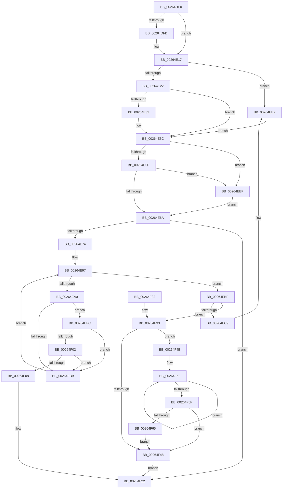

# ExReleaseAutoExpandPushLockExclusive

- RVA: `0x00264DE0`–`0x00264F6C` (길이 `396` bytes)
- VA: `0x0000000140264DE0`
- 실행 섹션: `.text`
- PDB 이름 있음: `예`; PDB Function 태그: `아니요`
- unwind 정보 RVA: `0x000646B4`
- 디코드: `110`개 명령, `396/396` bytes 표시
- 미해석 바이트: `0` (있으면 어셈블리에 `.byte`로 보존)

> 이 문서는 커널 이미지의 기계어와 PDB 기호를 분석해 생성했습니다. 4번과 5번은 함수 원형과 자료형을 바이너리 사용 방식에서 추정한 C 해석이며 원본 소스 복구 결과는 아닙니다.

## 1. Dependencies

- 직접 호출 지점: **6**; 고유 호출 대상: **5**
- 직접 호출자로 확인된 함수: **4**
- RIP 상대 이미지 참조: **0**

### Outgoing calls
- `0x00264E11` → [KeBugCheckEx](../4F/KeBugCheckEx_function_004FD660.md) (function, `0x004FD660`)
- `0x00264EDC` → [KeBugCheckEx](../4F/KeBugCheckEx_function_004FD660.md) (function, `0x004FD660`)
- `0x00264EE5` → [ExpReleaseFannedOutPushLockExclusive](ExpReleaseFannedOutPushLockExclusive_function_00264F74.md) (function, `0x00264F74`)
- `0x00264EF2` → [ExfReleasePushLock](ExfReleasePushLock_function_002638D0.md) (function, `0x002638D0`)
- `0x00264F1D` → [KiAbEntryFreeAndEnableInterrupts](KiAbEntryFreeAndEnableInterrupts_function_002622D0.md) (function, `0x002622D0`)
- `0x00264F65` → [KiRemoveSystemWorkPriorityKick](KiRemoveSystemWorkPriorityKick_function_002631D0.md) (function, `0x002631D0`)

### Direct callers
- [sub_00264587](Unknown_function_00264587.md) at `0x00264770`
- [MiUnlockAweVadsExclusive](../4B/MiUnlockAweVadsExclusive_function_004BDF1C.md) at `0x004BDF3C`
- [MiUnlockAwePagesExclusive](../68/MiUnlockAwePagesExclusive_function_006898FC.md) at `0x0068990B`
- [sub_006DAE7C](../6D/Unknown_function_006DAE7C.md) at `0x006DAE7E`

### Static image references
- 디코드된 RIP-relative 메모리 참조가 없습니다.

## 2. Other-region calls and transfers

- 다른 실행 섹션으로 향하는 call: **0**
- 별도 외부 분기/꼬리 이동을 확인하지 못했습니다.

## 3. Assembly (complete function range)

```asm
00264DE0  48 89 5C 24 08                  mov qword ptr [rsp + 8], rbx
00264DE5  48 89 74 24 10                  mov qword ptr [rsp + 0x10], rsi
00264DEA  57                              push rdi
00264DEB  48 83 EC 30                     sub rsp, 0x30
00264DEF  48 8B D9                        mov rbx, rcx
00264DF2  8B FA                           mov edi, edx
00264DF4  B9 F8 FF FF FF                  mov ecx, 0xfffffff8
00264DF9  85 D1                           test ecx, edx
00264DFB  74 1A                           je 0x140264e17
00264DFD  33 F6                           xor esi, esi
00264DFF  8B D7                           mov edx, edi
00264E01  45 33 C9                        xor r9d, r9d
00264E04  48 89 74 24 20                  mov qword ptr [rsp + 0x20], rsi
00264E09  4C 8B C3                        mov r8, rbx
00264E0C  B9 52 01 00 00                  mov ecx, 0x152
00264E11  E8 4A 88 29 00                  call 0x1404fd660
00264E16  CC                              int3
00264E17  8B 43 08                        mov eax, dword ptr [rbx + 8]
00264E1A  A8 01                           test al, 1
00264E1C  0F 85 C0 00 00 00               jne 0x140264ee2
00264E22  8B 4B 0C                        mov ecx, dword ptr [rbx + 0xc]
00264E25  8B C1                           mov eax, ecx
00264E27  25 00 00 0F 00                  and eax, 0xf0000
00264E2C  3D 00 00 0F 00                  cmp eax, 0xf0000
00264E31  73 09                           jae 0x140264e3c
00264E33  81 C1 00 00 01 00               add ecx, 0x10000
00264E39  89 4B 0C                        mov dword ptr [rbx + 0xc], ecx
00264E3C  0F 0D 0B                        prefetchw byte ptr [rbx]
00264E3F  48 8B 03                        mov rax, qword ptr [rbx]
00264E42  33 F6                           xor esi, esi
00264E44  48 8B C8                        mov rcx, rax
00264E47  48 83 E1 F0                     and rcx, 0xfffffffffffffff0
00264E4B  48 83 F9 10                     cmp rcx, 0x10
00264E4F  48 8D 50 F0                     lea rdx, [rax - 0x10]
00264E53  48 0F 46 D6                     cmovbe rdx, rsi
00264E57  A8 02                           test al, 2
00264E59  0F 85 90 00 00 00               jne 0x140264eef
00264E5F  F0 48 0F B1 13                  lock cmpxchg qword ptr [rbx], rdx
00264E64  0F 85 85 00 00 00               jne 0x140264eef
00264E6A  40 F6 C7 02                     test dil, 2
00264E6E  0F 85 AE 00 00 00               jne 0x140264f22
00264E74  65 4C 8B 14 25 88 01 00 00      mov r10, qword ptr gs:[0x188]
00264E7D  FA                              cli
00264E7E  4D 8B 82 70 04 00 00            mov r8, qword ptr [r10 + 0x470]
00264E85  4C 8B CB                        mov r9, rbx
00264E88  48 BF FC FF FF FF FF FF FF 7F   movabs rdi, 0x7ffffffffffffffc
00264E92  8B D6                           mov edx, esi
00264E94  4C 23 CF                        and r9, rdi
00264E97  41 0F B6 40 0C                  movzx eax, byte ptr [r8 + 0xc]
00264E9C  3B D0                           cmp edx, eax
00264E9E  73 1F                           jae 0x140264ebf
00264EA0  8B C2                           mov eax, edx
00264EA2  48 6B C8 58                     imul rcx, rax, 0x58
00264EA6  48 83 C1 10                     add rcx, 0x10
00264EAA  49 03 C8                        add rcx, r8
00264EAD  4C 8B 19                        mov r11, qword ptr [rcx]
00264EB0  49 8B C3                        mov rax, r11
00264EB3  48 23 C7                        and rax, rdi
00264EB6  49 3B C1                        cmp rax, r9
00264EB9  74 41                           je 0x140264efc
00264EBB  FF C2                           inc edx
00264EBD  EB D8                           jmp 0x140264e97
00264EBF  41 8B 42 78                     mov eax, dword ptr [r10 + 0x78]
00264EC3  0F BA E0 10                     bt eax, 0x10
00264EC7  72 6A                           jb 0x140264f33
00264EC9  45 33 C9                        xor r9d, r9d
00264ECC  48 89 74 24 20                  mov qword ptr [rsp + 0x20], rsi
00264ED1  4C 8B C3                        mov r8, rbx
00264ED4  49 8B D2                        mov rdx, r10
00264ED7  B9 62 01 00 00                  mov ecx, 0x162
00264EDC  E8 7F 87 29 00                  call 0x1404fd660
00264EE1  CC                              int3
00264EE2  48 23 C8                        and rcx, rax
00264EE5  E8 8A 00 00 00                  call 0x140264f74
00264EEA  E9 4D FF FF FF                  jmp 0x140264e3c
00264EEF  48 8B CB                        mov rcx, rbx
00264EF2  E8 D9 E9 FF FF                  call 0x1402638d0
00264EF7  E9 6E FF FF FF                  jmp 0x140264e6a
00264EFC  40 38 71 0A                     cmp byte ptr [rcx + 0xa], sil
00264F00  74 B9                           je 0x140264ebb
00264F02  41 F6 C3 01                     test r11b, 1
00264F06  75 B3                           jne 0x140264ebb
00264F08  41 B9 01 00 00 00               mov r9d, 1
00264F0E  40 88 71 0A                     mov byte ptr [rcx + 0xa], sil
00264F12  4C 8B C3                        mov r8, rbx
00264F15  48 89 74 24 20                  mov qword ptr [rsp + 0x20], rsi
00264F1A  49 8B D2                        mov rdx, r10
00264F1D  E8 AE D3 FF FF                  call 0x1402622d0
00264F22  48 8B 5C 24 40                  mov rbx, qword ptr [rsp + 0x40]
00264F27  48 8B 74 24 48                  mov rsi, qword ptr [rsp + 0x48]
00264F2C  48 83 C4 30                     add rsp, 0x30
00264F30  5F                              pop rdi
00264F31  C3                              ret
00264F32  CC                              int3
00264F33  65 48 8B 0C 25 20 00 00 00      mov rcx, qword ptr gs:[0x20]
00264F3C  4C 8B 81 B8 8E 00 00            mov r8, qword ptr [rcx + 0x8eb8]
00264F43  4D 85 C0                        test r8, r8
00264F46  75 03                           jne 0x140264f4b
00264F48  FB                              sti
00264F49  EB D7                           jmp 0x140264f22
00264F4B  41 0F 0D 08                     prefetchw byte ptr [r8]
00264F4F  41 8B 00                        mov eax, dword ptr [r8]
00264F52  8B D0                           mov edx, eax
00264F54  0F BA F2 15                     btr edx, 0x15
00264F58  F0 41 0F B1 10                  lock cmpxchg dword ptr [r8], edx
00264F5D  75 F3                           jne 0x140264f52
00264F5F  0F BA E0 15                     bt eax, 0x15
00264F63  73 E3                           jae 0x140264f48
00264F65  E8 66 E2 FF FF                  call 0x1402631d0
00264F6A  EB DC                           jmp 0x140264f48
```

## 4. C-style interpretation (structured pseudocode)

```c
__int64 __fastcall ExReleaseAutoExpandPushLockExclusive(__int64 a1, int a2, __int64 a3, int a4)
{
    __int64 result;
    __int64 v_rsi;
    __int64 v_rsp;
    unsigned __int64 v_stack_m18;
    unsigned __int64 v_stack_p10;
    unsigned __int64 v_stack_p8;

    v_stack_p8 = v_rbx;
    v_stack_p10 = v_rsi;
    v_rsp = (v_rsp) - (48);
    if ((((unsigned int)((unsigned int)(0xFFFFFFF8ULL))) & (a2)) != 0) {
        v_rsi = 0;
        a2 = (unsigned int)((unsigned int)(a2));
        a4 = 0;
        v_stack_m18 = 0;
        a3 = a1;
        a1 = 338;
        result = KeBugCheckEx(a1, a2, a3, a4);
    }
    if ((((unsigned __int8)((unsigned int)(*(unsigned int *)(a1 + 8)))) & (1)) != 0) goto loc_00264EE2;
    result = (unsigned int)(((unsigned int)((unsigned int)((unsigned int)(*(unsigned int *)(a1 + 12))))) & (0xF0000ULL));
    if (((unsigned int)(result)) < 0xF0000ULL) {
        a1 = (unsigned int)(((unsigned int)(*(unsigned int *)(a1 + 12))) + (0x10000ULL));
        *(unsigned int *)(a1 + 12) = (unsigned int)(a1);
    }
    v_rsi = 0;
    a1 = (*(unsigned __int64 *)(a1)) & (-16);
    a2 = *(unsigned __int64 *)(a1) - 16;
    if (a1 <= 16) { a2 = 0; }
    if ((((unsigned __int8)(*(unsigned __int64 *)(a1))) & (2)) != 0) goto loc_00264EEF;
    if ((((unsigned __int8)(*(unsigned __int64 *)(a1))) & (2)) != 0) goto loc_00264EEF;
loc_00264E6A:
    if ((((unsigned __int8)((unsigned int)(a2))) & (2)) != 0) goto loc_00264F22;
    a4 = (a1) & ((unsigned int)(a2));
loc_00264E97:
    if (0 >= ((unsigned int)(*(unsigned __int8 *)(*(unsigned __int64 *)(*(unsigned __int64 *)(gs_base + (0 + 392)) + 1136) + 12)))) goto loc_00264EBF;
    a1 = (a1) * (0);
    a1 = (a1) + (16);
    a1 = (a1) + (*(unsigned __int64 *)(*(unsigned __int64 *)(gs_base + (0 + 392)) + 1136));
    result = (*(unsigned __int64 *)(a1)) & ((unsigned int)(a2));
    if (result == a4) goto loc_00264EFC;
loc_00264EBB:
    a2 = (unsigned int)((0) + 1);
    goto loc_00264E97;
loc_00264EBF:
    if (result < a4) goto loc_00264F33;
    a4 = 0;
    v_stack_m18 = 0;
    result = KeBugCheckEx(354, *(unsigned __int64 *)(gs_base + (0 + 392)), a1, a4);
loc_00264EE2:
    a1 = (354) & (result);
    result = ExpReleaseFannedOutPushLockExclusive(a1, *(unsigned __int64 *)(gs_base + (0 + 392)), a1, a4);
    goto loc_00264E3C;
loc_00264EEF:
    result = ExfReleasePushLock(a1, *(unsigned __int64 *)(gs_base + (0 + 392)), a1, a4);
    goto loc_00264E6A;
loc_00264EFC:
    if ((*(unsigned __int8 *)(a1 + 10)) == 0) goto loc_00264EBB;
    if ((((unsigned __int8)(*(unsigned __int64 *)(a1))) & (1)) != 0) goto loc_00264EBB;
    *(unsigned __int8 *)(a1 + 10) = 0;
    v_stack_m18 = 0;
    result = KiAbEntryFreeAndEnableInterrupts(a1, *(unsigned __int64 *)(gs_base + (0 + 392)), a1, 1);
loc_00264F22:
    v_rsp = (v_rsp) + (48);
    return result;
loc_00264F33:
    if (*(unsigned __int64 *)(*(unsigned __int64 *)(gs_base + (0 + 32)) + 36536) != 0) goto loc_00264F4B;
loc_00264F48:
    goto loc_00264F22;
loc_00264F4B:
loc_00264F52:
    if (*(unsigned __int64 *)(*(unsigned __int64 *)(gs_base + (0 + 32)) + 36536) != 0) goto loc_00264F52;
    if (condition_is_above_or_equal) goto loc_00264F48;
    result = KiRemoveSystemWorkPriorityKick(*(unsigned __int64 *)(gs_base + (0 + 32)), (unsigned int)((unsigned int)((unsigned int)(*(unsigned int *)(*(unsigned __int64 *)(*(unsigned __int64 *)(gs_base + (0 + 32)) + 36536))))), *(unsigned __int64 *)(*(unsigned __int64 *)(gs_base + (0 + 32)) + 36536), 1);
    goto loc_00264F48;
}
```

## 5. (Beta) C Style

```c
int64_t ExReleaseAutoExpandPushLockExclusive(void *Arg1, int32_t Arg2, int64_t Arg3, int32_t Arg4)
{
    uint8_t *arg1 = (uint8_t *)Arg1;

    int64_t result;
    int64_t local_rsi;
    int64_t local_rsp;
    uint64_t v_stack_m18;
    uint64_t v_stack_p10;
    uint64_t v_stack_p8;

    v_stack_p8 = local_rbx;
    v_stack_p10 = local_rsi;
    local_rsp = (local_rsp) - (48);
    if ((((uint32_t)((uint32_t)(0xFFFFFFF8ULL))) & (Arg2)) != 0) {
        local_rsi = 0;
        Arg2 = (uint32_t)((uint32_t)(Arg2));
        Arg4 = 0;
        v_stack_m18 = 0;
        Arg3 = Arg1;
        Arg1 = 338;
        result = KeBugCheckEx(Arg1, Arg2, Arg3, Arg4);
    }
    if ((((uint8_t)((uint32_t)(*(uint32_t *)(arg1 + 0x8)))) & (1)) != 0) goto loc_00264EE2;
    result = (uint32_t)(((uint32_t)((uint32_t)((uint32_t)(*(uint32_t *)(arg1 + 0xC))))) & (0xF0000ULL));
    if (((uint32_t)(result)) < 0xF0000ULL) {
        Arg1 = (uint32_t)(((uint32_t)(*(uint32_t *)(arg1 + 0xC))) + (0x10000ULL));
        *(uint32_t *)(arg1 + 0xC) = (uint32_t)(Arg1);
    }
    local_rsi = 0;
    Arg1 = (*(uint64_t *)(arg1)) & (-16);
    Arg2 = *(uint64_t *)(arg1) - 16;
    if (Arg1 <= 16) { Arg2 = 0; }
    if ((((uint8_t)(*(uint64_t *)(arg1))) & (2)) != 0) goto loc_00264EEF;
    if ((((uint8_t)(*(uint64_t *)(arg1))) & (2)) != 0) goto loc_00264EEF;
loc_00264E6A:
    if ((((uint8_t)((uint32_t)(Arg2))) & (2)) != 0) goto loc_00264F22;
    Arg4 = (Arg1) & ((uint32_t)(Arg2));
loc_00264E97:
    if (0 >= ((uint32_t)(*(uint8_t *)(*(uint64_t *)(*(uint64_t *)(gs_base + (0 + 0x188)) + 0x470) + 0xC)))) goto loc_00264EBF;
    Arg1 = (Arg1) * (0);
    Arg1 = (Arg1) + (16);
    Arg1 = (Arg1) + (*(uint64_t *)(*(uint64_t *)(gs_base + (0 + 0x188)) + 0x470));
    result = (*(uint64_t *)(arg1)) & ((uint32_t)(Arg2));
    if (result == Arg4) goto loc_00264EFC;
loc_00264EBB:
    Arg2 = (uint32_t)((0) + 1);
    goto loc_00264E97;
loc_00264EBF:
    if (result < Arg4) goto loc_00264F33;
    Arg4 = 0;
    v_stack_m18 = 0;
    result = KeBugCheckEx(354, *(uint64_t *)(gs_base + (0 + 0x188)), Arg1, Arg4);
loc_00264EE2:
    Arg1 = (354) & (result);
    result = ExpReleaseFannedOutPushLockExclusive(Arg1, *(uint64_t *)(gs_base + (0 + 0x188)), Arg1, Arg4);
    goto loc_00264E3C;
loc_00264EEF:
    result = ExfReleasePushLock(Arg1, *(uint64_t *)(gs_base + (0 + 0x188)), Arg1, Arg4);
    goto loc_00264E6A;
loc_00264EFC:
    if ((*(uint8_t *)(arg1 + 0xA)) == 0) goto loc_00264EBB;
    if ((((uint8_t)(*(uint64_t *)(arg1))) & (1)) != 0) goto loc_00264EBB;
    *(uint8_t *)(arg1 + 0xA) = 0;
    v_stack_m18 = 0;
    result = KiAbEntryFreeAndEnableInterrupts(Arg1, *(uint64_t *)(gs_base + (0 + 0x188)), Arg1, 1);
loc_00264F22:
    local_rsp = (local_rsp) + (48);
    return result;
loc_00264F33:
    if (*(uint64_t *)(*(uint64_t *)(gs_base + (0 + 0x20)) + 0x8EB8) != 0) goto loc_00264F4B;
loc_00264F48:
    goto loc_00264F22;
loc_00264F4B:
loc_00264F52:
    if (*(uint64_t *)(*(uint64_t *)(gs_base + (0 + 0x20)) + 0x8EB8) != 0) goto loc_00264F52;
    if (condition_is_above_or_equal) goto loc_00264F48;
    result = KiRemoveSystemWorkPriorityKick(*(uint64_t *)(gs_base + (0 + 0x20)), (uint32_t)((uint32_t)((uint32_t)(*(uint32_t *)(*(uint64_t *)(*(uint64_t *)(gs_base + (0 + 0x20)) + 0x8EB8))))), *(uint64_t *)(*(uint64_t *)(gs_base + (0 + 0x20)) + 0x8EB8), 1);
    goto loc_00264F48;
}
```

### 관측된 메모리 오프셋

구조체 형식이 확인되지 않은 접근은 인자 기준의 오프셋으로만 기록했습니다.

| 기준 인자 | 오프셋 표현 | 폭 (bit) | 접근 |
|---|---:|---:|---|
| `Arg1` | `+ 0x0` | `8` | `R` |
| `Arg1` | `+ 0x0` | `64` | `R` |
| `Arg1` | `+ 0x8` | `32` | `R` |
| `Arg1` | `+ 0xC` | `32` | `R` |
| `Arg1` | `+ 0xC` | `32` | `W` |

## 6. Execution-region graph

[열기: 2D/3D 그래프와 함수 탐색 컨트롤 패널](../../../control-panel.html?section=text&rva=0x00264DE0&view=graph)

- 2D 그래프는 위에서 아래로 흐르고, 3D 그래프는 빈 공간을 드래그해 회전합니다. Shift+드래그는 이동, 휠은 확대·축소, 함수 노드 선택은 대상 보고서 이동입니다.

### Static fallback


