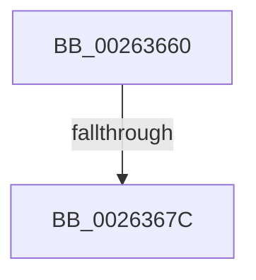

# ExReleaseAutoExpandPushLockShared

- RVA: `0x00263660`–`0x00263695` (길이 `53` bytes)
- VA: `0x0000000140263660`
- 실행 섹션: `.text`
- PDB 이름 있음: `예`; PDB Function 태그: `아니요`
- unwind 정보 RVA: `0x000646E4`
- 디코드: `15`개 명령, `53/53` bytes 표시
- 미해석 바이트: `0` (있으면 어셈블리에 `.byte`로 보존)

> 이 문서는 커널 이미지의 기계어와 PDB 기호를 분석해 생성했습니다. 4번과 5번은 함수 원형과 자료형을 바이너리 사용 방식에서 추정한 C 해석이며 원본 소스 복구 결과는 아닙니다.

## 1. Dependencies

- 직접 호출 지점: **1**; 고유 호출 대상: **1**
- 직접 호출자로 확인된 함수: **5**
- RIP 상대 이미지 참조: **0**

### Outgoing calls
- `0x0026368F` → [KeBugCheckEx](../4F/KeBugCheckEx_function_004FD660.md) (function, `0x004FD660`)

### Direct callers
- [FsRtlLookupPerFileObjectContext](FsRtlLookupPerFileObjectContext_function_002641F0.md) at `0x00264272`
- [FsRtlLookupPerStreamContextInternal](FsRtlLookupPerStreamContextInternal_function_00265020.md) at `0x002650A1`
- [FsRtlReleaseAutoExpandPushLockShared](FsRtlReleaseAutoExpandPushLockShared_function_00265514.md) at `0x0026551A`
- [MiUnlockLoaderEntry](../2A/MiUnlockLoaderEntry_function_002A3E28.md) at `0x002A3ED2`
- [MiUnlockAwePagesShared](../4C/MiUnlockAwePagesShared_function_004C66C4.md) at `0x004C66D5`

### Static image references
- 디코드된 RIP-relative 메모리 참조가 없습니다.

## 2. Other-region calls and transfers

- 다른 실행 섹션으로 향하는 call: **0**
- call이 아닌 외부 분기/꼬리 이동: **1**
  - `0x00263676` → [sub_0026379F](Unknown_function_0026379F.md) (`tail-transfer`)

## 3. Assembly (complete function range)

```asm
00263660  40 55                           push rbp
00263662  56                              push rsi
00263663  48 83 EC 38                     sub rsp, 0x38
00263667  33 ED                           xor ebp, ebp
00263669  8B F2                           mov esi, edx
0026366B  48 89 6C 24 60                  mov qword ptr [rsp + 0x60], rbp
00263670  F7 C2 F8 FF FF FF               test edx, 0xfffffff8
00263676  0F 84 23 01 00 00               je 0x14026379f
0026367C  4C 8B C1                        mov r8, rcx
0026367F  48 89 6C 24 20                  mov qword ptr [rsp + 0x20], rbp
00263684  B9 52 01 00 00                  mov ecx, 0x152
00263689  48 8B D6                        mov rdx, rsi
0026368C  45 33 C9                        xor r9d, r9d
0026368F  E8 CC 9F 29 00                  call 0x1404fd660
00263694  CC                              int3
```

## 4. C-style interpretation (structured pseudocode)

```c
__int64 __fastcall ExReleaseAutoExpandPushLockShared(__int64 a1, int a2, __int64 a3, int a4)
{
    __int64 result;
    __int64 v_rbp;
    __int64 v_rsp;
    unsigned __int64 v_stack_m28;
    unsigned __int64 v_stack_p18;

    v_rsp = (v_rsp) - (56);
    v_rbp = 0;
    v_stack_p18 = 0;
    v_stack_m28 = 0;
    a4 = 0;
    result = KeBugCheckEx(338, (unsigned int)(a2), a1, a4);
    return result;
}
```

## 5. (Beta) C Style

```c
int64_t ExReleaseAutoExpandPushLockShared(int64_t Arg1, int32_t Arg2, int64_t Arg3, int32_t Arg4)
{
    int64_t result;
    int64_t local_rbp;
    int64_t local_rsp;
    uint64_t v_stack_m28;
    uint64_t v_stack_p18;

    local_rsp = (local_rsp) - (56);
    local_rbp = 0;
    v_stack_p18 = 0;
    v_stack_m28 = 0;
    Arg4 = 0;
    result = KeBugCheckEx(338, (uint32_t)(Arg2), Arg1, Arg4);
    return result;
}
```

## 6. Execution-region graph

[열기: 2D/3D 그래프와 함수 탐색 컨트롤 패널](../../../control-panel.html?section=text&rva=0x00263660&view=graph)

- 2D 그래프는 위에서 아래로 흐르고, 3D 그래프는 빈 공간을 드래그해 회전합니다. Shift+드래그는 이동, 휠은 확대·축소, 함수 노드 선택은 대상 보고서 이동입니다.

### Static fallback


