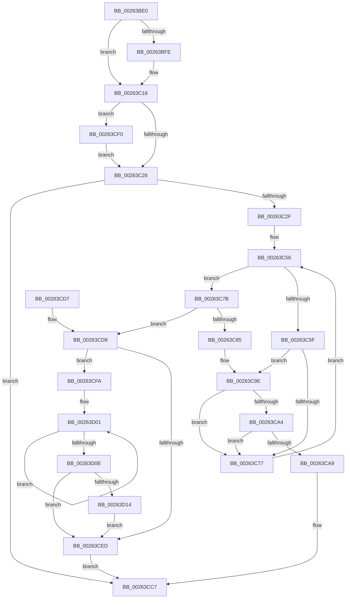

# ExReleaseCacheAwarePushLockSharedEx

- RVA: `0x00263BE0`–`0x00263D1B` (길이 `315` bytes)
- VA: `0x0000000140263BE0`
- 실행 섹션: `.text`
- PDB 이름 있음: `예`; PDB Function 태그: `아니요`
- unwind 정보 RVA: `0x000647B0`
- 디코드: `87`개 명령, `315/315` bytes 표시
- 미해석 바이트: `0` (있으면 어셈블리에 `.byte`로 보존)

> 이 문서는 커널 이미지의 기계어와 PDB 기호를 분석해 생성했습니다. 4번과 5번은 함수 원형과 자료형을 바이너리 사용 방식에서 추정한 C 해석이며 원본 소스 복구 결과는 아닙니다.

## 1. Dependencies

- 직접 호출 지점: **5**; 고유 호출 대상: **4**
- 직접 호출자로 확인된 함수: **0**
- RIP 상대 이미지 참조: **0**

### Outgoing calls
- `0x00263C10` → [KeBugCheckEx](../4F/KeBugCheckEx_function_004FD660.md) (function, `0x004FD660`)
- `0x00263C98` → [KeBugCheckEx](../4F/KeBugCheckEx_function_004FD660.md) (function, `0x004FD660`)
- `0x00263CC2` → [KiAbEntryFreeAndEnableInterrupts](KiAbEntryFreeAndEnableInterrupts_function_002622D0.md) (function, `0x002622D0`)
- `0x00263CF0` → [ExfReleasePushLockShared](ExfReleasePushLockShared_function_00263440.md) (function, `0x00263440`)
- `0x00263D14` → [KiRemoveSystemWorkPriorityKick](KiRemoveSystemWorkPriorityKick_function_002631D0.md) (function, `0x002631D0`)

### Direct callers
- 이 함수 시작 RVA로 연결되는 직접 call은 확인되지 않았습니다. 간접 호출은 완전히 역산할 수 없습니다.

### Static image references
- 디코드된 RIP-relative 메모리 참조가 없습니다.

## 2. Other-region calls and transfers

- 다른 실행 섹션으로 향하는 call: **0**
- 별도 외부 분기/꼬리 이동을 확인하지 못했습니다.

## 3. Assembly (complete function range)

```asm
00263BE0  48 89 5C 24 08                  mov qword ptr [rsp + 8], rbx
00263BE5  48 89 74 24 10                  mov qword ptr [rsp + 0x10], rsi
00263BEA  57                              push rdi
00263BEB  48 83 EC 30                     sub rsp, 0x30
00263BEF  33 F6                           xor esi, esi
00263BF1  8B DA                           mov ebx, edx
00263BF3  48 8B F9                        mov rdi, rcx
00263BF6  F7 C2 F8 FF FF FF               test edx, 0xfffffff8
00263BFC  74 18                           je 0x140263c16
00263BFE  4C 8B C1                        mov r8, rcx
00263C01  48 89 74 24 20                  mov qword ptr [rsp + 0x20], rsi
00263C06  B9 52 01 00 00                  mov ecx, 0x152
00263C0B  8B D3                           mov edx, ebx
00263C0D  45 33 C9                        xor r9d, r9d
00263C10  E8 4B 9A 29 00                  call 0x1404fd660
00263C15  CC                              int3
00263C16  B8 11 00 00 00                  mov eax, 0x11
00263C1B  F0 48 0F B1 31                  lock cmpxchg qword ptr [rcx], rsi
00263C20  0F 85 CA 00 00 00               jne 0x140263cf0
00263C26  F6 C3 02                        test bl, 2
00263C29  0F 85 98 00 00 00               jne 0x140263cc7
00263C2F  4C 8B 5F 10                     mov r11, qword ptr [rdi + 0x10]
00263C33  65 4C 8B 14 25 88 01 00 00      mov r10, qword ptr gs:[0x188]
00263C3C  FA                              cli
00263C3D  4D 8B 82 70 04 00 00            mov r8, qword ptr [r10 + 0x470]
00263C44  4D 8B CB                        mov r9, r11
00263C47  48 BF FC FF FF FF FF FF FF 7F   movabs rdi, 0x7ffffffffffffffc
00263C51  8B C6                           mov eax, esi
00263C53  4C 23 CF                        and r9, rdi
00263C56  41 0F B6 48 0C                  movzx ecx, byte ptr [r8 + 0xc]
00263C5B  3B C1                           cmp eax, ecx
00263C5D  73 1C                           jae 0x140263c7b
00263C5F  8B C8                           mov ecx, eax
00263C61  48 6B D9 58                     imul rbx, rcx, 0x58
00263C65  49 03 D8                        add rbx, r8
00263C68  48 8B 53 10                     mov rdx, qword ptr [rbx + 0x10]
00263C6C  48 8B CA                        mov rcx, rdx
00263C6F  48 23 CF                        and rcx, rdi
00263C72  49 3B C9                        cmp rcx, r9
00263C75  74 27                           je 0x140263c9e
00263C77  FF C0                           inc eax
00263C79  EB DB                           jmp 0x140263c56
00263C7B  41 8B 42 78                     mov eax, dword ptr [r10 + 0x78]
00263C7F  0F BA E0 10                     bt eax, 0x10
00263C83  72 53                           jb 0x140263cd8
00263C85  45 33 C9                        xor r9d, r9d
00263C88  48 89 74 24 20                  mov qword ptr [rsp + 0x20], rsi
00263C8D  4D 8B C3                        mov r8, r11
00263C90  49 8B D2                        mov rdx, r10
00263C93  B9 62 01 00 00                  mov ecx, 0x162
00263C98  E8 C3 99 29 00                  call 0x1404fd660
00263C9D  CC                              int3
00263C9E  40 38 73 1A                     cmp byte ptr [rbx + 0x1a], sil
00263CA2  74 D3                           je 0x140263c77
00263CA4  F6 C2 01                        test dl, 1
00263CA7  75 CE                           jne 0x140263c77
00263CA9  41 B9 01 00 00 00               mov r9d, 1
00263CAF  40 88 73 1A                     mov byte ptr [rbx + 0x1a], sil
00263CB3  4D 8B C3                        mov r8, r11
00263CB6  48 89 74 24 20                  mov qword ptr [rsp + 0x20], rsi
00263CBB  49 8B D2                        mov rdx, r10
00263CBE  48 8D 4B 10                     lea rcx, [rbx + 0x10]
00263CC2  E8 09 E6 FF FF                  call 0x1402622d0
00263CC7  48 8B 5C 24 40                  mov rbx, qword ptr [rsp + 0x40]
00263CCC  48 8B 74 24 48                  mov rsi, qword ptr [rsp + 0x48]
00263CD1  48 83 C4 30                     add rsp, 0x30
00263CD5  5F                              pop rdi
00263CD6  C3                              ret
00263CD7  CC                              int3
00263CD8  65 48 8B 0C 25 20 00 00 00      mov rcx, qword ptr gs:[0x20]
00263CE1  4C 8B 81 B8 8E 00 00            mov r8, qword ptr [rcx + 0x8eb8]
00263CE8  4D 85 C0                        test r8, r8
00263CEB  75 0D                           jne 0x140263cfa
00263CED  FB                              sti
00263CEE  EB D7                           jmp 0x140263cc7
00263CF0  E8 4B F7 FF FF                  call 0x140263440
00263CF5  E9 2C FF FF FF                  jmp 0x140263c26
00263CFA  41 0F 0D 08                     prefetchw byte ptr [r8]
00263CFE  41 8B 00                        mov eax, dword ptr [r8]
00263D01  8B D0                           mov edx, eax
00263D03  0F BA F2 15                     btr edx, 0x15
00263D07  F0 41 0F B1 10                  lock cmpxchg dword ptr [r8], edx
00263D0C  75 F3                           jne 0x140263d01
00263D0E  0F BA E0 15                     bt eax, 0x15
00263D12  73 D9                           jae 0x140263ced
00263D14  E8 B7 F4 FF FF                  call 0x1402631d0
00263D19  EB D2                           jmp 0x140263ced
```

## 4. C-style interpretation (structured pseudocode)

```c
__int64 __fastcall ExReleaseCacheAwarePushLockSharedEx(__int64 a1, int a2, __int64 a3, int a4)
{
    __int64 result;
    __int64 v_rbx;
    __int64 v_rsi;
    __int64 v_rsp;
    unsigned __int64 v_stack_m18;
    unsigned __int64 v_stack_p10;
    unsigned __int64 v_stack_p8;

    v_stack_p8 = v_rbx;
    v_stack_p10 = v_rsi;
    v_rsp = (v_rsp) - (48);
    v_rsi = 0;
    if (((a2) & (0xFFFFFFF8ULL)) != 0) {
        a3 = a1;
        v_stack_m18 = 0;
        a1 = 338;
        a2 = (unsigned int)((unsigned int)(a2));
        a4 = 0;
        result = KeBugCheckEx(a1, a2, a3, a4);
    }
    if (condition_is_not_equal) goto loc_00263CF0;
loc_00263C26:
    if ((((unsigned __int8)((unsigned int)(a2))) & (2)) != 0) goto loc_00263CC7;
    a4 = (*(unsigned __int64 *)(a1 + 16)) & (a1);
loc_00263C56:
    if (0 >= ((unsigned int)(*(unsigned __int8 *)(*(unsigned __int64 *)(*(unsigned __int64 *)(gs_base + (0 + 392)) + 1136) + 12)))) goto loc_00263C7B;
    v_rbx = ((unsigned int)(a2)) * (0);
    v_rbx = (v_rbx) + (*(unsigned __int64 *)(*(unsigned __int64 *)(gs_base + (0 + 392)) + 1136));
    a1 = (*(unsigned __int64 *)(v_rbx + 16)) & (a1);
    if (a1 == a4) goto loc_00263C9E;
loc_00263C77:
    result = (unsigned int)((0) + 1);
    goto loc_00263C56;
loc_00263C7B:
    if (a1 < a4) goto loc_00263CD8;
    a4 = 0;
    v_stack_m18 = 0;
    result = KeBugCheckEx(354, *(unsigned __int64 *)(gs_base + (0 + 392)), *(unsigned __int64 *)(a1 + 16), a4);
loc_00263C9E:
    if ((*(unsigned __int8 *)(v_rbx + 26)) == 0) goto loc_00263C77;
    if ((((unsigned __int8)(*(unsigned __int64 *)(gs_base + (0 + 392)))) & (1)) != 0) goto loc_00263C77;
    *(unsigned __int8 *)(v_rbx + 26) = 0;
    v_stack_m18 = 0;
    result = KiAbEntryFreeAndEnableInterrupts(v_rbx + 16, *(unsigned __int64 *)(gs_base + (0 + 392)), *(unsigned __int64 *)(a1 + 16), 1);
loc_00263CC7:
    v_rsp = (v_rsp) + (48);
    return result;
loc_00263CD8:
    if (*(unsigned __int64 *)(*(unsigned __int64 *)(gs_base + (0 + 32)) + 36536) != 0) goto loc_00263CFA;
loc_00263CED:
    goto loc_00263CC7;
loc_00263CF0:
    result = ExfReleasePushLockShared(*(unsigned __int64 *)(gs_base + (0 + 32)), *(unsigned __int64 *)(gs_base + (0 + 392)), *(unsigned __int64 *)(*(unsigned __int64 *)(gs_base + (0 + 32)) + 36536), 1);
    goto loc_00263C26;
loc_00263CFA:
loc_00263D01:
    if (*(unsigned __int64 *)(*(unsigned __int64 *)(gs_base + (0 + 32)) + 36536) != 0) goto loc_00263D01;
    if (condition_is_above_or_equal) goto loc_00263CED;
    result = KiRemoveSystemWorkPriorityKick(*(unsigned __int64 *)(gs_base + (0 + 32)), (unsigned int)((unsigned int)((unsigned int)(*(unsigned int *)(*(unsigned __int64 *)(*(unsigned __int64 *)(gs_base + (0 + 32)) + 36536))))), *(unsigned __int64 *)(*(unsigned __int64 *)(gs_base + (0 + 32)) + 36536), 1);
    goto loc_00263CED;
}
```

## 5. (Beta) C Style

```c
int64_t ExReleaseCacheAwarePushLockSharedEx(void *Arg1, int32_t Arg2, int64_t Arg3, int32_t Arg4)
{
    uint8_t *arg1 = (uint8_t *)Arg1;

    int64_t result;
    int64_t local_rbx;
    int64_t local_rsi;
    int64_t local_rsp;
    uint64_t v_stack_m18;
    uint64_t v_stack_p10;
    uint64_t v_stack_p8;

    v_stack_p8 = local_rbx;
    v_stack_p10 = local_rsi;
    local_rsp = (local_rsp) - (48);
    local_rsi = 0;
    if (((Arg2) & (0xFFFFFFF8ULL)) != 0) {
        Arg3 = Arg1;
        v_stack_m18 = 0;
        Arg1 = 338;
        Arg2 = (uint32_t)((uint32_t)(Arg2));
        Arg4 = 0;
        result = KeBugCheckEx(Arg1, Arg2, Arg3, Arg4);
    }
    if (condition_is_not_equal) goto loc_00263CF0;
loc_00263C26:
    if ((((uint8_t)((uint32_t)(Arg2))) & (2)) != 0) goto loc_00263CC7;
    Arg4 = (*(uint64_t *)(arg1 + 0x10)) & (Arg1);
loc_00263C56:
    if (0 >= ((uint32_t)(*(uint8_t *)(*(uint64_t *)(*(uint64_t *)(gs_base + (0 + 0x188)) + 0x470) + 0xC)))) goto loc_00263C7B;
    local_rbx = ((uint32_t)(Arg2)) * (0);
    local_rbx = (local_rbx) + (*(uint64_t *)(*(uint64_t *)(gs_base + (0 + 0x188)) + 0x470));
    Arg1 = (*(uint64_t *)(local_rbx + 0x10)) & (Arg1);
    if (Arg1 == Arg4) goto loc_00263C9E;
loc_00263C77:
    result = (uint32_t)((0) + 1);
    goto loc_00263C56;
loc_00263C7B:
    if (Arg1 < Arg4) goto loc_00263CD8;
    Arg4 = 0;
    v_stack_m18 = 0;
    result = KeBugCheckEx(354, *(uint64_t *)(gs_base + (0 + 0x188)), *(uint64_t *)(arg1 + 0x10), Arg4);
loc_00263C9E:
    if ((*(uint8_t *)(local_rbx + 0x1A)) == 0) goto loc_00263C77;
    if ((((uint8_t)(*(uint64_t *)(gs_base + (0 + 0x188)))) & (1)) != 0) goto loc_00263C77;
    *(uint8_t *)(local_rbx + 0x1A) = 0;
    v_stack_m18 = 0;
    result = KiAbEntryFreeAndEnableInterrupts(local_rbx + 16, *(uint64_t *)(gs_base + (0 + 0x188)), *(uint64_t *)(arg1 + 0x10), 1);
loc_00263CC7:
    local_rsp = (local_rsp) + (48);
    return result;
loc_00263CD8:
    if (*(uint64_t *)(*(uint64_t *)(gs_base + (0 + 0x20)) + 0x8EB8) != 0) goto loc_00263CFA;
loc_00263CED:
    goto loc_00263CC7;
loc_00263CF0:
    result = ExfReleasePushLockShared(*(uint64_t *)(gs_base + (0 + 0x20)), *(uint64_t *)(gs_base + (0 + 0x188)), *(uint64_t *)(*(uint64_t *)(gs_base + (0 + 0x20)) + 0x8EB8), 1);
    goto loc_00263C26;
loc_00263CFA:
loc_00263D01:
    if (*(uint64_t *)(*(uint64_t *)(gs_base + (0 + 0x20)) + 0x8EB8) != 0) goto loc_00263D01;
    if (condition_is_above_or_equal) goto loc_00263CED;
    result = KiRemoveSystemWorkPriorityKick(*(uint64_t *)(gs_base + (0 + 0x20)), (uint32_t)((uint32_t)((uint32_t)(*(uint32_t *)(*(uint64_t *)(*(uint64_t *)(gs_base + (0 + 0x20)) + 0x8EB8))))), *(uint64_t *)(*(uint64_t *)(gs_base + (0 + 0x20)) + 0x8EB8), 1);
    goto loc_00263CED;
}
```

### 관측된 메모리 오프셋

구조체 형식이 확인되지 않은 접근은 인자 기준의 오프셋으로만 기록했습니다.

| 기준 인자 | 오프셋 표현 | 폭 (bit) | 접근 |
|---|---:|---:|---|
| `Arg1` | `+ 0x10` | `64` | `R` |

## 6. Execution-region graph

[열기: 2D/3D 그래프와 함수 탐색 컨트롤 패널](../../../control-panel.html?section=text&rva=0x00263BE0&view=graph)

- 2D 그래프는 위에서 아래로 흐르고, 3D 그래프는 빈 공간을 드래그해 회전합니다. Shift+드래그는 이동, 휠은 확대·축소, 함수 노드 선택은 대상 보고서 이동입니다.

### Static fallback


