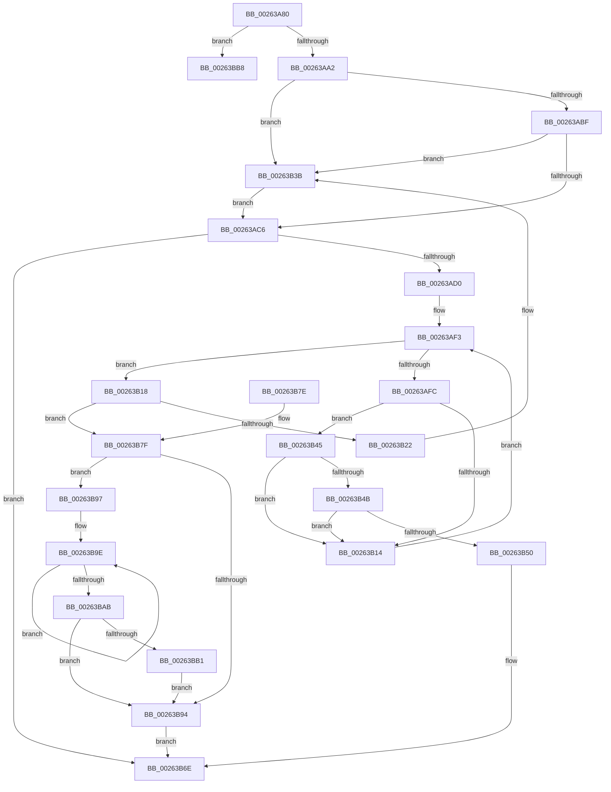

# ExReleasePushLockEx

- RVA: `0x00263A80`–`0x00263BD1` (길이 `337` bytes)
- VA: `0x0000000140263A80`
- 실행 섹션: `.text`
- PDB 이름 있음: `예`; PDB Function 태그: `아니요`
- unwind 정보 RVA: `0x0006479C`
- 디코드: `95`개 명령, `337/337` bytes 표시
- 미해석 바이트: `0` (있으면 어셈블리에 `.byte`로 보존)

> 이 문서는 커널 이미지의 기계어와 PDB 기호를 분석해 생성했습니다. 4번과 5번은 함수 원형과 자료형을 바이너리 사용 방식에서 추정한 C 해석이며 원본 소스 복구 결과는 아닙니다.

## 1. Dependencies

- 직접 호출 지점: **5**; 고유 호출 대상: **4**
- 직접 호출자로 확인된 함수: **0**
- RIP 상대 이미지 참조: **0**

### Outgoing calls
- `0x00263B35` → [KeBugCheckEx](../4F/KeBugCheckEx_function_004FD660.md) (function, `0x004FD660`)
- `0x00263B3E` → [ExfReleasePushLock](ExfReleasePushLock_function_002638D0.md) (function, `0x002638D0`)
- `0x00263B69` → [KiAbEntryFreeAndEnableInterrupts](KiAbEntryFreeAndEnableInterrupts_function_002622D0.md) (function, `0x002622D0`)
- `0x00263BB1` → [KiRemoveSystemWorkPriorityKick](KiRemoveSystemWorkPriorityKick_function_002631D0.md) (function, `0x002631D0`)
- `0x00263BCB` → [KeBugCheckEx](../4F/KeBugCheckEx_function_004FD660.md) (function, `0x004FD660`)

### Direct callers
- 이 함수 시작 RVA로 연결되는 직접 call은 확인되지 않았습니다. 간접 호출은 완전히 역산할 수 없습니다.

### Static image references
- 디코드된 RIP-relative 메모리 참조가 없습니다.

## 2. Other-region calls and transfers

- 다른 실행 섹션으로 향하는 call: **0**
- 별도 외부 분기/꼬리 이동을 확인하지 못했습니다.

## 3. Assembly (complete function range)

```asm
00263A80  48 89 5C 24 08                  mov qword ptr [rsp + 8], rbx
00263A85  48 89 74 24 10                  mov qword ptr [rsp + 0x10], rsi
00263A8A  57                              push rdi
00263A8B  48 83 EC 30                     sub rsp, 0x30
00263A8F  33 F6                           xor esi, esi
00263A91  8B FA                           mov edi, edx
00263A93  48 8B D9                        mov rbx, rcx
00263A96  F7 C2 F8 FF FF FF               test edx, 0xfffffff8
00263A9C  0F 85 16 01 00 00               jne 0x140263bb8
00263AA2  0F 0D 09                        prefetchw byte ptr [rcx]
00263AA5  48 8B 01                        mov rax, qword ptr [rcx]
00263AA8  48 8B C8                        mov rcx, rax
00263AAB  48 83 E1 F0                     and rcx, 0xfffffffffffffff0
00263AAF  48 83 F9 10                     cmp rcx, 0x10
00263AB3  48 8D 50 F0                     lea rdx, [rax - 0x10]
00263AB7  48 0F 46 D6                     cmovbe rdx, rsi
00263ABB  A8 02                           test al, 2
00263ABD  75 7C                           jne 0x140263b3b
00263ABF  F0 48 0F B1 13                  lock cmpxchg qword ptr [rbx], rdx
00263AC4  75 75                           jne 0x140263b3b
00263AC6  40 F6 C7 02                     test dil, 2
00263ACA  0F 85 9E 00 00 00               jne 0x140263b6e
00263AD0  65 4C 8B 14 25 88 01 00 00      mov r10, qword ptr gs:[0x188]
00263AD9  FA                              cli
00263ADA  4D 8B 82 70 04 00 00            mov r8, qword ptr [r10 + 0x470]
00263AE1  4C 8B CB                        mov r9, rbx
00263AE4  48 BF FC FF FF FF FF FF FF 7F   movabs rdi, 0x7ffffffffffffffc
00263AEE  8B C6                           mov eax, esi
00263AF0  4C 23 CF                        and r9, rdi
00263AF3  41 0F B6 48 0C                  movzx ecx, byte ptr [r8 + 0xc]
00263AF8  3B C1                           cmp eax, ecx
00263AFA  73 1C                           jae 0x140263b18
00263AFC  8B C8                           mov ecx, eax
00263AFE  4C 6B D9 58                     imul r11, rcx, 0x58
00263B02  4D 03 D8                        add r11, r8
00263B05  49 8B 53 10                     mov rdx, qword ptr [r11 + 0x10]
00263B09  48 8B CA                        mov rcx, rdx
00263B0C  48 23 CF                        and rcx, rdi
00263B0F  49 3B C9                        cmp rcx, r9
00263B12  74 31                           je 0x140263b45
00263B14  FF C0                           inc eax
00263B16  EB DB                           jmp 0x140263af3
00263B18  41 8B 42 78                     mov eax, dword ptr [r10 + 0x78]
00263B1C  0F BA E0 10                     bt eax, 0x10
00263B20  72 5D                           jb 0x140263b7f
00263B22  45 33 C9                        xor r9d, r9d
00263B25  48 89 74 24 20                  mov qword ptr [rsp + 0x20], rsi
00263B2A  4C 8B C3                        mov r8, rbx
00263B2D  49 8B D2                        mov rdx, r10
00263B30  B9 62 01 00 00                  mov ecx, 0x162
00263B35  E8 26 9B 29 00                  call 0x1404fd660
00263B3A  CC                              int3
00263B3B  48 8B CB                        mov rcx, rbx
00263B3E  E8 8D FD FF FF                  call 0x1402638d0
00263B43  EB 81                           jmp 0x140263ac6
00263B45  41 38 73 1A                     cmp byte ptr [r11 + 0x1a], sil
00263B49  74 C9                           je 0x140263b14
00263B4B  F6 C2 01                        test dl, 1
00263B4E  75 C4                           jne 0x140263b14
00263B50  41 B9 01 00 00 00               mov r9d, 1
00263B56  41 88 73 1A                     mov byte ptr [r11 + 0x1a], sil
00263B5A  4C 8B C3                        mov r8, rbx
00263B5D  48 89 74 24 20                  mov qword ptr [rsp + 0x20], rsi
00263B62  49 8B D2                        mov rdx, r10
00263B65  49 8D 4B 10                     lea rcx, [r11 + 0x10]
00263B69  E8 62 E7 FF FF                  call 0x1402622d0
00263B6E  48 8B 5C 24 40                  mov rbx, qword ptr [rsp + 0x40]
00263B73  48 8B 74 24 48                  mov rsi, qword ptr [rsp + 0x48]
00263B78  48 83 C4 30                     add rsp, 0x30
00263B7C  5F                              pop rdi
00263B7D  C3                              ret
00263B7E  CC                              int3
00263B7F  65 48 8B 0C 25 20 00 00 00      mov rcx, qword ptr gs:[0x20]
00263B88  4C 8B 81 B8 8E 00 00            mov r8, qword ptr [rcx + 0x8eb8]
00263B8F  4D 85 C0                        test r8, r8
00263B92  75 03                           jne 0x140263b97
00263B94  FB                              sti
00263B95  EB D7                           jmp 0x140263b6e
00263B97  41 0F 0D 08                     prefetchw byte ptr [r8]
00263B9B  41 8B 00                        mov eax, dword ptr [r8]
00263B9E  8B D0                           mov edx, eax
00263BA0  0F BA F2 15                     btr edx, 0x15
00263BA4  F0 41 0F B1 10                  lock cmpxchg dword ptr [r8], edx
00263BA9  75 F3                           jne 0x140263b9e
00263BAB  0F BA E0 15                     bt eax, 0x15
00263BAF  73 E3                           jae 0x140263b94
00263BB1  E8 1A F6 FF FF                  call 0x1402631d0
00263BB6  EB DC                           jmp 0x140263b94
00263BB8  48 8B D7                        mov rdx, rdi
00263BBB  48 89 74 24 20                  mov qword ptr [rsp + 0x20], rsi
00263BC0  45 33 C9                        xor r9d, r9d
00263BC3  4C 8B C3                        mov r8, rbx
00263BC6  B9 52 01 00 00                  mov ecx, 0x152
00263BCB  E8 90 9A 29 00                  call 0x1404fd660
00263BD0  CC                              int3
```

## 4. C-style interpretation (structured pseudocode)

```c
__int64 __fastcall ExReleasePushLockEx(__int64 a1, int a2)
{
    __int64 result;
    __int64 v_r11;
    __int64 v_rsi;
    __int64 v_rsp;
    unsigned __int64 v_stack_m18;
    unsigned __int64 v_stack_p10;
    unsigned __int64 v_stack_p20;
    unsigned __int64 v_stack_p8;

    v_stack_p8 = v_rbx;
    v_stack_p10 = v_rsi;
    v_rsp = (v_rsp) - (48);
    v_rsi = 0;
    if (((a2) & (0xFFFFFFF8ULL)) != 0) goto loc_00263BB8;
    a1 = (*(unsigned __int64 *)(a1)) & (-16);
    a2 = *(unsigned __int64 *)(a1) - 16;
    if (a1 <= 16) { a2 = 0; }
    if ((((unsigned __int8)(*(unsigned __int64 *)(a1))) & (2)) != 0) goto loc_00263B3B;
    if ((((unsigned __int8)(*(unsigned __int64 *)(a1))) & (2)) != 0) goto loc_00263B3B;
loc_00263AC6:
    if ((((unsigned __int8)((unsigned int)(a2))) & (2)) != 0) goto loc_00263B6E;
    a4 = (a1) & ((unsigned int)(a2));
loc_00263AF3:
    if (0 >= ((unsigned int)(*(unsigned __int8 *)(*(unsigned __int64 *)(*(unsigned __int64 *)(gs_base + (0 + 392)) + 1136) + 12)))) goto loc_00263B18;
    v_r11 = (v_r11) * (0);
    v_r11 = (v_r11) + (*(unsigned __int64 *)(*(unsigned __int64 *)(gs_base + (0 + 392)) + 1136));
    a1 = (*(unsigned __int64 *)(v_r11 + 16)) & ((unsigned int)(a2));
    if (a1 == a4) goto loc_00263B45;
loc_00263B14:
    result = (unsigned int)((0) + 1);
    goto loc_00263AF3;
loc_00263B18:
    if (a1 < a4) goto loc_00263B7F;
    a4 = 0;
    v_stack_m18 = 0;
    result = KeBugCheckEx(354, *(unsigned __int64 *)(gs_base + (0 + 392)), a1, a4);
loc_00263B3B:
    result = ExfReleasePushLock(a1, *(unsigned __int64 *)(gs_base + (0 + 392)), a1, a4);
    goto loc_00263AC6;
loc_00263B45:
    if ((*(unsigned __int8 *)(v_r11 + 26)) == 0) goto loc_00263B14;
    if ((((unsigned __int8)(*(unsigned __int64 *)(gs_base + (0 + 392)))) & (1)) != 0) goto loc_00263B14;
    *(unsigned __int8 *)(v_r11 + 26) = 0;
    v_stack_m18 = 0;
    result = KiAbEntryFreeAndEnableInterrupts(v_r11 + 16, *(unsigned __int64 *)(gs_base + (0 + 392)), a1, 1);
loc_00263B6E:
    v_rsp = (v_rsp) + (48);
    return result;
loc_00263B7F:
    if (*(unsigned __int64 *)(*(unsigned __int64 *)(gs_base + (0 + 32)) + 36536) != 0) goto loc_00263B97;
loc_00263B94:
    goto loc_00263B6E;
loc_00263B97:
loc_00263B9E:
    if (*(unsigned __int64 *)(*(unsigned __int64 *)(gs_base + (0 + 32)) + 36536) != 0) goto loc_00263B9E;
    if (condition_is_above_or_equal) goto loc_00263B94;
    result = KiRemoveSystemWorkPriorityKick(*(unsigned __int64 *)(gs_base + (0 + 32)), (unsigned int)((unsigned int)((unsigned int)(*(unsigned int *)(*(unsigned __int64 *)(*(unsigned __int64 *)(gs_base + (0 + 32)) + 36536))))), *(unsigned __int64 *)(*(unsigned __int64 *)(gs_base + (0 + 32)) + 36536), 1);
    goto loc_00263B94;
loc_00263BB8:
    v_stack_p20 = v_stack_p10;
    a4 = 0;
    result = KeBugCheckEx(338, (unsigned int)(a2), v_stack_p8, a4);
    return result;
}
```

## 5. (Beta) C Style

```c
int64_t ExReleasePushLockEx(void *Arg1, int32_t Arg2)
{
    uint8_t *arg1 = (uint8_t *)Arg1;

    int64_t result;
    int64_t local_r11;
    int64_t local_rsi;
    int64_t local_rsp;
    uint64_t v_stack_m18;
    uint64_t v_stack_p10;
    uint64_t v_stack_p20;
    uint64_t v_stack_p8;

    v_stack_p8 = local_rbx;
    v_stack_p10 = local_rsi;
    local_rsp = (local_rsp) - (48);
    local_rsi = 0;
    if (((Arg2) & (0xFFFFFFF8ULL)) != 0) goto loc_00263BB8;
    Arg1 = (*(uint64_t *)(arg1)) & (-16);
    Arg2 = *(uint64_t *)(arg1) - 16;
    if (Arg1 <= 16) { Arg2 = 0; }
    if ((((uint8_t)(*(uint64_t *)(arg1))) & (2)) != 0) goto loc_00263B3B;
    if ((((uint8_t)(*(uint64_t *)(arg1))) & (2)) != 0) goto loc_00263B3B;
loc_00263AC6:
    if ((((uint8_t)((uint32_t)(Arg2))) & (2)) != 0) goto loc_00263B6E;
    a4 = (Arg1) & ((uint32_t)(Arg2));
loc_00263AF3:
    if (0 >= ((uint32_t)(*(uint8_t *)(*(uint64_t *)(*(uint64_t *)(gs_base + (0 + 0x188)) + 0x470) + 0xC)))) goto loc_00263B18;
    local_r11 = (local_r11) * (0);
    local_r11 = (local_r11) + (*(uint64_t *)(*(uint64_t *)(gs_base + (0 + 0x188)) + 0x470));
    Arg1 = (*(uint64_t *)(local_r11 + 0x10)) & ((uint32_t)(Arg2));
    if (Arg1 == a4) goto loc_00263B45;
loc_00263B14:
    result = (uint32_t)((0) + 1);
    goto loc_00263AF3;
loc_00263B18:
    if (Arg1 < a4) goto loc_00263B7F;
    a4 = 0;
    v_stack_m18 = 0;
    result = KeBugCheckEx(354, *(uint64_t *)(gs_base + (0 + 0x188)), Arg1, a4);
loc_00263B3B:
    result = ExfReleasePushLock(Arg1, *(uint64_t *)(gs_base + (0 + 0x188)), Arg1, a4);
    goto loc_00263AC6;
loc_00263B45:
    if ((*(uint8_t *)(local_r11 + 0x1A)) == 0) goto loc_00263B14;
    if ((((uint8_t)(*(uint64_t *)(gs_base + (0 + 0x188)))) & (1)) != 0) goto loc_00263B14;
    *(uint8_t *)(local_r11 + 0x1A) = 0;
    v_stack_m18 = 0;
    result = KiAbEntryFreeAndEnableInterrupts(local_r11 + 16, *(uint64_t *)(gs_base + (0 + 0x188)), Arg1, 1);
loc_00263B6E:
    local_rsp = (local_rsp) + (48);
    return result;
loc_00263B7F:
    if (*(uint64_t *)(*(uint64_t *)(gs_base + (0 + 0x20)) + 0x8EB8) != 0) goto loc_00263B97;
loc_00263B94:
    goto loc_00263B6E;
loc_00263B97:
loc_00263B9E:
    if (*(uint64_t *)(*(uint64_t *)(gs_base + (0 + 0x20)) + 0x8EB8) != 0) goto loc_00263B9E;
    if (condition_is_above_or_equal) goto loc_00263B94;
    result = KiRemoveSystemWorkPriorityKick(*(uint64_t *)(gs_base + (0 + 0x20)), (uint32_t)((uint32_t)((uint32_t)(*(uint32_t *)(*(uint64_t *)(*(uint64_t *)(gs_base + (0 + 0x20)) + 0x8EB8))))), *(uint64_t *)(*(uint64_t *)(gs_base + (0 + 0x20)) + 0x8EB8), 1);
    goto loc_00263B94;
loc_00263BB8:
    v_stack_p20 = v_stack_p10;
    a4 = 0;
    result = KeBugCheckEx(338, (uint32_t)(Arg2), v_stack_p8, a4);
    return result;
}
```

### 관측된 메모리 오프셋

구조체 형식이 확인되지 않은 접근은 인자 기준의 오프셋으로만 기록했습니다.

| 기준 인자 | 오프셋 표현 | 폭 (bit) | 접근 |
|---|---:|---:|---|
| `Arg1` | `+ 0x0` | `8` | `R` |
| `Arg1` | `+ 0x0` | `64` | `R` |

## 6. Execution-region graph

[열기: 2D/3D 그래프와 함수 탐색 컨트롤 패널](../../../control-panel.html?section=text&rva=0x00263A80&view=graph)

- 2D 그래프는 위에서 아래로 흐르고, 3D 그래프는 빈 공간을 드래그해 회전합니다. Shift+드래그는 이동, 휠은 확대·축소, 함수 노드 선택은 대상 보고서 이동입니다.

### Static fallback


