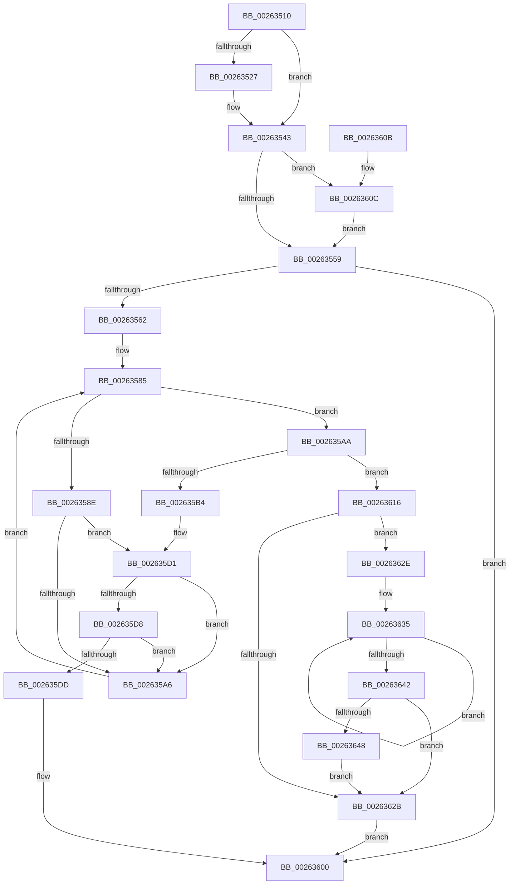

# ExReleasePushLockExclusiveEx

- RVA: `0x00263510`–`0x0026364F` (길이 `319` bytes)
- VA: `0x0000000140263510`
- 실행 섹션: `.text`
- PDB 이름 있음: `예`; PDB Function 태그: `아니요`
- unwind 정보 RVA: `0x000646D4`
- 디코드: `85`개 명령, `319/319` bytes 표시
- 미해석 바이트: `0` (있으면 어셈블리에 `.byte`로 보존)

> 이 문서는 커널 이미지의 기계어와 PDB 기호를 분석해 생성했습니다. 4번과 5번은 함수 원형과 자료형을 바이너리 사용 방식에서 추정한 C 해석이며 원본 소스 복구 결과는 아닙니다.

## 1. Dependencies

- 직접 호출 지점: **5**; 고유 호출 대상: **4**
- 직접 호출자로 확인된 함수: **0**
- RIP 상대 이미지 참조: **0**

### Outgoing calls
- `0x0026353D` → [KeBugCheckEx](../4F/KeBugCheckEx_function_004FD660.md) (function, `0x004FD660`)
- `0x002635CB` → [KeBugCheckEx](../4F/KeBugCheckEx_function_004FD660.md) (function, `0x004FD660`)
- `0x002635FB` → [KiAbEntryFreeAndEnableInterrupts](KiAbEntryFreeAndEnableInterrupts_function_002622D0.md) (function, `0x002622D0`)
- `0x0026360C` → [ExfTryToWakePushLock](ExfTryToWakePushLock_function_00265DD0.md) (function, `0x00265DD0`)
- `0x00263648` → [KiRemoveSystemWorkPriorityKick](KiRemoveSystemWorkPriorityKick_function_002631D0.md) (function, `0x002631D0`)

### Direct callers
- 이 함수 시작 RVA로 연결되는 직접 call은 확인되지 않았습니다. 간접 호출은 완전히 역산할 수 없습니다.

### Static image references
- 디코드된 RIP-relative 메모리 참조가 없습니다.

## 2. Other-region calls and transfers

- 다른 실행 섹션으로 향하는 call: **0**
- 별도 외부 분기/꼬리 이동을 확인하지 못했습니다.

## 3. Assembly (complete function range)

```asm
00263510  48 89 5C 24 08                  mov qword ptr [rsp + 8], rbx
00263515  57                              push rdi
00263516  48 83 EC 30                     sub rsp, 0x30
0026351A  8B DA                           mov ebx, edx
0026351C  48 8B F9                        mov rdi, rcx
0026351F  F7 C2 F8 FF FF FF               test edx, 0xfffffff8
00263525  74 1C                           je 0x140263543
00263527  4C 8B C1                        mov r8, rcx
0026352A  48 C7 44 24 20 00 00 00 00      mov qword ptr [rsp + 0x20], 0
00263533  B9 52 01 00 00                  mov ecx, 0x152
00263538  8B D3                           mov edx, ebx
0026353A  45 33 C9                        xor r9d, r9d
0026353D  E8 1E A1 29 00                  call 0x1404fd660
00263542  CC                              int3
00263543  48 C7 C0 FF FF FF FF            mov rax, 0xffffffffffffffff
0026354A  F0 48 0F C1 01                  lock xadd qword ptr [rcx], rax
0026354F  24 06                           and al, 6
00263551  3C 02                           cmp al, 2
00263553  0F 84 B3 00 00 00               je 0x14026360c
00263559  F6 C3 02                        test bl, 2
0026355C  0F 85 9E 00 00 00               jne 0x140263600
00263562  65 4C 8B 14 25 88 01 00 00      mov r10, qword ptr gs:[0x188]
0026356B  FA                              cli
0026356C  4D 8B 82 70 04 00 00            mov r8, qword ptr [r10 + 0x470]
00263573  4C 8B CF                        mov r9, rdi
00263576  48 BB FC FF FF FF FF FF FF 7F   movabs rbx, 0x7ffffffffffffffc
00263580  4C 23 CB                        and r9, rbx
00263583  33 C0                           xor eax, eax
00263585  41 0F B6 48 0C                  movzx ecx, byte ptr [r8 + 0xc]
0026358A  3B C1                           cmp eax, ecx
0026358C  73 1C                           jae 0x1402635aa
0026358E  8B C8                           mov ecx, eax
00263590  4C 6B D9 58                     imul r11, rcx, 0x58
00263594  4D 03 D8                        add r11, r8
00263597  49 8B 53 10                     mov rdx, qword ptr [r11 + 0x10]
0026359B  48 8B CA                        mov rcx, rdx
0026359E  48 23 CB                        and rcx, rbx
002635A1  49 3B C9                        cmp rcx, r9
002635A4  74 2B                           je 0x1402635d1
002635A6  FF C0                           inc eax
002635A8  EB DB                           jmp 0x140263585
002635AA  41 8B 42 78                     mov eax, dword ptr [r10 + 0x78]
002635AE  0F BA E0 10                     bt eax, 0x10
002635B2  72 62                           jb 0x140263616
002635B4  45 33 C9                        xor r9d, r9d
002635B7  48 C7 44 24 20 00 00 00 00      mov qword ptr [rsp + 0x20], 0
002635C0  4C 8B C7                        mov r8, rdi
002635C3  49 8B D2                        mov rdx, r10
002635C6  B9 62 01 00 00                  mov ecx, 0x162
002635CB  E8 90 A0 29 00                  call 0x1404fd660
002635D0  CC                              int3
002635D1  41 80 7B 1A 00                  cmp byte ptr [r11 + 0x1a], 0
002635D6  74 CE                           je 0x1402635a6
002635D8  F6 C2 01                        test dl, 1
002635DB  75 C9                           jne 0x1402635a6
002635DD  41 B9 01 00 00 00               mov r9d, 1
002635E3  41 C6 43 1A 00                  mov byte ptr [r11 + 0x1a], 0
002635E8  4C 8B C7                        mov r8, rdi
002635EB  48 C7 44 24 20 00 00 00 00      mov qword ptr [rsp + 0x20], 0
002635F4  49 8B D2                        mov rdx, r10
002635F7  49 8D 4B 10                     lea rcx, [r11 + 0x10]
002635FB  E8 D0 EC FF FF                  call 0x1402622d0
00263600  48 8B 5C 24 40                  mov rbx, qword ptr [rsp + 0x40]
00263605  48 83 C4 30                     add rsp, 0x30
00263609  5F                              pop rdi
0026360A  C3                              ret
0026360B  CC                              int3
0026360C  E8 BF 27 00 00                  call 0x140265dd0
00263611  E9 43 FF FF FF                  jmp 0x140263559
00263616  65 48 8B 0C 25 20 00 00 00      mov rcx, qword ptr gs:[0x20]
0026361F  4C 8B 81 B8 8E 00 00            mov r8, qword ptr [rcx + 0x8eb8]
00263626  4D 85 C0                        test r8, r8
00263629  75 03                           jne 0x14026362e
0026362B  FB                              sti
0026362C  EB D2                           jmp 0x140263600
0026362E  41 0F 0D 08                     prefetchw byte ptr [r8]
00263632  41 8B 00                        mov eax, dword ptr [r8]
00263635  8B D0                           mov edx, eax
00263637  0F BA F2 15                     btr edx, 0x15
0026363B  F0 41 0F B1 10                  lock cmpxchg dword ptr [r8], edx
00263640  75 F3                           jne 0x140263635
00263642  0F BA E0 15                     bt eax, 0x15
00263646  73 E3                           jae 0x14026362b
00263648  E8 83 FB FF FF                  call 0x1402631d0
0026364D  EB DC                           jmp 0x14026362b
```

## 4. C-style interpretation (structured pseudocode)

```c
__int64 __fastcall ExReleasePushLockExclusiveEx(__int64 a1, int a2, __int64 a3, int a4)
{
    __int64 result;
    __int64 v_r11;
    __int64 v_rsp;
    unsigned __int64 v_stack_m18;
    unsigned __int64 v_stack_p8;

    v_stack_p8 = v_rbx;
    v_rsp = (v_rsp) - (48);
    if (((a2) & (0xFFFFFFF8ULL)) != 0) {
        a3 = a1;
        v_stack_m18 = 0;
        a1 = 338;
        a2 = (unsigned int)((unsigned int)(a2));
        a4 = 0;
        result = KeBugCheckEx(a1, a2, a3, a4);
    }
    result = (unsigned __int8)((-1) & (6));
    if (((unsigned __int8)(result)) == 2) goto loc_0026360C;
loc_00263559:
    if ((((unsigned __int8)((unsigned int)(a2))) & (2)) != 0) goto loc_00263600;
    a4 = (a1) & ((unsigned int)(a2));
    result = 0;
loc_00263585:
    if (0 >= ((unsigned int)(*(unsigned __int8 *)(*(unsigned __int64 *)(*(unsigned __int64 *)(gs_base + (0 + 392)) + 1136) + 12)))) goto loc_002635AA;
    v_r11 = (v_r11) * (0);
    v_r11 = (v_r11) + (*(unsigned __int64 *)(*(unsigned __int64 *)(gs_base + (0 + 392)) + 1136));
    a1 = (*(unsigned __int64 *)(v_r11 + 16)) & ((unsigned int)(a2));
    if (a1 == a4) goto loc_002635D1;
loc_002635A6:
    result = (unsigned int)((result) + 1);
    goto loc_00263585;
loc_002635AA:
    if (a1 < a4) goto loc_00263616;
    a4 = 0;
    v_stack_m18 = 0;
    result = KeBugCheckEx(354, *(unsigned __int64 *)(gs_base + (0 + 392)), a1, a4);
loc_002635D1:
    if ((*(unsigned __int8 *)(v_r11 + 26)) == 0) goto loc_002635A6;
    if ((((unsigned __int8)(*(unsigned __int64 *)(gs_base + (0 + 392)))) & (1)) != 0) goto loc_002635A6;
    *(unsigned __int8 *)(v_r11 + 26) = 0;
    v_stack_m18 = 0;
    result = KiAbEntryFreeAndEnableInterrupts(v_r11 + 16, *(unsigned __int64 *)(gs_base + (0 + 392)), a1, 1);
loc_00263600:
    v_rsp = (v_rsp) + (48);
    return result;
loc_0026360C:
    result = ExfTryToWakePushLock(v_r11 + 16, *(unsigned __int64 *)(gs_base + (0 + 392)), a1, 1);
    goto loc_00263559;
loc_00263616:
    if (*(unsigned __int64 *)(*(unsigned __int64 *)(gs_base + (0 + 32)) + 36536) != 0) goto loc_0026362E;
loc_0026362B:
    goto loc_00263600;
loc_0026362E:
loc_00263635:
    if (*(unsigned __int64 *)(*(unsigned __int64 *)(gs_base + (0 + 32)) + 36536) != 0) goto loc_00263635;
    if (condition_is_above_or_equal) goto loc_0026362B;
    result = KiRemoveSystemWorkPriorityKick(*(unsigned __int64 *)(gs_base + (0 + 32)), (unsigned int)((unsigned int)((unsigned int)(*(unsigned int *)(*(unsigned __int64 *)(*(unsigned __int64 *)(gs_base + (0 + 32)) + 36536))))), *(unsigned __int64 *)(*(unsigned __int64 *)(gs_base + (0 + 32)) + 36536), 1);
    goto loc_0026362B;
}
```

## 5. (Beta) C Style

```c
int64_t ExReleasePushLockExclusiveEx(int64_t Arg1, int32_t Arg2, int64_t Arg3, int32_t Arg4)
{
    int64_t result;
    int64_t local_r11;
    int64_t local_rsp;
    uint64_t v_stack_m18;
    uint64_t v_stack_p8;

    v_stack_p8 = local_rbx;
    local_rsp = (local_rsp) - (48);
    if (((Arg2) & (0xFFFFFFF8ULL)) != 0) {
        Arg3 = Arg1;
        v_stack_m18 = 0;
        Arg1 = 338;
        Arg2 = (uint32_t)((uint32_t)(Arg2));
        Arg4 = 0;
        result = KeBugCheckEx(Arg1, Arg2, Arg3, Arg4);
    }
    result = (uint8_t)((-1) & (6));
    if (((uint8_t)(result)) == 2) goto loc_0026360C;
loc_00263559:
    if ((((uint8_t)((uint32_t)(Arg2))) & (2)) != 0) goto loc_00263600;
    Arg4 = (Arg1) & ((uint32_t)(Arg2));
    result = 0;
loc_00263585:
    if (0 >= ((uint32_t)(*(uint8_t *)(*(uint64_t *)(*(uint64_t *)(gs_base + (0 + 0x188)) + 0x470) + 0xC)))) goto loc_002635AA;
    local_r11 = (local_r11) * (0);
    local_r11 = (local_r11) + (*(uint64_t *)(*(uint64_t *)(gs_base + (0 + 0x188)) + 0x470));
    Arg1 = (*(uint64_t *)(local_r11 + 0x10)) & ((uint32_t)(Arg2));
    if (Arg1 == Arg4) goto loc_002635D1;
loc_002635A6:
    result = (uint32_t)((result) + 1);
    goto loc_00263585;
loc_002635AA:
    if (Arg1 < Arg4) goto loc_00263616;
    Arg4 = 0;
    v_stack_m18 = 0;
    result = KeBugCheckEx(354, *(uint64_t *)(gs_base + (0 + 0x188)), Arg1, Arg4);
loc_002635D1:
    if ((*(uint8_t *)(local_r11 + 0x1A)) == 0) goto loc_002635A6;
    if ((((uint8_t)(*(uint64_t *)(gs_base + (0 + 0x188)))) & (1)) != 0) goto loc_002635A6;
    *(uint8_t *)(local_r11 + 0x1A) = 0;
    v_stack_m18 = 0;
    result = KiAbEntryFreeAndEnableInterrupts(local_r11 + 16, *(uint64_t *)(gs_base + (0 + 0x188)), Arg1, 1);
loc_00263600:
    local_rsp = (local_rsp) + (48);
    return result;
loc_0026360C:
    result = ExfTryToWakePushLock(local_r11 + 16, *(uint64_t *)(gs_base + (0 + 0x188)), Arg1, 1);
    goto loc_00263559;
loc_00263616:
    if (*(uint64_t *)(*(uint64_t *)(gs_base + (0 + 0x20)) + 0x8EB8) != 0) goto loc_0026362E;
loc_0026362B:
    goto loc_00263600;
loc_0026362E:
loc_00263635:
    if (*(uint64_t *)(*(uint64_t *)(gs_base + (0 + 0x20)) + 0x8EB8) != 0) goto loc_00263635;
    if (condition_is_above_or_equal) goto loc_0026362B;
    result = KiRemoveSystemWorkPriorityKick(*(uint64_t *)(gs_base + (0 + 0x20)), (uint32_t)((uint32_t)((uint32_t)(*(uint32_t *)(*(uint64_t *)(*(uint64_t *)(gs_base + (0 + 0x20)) + 0x8EB8))))), *(uint64_t *)(*(uint64_t *)(gs_base + (0 + 0x20)) + 0x8EB8), 1);
    goto loc_0026362B;
}
```

## 6. Execution-region graph

[열기: 2D/3D 그래프와 함수 탐색 컨트롤 패널](../../../control-panel.html?section=text&rva=0x00263510&view=graph)

- 2D 그래프는 위에서 아래로 흐르고, 3D 그래프는 빈 공간을 드래그해 회전합니다. Shift+드래그는 이동, 휠은 확대·축소, 함수 노드 선택은 대상 보고서 이동입니다.

### Static fallback


