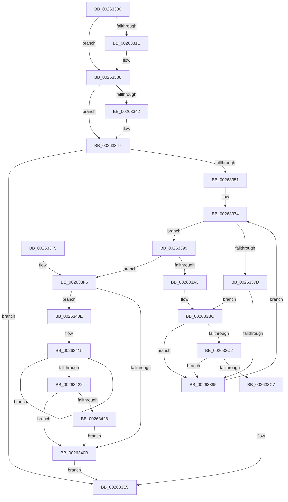

# ExReleasePushLockSharedEx

- RVA: `0x00263300`–`0x0026342F` (길이 `303` bytes)
- VA: `0x0000000140263300`
- 실행 섹션: `.text`
- PDB 이름 있음: `예`; PDB Function 태그: `아니요`
- unwind 정보 RVA: `0x000646B4`
- 디코드: `85`개 명령, `303/303` bytes 표시
- 미해석 바이트: `0` (있으면 어셈블리에 `.byte`로 보존)

> 이 문서는 커널 이미지의 기계어와 PDB 기호를 분석해 생성했습니다. 4번과 5번은 함수 원형과 자료형을 바이너리 사용 방식에서 추정한 C 해석이며 원본 소스 복구 결과는 아닙니다.

## 1. Dependencies

- 직접 호출 지점: **5**; 고유 호출 대상: **4**
- 직접 호출자로 확인된 함수: **0**
- RIP 상대 이미지 참조: **0**

### Outgoing calls
- `0x00263330` → [KeBugCheckEx](../4F/KeBugCheckEx_function_004FD660.md) (function, `0x004FD660`)
- `0x00263342` → [ExfReleasePushLockShared](ExfReleasePushLockShared_function_00263440.md) (function, `0x00263440`)
- `0x002633B6` → [KeBugCheckEx](../4F/KeBugCheckEx_function_004FD660.md) (function, `0x004FD660`)
- `0x002633E0` → [KiAbEntryFreeAndEnableInterrupts](KiAbEntryFreeAndEnableInterrupts_function_002622D0.md) (function, `0x002622D0`)
- `0x00263428` → [KiRemoveSystemWorkPriorityKick](KiRemoveSystemWorkPriorityKick_function_002631D0.md) (function, `0x002631D0`)

### Direct callers
- 이 함수 시작 RVA로 연결되는 직접 call은 확인되지 않았습니다. 간접 호출은 완전히 역산할 수 없습니다.

### Static image references
- 디코드된 RIP-relative 메모리 참조가 없습니다.

## 2. Other-region calls and transfers

- 다른 실행 섹션으로 향하는 call: **0**
- 별도 외부 분기/꼬리 이동을 확인하지 못했습니다.

## 3. Assembly (complete function range)

```asm
00263300  48 89 5C 24 08                  mov qword ptr [rsp + 8], rbx
00263305  48 89 74 24 10                  mov qword ptr [rsp + 0x10], rsi
0026330A  57                              push rdi
0026330B  48 83 EC 30                     sub rsp, 0x30
0026330F  33 F6                           xor esi, esi
00263311  8B FA                           mov edi, edx
00263313  48 8B D9                        mov rbx, rcx
00263316  F7 C2 F8 FF FF FF               test edx, 0xfffffff8
0026331C  74 18                           je 0x140263336
0026331E  4C 8B C1                        mov r8, rcx
00263321  48 89 74 24 20                  mov qword ptr [rsp + 0x20], rsi
00263326  B9 52 01 00 00                  mov ecx, 0x152
0026332B  8B D7                           mov edx, edi
0026332D  45 33 C9                        xor r9d, r9d
00263330  E8 2B A3 29 00                  call 0x1404fd660
00263335  CC                              int3
00263336  B8 11 00 00 00                  mov eax, 0x11
0026333B  F0 48 0F B1 31                  lock cmpxchg qword ptr [rcx], rsi
00263340  74 05                           je 0x140263347
00263342  E8 F9 00 00 00                  call 0x140263440
00263347  40 F6 C7 02                     test dil, 2
0026334B  0F 85 94 00 00 00               jne 0x1402633e5
00263351  65 4C 8B 14 25 88 01 00 00      mov r10, qword ptr gs:[0x188]
0026335A  FA                              cli
0026335B  4D 8B 82 70 04 00 00            mov r8, qword ptr [r10 + 0x470]
00263362  4C 8B CB                        mov r9, rbx
00263365  48 BF FC FF FF FF FF FF FF 7F   movabs rdi, 0x7ffffffffffffffc
0026336F  8B C6                           mov eax, esi
00263371  4C 23 CF                        and r9, rdi
00263374  41 0F B6 48 0C                  movzx ecx, byte ptr [r8 + 0xc]
00263379  3B C1                           cmp eax, ecx
0026337B  73 1C                           jae 0x140263399
0026337D  8B C8                           mov ecx, eax
0026337F  4C 6B D9 58                     imul r11, rcx, 0x58
00263383  4D 03 D8                        add r11, r8
00263386  49 8B 53 10                     mov rdx, qword ptr [r11 + 0x10]
0026338A  48 8B CA                        mov rcx, rdx
0026338D  48 23 CF                        and rcx, rdi
00263390  49 3B C9                        cmp rcx, r9
00263393  74 27                           je 0x1402633bc
00263395  FF C0                           inc eax
00263397  EB DB                           jmp 0x140263374
00263399  41 8B 42 78                     mov eax, dword ptr [r10 + 0x78]
0026339D  0F BA E0 10                     bt eax, 0x10
002633A1  72 53                           jb 0x1402633f6
002633A3  45 33 C9                        xor r9d, r9d
002633A6  48 89 74 24 20                  mov qword ptr [rsp + 0x20], rsi
002633AB  4C 8B C3                        mov r8, rbx
002633AE  49 8B D2                        mov rdx, r10
002633B1  B9 62 01 00 00                  mov ecx, 0x162
002633B6  E8 A5 A2 29 00                  call 0x1404fd660
002633BB  CC                              int3
002633BC  41 38 73 1A                     cmp byte ptr [r11 + 0x1a], sil
002633C0  74 D3                           je 0x140263395
002633C2  F6 C2 01                        test dl, 1
002633C5  75 CE                           jne 0x140263395
002633C7  41 B9 01 00 00 00               mov r9d, 1
002633CD  41 88 73 1A                     mov byte ptr [r11 + 0x1a], sil
002633D1  4C 8B C3                        mov r8, rbx
002633D4  48 89 74 24 20                  mov qword ptr [rsp + 0x20], rsi
002633D9  49 8B D2                        mov rdx, r10
002633DC  49 8D 4B 10                     lea rcx, [r11 + 0x10]
002633E0  E8 EB EE FF FF                  call 0x1402622d0
002633E5  48 8B 5C 24 40                  mov rbx, qword ptr [rsp + 0x40]
002633EA  48 8B 74 24 48                  mov rsi, qword ptr [rsp + 0x48]
002633EF  48 83 C4 30                     add rsp, 0x30
002633F3  5F                              pop rdi
002633F4  C3                              ret
002633F5  CC                              int3
002633F6  65 48 8B 0C 25 20 00 00 00      mov rcx, qword ptr gs:[0x20]
002633FF  4C 8B 81 B8 8E 00 00            mov r8, qword ptr [rcx + 0x8eb8]
00263406  4D 85 C0                        test r8, r8
00263409  75 03                           jne 0x14026340e
0026340B  FB                              sti
0026340C  EB D7                           jmp 0x1402633e5
0026340E  41 0F 0D 08                     prefetchw byte ptr [r8]
00263412  41 8B 00                        mov eax, dword ptr [r8]
00263415  8B D0                           mov edx, eax
00263417  0F BA F2 15                     btr edx, 0x15
0026341B  F0 41 0F B1 10                  lock cmpxchg dword ptr [r8], edx
00263420  75 F3                           jne 0x140263415
00263422  0F BA E0 15                     bt eax, 0x15
00263426  73 E3                           jae 0x14026340b
00263428  E8 A3 FD FF FF                  call 0x1402631d0
0026342D  EB DC                           jmp 0x14026340b
```

## 4. C-style interpretation (structured pseudocode)

```c
__int64 __fastcall ExReleasePushLockSharedEx(__int64 a1, int a2, __int64 a3, int a4)
{
    __int64 result;
    __int64 v_r11;
    __int64 v_rsi;
    __int64 v_rsp;
    unsigned __int64 v_stack_m18;
    unsigned __int64 v_stack_p10;
    unsigned __int64 v_stack_p8;

    v_stack_p8 = v_rbx;
    v_stack_p10 = v_rsi;
    v_rsp = (v_rsp) - (48);
    v_rsi = 0;
    if (((a2) & (0xFFFFFFF8ULL)) != 0) {
        a3 = a1;
        v_stack_m18 = 0;
        a1 = 338;
        a2 = (unsigned int)((unsigned int)(a2));
        a4 = 0;
        result = KeBugCheckEx(a1, a2, a3, a4);
    }
    result = 17;
    if (!(condition_is_equal)) {
        result = ExfReleasePushLockShared(a1, a2, a3, a4);
    }
    if ((((unsigned __int8)((unsigned int)(a2))) & (2)) != 0) goto loc_002633E5;
    a4 = (a1) & ((unsigned int)(a2));
loc_00263374:
    if (0 >= ((unsigned int)(*(unsigned __int8 *)(*(unsigned __int64 *)(*(unsigned __int64 *)(gs_base + (0 + 392)) + 1136) + 12)))) goto loc_00263399;
    v_r11 = (v_r11) * (0);
    v_r11 = (v_r11) + (*(unsigned __int64 *)(*(unsigned __int64 *)(gs_base + (0 + 392)) + 1136));
    a1 = (*(unsigned __int64 *)(v_r11 + 16)) & ((unsigned int)(a2));
    if (a1 == a4) goto loc_002633BC;
loc_00263395:
    result = (unsigned int)((0) + 1);
    goto loc_00263374;
loc_00263399:
    if (a1 < a4) goto loc_002633F6;
    a4 = 0;
    v_stack_m18 = 0;
    result = KeBugCheckEx(354, *(unsigned __int64 *)(gs_base + (0 + 392)), a1, a4);
loc_002633BC:
    if ((*(unsigned __int8 *)(v_r11 + 26)) == 0) goto loc_00263395;
    if ((((unsigned __int8)(*(unsigned __int64 *)(gs_base + (0 + 392)))) & (1)) != 0) goto loc_00263395;
    *(unsigned __int8 *)(v_r11 + 26) = 0;
    v_stack_m18 = 0;
    result = KiAbEntryFreeAndEnableInterrupts(v_r11 + 16, *(unsigned __int64 *)(gs_base + (0 + 392)), a1, 1);
loc_002633E5:
    v_rsp = (v_rsp) + (48);
    return result;
loc_002633F6:
    if (*(unsigned __int64 *)(*(unsigned __int64 *)(gs_base + (0 + 32)) + 36536) != 0) goto loc_0026340E;
loc_0026340B:
    goto loc_002633E5;
loc_0026340E:
loc_00263415:
    if (*(unsigned __int64 *)(*(unsigned __int64 *)(gs_base + (0 + 32)) + 36536) != 0) goto loc_00263415;
    if (condition_is_above_or_equal) goto loc_0026340B;
    result = KiRemoveSystemWorkPriorityKick(*(unsigned __int64 *)(gs_base + (0 + 32)), (unsigned int)((unsigned int)((unsigned int)(*(unsigned int *)(*(unsigned __int64 *)(*(unsigned __int64 *)(gs_base + (0 + 32)) + 36536))))), *(unsigned __int64 *)(*(unsigned __int64 *)(gs_base + (0 + 32)) + 36536), 1);
    goto loc_0026340B;
}
```

## 5. (Beta) C Style

```c
int64_t ExReleasePushLockSharedEx(int64_t Arg1, int32_t Arg2, int64_t Arg3, int32_t Arg4)
{
    int64_t result;
    int64_t local_r11;
    int64_t local_rsi;
    int64_t local_rsp;
    uint64_t v_stack_m18;
    uint64_t v_stack_p10;
    uint64_t v_stack_p8;

    v_stack_p8 = local_rbx;
    v_stack_p10 = local_rsi;
    local_rsp = (local_rsp) - (48);
    local_rsi = 0;
    if (((Arg2) & (0xFFFFFFF8ULL)) != 0) {
        Arg3 = Arg1;
        v_stack_m18 = 0;
        Arg1 = 338;
        Arg2 = (uint32_t)((uint32_t)(Arg2));
        Arg4 = 0;
        result = KeBugCheckEx(Arg1, Arg2, Arg3, Arg4);
    }
    result = 17;
    if (!(condition_is_equal)) {
        result = ExfReleasePushLockShared(Arg1, Arg2, Arg3, Arg4);
    }
    if ((((uint8_t)((uint32_t)(Arg2))) & (2)) != 0) goto loc_002633E5;
    Arg4 = (Arg1) & ((uint32_t)(Arg2));
loc_00263374:
    if (0 >= ((uint32_t)(*(uint8_t *)(*(uint64_t *)(*(uint64_t *)(gs_base + (0 + 0x188)) + 0x470) + 0xC)))) goto loc_00263399;
    local_r11 = (local_r11) * (0);
    local_r11 = (local_r11) + (*(uint64_t *)(*(uint64_t *)(gs_base + (0 + 0x188)) + 0x470));
    Arg1 = (*(uint64_t *)(local_r11 + 0x10)) & ((uint32_t)(Arg2));
    if (Arg1 == Arg4) goto loc_002633BC;
loc_00263395:
    result = (uint32_t)((0) + 1);
    goto loc_00263374;
loc_00263399:
    if (Arg1 < Arg4) goto loc_002633F6;
    Arg4 = 0;
    v_stack_m18 = 0;
    result = KeBugCheckEx(354, *(uint64_t *)(gs_base + (0 + 0x188)), Arg1, Arg4);
loc_002633BC:
    if ((*(uint8_t *)(local_r11 + 0x1A)) == 0) goto loc_00263395;
    if ((((uint8_t)(*(uint64_t *)(gs_base + (0 + 0x188)))) & (1)) != 0) goto loc_00263395;
    *(uint8_t *)(local_r11 + 0x1A) = 0;
    v_stack_m18 = 0;
    result = KiAbEntryFreeAndEnableInterrupts(local_r11 + 16, *(uint64_t *)(gs_base + (0 + 0x188)), Arg1, 1);
loc_002633E5:
    local_rsp = (local_rsp) + (48);
    return result;
loc_002633F6:
    if (*(uint64_t *)(*(uint64_t *)(gs_base + (0 + 0x20)) + 0x8EB8) != 0) goto loc_0026340E;
loc_0026340B:
    goto loc_002633E5;
loc_0026340E:
loc_00263415:
    if (*(uint64_t *)(*(uint64_t *)(gs_base + (0 + 0x20)) + 0x8EB8) != 0) goto loc_00263415;
    if (condition_is_above_or_equal) goto loc_0026340B;
    result = KiRemoveSystemWorkPriorityKick(*(uint64_t *)(gs_base + (0 + 0x20)), (uint32_t)((uint32_t)((uint32_t)(*(uint32_t *)(*(uint64_t *)(*(uint64_t *)(gs_base + (0 + 0x20)) + 0x8EB8))))), *(uint64_t *)(*(uint64_t *)(gs_base + (0 + 0x20)) + 0x8EB8), 1);
    goto loc_0026340B;
}
```

## 6. Execution-region graph

[열기: 2D/3D 그래프와 함수 탐색 컨트롤 패널](../../../control-panel.html?section=text&rva=0x00263300&view=graph)

- 2D 그래프는 위에서 아래로 흐르고, 3D 그래프는 빈 공간을 드래그해 회전합니다. Shift+드래그는 이동, 휠은 확대·축소, 함수 노드 선택은 대상 보고서 이동입니다.

### Static fallback


