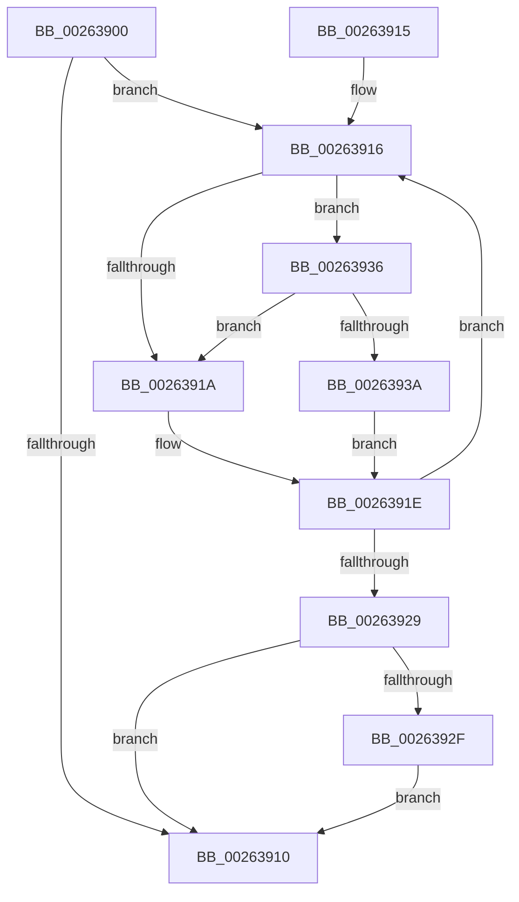

# ExfReleasePushLockExclusive

- RVA: `0x00263900`–`0x00263942` (길이 `66` bytes)
- VA: `0x0000000140263900`
- 실행 섹션: `.text`
- PDB 이름 있음: `예`; PDB Function 태그: `아니요`
- unwind 정보 RVA: `0x00064778`
- 디코드: `22`개 명령, `66/66` bytes 표시
- 미해석 바이트: `0` (있으면 어셈블리에 `.byte`로 보존)

> 이 문서는 커널 이미지의 기계어와 PDB 기호를 분석해 생성했습니다. 4번과 5번은 함수 원형과 자료형을 바이너리 사용 방식에서 추정한 C 해석이며 원본 소스 복구 결과는 아닙니다.

## 1. Dependencies

- 직접 호출 지점: **1**; 고유 호출 대상: **1**
- 직접 호출자로 확인된 함수: **2**
- RIP 상대 이미지 참조: **0**

### Outgoing calls
- `0x0026392F` → [ExpWakePushLock](../34/ExpWakePushLock_function_00341050.md) (function, `0x00341050`)

### Direct callers
- [ExfReleasePushLock](ExfReleasePushLock_function_002638D0.md) at `0x002638E4`
- [ExfAcquireReleasePushLockExclusive](../41/ExfAcquireReleasePushLockExclusive_function_00419C2C.md) at `0x00419C60`

### Static image references
- 디코드된 RIP-relative 메모리 참조가 없습니다.

## 2. Other-region calls and transfers

- 다른 실행 섹션으로 향하는 call: **0**
- 별도 외부 분기/꼬리 이동을 확인하지 못했습니다.

## 3. Assembly (complete function range)

```asm
00263900  48 83 EC 28                     sub rsp, 0x28
00263904  33 D2                           xor edx, edx
00263906  8D 42 01                        lea eax, [rdx + 1]
00263909  F0 48 0F B1 11                  lock cmpxchg qword ptr [rcx], rdx
0026390E  75 06                           jne 0x140263916
00263910  48 83 C4 28                     add rsp, 0x28
00263914  C3                              ret
00263915  CC                              int3
00263916  A8 04                           test al, 4
00263918  74 1C                           je 0x140263936
0026391A  49 83 C8 FF                     or r8, 0xffffffffffffffff
0026391E  49 8D 14 00                     lea rdx, [r8 + rax]
00263922  F0 48 0F B1 11                  lock cmpxchg qword ptr [rcx], rdx
00263927  75 ED                           jne 0x140263916
00263929  49 83 F8 03                     cmp r8, 3
0026392D  75 E1                           jne 0x140263910
0026392F  E8 1C D7 0D 00                  call 0x140341050
00263934  EB DA                           jmp 0x140263910
00263936  A8 02                           test al, 2
00263938  74 E0                           je 0x14026391a
0026393A  41 B8 03 00 00 00               mov r8d, 3
00263940  EB DC                           jmp 0x14026391e
```

## 4. C-style interpretation (structured pseudocode)

```c
__int64 __fastcall ExfReleasePushLockExclusive(__int64 a1, int a2, __int64 a3)
{
    __int64 result;
    __int64 v_rsp;

    v_rsp = (v_rsp) - (40);
    a2 = 0;
    if (condition_is_not_equal) goto loc_00263916;
loc_00263910:
    v_rsp = (v_rsp) + (40);
    return a2 + 1;
loc_00263916:
    if ((((unsigned __int8)(a2 + 1)) & (4)) == 0) goto loc_00263936;
loc_0026391A:
    a3 = (a3) | (-1);
loc_0026391E:
    if (condition_is_not_equal) goto loc_00263916;
    if (a3 != 3) goto loc_00263910;
    result = ExpWakePushLock(a1, a3 + a2 + 1 * 1, a3, a4);
    goto loc_00263910;
loc_00263936:
    if ((((unsigned __int8)(result)) & (2)) == 0) goto loc_0026391A;
    goto loc_0026391E;
}
```

## 5. (Beta) C Style

```c
int64_t ExfReleasePushLockExclusive(void *Arg1, int32_t Arg2, int64_t Arg3)
{
    uint8_t *arg1 = (uint8_t *)Arg1;

    int64_t result;
    int64_t local_rsp;

    local_rsp = (local_rsp) - (40);
    Arg2 = 0;
    if (condition_is_not_equal) goto loc_00263916;
loc_00263910:
    local_rsp = (local_rsp) + (40);
    return Arg2 + 1;
loc_00263916:
    if ((((uint8_t)(Arg2 + 1)) & (4)) == 0) goto loc_00263936;
loc_0026391A:
    Arg3 = (Arg3) | (-1);
loc_0026391E:
    if (condition_is_not_equal) goto loc_00263916;
    if (Arg3 != 3) goto loc_00263910;
    result = ExpWakePushLock(Arg1, Arg3 + Arg2 + 1 * 1, Arg3, a4);
    goto loc_00263910;
loc_00263936:
    if ((((uint8_t)(result)) & (2)) == 0) goto loc_0026391A;
    goto loc_0026391E;
}
```

### 관측된 메모리 오프셋

구조체 형식이 확인되지 않은 접근은 인자 기준의 오프셋으로만 기록했습니다.

| 기준 인자 | 오프셋 표현 | 폭 (bit) | 접근 |
|---|---:|---:|---|
| `Arg1` | `+ 0x0` | `64` | `R` |

## 6. Execution-region graph

[열기: 2D/3D 그래프와 함수 탐색 컨트롤 패널](../../../control-panel.html?section=text&rva=0x00263900&view=graph)

- 2D 그래프는 위에서 아래로 흐르고, 3D 그래프는 빈 공간을 드래그해 회전합니다. Shift+드래그는 이동, 휠은 확대·축소, 함수 노드 선택은 대상 보고서 이동입니다.

### Static fallback


