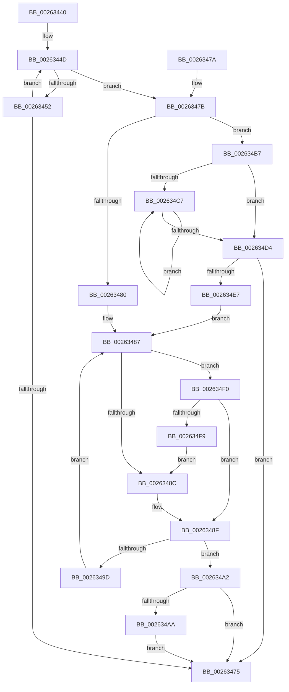

# ExfReleasePushLockShared

- RVA: `0x00263440`–`0x002634FB` (길이 `187` bytes)
- VA: `0x0000000140263440`
- 실행 섹션: `.text`
- PDB 이름 있음: `예`; PDB Function 태그: `아니요`
- unwind 정보 RVA: `0x000646C8`
- 디코드: `57`개 명령, `187/187` bytes 표시
- 미해석 바이트: `0` (있으면 어셈블리에 `.byte`로 보존)

> 이 문서는 커널 이미지의 기계어와 PDB 기호를 분석해 생성했습니다. 4번과 5번은 함수 원형과 자료형을 바이너리 사용 방식에서 추정한 C 해석이며 원본 소스 복구 결과는 아닙니다.

## 1. Dependencies

- 직접 호출 지점: **1**; 고유 호출 대상: **1**
- 직접 호출자로 확인된 함수: **286**
- RIP 상대 이미지 참조: **0**

### Outgoing calls
- `0x002634B0` → [ExpWakePushLock](../34/ExpWakePushLock_function_00341050.md) (function, `0x00341050`)

### Direct callers
- [sub_00210084](../21/Unknown_function_00210084.md) at `0x002101E7`
- [ExReleasePushLockSharedEx](ExReleasePushLockSharedEx_function_00263300.md) at `0x00263342`
- [sub_0026379F](Unknown_function_0026379F.md) at `0x0026382A`
- [ExfReleasePushLock](ExfReleasePushLock_function_002638D0.md) at `0x002638EF`
- [PspUnlockProcessShared](PspUnlockProcessShared_function_00263950.md) at `0x0026397F`
- [ExReleaseCacheAwarePushLockSharedEx](ExReleaseCacheAwarePushLockSharedEx_function_00263BE0.md) at `0x00263CF0`
- [MiUnlockLoaderEntry](../2A/MiUnlockLoaderEntry_function_002A3E28.md) at `0x002A3E6F`
- [UNLOCK_ADDRESS_SPACE_SHARED](../2A/UNLOCK_ADDRESS_SPACE_SHARED_function_002A8ACC.md) at `0x002A8AFE`
- [PopPepWork](../2B/PopPepWork_function_002BCBC0.md) at `0x002BCE7C`
- [MiUnlockControlAreaFileObjectShared](../2D/MiUnlockControlAreaFileObjectShared_function_002DFCB4.md) at `0x002DFCDA`
- [StLockReleaseShared](../2E/StLockReleaseShared_function_002E0320.md) at `0x002E0338`
- [sub_002E087E](../2E/Unknown_function_002E087E.md) at `0x002E0A96`
- [MiTrimSharedPageFromViews](../2E/MiTrimSharedPageFromViews_function_002E16F8.md) at `0x002E1924`
- [MiTrimSharedPageFromViews](../2E/MiTrimSharedPageFromViews_function_002E16F8.md) at `0x002E21E1`
- [MiUnlockVadShared](../2E/MiUnlockVadShared_function_002E2420.md) at `0x002E245C`
- [PspUnlockProcessListShared](../2E/PspUnlockProcessListShared_function_002E2920.md) at `0x002E2953`
- [ExpSaAllocatorFree](../2E/ExpSaAllocatorFree_function_002E2E00.md) at `0x002E2E9C`
- [InsertEventEntryInLookUpTable](../2F/InsertEventEntryInLookUpTable_function_002F1424.md) at `0x002F1568`
- [RtlpLookupDynamicUserFunctionTable](../2F/RtlpLookupDynamicUserFunctionTable_function_002F333C.md) at `0x002F3486`
- [RtlpLookupDynamicUserFunctionTable](../2F/RtlpLookupDynamicUserFunctionTable_function_002F333C.md) at `0x002F35F5`
- [AlpcpSignalAndWait](../2F/AlpcpSignalAndWait_function_002F9620.md) at `0x002F971E`
- [AlpcpSignalAndWait](../2F/AlpcpSignalAndWait_function_002F9620.md) at `0x002F9A8B`
- [MiReturnLockedVadOrNextVa](../31/MiReturnLockedVadOrNextVa_function_00316980.md) at `0x00316DC2`
- [RtlpHpReleaseLockShared](../32/RtlpHpReleaseLockShared_function_003245B0.md) at `0x003245CC`
- [SmpKeyedStoreReference](../34/SmpKeyedStoreReference_function_003499CC.md) at `0x00349A5C`
- [sub_0034A167](../34/Unknown_function_0034A167.md) at `0x0034A181`
- [sub_0034CEDD](../34/Unknown_function_0034CEDD.md) at `0x0034CEF4`
- [sub_0034D8EA](../34/Unknown_function_0034D8EA.md) at `0x0034D902`
- [MiWalkEntireImage](../36/MiWalkEntireImage_function_00365D70.md) at `0x00366FDE`
- [MiWalkEntireImage](../36/MiWalkEntireImage_function_00365D70.md) at `0x00366FEB`
- [AlpcpSignal](../39/AlpcpSignal_function_003955E0.md) at `0x003956CD`
- [AlpcpSignal](../39/AlpcpSignal_function_003955E0.md) at `0x00396037`
- [SepRmReferenceCapTable](../3A/SepRmReferenceCapTable_function_003A537C.md) at `0x003A5418`
- [ExpSaAllocatorAllocate](../3B/ExpSaAllocatorAllocate_function_003B402C.md) at `0x003B40E0`
- [ExpSaAllocatorAllocate](../3B/ExpSaAllocatorAllocate_function_003B402C.md) at `0x003B41EA`
- [MiUnlockDynamicMemoryShared](../3B/MiUnlockDynamicMemoryShared_function_003B8A48.md) at `0x003B8A6B`
- [PspUnlockThreadSecurityShared](../3C/PspUnlockThreadSecurityShared_function_003C2E40.md) at `0x003C2E65`
- [PspUnlockProcessThreadListShared](../3E/PspUnlockProcessThreadListShared_function_003ECC10.md) at `0x003ECC3F`
- [AlpcpQueueIoCompletionPort](../3F/AlpcpQueueIoCompletionPort_function_003FF760.md) at `0x003FFAAA`
- [AlpcpQueueIoCompletionPort](../3F/AlpcpQueueIoCompletionPort_function_003FF760.md) at `0x003FFD92`
- [sub_004201AA](../42/Unknown_function_004201AA.md) at `0x00420258`
- [sub_00420595](../42/Unknown_function_00420595.md) at `0x004205B3`
- [sub_00420595](../42/Unknown_function_00420595.md) at `0x0042060E`
- [sub_0042067D](../42/Unknown_function_0042067D.md) at `0x004206B6`
- [sub_0042067D](../42/Unknown_function_0042067D.md) at `0x00420712`
- [PopFxStopDeviceAccounting](../42/PopFxStopDeviceAccounting_function_004261D8.md) at `0x004263B7`
- [PopDiagTraceFxRundown](../43/PopDiagTraceFxRundown_function_0043A028.md) at `0x0043A0E5`
- [PopDiagTraceFxRundown](../43/PopDiagTraceFxRundown_function_0043A028.md) at `0x0043A186`
- [PopFxPauseDeviceAccounting](../43/PopFxPauseDeviceAccounting_function_0043D0C8.md) at `0x0043D207`
- [PopFxResumeDeviceAccounting](../43/PopFxResumeDeviceAccounting_function_0043D4D8.md) at `0x0043D642`
- [MiIssuePageHeatList](../44/MiIssuePageHeatList_function_0044615C.md) at `0x004462CC`
- [MI_UNLOCK_RELOCATIONS_SHARED](../44/MI_UNLOCK_RELOCATIONS_SHARED_function_0044A7EC.md) at `0x0044A80C`
- [CcSlowReferenceSharedCacheMapFileObject](../45/CcSlowReferenceSharedCacheMapFileObject_function_00458C10.md) at `0x00458C90`
- [PopPepIdleTimeoutRoutine](../45/PopPepIdleTimeoutRoutine_function_00458E10.md) at `0x00458F8D`
- [PopFxResidentTimeoutRoutine](../46/PopFxResidentTimeoutRoutine_function_00462650.md) at `0x00462765`
- [PoFxSystemLatencyNotify](../46/PoFxSystemLatencyNotify_function_0046A15C.md) at `0x0046A21A`
- [MiFinishResume](../47/MiFinishResume_function_0047F9C0.md) at `0x0047FA4F`
- [MiSendParkedCoreUpdateToAllChildPartitions](../47/MiSendParkedCoreUpdateToAllChildPartitions_function_0047FAC0.md) at `0x0047FB53`
- [PfLockSharedRelease](../48/PfLockSharedRelease_function_0048DF24.md) at `0x0048DF3C`
- [MmCheckProcessShadow](../49/MmCheckProcessShadow_function_004931C0.md) at `0x0049326E`
- [PoFxPrepareDevice](../49/PoFxPrepareDevice_function_00499F0C.md) at `0x0049A014`
- [PopFxActivateDevicesForSx](../4A/PopFxActivateDevicesForSx_function_004A0CAC.md) at `0x004A0D7F`
- [PopFxStartDeviceAccounting](../4A/PopFxStartDeviceAccounting_function_004A384C.md) at `0x004A3A4A`
- [PspUnlockQuotaListShared](../4A/PspUnlockQuotaListShared_function_004A5234.md) at `0x004A5253`
- [PspUnlockProcessSharedUnsafe](../4B/PspUnlockProcessSharedUnsafe_function_004B2800.md) at `0x004B281C`
- [PopFxIdleDevicesFromSx](../4B/PopFxIdleDevicesFromSx_function_004B2FB4.md) at `0x004B307F`
- [PoFxStartDevicePowerManagement](../4B/PoFxStartDevicePowerManagement_function_004B5740.md) at `0x004B57F6`
- [sub_004BA83C](../4B/Unknown_function_004BA83C.md) at `0x004BA948`
- [PopFxFindAcpiDeviceByUniqueId](../4C/PopFxFindAcpiDeviceByUniqueId_function_004C5C30.md) at `0x004C5D30`
- [PopFxFindAndReferenceAcpiDevice](../4C/PopFxFindAndReferenceAcpiDevice_function_004C76E0.md) at `0x004C77B2`
- [PopFxLowPowerEpochCallback](../4C/PopFxLowPowerEpochCallback_function_004CBC10.md) at `0x004CBD1D`
- [PopFxRegisterDeviceWithPep](../4C/PopFxRegisterDeviceWithPep_function_004CF794.md) at `0x004CF892`
- [SmHwAcceleratorPartitionMgrFreeDescriptor](../4D/SmHwAcceleratorPartitionMgrFreeDescriptor_function_004D7918.md) at `0x004D79DA`
- [UNLOCK_ADDRESS_SPACE_SHARED_UNORDERED](../4F/UNLOCK_ADDRESS_SPACE_SHARED_UNORDERED_function_004F8924.md) at `0x004F8952`
- [PspReleasePushLockShared](../4F/PspReleasePushLockShared_function_004F8D00.md) at `0x004F8D1B`
- [IommuProcessPageRequestQueue](../56/IommuProcessPageRequestQueue_function_00565BA0.md) at `0x00566028`
- [IopProcessIoTracking](../59/IopProcessIoTracking_function_005986C0.md) at `0x005987AB`
- [KeQueryDpcWatchdogConfiguration](../5B/KeQueryDpcWatchdogConfiguration_function_005B5800.md) at `0x005B5974`
- [KiAvailableCpusPartitionWorkItemCallback](../5B/KiAvailableCpusPartitionWorkItemCallback_function_005B9990.md) at `0x005B9A3E`
- [PopFxDisableBasicAccountingWorker](../5D/PopFxDisableBasicAccountingWorker_function_005D28D0.md) at `0x005D29BA`
- [PopPepIterateDeviceList](../5D/PopPepIterateDeviceList_function_005DCC84.md) at `0x005DCD80`
- [PopPepPlatformStateRegistered](../5D/PopPepPlatformStateRegistered_function_005DCDB8.md) at `0x005DCEE9`
- [PopPepPlatformStateRegistered](../5D/PopPepPlatformStateRegistered_function_005DCDB8.md) at `0x005DCF86`
- [PopFxAcpiPrepareDevice](../5D/PopFxAcpiPrepareDevice_function_005DD5F4.md) at `0x005DD6DD`
- [PspLookupSyscallProviderById](../5E/PspLookupSyscallProviderById_function_005E237C.md) at `0x005E2407`
- [PspSetProcessTimerDelayForWin32](../5E/PspSetProcessTimerDelayForWin32_function_005E3DB8.md) at `0x005E3E2B`
- [PspSetProcessTimerDelayForWin32](../5E/PspSetProcessTimerDelayForWin32_function_005E3DB8.md) at `0x005E3E46`
- [SepSetTokenAntiTamperEntry](../60/SepSetTokenAntiTamperEntry_function_0060B28C.md) at `0x0060B37C`
- [SepSetTokenAntiTamperEntry](../60/SepSetTokenAntiTamperEntry_function_0060B28C.md) at `0x0060B562`
- [SepSetTokenLowboxNumberEntry](../60/SepSetTokenLowboxNumberEntry_function_0060B594.md) at `0x0060B67F`
- [SepSetTokenLowboxNumberEntry](../60/SepSetTokenLowboxNumberEntry_function_0060B594.md) at `0x0060B861`
- [SmKmVirtualLockCtxLockMemory](../61/SmKmVirtualLockCtxLockMemory_function_0061000C.md) at `0x006100DE`
- [SmKmVirtualLockCtxLockMemory](../61/SmKmVirtualLockCtxLockMemory_function_0061000C.md) at `0x0061011F`
- [SmGetStoreOwnerProcessId](../61/SmGetStoreOwnerProcessId_function_00610E4C.md) at `0x00610F4A`
- [DifExfReleasePushLockSharedWrapper](../62/DifExfReleasePushLockSharedWrapper_function_00623C30.md) at `0x00623CF6`
- [EtwpGetCompressionSettings](../65/EtwpGetCompressionSettings_function_006535A8.md) at `0x0065365B`
- [MiMarkHugePfnBad](../67/MiMarkHugePfnBad_function_00676744.md) at `0x00676AE8`
- [MiMarkHugePfnBad](../67/MiMarkHugePfnBad_function_00676744.md) at `0x00676B60`
- [ExpQueryLicenseValueFromBlobHelper$fin$0](../6D/ExpQueryLicenseValueFromBlobHelper_fin_0_function_006D4F5C.md) at `0x006D4F84`
- [sub_006D969C](../6D/Unknown_function_006D969C.md) at `0x006D9789`
- [sub_006D969C](../6D/Unknown_function_006D969C.md) at `0x006D99A5`
- [sub_006DEED6](../6D/Unknown_function_006DEED6.md) at `0x006DEEE5`
- [sub_006E3418](../6E/Unknown_function_006E3418.md) at `0x006E3504`
- [sub_006F2710](../6F/Unknown_function_006F2710.md) at `0x006F2790`
- [KiAvailableCpusProcessWorkItemCallback](../../page/74/KiAvailableCpusProcessWorkItemCallback_function_00746140.md) at `0x007461BC`
- [AlpcpPortQueryServerInfo](../../page/74/AlpcpPortQueryServerInfo_function_0074C784.md) at `0x0074C979`
- [AlpcpPortQueryServerInfo](../../page/74/AlpcpPortQueryServerInfo_function_0074C784.md) at `0x0074CA05`
- [ObIsDosDeviceLocallyMapped](../../page/74/ObIsDosDeviceLocallyMapped_function_0074EAB0.md) at `0x0074EB45`
- [PspGetNextSyscallProviderProcess](../../page/77/PspGetNextSyscallProviderProcess_function_0077E598.md) at `0x0077E64E`
- [PsSwapProcessWorkingSet](../../page/78/PsSwapProcessWorkingSet_function_00781C24.md) at `0x00781CDF`
- [PspSetProcessAffinityUpdateMode](../../page/78/PspSetProcessAffinityUpdateMode_function_007828D8.md) at `0x00782A10`
- [PspUpdateSingleProcessAffinity](../../page/78/PspUpdateSingleProcessAffinity_function_00782B00.md) at `0x00782BB1`
- [PsTerminateVsmEnclave](../../page/78/PsTerminateVsmEnclave_function_00788A64.md) at `0x00788C0C`
- [SepIsValidProcUniqueLuid](../../page/7A/SepIsValidProcUniqueLuid_function_007A28B0.md) at `0x007A295D`
- [SepDereferenceAntiTamperEntry](../../page/7A/SepDereferenceAntiTamperEntry_function_007A2E50.md) at `0x007A2F11`
- [SepIsParentOfChildAppContainer](../../page/7A/SepIsParentOfChildAppContainer_function_007A34C0.md) at `0x007A365C`
- [SmKmKeyGenGenerate](../../page/7A/SmKmKeyGenGenerate_function_007A85CC.md) at `0x007A865A`
- [SmKmKeyGenGenerate](../../page/7A/SmKmKeyGenGenerate_function_007A85CC.md) at `0x007A8698`
- [SmKmKeyGenGenerate](../../page/7A/SmKmKeyGenGenerate_function_007A85CC.md) at `0x007A86D9`
- [SmEtwEnableCallback](../../page/7A/SmEtwEnableCallback_function_007AA080.md) at `0x007AA1CE`
- [SmcGetCacheStats](../../page/7A/SmcGetCacheStats_function_007ABE0C.md) at `0x007ABF66`
- [EtwCleanupSiloState](../../page/7B/EtwCleanupSiloState_function_007B4B9C.md) at `0x007B4C75`
- [ExpGetSystemPlatformBinary](../../page/7C/ExpGetSystemPlatformBinary_function_007C3C18.md) at `0x007C3D4A`
- [ExpGetSystemPlatformBinary](../../page/7C/ExpGetSystemPlatformBinary_function_007C3C18.md) at `0x007C4051`
- [ExFetchLicenseData](../../page/7C/ExFetchLicenseData_function_007C7780.md) at `0x007C78A4`
- [ExGetLicenseTamperState](../../page/7C/ExGetLicenseTamperState_function_007C7A30.md) at `0x007C7AE0`
- [sub_007C7FB0](../../page/7C/Unknown_function_007C7FB0.md) at `0x007C8065`
- [sub_007C87A4](../../page/7C/Unknown_function_007C87A4.md) at `0x007C887A`
- [sub_007C8D5C](../../page/7C/Unknown_function_007C8D5C.md) at `0x007C8E45`
- [SLGetSubscriptionPfn](../../page/7C/SLGetSubscriptionPfn_function_007C9108.md) at `0x007C93C1`
- [SLQueryLicenseValueInternal](../../page/7C/SLQueryLicenseValueInternal_function_007C93EC.md) at `0x007C9726`
- [SLUpdateLicenseDataInternal](../../page/7C/SLUpdateLicenseDataInternal_function_007C9C04.md) at `0x007C9EA7`
- [SLUpdateLicenseDataInternal](../../page/7C/SLUpdateLicenseDataInternal_function_007C9C04.md) at `0x007CA2BB`
- [SLUpdateLicenseDataInternal](../../page/7C/SLUpdateLicenseDataInternal_function_007C9C04.md) at `0x007CA513`
- [ExRegisterExtension](../../page/7D/ExRegisterExtension_function_007D0420.md) at `0x007D052D`
- [ExpKdPullRemoteFileForUser](../../page/7D/ExpKdPullRemoteFileForUser_function_007D15AC.md) at `0x007D17EE`
- [ExpWnfDeletePermanentStateData](../../page/7D/ExpWnfDeletePermanentStateData_function_007D6254.md) at `0x007D6322`
- [MmEnumerateBadPages](../../page/7F/MmEnumerateBadPages_function_007FDE28.md) at `0x007FDEF0`
- [MiIsExtentDangling](../../page/80/MiIsExtentDangling_function_008010A0.md) at `0x00801244`
- [MiGetAllRegisteredPatches](../../page/80/MiGetAllRegisteredPatches_function_0080367C.md) at `0x00803826`
- [MiLogHotPatchRundown](../../page/80/MiLogHotPatchRundown_function_008057A4.md) at `0x00805B2A`
- [MiLogHotPatchRundown](../../page/80/MiLogHotPatchRundown_function_008057A4.md) at `0x0080626D`
- [MiOpenSpecialPurposeMemory](../../page/80/MiOpenSpecialPurposeMemory_function_0080FA28.md) at `0x0080FB24`
- [MiQuerySpecialPurposeMemoryInformation](../../page/80/MiQuerySpecialPurposeMemoryInformation_function_0080FBC8.md) at `0x0080FE39`
- [HvUnlockHiveFlusherShared](../../page/84/HvUnlockHiveFlusherShared_function_00848738.md) at `0x00848751`
- [NtDeleteKey](../../page/84/NtDeleteKey_function_00849920.md) at `0x00849CED`
- [NtDeleteKey](../../page/84/NtDeleteKey_function_00849920.md) at `0x00849D38`
- [sub_0084E4B5](../../page/84/Unknown_function_0084E4B5.md) at `0x0084E6DF`
- [CmpCreateKeyControlBlock](../../page/85/CmpCreateKeyControlBlock_function_00851DB0.md) at `0x0085215F`
- [CmpWalkOneLevel](../../page/85/CmpWalkOneLevel_function_00852BA0.md) at `0x00853987`
- [sub_00856589](../../page/85/Unknown_function_00856589.md) at `0x0085658D`
- [ObpReferenceSecurityDescriptorSlow](../../page/87/ObpReferenceSecurityDescriptorSlow_function_0087484C.md) at `0x00874944`
- [CmpVolumeContextUnlockShared](../../page/87/CmpVolumeContextUnlockShared_function_0087BE5C.md) at `0x0087BE75`
- [NtAreMappedFilesTheSame](../../page/87/NtAreMappedFilesTheSame_function_0087EC70.md) at `0x0087EDBF`
- [MiIsRangeFullyCommitted](../../page/88/MiIsRangeFullyCommitted_function_00881E24.md) at `0x00881F37`
- [AlpcpCreateSectionView](../../page/88/AlpcpCreateSectionView_function_0088850C.md) at `0x008885E3`
- [AlpcpLocateSectionView](../../page/88/AlpcpLocateSectionView_function_00889754.md) at `0x00889823`
- [AlpcpLocateSectionView](../../page/88/AlpcpLocateSectionView_function_00889754.md) at `0x008898B2`
- [sub_00889F78](../../page/88/Unknown_function_00889F78.md) at `0x00889F9D`
- [sub_00889F78](../../page/88/Unknown_function_00889F78.md) at `0x00889FE6`
- [AlpcpSendMessage](../../page/88/AlpcpSendMessage_function_0088BD40.md) at `0x0088CCE6`
- [PspChargeProcessWakeCounter](../../page/88/PspChargeProcessWakeCounter_function_0088D2A0.md) at `0x0088D3E5`
- [sub_0088D871](../../page/88/Unknown_function_0088D871.md) at `0x0088DADE`
- [sub_0088DBCA](../../page/88/Unknown_function_0088DBCA.md) at `0x0088DC6C`
- [AlpcpDispatchNewMessage](../../page/88/AlpcpDispatchNewMessage_function_0088DD20.md) at `0x0088DFC6`
- [AlpcpDispatchNewMessage](../../page/88/AlpcpDispatchNewMessage_function_0088DD20.md) at `0x0088E0BF`
- [sub_0088E1DC](../../page/88/Unknown_function_0088E1DC.md) at `0x0088E51B`
- [sub_0088E1DC](../../page/88/Unknown_function_0088E1DC.md) at `0x0088E6F9`
- [sub_0088EC77](../../page/88/Unknown_function_0088EC77.md) at `0x0088F1A3`
- [sub_0088EC77](../../page/88/Unknown_function_0088EC77.md) at `0x0088F206`
- [sub_0088EC77](../../page/88/Unknown_function_0088EC77.md) at `0x0088F2A0`
- [sub_0088EC77](../../page/88/Unknown_function_0088EC77.md) at `0x0088F2B1`
- [sub_0088EC77](../../page/88/Unknown_function_0088EC77.md) at `0x0088F2D1`
- [AlpcpDispatchReplyToPort](../../page/88/AlpcpDispatchReplyToPort_function_0088F880.md) at `0x0088FC11`
- [AlpcpDispatchReplyToPort](../../page/88/AlpcpDispatchReplyToPort_function_0088F880.md) at `0x0088FC56`
- [AlpcpDispatchReplyToPort](../../page/88/AlpcpDispatchReplyToPort_function_0088F880.md) at `0x0088FC74`
- [AlpcpUnlockAndDereferenceTargetPortsAndCommunicationInfo](../../page/88/AlpcpUnlockAndDereferenceTargetPortsAndCommunicationInfo_function_0088FE2C.md) at `0x0088FE5B`
- [AlpcpUnlockAndDereferenceTargetPortsAndCommunicationInfo](../../page/88/AlpcpUnlockAndDereferenceTargetPortsAndCommunicationInfo_function_0088FE2C.md) at `0x0088FE9A`
- [AlpcpUnlockAndDereferenceTargetPortsAndCommunicationInfo](../../page/88/AlpcpUnlockAndDereferenceTargetPortsAndCommunicationInfo_function_0088FE2C.md) at `0x0088FECE`
- [sub_00890033](../../page/89/Unknown_function_00890033.md) at `0x008900C1`
- [AlpcpEnumerateResourcesPort](../../page/89/AlpcpEnumerateResourcesPort_function_00890424.md) at `0x008904B1`
- [AlpcpCaptureSecurityAttribute](../../page/89/AlpcpCaptureSecurityAttribute_function_00890540.md) at `0x008906FE`
- [AlpcpCaptureSecurityAttribute](../../page/89/AlpcpCaptureSecurityAttribute_function_00890540.md) at `0x00890788`
- [sub_0089090A](../../page/89/Unknown_function_0089090A.md) at `0x0089090D`
- [sub_008909EC](../../page/89/Unknown_function_008909EC.md) at `0x00890A4C`
- [AlpcpCreateSecurityContext](../../page/89/AlpcpCreateSecurityContext_function_00890D94.md) at `0x00891014`
- [AlpcpCreateSecurityContext](../../page/89/AlpcpCreateSecurityContext_function_00890D94.md) at `0x00891129`
- [AlpcpCreateSecurityContext](../../page/89/AlpcpCreateSecurityContext_function_00890D94.md) at `0x00891153`
- [AlpcpCreateReserve](../../page/89/AlpcpCreateReserve_function_00892318.md) at `0x00892519`
- [AlpcpCreateReserve](../../page/89/AlpcpCreateReserve_function_00892318.md) at `0x0089254A`
- [AlpcpCreateReserve](../../page/89/AlpcpCreateReserve_function_00892318.md) at `0x0089259F`
- [AlpcpCreateSection](../../page/89/AlpcpCreateSection_function_0089307C.md) at `0x0089324D`
- [AlpcpCreateSection](../../page/89/AlpcpCreateSection_function_0089307C.md) at `0x00893328`
- [AlpcpCreateSection](../../page/89/AlpcpCreateSection_function_0089307C.md) at `0x0089334A`
- [AlpcpCancelMessage](../../page/89/AlpcpCancelMessage_function_00894120.md) at `0x00894204`
- [AlpcpCancelMessage](../../page/89/AlpcpCancelMessage_function_00894120.md) at `0x00894462`
- [AlpcpCancelMessage](../../page/89/AlpcpCancelMessage_function_00894120.md) at `0x008946A1`
- [AlpcpReceiveDirectMessagePort](../../page/89/AlpcpReceiveDirectMessagePort_function_008950B4.md) at `0x0089525C`
- [AlpcpReceiveDirectMessagePort](../../page/89/AlpcpReceiveDirectMessagePort_function_008950B4.md) at `0x008952D9`
- [AlpcpReceiveDirectMessagePort](../../page/89/AlpcpReceiveDirectMessagePort_function_008950B4.md) at `0x0089533F`
- [NtAlpcOpenSenderProcess](../../page/89/NtAlpcOpenSenderProcess_function_008953B0.md) at `0x00895754`
- [NtAlpcOpenSenderProcess](../../page/89/NtAlpcOpenSenderProcess_function_008953B0.md) at `0x008957C7`
- [NtAlpcOpenSenderProcess](../../page/89/NtAlpcOpenSenderProcess_function_008953B0.md) at `0x008957F5`
- [AlpcpReceiveLegacyMessage](../../page/89/AlpcpReceiveLegacyMessage_function_00895DE0.md) at `0x008960E5`
- [AlpcpReceiveLegacyMessage](../../page/89/AlpcpReceiveLegacyMessage_function_00895DE0.md) at `0x00896149`
- [AlpcpReceiveMessagePort](../../page/89/AlpcpReceiveMessagePort_function_00896B40.md) at `0x00896CA9`
- [AlpcpReceiveMessagePort](../../page/89/AlpcpReceiveMessagePort_function_00896B40.md) at `0x00896DB1`
- [AlpcpReceiveMessagePort](../../page/89/AlpcpReceiveMessagePort_function_00896B40.md) at `0x0089716F`
- [AlpcpReceiveMessagePort](../../page/89/AlpcpReceiveMessagePort_function_00896B40.md) at `0x00897265`
- [AlpcpReceiveMessagePort](../../page/89/AlpcpReceiveMessagePort_function_00896B40.md) at `0x008972C3`
- [ObpLookupObjectName](../../page/89/ObpLookupObjectName_function_0089BE90.md) at `0x0089D572`
- [ObpLookupObjectName](../../page/89/ObpLookupObjectName_function_0089BE90.md) at `0x0089D6F5`
- [ObpLookupObjectName](../../page/89/ObpLookupObjectName_function_0089BE90.md) at `0x0089D7C7`
- [ObpLookupObjectName](../../page/89/ObpLookupObjectName_function_0089BE90.md) at `0x0089DAEE`
- [ObpLookupObjectName](../../page/89/ObpLookupObjectName_function_0089BE90.md) at `0x0089DBC1`
- [ObpLookupObjectName](../../page/89/ObpLookupObjectName_function_0089BE90.md) at `0x0089DCA1`
- [ExpSnapShotHandleTables](../../page/8A/ExpSnapShotHandleTables_function_008A25C0.md) at `0x008A2A1F`
- [NtQueryObject](../../page/8A/NtQueryObject_function_008A6DB0.md) at `0x008A7188`
- [NtQueryObject](../../page/8A/NtQueryObject_function_008A6DB0.md) at `0x008A7387`
- [NtQueryObject](../../page/8A/NtQueryObject_function_008A6DB0.md) at `0x008A7524`
- [NtQueryObject](../../page/8A/NtQueryObject_function_008A6DB0.md) at `0x008A7533`
- [ObQueryNameStringMode](../../page/8A/ObQueryNameStringMode_function_008A7ED0.md) at `0x008A8114`
- [ObQueryNameStringMode](../../page/8A/ObQueryNameStringMode_function_008A7ED0.md) at `0x008A8270`
- [ObQueryNameStringMode](../../page/8A/ObQueryNameStringMode_function_008A7ED0.md) at `0x008A839F`
- [ObQueryNameStringMode](../../page/8A/ObQueryNameStringMode_function_008A7ED0.md) at `0x008A84F5`
- [ObQueryNameStringMode](../../page/8A/ObQueryNameStringMode_function_008A7ED0.md) at `0x008A8695`
- [ObQueryNameStringMode](../../page/8A/ObQueryNameStringMode_function_008A7ED0.md) at `0x008A87D2`
- [ObQueryNameStringMode](../../page/8A/ObQueryNameStringMode_function_008A7ED0.md) at `0x008A87FA`
- [sub_008BA32C](../../page/8B/Unknown_function_008BA32C.md) at `0x008BA4F8`
- [sub_008BA74A](../../page/8B/Unknown_function_008BA74A.md) at `0x008BAA17`
- [sub_008BAA6F](../../page/8B/Unknown_function_008BAA6F.md) at `0x008BAC34`
- [ObSetSecurityDescriptorInfo](../../page/8B/ObSetSecurityDescriptorInfo_function_008BAE20.md) at `0x008BAFE3`
- [ObSetSecurityDescriptorInfo](../../page/8B/ObSetSecurityDescriptorInfo_function_008BAE20.md) at `0x008BB3E1`
- [ObSetSecurityDescriptorInfo](../../page/8B/ObSetSecurityDescriptorInfo_function_008BAE20.md) at `0x008BB499`
- [ExpWnfPopulateStateData](../../page/8B/ExpWnfPopulateStateData_function_008BF354.md) at `0x008BF515`
- [ObLogSecurityDescriptor](../../page/8C/ObLogSecurityDescriptor_function_008C0020.md) at `0x008C01BD`
- [ObLogSecurityDescriptor](../../page/8C/ObLogSecurityDescriptor_function_008C0020.md) at `0x008C02F1`
- [ObLogSecurityDescriptor](../../page/8C/ObLogSecurityDescriptor_function_008C0020.md) at `0x008C0324`
- [EtwpReferenceLoggerSecurityDescriptor](../../page/8C/EtwpReferenceLoggerSecurityDescriptor_function_008C0810.md) at `0x008C0904`
- [EtwpFindOrCreateGuidEntry](../../page/8C/EtwpFindOrCreateGuidEntry_function_008C1B70.md) at `0x008C1D7A`
- [EtwpFindGuidEntryByGuid](../../page/8C/EtwpFindGuidEntryByGuid_function_008C1DB0.md) at `0x008C1E8E`
- [sub_008C28B0](../../page/8C/Unknown_function_008C28B0.md) at `0x008C2DA5`
- [EtwpGetGuidList](../../page/8C/EtwpGetGuidList_function_008C2F00.md) at `0x008C3076`
- [EtwpGetNextGuidEntry](../../page/8C/EtwpGetNextGuidEntry_function_008C3170.md) at `0x008C3275`
- [PsGetNextProcessThread](../../page/8C/PsGetNextProcessThread_function_008C9CF0.md) at `0x008C9E09`
- [sub_008D2420](../../page/8D/Unknown_function_008D2420.md) at `0x008D24CA`
- [sub_008D2F2C](../../page/8D/Unknown_function_008D2F2C.md) at `0x008D329F`
- [sub_008D379C](../../page/8D/Unknown_function_008D379C.md) at `0x008D39A1`
- [sub_008D3C9D](../../page/8D/Unknown_function_008D3C9D.md) at `0x008D3CB0`
- [EtwpCovSampContextGetModule](../../page/8D/EtwpCovSampContextGetModule_function_008D7FEC.md) at `0x008D81B0`
- [EtwpCovSampContextGetModule](../../page/8D/EtwpCovSampContextGetModule_function_008D7FEC.md) at `0x008D8202`
- [RtlFindDynamicEnforcedAddressInRanges](../../page/8D/RtlFindDynamicEnforcedAddressInRanges_function_008D9B84.md) at `0x008D9C2A`
- [EtwpCovSampContextPruneModules](../../page/8D/EtwpCovSampContextPruneModules_function_008DA03C.md) at `0x008DA59B`
- [sub_00907768](../../page/90/Unknown_function_00907768.md) at `0x009077F6`
- [ExpWnfLookupNameInstance](../../page/90/ExpWnfLookupNameInstance_function_00908C70.md) at `0x00908D32`
- [ExpWnfAcquireSubscriptionByName](../../page/90/ExpWnfAcquireSubscriptionByName_function_00908D7C.md) at `0x00908E09`
- [ExpWnfAcquireSubscriptionByName](../../page/90/ExpWnfAcquireSubscriptionByName_function_00908D7C.md) at `0x00908E40`
- [ExpWnfDeliverThreadNotifications](../../page/90/ExpWnfDeliverThreadNotifications_function_00909630.md) at `0x009098B2`
- [ExpWnfDeliverThreadNotifications](../../page/90/ExpWnfDeliverThreadNotifications_function_00909630.md) at `0x0090999A`
- [ExpWnfCompleteThreadSubscriptions](../../page/90/ExpWnfCompleteThreadSubscriptions_function_00909A10.md) at `0x00909B93`
- [ExpWnfReadStateData](../../page/90/ExpWnfReadStateData_function_00909C50.md) at `0x00909D2C`
- [NtQueryWnfStateData](../../page/90/NtQueryWnfStateData_function_00909DF0.md) at `0x0090A370`
- [ExpNtUpdateWnfStateData](../../page/90/ExpNtUpdateWnfStateData_function_0090A7A0.md) at `0x0090AC7F`
- [ExpNtUpdateWnfStateData](../../page/90/ExpNtUpdateWnfStateData_function_0090A7A0.md) at `0x0090B228`
- [sub_0090B43E](../../page/90/Unknown_function_0090B43E.md) at `0x0090B73F`
- [sub_0090B43E](../../page/90/Unknown_function_0090B43E.md) at `0x0090B74C`
- [ExpWnfWriteStateData](../../page/90/ExpWnfWriteStateData_function_0090B7B0.md) at `0x0090BA52`
- [ExpWnfNotifyNameSubscribers](../../page/90/ExpWnfNotifyNameSubscribers_function_0090C160.md) at `0x0090C30F`
- [ExpWnfDispatchKernelSubscription](../../page/90/ExpWnfDispatchKernelSubscription_function_0090C520.md) at `0x0090C70E`
- [ExpWnfDispatchKernelSubscription](../../page/90/ExpWnfDispatchKernelSubscription_function_0090C520.md) at `0x0090C90E`
- [PsQueryStatisticsProcess](../../page/91/PsQueryStatisticsProcess_function_00919350.md) at `0x00919552`
- [sub_0091A184](../../page/91/Unknown_function_0091A184.md) at `0x0091A18B`
- [PspUnlockJobMemoryLimitsShared](../../page/91/PspUnlockJobMemoryLimitsShared_function_0091A420.md) at `0x0091A448`
- [sub_0091BE05](../../page/91/Unknown_function_0091BE05.md) at `0x0091BE08`
- [PsGetNextProcess](../../page/91/PsGetNextProcess_function_0091C900.md) at `0x0091C9D3`
- [ExGetNextProcess](../../page/91/ExGetNextProcess_function_0091CAD0.md) at `0x0091CBA9`
- [DbgkpSendErrorMessage](../../page/92/DbgkpSendErrorMessage_function_009210A8.md) at `0x009212A6`
- [AlpcpProcessSynchronousRequest](../../page/92/AlpcpProcessSynchronousRequest_function_00921FCC.md) at `0x00922478`
- [AlpcpProcessSynchronousRequest](../../page/92/AlpcpProcessSynchronousRequest_function_00921FCC.md) at `0x00922496`
- [AlpcpReceiveSynchronousReply](../../page/92/AlpcpReceiveSynchronousReply_function_009224F0.md) at `0x0092271D`
- [AlpcpReceiveSynchronousReply](../../page/92/AlpcpReceiveSynchronousReply_function_009224F0.md) at `0x009227F3`
- [AlpcpDispatchConnectionRequest](../../page/92/AlpcpDispatchConnectionRequest_function_0092353C.md) at `0x009235C9`
- [AlpcpDispatchConnectionRequest](../../page/92/AlpcpDispatchConnectionRequest_function_0092353C.md) at `0x00923719`
- [AlpcpDispatchConnectionRequest](../../page/92/AlpcpDispatchConnectionRequest_function_0092353C.md) at `0x00923739`
- [AlpcpDispatchConnectionRequest](../../page/92/AlpcpDispatchConnectionRequest_function_0092353C.md) at `0x00923759`
- [AlpcpSendLegacySynchronousRequest](../../page/92/AlpcpSendLegacySynchronousRequest_function_0092376C.md) at `0x00923A65`
- [AlpcpSendLegacySynchronousRequest](../../page/92/AlpcpSendLegacySynchronousRequest_function_0092376C.md) at `0x00923D09`
- [AlpcpSendLegacySynchronousRequest](../../page/92/AlpcpSendLegacySynchronousRequest_function_0092376C.md) at `0x00923DE4`
- [AlpcpSendLegacySynchronousRequest](../../page/92/AlpcpSendLegacySynchronousRequest_function_0092376C.md) at `0x00923E0B`
- [AlpcpDispatchCloseMessage](../../page/92/AlpcpDispatchCloseMessage_function_00923FBC.md) at `0x009240A8`
- [AlpcpDispatchCloseMessage](../../page/92/AlpcpDispatchCloseMessage_function_00923FBC.md) at `0x00924130`
- [AlpcpDisconnectPort](../../page/92/AlpcpDisconnectPort_function_00924A68.md) at `0x00924DB2`
- [AlpcpFlushMessagesPort](../../page/92/AlpcpFlushMessagesPort_function_00925554.md) at `0x00925799`
- [AlpcpCreateClientPort](../../page/92/AlpcpCreateClientPort_function_009270AC.md) at `0x009271E0`
- [sub_009333F9](../../page/93/Unknown_function_009333F9.md) at `0x009333FD`
- [VrpUnlockJobContextShared](../../page/93/VrpUnlockJobContextShared_function_009345D8.md) at `0x009345F1`
- [MiRelocateImagePfn](../../page/93/MiRelocateImagePfn_function_0093F2A8.md) at `0x0093F5C7`
- [CmpVolumeManagerGetContextForFile](../../page/95/CmpVolumeManagerGetContextForFile_function_009525A8.md) at `0x0095267C`
- [EtwpCoverageSamplerQuery](../../page/95/EtwpCoverageSamplerQuery_function_0095C4A0.md) at `0x0095D1D7`
- [sub_00967060](../../page/96/Unknown_function_00967060.md) at `0x0096712C`
- [ObQueryDeviceMapInformation](../../page/96/ObQueryDeviceMapInformation_function_0096C5C0.md) at `0x0096CAB9`
- [ObQueryDeviceMapInformation](../../page/96/ObQueryDeviceMapInformation_function_0096C5C0.md) at `0x0096CADA`
- [ObpReferenceCurrentDeviceMap](../../page/96/ObpReferenceCurrentDeviceMap_function_0096CBD0.md) at `0x0096CD9B`
- [sub_0096D265](../../page/96/Unknown_function_0096D265.md) at `0x0096D268`
- [sub_009A03AC](../../page/9A/Unknown_function_009A03AC.md) at `0x009A0479`
- [sub_009A09B8](../../page/9A/Unknown_function_009A09B8.md) at `0x009A0AA1`
- [sub_009A17F0](../../page/9A/Unknown_function_009A17F0.md) at `0x009A18A1`
- [sub_009A732C](../../page/9A/Unknown_function_009A732C.md) at `0x009A74DD`
- [sub_009A764D](../../page/9A/Unknown_function_009A764D.md) at `0x009A7687`
- [sub_009A764D](../../page/9A/Unknown_function_009A764D.md) at `0x009A76B6`
- [AlpcpPortQueryServerSessionInfo](../../page/9C/AlpcpPortQueryServerSessionInfo_function_009CAB0C.md) at `0x009CABB4`
- [AlpcpPortQueryConnectedSidInfo](../../page/9C/AlpcpPortQueryConnectedSidInfo_function_009CAC3C.md) at `0x009CAD2F`
- [sub_009CB0EC](../../page/9C/Unknown_function_009CB0EC.md) at `0x009CB0F0`
- [ExpWnfSubscribeNameInstance](../../page/9D/ExpWnfSubscribeNameInstance_function_009D50E8.md) at `0x009D51D1`
- [ExpWnfNotifySubscription](../../page/9D/ExpWnfNotifySubscription_function_009D587C.md) at `0x009D5908`
- [sub_009D6177](../../page/9D/Unknown_function_009D6177.md) at `0x009D617E`
- [PsQueryRuntimeProcess](../../page/9D/PsQueryRuntimeProcess_function_009D6C10.md) at `0x009D6CCA`
- [EtwpIsGuidAllowed](../../page/9E/EtwpIsGuidAllowed_function_009EB45C.md) at `0x009EB4D4`
- [EtwpAddRegEntryToGroup](../../page/9F/EtwpAddRegEntryToGroup_function_009F39D4.md) at `0x009F3C73`
- [EtwpAddRegEntryToGroup](../../page/9F/EtwpAddRegEntryToGroup_function_009F39D4.md) at `0x009F3DB8`
- [AlpcpReplyLegacySynchronousRequest](../../page/9F/AlpcpReplyLegacySynchronousRequest_function_009F5CF0.md) at `0x009F5F57`
- [AlpcpReplyLegacySynchronousRequest](../../page/9F/AlpcpReplyLegacySynchronousRequest_function_009F5CF0.md) at `0x009F611C`
- [NtSetInformationJobObject](../../page/9F/NtSetInformationJobObject_function_009F84C0.md) at `0x009FA830`
- [NtQueryInformationJobObject](../../page/9F/NtQueryInformationJobObject_function_009FB860.md) at `0x009FBD55`
- [PspStorageGetObject](../../page/9F/PspStorageGetObject_function_009FC6F4.md) at `0x009FC79B`
- [PspUnlockJobListShared](../../page/9F/PspUnlockJobListShared_function_009FF588.md) at `0x009FF5A8`
- [PspSelectVsmEnclaveByNumber](../../page/A0/PspSelectVsmEnclaveByNumber_function_00A0D610.md) at `0x00A0D776`
- [NtAlpcSetInformation](../../page/A1/NtAlpcSetInformation_function_00A19DC0.md) at `0x00A19FE2`
- [RtlpFlsDataCleanup](../../page/A1/RtlpFlsDataCleanup_function_00A1D998.md) at `0x00A1DB05`
- [ExReleaseTimeRefreshLockShared](../../page/A2/ExReleaseTimeRefreshLockShared_function_00A2023C.md) at `0x00A20257`
- [AlpcpReturnMessageOnInsufficientBuffer](../../page/A2/AlpcpReturnMessageOnInsufficientBuffer_function_00A2EF7C.md) at `0x00A2F028`
- [AlpcpReturnMessageOnInsufficientBuffer](../../page/A2/AlpcpReturnMessageOnInsufficientBuffer_function_00A2EF7C.md) at `0x00A2F070`
- [NtAlpcDeleteSectionView](../../page/A2/NtAlpcDeleteSectionView_function_00A2F240.md) at `0x00A2F31E`
- [CmFcManagerQueryFeatureConfigurationSectionInformation](../../page/A3/CmFcManagerQueryFeatureConfigurationSectionInformation_function_00A30240.md) at `0x00A3034C`
- [AlpcpAcceptConnectPort](../../page/A3/AlpcpAcceptConnectPort_function_00A34290.md) at `0x00A3478E`
- [RtlpFindDynamicEHContinuationTarget](../../page/A3/RtlpFindDynamicEHContinuationTarget_function_00A3ABA0.md) at `0x00A3AC51`
- [MiFindProcessImageHotPatchRecord](../../page/A4/MiFindProcessImageHotPatchRecord_function_00A4206C.md) at `0x00A421AE`
- [CmFcpManagerPublishChangeNotifications](../../page/A4/CmFcpManagerPublishChangeNotifications_function_00A44E94.md) at `0x00A44F21`
- [AlpcpReferenceMessageByWaitingThreadPort](../../page/A4/AlpcpReferenceMessageByWaitingThreadPort_function_00A47F7C.md) at `0x00A48151`
- [AlpcpQueryRemoteView](../../page/A4/AlpcpQueryRemoteView_function_00A49744.md) at `0x00A497E0`
- [AlpcpQueryRemoteView](../../page/A4/AlpcpQueryRemoteView_function_00A49744.md) at `0x00A49857`
- [ExpWnfAcquireSubscriptionNameInstance](../../page/A4/ExpWnfAcquireSubscriptionNameInstance_function_00A4A51C.md) at `0x00A4A5AC`
- [SepDereferenceLowBoxNumberEntry](../../page/A5/SepDereferenceLowBoxNumberEntry_function_00A55DBC.md) at `0x00A55F15`
- [ExpPrivatePoolGetNext](../../page/A5/ExpPrivatePoolGetNext_function_00A5FD60.md) at `0x00A5FDC3`
- [SepSetTokenLowboxNumber](../../page/A6/SepSetTokenLowboxNumber_function_00A64D6C.md) at `0x00A64E81`
- [SepSetTokenLowboxNumber](../../page/A6/SepSetTokenLowboxNumber_function_00A64D6C.md) at `0x00A64F56`
- [PsReferencePartitionSystemProcess](../../page/A6/PsReferencePartitionSystemProcess_function_00A68E00.md) at `0x00A68E9A`
- [MiFindHotPatchRecord](../../page/A6/MiFindHotPatchRecord_function_00A6E618.md) at `0x00A6E74B`
- [AlpcpSignalPortAndUnlock](../../page/A7/AlpcpSignalPortAndUnlock_function_00A76910.md) at `0x00A7697E`
- [SmProcessSystemStoreTrimRequest](../../page/A7/SmProcessSystemStoreTrimRequest_function_00A784E0.md) at `0x00A78693`
- [SmProcessSystemStoreTrimRequest](../../page/A7/SmProcessSystemStoreTrimRequest_function_00A784E0.md) at `0x00A7872B`
- [ExpWnfAcquirePermanentDataStoreHandle](../../page/A7/ExpWnfAcquirePermanentDataStoreHandle_function_00A7A210.md) at `0x00A7A336`
- [EtwpGetDisallowList](../../page/A7/EtwpGetDisallowList_function_00A7DE80.md) at `0x00A7DF32`
- [ExpWnfEnumerateScopeInstances](../../page/A7/ExpWnfEnumerateScopeInstances_function_00A7ECE8.md) at `0x00A7ED9F`
- [AlpcpMapLegacyPortRemoteView](../../page/A9/AlpcpMapLegacyPortRemoteView_function_00A9FEE4.md) at `0x00A9FF90`
- [ExpWnfInvalidateDataStores](../../page/AB/ExpWnfInvalidateDataStores_function_00AB6E08.md) at `0x00AB6F25`
- [MiQueryLoadedPatches](../../page/AB/MiQueryLoadedPatches_function_00ABE538.md) at `0x00ABE7C4`
- [AlpcpInvokeLogCallbacks](../../page/AC/AlpcpInvokeLogCallbacks_function_00AC40D0.md) at `0x00AC4166`
- [MiQueryProcessActivePatches](../../page/AC/MiQueryProcessActivePatches_function_00AC6164.md) at `0x00AC6805`
- [PopQueryPowerButtonBugcheckEnabled](../../page/AC/PopQueryPowerButtonBugcheckEnabled_function_00ACA4E4.md) at `0x00ACA567`
- [CmFcpManagerProcessUsageDataProviders](../../page/AF/CmFcpManagerProcessUsageDataProviders_function_00AF7B6C.md) at `0x00AF7C28`
- [CmFcpManagerProcessUsageDataProviders](../../page/AF/CmFcpManagerProcessUsageDataProviders_function_00AF7B6C.md) at `0x00AF7CB4`
- [ExpWnfReadStateData$fin$0](../../page/B0/ExpWnfReadStateData_fin_0_function_00B0F26E.md) at `0x00B0F28D`
- [ExpGetKernelDataProtection$fin$0](../../page/B0/ExpGetKernelDataProtection_fin_0_function_00B0FDDF.md) at `0x00B0FE04`
- [ExFetchLicenseData$fin$0](../../page/B1/ExFetchLicenseData_fin_0_function_00B14EAD.md) at `0x00B14ED2`
- [ExpLoadAndSortLicensingCacheDescriptors$fin$1](../../page/B1/ExpLoadAndSortLicensingCacheDescriptors_fin_1_function_00B14EF8.md) at `0x00B14F20`
- [ExpPutLicenseDataIntoRegistry$fin$0](../../page/B1/ExpPutLicenseDataIntoRegistry_fin_0_function_00B14F91.md) at `0x00B14FB6`
- [SLGetSubscriptionPfn$fin$1](../../page/B1/SLGetSubscriptionPfn_fin_1_function_00B15027.md) at `0x00B1504F`
- [SLUpdateLicenseDataInternal$fin$1](../../page/B1/SLUpdateLicenseDataInternal_fin_1_function_00B150F3.md) at `0x00B1511B`
- [SLUpdateLicenseDataInternal$fin$0](../../page/B1/SLUpdateLicenseDataInternal_fin_0_function_00B1513B.md) at `0x00B15163`
- [sub_00B197CC](../../page/B1/Unknown_function_00B197CC.md) at `0x00B1982B`
- [sub_00B197CC](../../page/B1/Unknown_function_00B197CC.md) at `0x00B19886`
- [sub_00B197CC](../../page/B1/Unknown_function_00B197CC.md) at `0x00B19992`
- [sub_00B197CC](../../page/B1/Unknown_function_00B197CC.md) at `0x00B199C7`
- [sub_00B197CC](../../page/B1/Unknown_function_00B197CC.md) at `0x00B19AA8`
- [sub_00B1BBD6](../../page/B1/Unknown_function_00B1BBD6.md) at `0x00B1BBFC`
- [sub_00B1BC18](../../page/B1/Unknown_function_00B1BC18.md) at `0x00B1BDA8`
- [sub_00B1BC18](../../page/B1/Unknown_function_00B1BC18.md) at `0x00B1BF1D`
- [sub_00B1BF5E](../../page/B1/Unknown_function_00B1BF5E.md) at `0x00B1C0EF`
- [sub_00B1BF5E](../../page/B1/Unknown_function_00B1BF5E.md) at `0x00B1C27F`
- [sub_00B20C44](../../page/B2/Unknown_function_00B20C44.md) at `0x00B20CAC`
- [sub_00B22776](../../page/B2/Unknown_function_00B22776.md) at `0x00B2278F`
- [sub_00B22776](../../page/B2/Unknown_function_00B22776.md) at `0x00B227FD`
- [sub_00B22776](../../page/B2/Unknown_function_00B22776.md) at `0x00B22817`
- [sub_00B22776](../../page/B2/Unknown_function_00B22776.md) at `0x00B22848`
- [sub_00B22776](../../page/B2/Unknown_function_00B22776.md) at `0x00B22871`
- [sub_00B316B4](../../page/B3/Unknown_function_00B316B4.md) at `0x00B3198A`
- [sub_00B414D2](../../page/B4/Unknown_function_00B414D2.md) at `0x00B414EA`
- [sub_00B414D2](../../page/B4/Unknown_function_00B414D2.md) at `0x00B415F7`
- [sub_00B49312](../../page/B4/Unknown_function_00B49312.md) at `0x00B49549`
- [sub_00B49312](../../page/B4/Unknown_function_00B49312.md) at `0x00B4956B`
- [WheaConfigureErrorSource](../../pagelk/B7/WheaConfigureErrorSource_function_00B733A0.md) at `0x00B7351D`
- [WheaUnconfigureErrorSource](../../pagelk/B7/WheaUnconfigureErrorSource_function_00B73560.md) at `0x00B7365E`
- [MmDuplicateMemory](../../pagelk/B7/MmDuplicateMemory_function_00B74158.md) at `0x00B74514`
- [CmpUnlockRegistry](../../pagecmrc/BC/CmpUnlockRegistry_function_00BC9A84.md) at `0x00BC9B21`

### Static image references
- 디코드된 RIP-relative 메모리 참조가 없습니다.

## 2. Other-region calls and transfers

- 다른 실행 섹션으로 향하는 call: **0**
- 별도 외부 분기/꼬리 이동을 확인하지 못했습니다.

## 3. Assembly (complete function range)

```asm
00263440  48 83 EC 28                     sub rsp, 0x28
00263444  4C 8B C1                        mov r8, rcx
00263447  0F 0D 09                        prefetchw byte ptr [rcx]
0026344A  48 8B 11                        mov rdx, qword ptr [rcx]
0026344D  F6 C2 02                        test dl, 2
00263450  75 29                           jne 0x14026347b
00263452  45 33 C9                        xor r9d, r9d
00263455  48 8D 42 F0                     lea rax, [rdx - 0x10]
00263459  48 8B CA                        mov rcx, rdx
0026345C  48 83 E1 F0                     and rcx, 0xfffffffffffffff0
00263460  48 83 F9 10                     cmp rcx, 0x10
00263464  4C 0F 45 C8                     cmovne r9, rax
00263468  48 8B C2                        mov rax, rdx
0026346B  F0 4D 0F B1 08                  lock cmpxchg qword ptr [r8], r9
00263470  48 8B D0                        mov rdx, rax
00263473  75 D8                           jne 0x14026344d
00263475  48 83 C4 28                     add rsp, 0x28
00263479  C3                              ret
0026347A  CC                              int3
0026347B  F6 C2 08                        test dl, 8
0026347E  75 37                           jne 0x1402634b7
00263480  49 C7 C1 FF FF FF FF            mov r9, 0xffffffffffffffff
00263487  F6 C2 04                        test dl, 4
0026348A  74 64                           je 0x1402634f0
0026348C  49 8B C1                        mov rax, r9
0026348F  48 8D 0C 10                     lea rcx, [rax + rdx]
00263493  48 8B C2                        mov rax, rdx
00263496  F0 49 0F B1 08                  lock cmpxchg qword ptr [r8], rcx
0026349B  74 05                           je 0x1402634a2
0026349D  48 8B D0                        mov rdx, rax
002634A0  EB E5                           jmp 0x140263487
002634A2  80 E2 06                        and dl, 6
002634A5  80 FA 02                        cmp dl, 2
002634A8  75 CB                           jne 0x140263475
002634AA  48 8B D1                        mov rdx, rcx
002634AD  49 8B C8                        mov rcx, r8
002634B0  E8 9B DB 0D 00                  call 0x140341050
002634B5  EB BE                           jmp 0x140263475
002634B7  48 8B C2                        mov rax, rdx
002634BA  48 83 E0 F0                     and rax, 0xfffffffffffffff0
002634BE  48 8B 48 20                     mov rcx, qword ptr [rax + 0x20]
002634C2  48 85 C9                        test rcx, rcx
002634C5  75 0D                           jne 0x1402634d4
002634C7  48 8B 40 18                     mov rax, qword ptr [rax + 0x18]
002634CB  48 8B 48 20                     mov rcx, qword ptr [rax + 0x20]
002634CF  48 85 C9                        test rcx, rcx
002634D2  74 F3                           je 0x1402634c7
002634D4  49 C7 C1 FF FF FF FF            mov r9, 0xffffffffffffffff
002634DB  F0 44 0F C1 49 30               lock xadd dword ptr [rcx + 0x30], r9d
002634E1  41 83 E9 01                     sub r9d, 1
002634E5  7F 8E                           jg 0x140263475
002634E7  49 C7 C1 F7 FF FF FF            mov r9, 0xfffffffffffffff7
002634EE  EB 97                           jmp 0x140263487
002634F0  49 8D 41 04                     lea rax, [r9 + 4]
002634F4  F6 C2 02                        test dl, 2
002634F7  75 96                           jne 0x14026348f
002634F9  EB 91                           jmp 0x14026348c
```

## 4. C-style interpretation (structured pseudocode)

```c
__int64 __fastcall ExfReleasePushLockShared(__int64 a1, __int64 a2, __int64 a3, int a4)
{
    __int64 result;
    __int64 v_rsp;

    v_rsp = (v_rsp) - (40);
loc_0026344D:
    if ((((unsigned __int8)(*(unsigned __int64 *)(a1))) & (2)) != 0) goto loc_0026347B;
    a4 = 0;
    a1 = (*(unsigned __int64 *)(a1)) & (-16);
    if (a1 != 16) { a4 = *(unsigned __int64 *)(a1) - 16; }
    if (a1 != 16) goto loc_0026344D;
loc_00263475:
    v_rsp = (v_rsp) + (40);
    return *(unsigned __int64 *)(a1);
loc_0026347B:
    if ((((unsigned __int8)(*(unsigned __int64 *)(a1))) & (8)) != 0) goto loc_002634B7;
loc_00263487:
    if ((((unsigned __int8)(*(unsigned __int64 *)(a1))) & (4)) == 0) goto loc_002634F0;
loc_0026348C:
loc_0026348F:
    if ((((unsigned __int8)(*(unsigned __int64 *)(a1))) & (4)) == 0) goto loc_002634A2;
    goto loc_00263487;
loc_002634A2:
    a2 = (unsigned __int8)((*(unsigned __int64 *)(a1)) & (6));
    if (((unsigned __int8)(a2)) != 2) goto loc_00263475;
    result = ExpWakePushLock(a1, -1 + *(unsigned __int64 *)(a1) * 1, a1, -1);
    goto loc_00263475;
loc_002634B7:
    result = (-1 + *(unsigned __int64 *)(a1) * 1) & (-16);
    if (*(unsigned __int64 *)(result + 32) != 0) goto loc_002634D4;
loc_002634C7:
    if (*(unsigned __int64 *)(*(unsigned __int64 *)(result + 24) + 32) == 0) goto loc_002634C7;
loc_002634D4:
    a4 = (unsigned int)((-1) - (1));
    if (condition_is_greater) goto loc_00263475;
    goto loc_00263487;
loc_002634F0:
    if ((((unsigned __int8)(-1 + *(unsigned __int64 *)(a1) * 1)) & (2)) != 0) goto loc_0026348F;
    goto loc_0026348C;
}
```

## 5. (Beta) C Style

```c
int64_t ExfReleasePushLockShared(void *Arg1, int64_t Arg2, int64_t Arg3, int32_t Arg4)
{
    uint8_t *arg1 = (uint8_t *)Arg1;

    int64_t result;
    int64_t local_rsp;

    local_rsp = (local_rsp) - (40);
loc_0026344D:
    if ((((uint8_t)(*(uint64_t *)(arg1))) & (2)) != 0) goto loc_0026347B;
    Arg4 = 0;
    Arg1 = (*(uint64_t *)(arg1)) & (-16);
    if (Arg1 != 16) { Arg4 = *(uint64_t *)(arg1) - 16; }
    if (Arg1 != 16) goto loc_0026344D;
loc_00263475:
    local_rsp = (local_rsp) + (40);
    return *(uint64_t *)(arg1);
loc_0026347B:
    if ((((uint8_t)(*(uint64_t *)(arg1))) & (8)) != 0) goto loc_002634B7;
loc_00263487:
    if ((((uint8_t)(*(uint64_t *)(arg1))) & (4)) == 0) goto loc_002634F0;
loc_0026348C:
loc_0026348F:
    if ((((uint8_t)(*(uint64_t *)(arg1))) & (4)) == 0) goto loc_002634A2;
    goto loc_00263487;
loc_002634A2:
    Arg2 = (uint8_t)((*(uint64_t *)(arg1)) & (6));
    if (((uint8_t)(Arg2)) != 2) goto loc_00263475;
    result = ExpWakePushLock(Arg1, -1 + *(uint64_t *)(arg1) * 1, Arg1, -1);
    goto loc_00263475;
loc_002634B7:
    result = (-1 + *(uint64_t *)(arg1) * 1) & (-16);
    if (*(uint64_t *)(result + 0x20) != 0) goto loc_002634D4;
loc_002634C7:
    if (*(uint64_t *)(*(uint64_t *)(result + 0x18) + 0x20) == 0) goto loc_002634C7;
loc_002634D4:
    Arg4 = (uint32_t)((-1) - (1));
    if (condition_is_greater) goto loc_00263475;
    goto loc_00263487;
loc_002634F0:
    if ((((uint8_t)(-1 + *(uint64_t *)(arg1) * 1)) & (2)) != 0) goto loc_0026348F;
    goto loc_0026348C;
}
```

### 관측된 메모리 오프셋

구조체 형식이 확인되지 않은 접근은 인자 기준의 오프셋으로만 기록했습니다.

| 기준 인자 | 오프셋 표현 | 폭 (bit) | 접근 |
|---|---:|---:|---|
| `Arg1` | `+ 0x0` | `8` | `R` |
| `Arg1` | `+ 0x0` | `64` | `R` |

## 6. Execution-region graph

[열기: 2D/3D 그래프와 함수 탐색 컨트롤 패널](../../../control-panel.html?section=text&rva=0x00263440&view=graph)

- 2D 그래프는 위에서 아래로 흐르고, 3D 그래프는 빈 공간을 드래그해 회전합니다. Shift+드래그는 이동, 휠은 확대·축소, 함수 노드 선택은 대상 보고서 이동입니다.

### Static fallback


