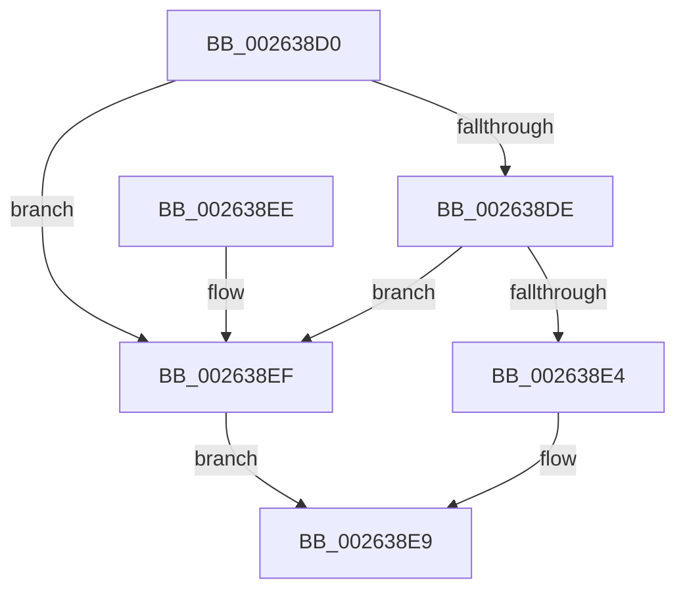

# ExfReleasePushLock

- RVA: `0x002638D0`–`0x002638F6` (길이 `38` bytes)
- VA: `0x00000001402638D0`
- 실행 섹션: `.text`
- PDB 이름 있음: `예`; PDB Function 태그: `아니요`
- unwind 정보 RVA: `0x0005CEE8`
- 디코드: `13`개 명령, `38/38` bytes 표시
- 미해석 바이트: `0` (있으면 어셈블리에 `.byte`로 보존)

> 이 문서는 커널 이미지의 기계어와 PDB 기호를 분석해 생성했습니다. 4번과 5번은 함수 원형과 자료형을 바이너리 사용 방식에서 추정한 C 해석이며 원본 소스 복구 결과는 아닙니다.

## 1. Dependencies

- 직접 호출 지점: **2**; 고유 호출 대상: **2**
- 직접 호출자로 확인된 함수: **161**
- RIP 상대 이미지 참조: **0**

### Outgoing calls
- `0x002638E4` → [ExfReleasePushLockExclusive](ExfReleasePushLockExclusive_function_00263900.md) (function, `0x00263900`)
- `0x002638EF` → [ExfReleasePushLockShared](ExfReleasePushLockShared_function_00263440.md) (function, `0x00263440`)

### Direct callers
- [CcFlushCacheOneRange](../23/CcFlushCacheOneRange_function_00236A30.md) at `0x00236E53`
- [ExReleasePushLockEx](ExReleasePushLockEx_function_00263A80.md) at `0x00263B3E`
- [sub_00263D49](Unknown_function_00263D49.md) at `0x00263DF1`
- [ExReleaseAutoExpandPushLockExclusive](ExReleaseAutoExpandPushLockExclusive_function_00264DE0.md) at `0x00264EF2`
- [FsRtlReleaseAutoExpandPushLockExclusive](FsRtlReleaseAutoExpandPushLockExclusive_function_00265B5C.md) at `0x00265BDB`
- [FsRtlReleasePushLock](FsRtlReleasePushLock_function_00265D7C.md) at `0x00265DC3`
- [CcGetVacbMiss](../27/CcGetVacbMiss_function_00272900.md) at `0x00272E30`
- [CcGetVacbMiss](../27/CcGetVacbMiss_function_00272900.md) at `0x00272F92`
- [PoGetIdleTimes](../2D/PoGetIdleTimes_function_002DF570.md) at `0x002DF890`
- [PopReleaseRwLock](../2D/PopReleaseRwLock_function_002DFBBC.md) at `0x002DFC18`
- [EtwpUnlockBufferList](../2D/EtwpUnlockBufferList_function_002DFC28.md) at `0x002DFCA6`
- [CcReleaseBcbLockAndVacbLock](../2D/CcReleaseBcbLockAndVacbLock_function_002DFDF0.md) at `0x002DFE5B`
- [NtTraceEvent](../2F/NtTraceEvent_function_002FA6C0.md) at `0x002FB19B`
- [EtwpEnqueueAvailableBuffer](../2F/EtwpEnqueueAvailableBuffer_function_002FE7DC.md) at `0x002FE900`
- [CcPinFileData](../33/CcPinFileData_function_0033FB40.md) at `0x003403D7`
- [CcGetVirtualAddress](../34/CcGetVirtualAddress_function_00340C9C.md) at `0x00340EB2`
- [CcGetVirtualAddress](../34/CcGetVirtualAddress_function_00340C9C.md) at `0x00340FC4`
- [CcUnpinFileDataEx](../35/CcUnpinFileDataEx_function_00359DEC.md) at `0x0035A0D2`
- [CcAllocateInitializeBcb](../41/CcAllocateInitializeBcb_function_0041F5A4.md) at `0x0041F702`
- [CcPostWorkQueueAsyncRead](../45/CcPostWorkQueueAsyncRead_function_0045D624.md) at `0x0045D8DF`
- [CcPostWorkQueueAsyncRead](../45/CcPostWorkQueueAsyncRead_function_0045D624.md) at `0x0045D92E`
- [CcCompleteAsyncReadWorker](../45/CcCompleteAsyncReadWorker_function_0045D9C0.md) at `0x0045DABD`
- [CcAsyncReadWorker](../45/CcAsyncReadWorker_function_0045DB10.md) at `0x0045E06F`
- [CcAsyncReadWorker](../45/CcAsyncReadWorker_function_0045DB10.md) at `0x0045E07C`
- [CcAsyncReadWorker](../45/CcAsyncReadWorker_function_0045DB10.md) at `0x0045E086`
- [PnpDeviceActionWorker](../47/PnpDeviceActionWorker_function_00478400.md) at `0x0047891E`
- [ExpUnlockCallbackListShared](../4A/ExpUnlockCallbackListShared_function_004ABC3C.md) at `0x004ABCAE`
- [IopCleanupNotifications](../4B/IopCleanupNotifications_function_004B044C.md) at `0x004B054F`
- [CcGetNumberOfMappedPages](../4C/CcGetNumberOfMappedPages_function_004CCB50.md) at `0x004CCBFD`
- [PopFxDestroyDirectedDripsCandidateDeviceList](../4D/PopFxDestroyDirectedDripsCandidateDeviceList_function_004D2D98.md) at `0x004D2E1A`
- [ExpUnlockCallbackListExclusive](../4D/ExpUnlockCallbackListExclusive_function_004D643C.md) at `0x004D647E`
- [CcAsyncReadWorkerThread](../57/CcAsyncReadWorkerThread_function_0057F560.md) at `0x0057F670`
- [PnpCancelDeviceActionRequest](../5A/PnpCancelDeviceActionRequest_function_005A8330.md) at `0x005A83B4`
- [DifExfReleasePushLockWrapper](../62/DifExfReleasePushLockWrapper_function_00623D90.md) at `0x00623E56`
- [CmpNotifyMachineHiveLoaded](../66/CmpNotifyMachineHiveLoaded_function_0066A43C.md) at `0x0066A505`
- [sub_006DF40E](../6D/Unknown_function_006DF40E.md) at `0x006DF5AD`
- [sub_006F2006](../6F/Unknown_function_006F2006.md) at `0x006F207D`
- [sub_006F2098](../6F/Unknown_function_006F2098.md) at `0x006F2107`
- [EtwpTrackProviderBinaryKm](../../page/6F/EtwpTrackProviderBinaryKm_function_006FD8E8.md) at `0x006FDAE9`
- [EtwpTrackProviderBinaryKm](../../page/6F/EtwpTrackProviderBinaryKm_function_006FD8E8.md) at `0x006FDB46`
- [ExpWatchProductTypeWork](../../page/6F/ExpWatchProductTypeWork_function_006FFCA0.md) at `0x0070035B`
- [CmpUnLockFreezeQueue](../../page/70/CmpUnLockFreezeQueue_function_00704894.md) at `0x007048D2`
- [PdcReleaseRwLockExclusive](../../page/70/PdcReleaseRwLockExclusive_function_00705288.md) at `0x007052BF`
- [IoRegisterContainerNotification](../../page/71/IoRegisterContainerNotification_function_0071E700.md) at `0x0071E8B7`
- [IoUnregisterContainerNotification](../../page/71/IoUnregisterContainerNotification_function_0071E9C0.md) at `0x0071EAAB`
- [ObShutdownSystem](../../page/74/ObShutdownSystem_function_0074DBB0.md) at `0x0074DEFF`
- [ObRevokeHandles](../../page/74/ObRevokeHandles_function_0074E838.md) at `0x0074E8DD`
- [PopFxDestroyDripsBlockingDeviceList](../../page/75/PopFxDestroyDripsBlockingDeviceList_function_00758DEC.md) at `0x00758E8E`
- [PsRegisterAltSystemCallHandler](../../page/78/PsRegisterAltSystemCallHandler_function_00787110.md) at `0x007871E6`
- [PsRegisterAltSystemCallHandler](../../page/78/PsRegisterAltSystemCallHandler_function_00787110.md) at `0x00787235`
- [WdipSemInitialize](../../page/7A/WdipSemInitialize_function_007AEC68.md) at `0x007AECFD`
- [WdipSemUpdate](../../page/7A/WdipSemUpdate_function_007AED28.md) at `0x007AEDD6`
- [WdipSemMarkInstanceForDeletion](../../page/7B/WdipSemMarkInstanceForDeletion_function_007B0C84.md) at `0x007B0D44`
- [WdipSemUpdateFrequentScenarioTable](../../page/7B/WdipSemUpdateFrequentScenarioTable_function_007B0D7C.md) at `0x007B0E7B`
- [EtwpInitializeSiloState](../../page/7B/EtwpInitializeSiloState_function_007B6A3C.md) at `0x007B6CE7`
- [EtwpDeleteSessionDemuxObject](../../page/7B/EtwpDeleteSessionDemuxObject_function_007BC480.md) at `0x007BC56C`
- [EtwpGetPrivateSessionTraceHandle](../../page/7B/EtwpGetPrivateSessionTraceHandle_function_007BC5A8.md) at `0x007BC792`
- [EtwpRegisterPrivateSession](../../page/7B/EtwpRegisterPrivateSession_function_007BC92C.md) at `0x007BCB06`
- [SendCaptureStateNotificationsWorker](../../page/7B/SendCaptureStateNotificationsWorker_function_007BCF30.md) at `0x007BD1CA`
- [CmpFinishSystemHivesLoad](../../page/7D/CmpFinishSystemHivesLoad_function_007DA210.md) at `0x007DA6D6`
- [CmpFinishSystemHivesLoad](../../page/7D/CmpFinishSystemHivesLoad_function_007DA210.md) at `0x007DA7DC`
- [CmpFinishSystemHivesLoad](../../page/7D/CmpFinishSystemHivesLoad_function_007DA210.md) at `0x007DA8FB`
- [CmpFinishSystemHivesLoad](../../page/7D/CmpFinishSystemHivesLoad_function_007DA210.md) at `0x007DAA03`
- [CmpFinishSystemHivesLoad](../../page/7D/CmpFinishSystemHivesLoad_function_007DA210.md) at `0x007DAB5C`
- [CmRegisterMachineHiveLoadedNotification](../../page/7E/CmRegisterMachineHiveLoadedNotification_function_007E1A90.md) at `0x007E1C71`
- [CmRegisterMachineHiveLoadedNotification](../../page/7E/CmRegisterMachineHiveLoadedNotification_function_007E1A90.md) at `0x007E1CA5`
- [CmUnregisterMachineHiveLoadedNotification](../../page/7E/CmUnregisterMachineHiveLoadedNotification_function_007E1CE0.md) at `0x007E1DB2`
- [CmpUnlockGlobalKeyLockTracker](../../page/7E/CmpUnlockGlobalKeyLockTracker_function_007EDEDC.md) at `0x007EDF1A`
- [CmpGetNameControlBlock](../../page/84/CmpGetNameControlBlock_function_0084A750.md) at `0x0084AB04`
- [CmpGetNameControlBlock](../../page/84/CmpGetNameControlBlock_function_0084A750.md) at `0x0084AB11`
- [CmpUnlockHiveList](../../page/84/CmpUnlockHiveList_function_0084E424.md) at `0x0084E474`
- [CmpPerformCompleteKcbCacheLookup](../../page/84/CmpPerformCompleteKcbCacheLookup_function_0084FD20.md) at `0x008503A8`
- [CmpPerformCompleteKcbCacheLookup](../../page/84/CmpPerformCompleteKcbCacheLookup_function_0084FD20.md) at `0x008503D2`
- [CmpPerformCompleteKcbCacheLookup](../../page/84/CmpPerformCompleteKcbCacheLookup_function_0084FD20.md) at `0x0085063A`
- [CmpPerformCompleteKcbCacheLookup](../../page/84/CmpPerformCompleteKcbCacheLookup_function_0084FD20.md) at `0x00850A5A`
- [CmpPerformCompleteKcbCacheLookup](../../page/84/CmpPerformCompleteKcbCacheLookup_function_0084FD20.md) at `0x00850FCA`
- [CmpPerformCompleteKcbCacheLookup](../../page/84/CmpPerformCompleteKcbCacheLookup_function_0084FD20.md) at `0x0085116E`
- [sub_00851A5C](../../page/85/Unknown_function_00851A5C.md) at `0x00851AFF`
- [CmpWalkOneLevel](../../page/85/CmpWalkOneLevel_function_00852BA0.md) at `0x008532F1`
- [CmpWalkOneLevel](../../page/85/CmpWalkOneLevel_function_00852BA0.md) at `0x008538C2`
- [sub_0085E942](../../page/85/Unknown_function_0085E942.md) at `0x0085E98D`
- [CmpUnlockHashEntryByIndex](../../page/86/CmpUnlockHashEntryByIndex_function_00862460.md) at `0x008624AB`
- [CmpDereferenceNameControlBlockWithLock](../../page/86/CmpDereferenceNameControlBlockWithLock_function_00862840.md) at `0x0086296F`
- [ObpDecrementHandleCount](../../page/86/ObpDecrementHandleCount_function_008632E0.md) at `0x00863710`
- [ObpDecrementHandleCount](../../page/86/ObpDecrementHandleCount_function_008632E0.md) at `0x00863761`
- [ObpDecrementHandleCount](../../page/86/ObpDecrementHandleCount_function_008632E0.md) at `0x00863905`
- [ObpDecrementHandleCount](../../page/86/ObpDecrementHandleCount_function_008632E0.md) at `0x00863A7B`
- [ObpDecrementHandleCount](../../page/86/ObpDecrementHandleCount_function_008632E0.md) at `0x00863A89`
- [CmpUnlockHashEntryByKcb](../../page/86/CmpUnlockHashEntryByKcb_function_00864370.md) at `0x0086444B`
- [CmpUnlockHashEntry](../../page/86/CmpUnlockHashEntry_function_00864460.md) at `0x008644FC`
- [sub_00864EE6](../../page/86/Unknown_function_00864EE6.md) at `0x00864FC0`
- [sub_00865B4C](../../page/86/Unknown_function_00865B4C.md) at `0x00865C33`
- [CmpCallCallBacksEx](../../page/86/CmpCallCallBacksEx_function_00865F40.md) at `0x00866198`
- [CmpCallCallBacksEx](../../page/86/CmpCallCallBacksEx_function_00865F40.md) at `0x00866493`
- [CmpCallbackFillObjectContext](../../page/86/CmpCallbackFillObjectContext_function_00866A10.md) at `0x0086729A`
- [CmpCallbackFillObjectContext](../../page/86/CmpCallbackFillObjectContext_function_00866A10.md) at `0x008672EF`
- [CmpCallbackFillObjectContext](../../page/86/CmpCallbackFillObjectContext_function_00866A10.md) at `0x00867300`
- [CmpCallbackFillObjectContext](../../page/86/CmpCallbackFillObjectContext_function_00866A10.md) at `0x00867311`
- [CmpCallbackFillObjectContext](../../page/86/CmpCallbackFillObjectContext_function_00866A10.md) at `0x00867336`
- [CmpCallbackFillObjectContext](../../page/86/CmpCallbackFillObjectContext_function_00866A10.md) at `0x00867347`
- [ObCloseHandleTableEntry](../../page/86/ObCloseHandleTableEntry_function_00869E20.md) at `0x0086A4A6`
- [ObCloseHandleTableEntry](../../page/86/ObCloseHandleTableEntry_function_00869E20.md) at `0x0086A5B3`
- [ObCloseHandleTableEntry](../../page/86/ObCloseHandleTableEntry_function_00869E20.md) at `0x0086A872`
- [ObCloseHandleTableEntry](../../page/86/ObCloseHandleTableEntry_function_00869E20.md) at `0x0086A9E7`
- [ObCloseHandleTableEntry](../../page/86/ObCloseHandleTableEntry_function_00869E20.md) at `0x0086A9F5`
- [ObpCreateHandle](../../page/86/ObpCreateHandle_function_0086B950.md) at `0x0086CCA3`
- [ObpCreateHandle](../../page/86/ObpCreateHandle_function_0086B950.md) at `0x0086CCE0`
- [ObpCreateHandle](../../page/86/ObpCreateHandle_function_0086B950.md) at `0x0086D80D`
- [ObpIncrementHandleCountEx](../../page/86/ObpIncrementHandleCountEx_function_0086DA10.md) at `0x0086DF6C`
- [ObpIncrementHandleCountEx](../../page/86/ObpIncrementHandleCountEx_function_0086DA10.md) at `0x0086E158`
- [ObpIncrementHandleCountEx](../../page/86/ObpIncrementHandleCountEx_function_0086DA10.md) at `0x0086E2F9`
- [ObpIncrementHandleCountEx](../../page/86/ObpIncrementHandleCountEx_function_0086DA10.md) at `0x0086E373`
- [ObpIncrementHandleCountEx](../../page/86/ObpIncrementHandleCountEx_function_0086DA10.md) at `0x0086E3BE`
- [CmpUnlockAppHiveLoadList](../../page/87/CmpUnlockAppHiveLoadList_function_00878704.md) at `0x00878759`
- [sub_0089A511](../../page/89/Unknown_function_0089A511.md) at `0x0089A53C`
- [sub_0089A511](../../page/89/Unknown_function_0089A511.md) at `0x0089A6CC`
- [sub_0089A511](../../page/89/Unknown_function_0089A511.md) at `0x0089A842`
- [sub_0089A511](../../page/89/Unknown_function_0089A511.md) at `0x0089A850`
- [sub_0089AEE3](../../page/89/Unknown_function_0089AEE3.md) at `0x0089AF7D`
- [ObpLookupObjectName](../../page/89/ObpLookupObjectName_function_0089BE90.md) at `0x0089CC6A`
- [ObpLookupObjectName](../../page/89/ObpLookupObjectName_function_0089BE90.md) at `0x0089CC86`
- [ObInsertObjectEx](../../page/8B/ObInsertObjectEx_function_008B97A0.md) at `0x008B9EFF`
- [sub_008BA74A](../../page/8B/Unknown_function_008BA74A.md) at `0x008BA9E9`
- [ObSetSecurityDescriptorInfo](../../page/8B/ObSetSecurityDescriptorInfo_function_008BAE20.md) at `0x008BB406`
- [ObpSetObjectAuditInfo](../../page/8B/ObpSetObjectAuditInfo_function_008BD1F8.md) at `0x008BD32F`
- [EtwpReceiveNotification](../../page/8B/EtwpReceiveNotification_function_008BF9F0.md) at `0x008BFC3D`
- [EtwpReceiveNotification](../../page/8B/EtwpReceiveNotification_function_008BF9F0.md) at `0x008BFC4A`
- [EtwpRundownNotifications](../../page/8C/EtwpRundownNotifications_function_008C1284.md) at `0x008C1426`
- [EtwpClearSessionAndUnreferenceEntry](../../page/8C/EtwpClearSessionAndUnreferenceEntry_function_008C1438.md) at `0x008C16A9`
- [EtwpClearSessionAndUnreferenceEntry](../../page/8C/EtwpClearSessionAndUnreferenceEntry_function_008C1438.md) at `0x008C189C`
- [EtwpDeleteRegistrationObject](../../page/8C/EtwpDeleteRegistrationObject_function_008C1F30.md) at `0x008C2221`
- [EtwpDeleteRegistrationObject](../../page/8C/EtwpDeleteRegistrationObject_function_008C1F30.md) at `0x008C222E`
- [sub_008C28B0](../../page/8C/Unknown_function_008C28B0.md) at `0x008C2978`
- [ObpCallPreOperationCallbacks](../../page/8C/ObpCallPreOperationCallbacks_function_008C6570.md) at `0x008C6886`
- [ObpCallPreOperationCallbacks](../../page/8C/ObpCallPreOperationCallbacks_function_008C6570.md) at `0x008C689B`
- [EtwpNotifyGuid](../../page/8C/EtwpNotifyGuid_function_008C8110.md) at `0x008C8406`
- [EtwpQueueNotification](../../page/8C/EtwpQueueNotification_function_008C870C.md) at `0x008C889C`
- [PiDqQueryUnlock](../../page/8D/PiDqQueryUnlock_function_008DDA6C.md) at `0x008DDABD`
- [sub_008E314B](../../page/8E/Unknown_function_008E314B.md) at `0x008E347A`
- [sub_008E455D](../../page/8E/Unknown_function_008E455D.md) at `0x008E456B`
- [sub_008E4C9A](../../page/8E/Unknown_function_008E4C9A.md) at `0x008E4DD8`
- [PiDmObjectReleaseLock](../../page/8E/PiDmObjectReleaseLock_function_008E5584.md) at `0x008E55D4`
- [sub_008F3634](../../page/8F/Unknown_function_008F3634.md) at `0x008F36C9`
- [EtwpRegisterKMProvider](../../page/92/EtwpRegisterKMProvider_function_009209A4.md) at `0x00920C56`
- [sub_00936BA4](../../page/93/Unknown_function_00936BA4.md) at `0x00936BAB`
- [sub_00936BA4](../../page/93/Unknown_function_00936BA4.md) at `0x00936BBC`
- [CmpUnlockContextList](../../page/93/CmpUnlockContextList_function_00936C10.md) at `0x00936C6E`
- [VrpUnlockDiffHiveTable](../../page/93/VrpUnlockDiffHiveTable_function_00936E40.md) at `0x00936E95`
- [sub_0094D712](../../page/94/Unknown_function_0094D712.md) at `0x0094D78E`
- [CmpUnlockCallbackList](../../page/97/CmpUnlockCallbackList_function_0097D760.md) at `0x0097D7BE`
- [ObCheckActiveHandles](../../page/98/ObCheckActiveHandles_function_009828EC.md) at `0x0098299D`
- [ObpMarkDirectoryObjectsTemporary](../../page/99/ObpMarkDirectoryObjectsTemporary_function_0099F00C.md) at `0x0099F1E9`
- [ObpUnlockDirectory](../../page/99/ObpUnlockDirectory_function_0099F8A0.md) at `0x0099F92A`
- [ObHandleRevocationBlockAddObject](../../page/9A/ObHandleRevocationBlockAddObject_function_009A9280.md) at `0x009A9353`
- [sub_009AA147](../../page/9A/Unknown_function_009AA147.md) at `0x009AA14A`
- [sub_009AA21F](../../page/9A/Unknown_function_009AA21F.md) at `0x009AA222`
- [UNLOCK_HIVE_LOAD](../../page/9B/UNLOCK_HIVE_LOAD_function_009B2EBC.md) at `0x009B2F27`
- [CmpUnlockDeletedHashEntryByKcb](../../page/9B/CmpUnlockDeletedHashEntryByKcb_function_009B3100.md) at `0x009B31C9`
- [EtwpStopLoggerInstance](../../page/9B/EtwpStopLoggerInstance_function_009BEB94.md) at `0x009BEE6B`
- [EtwpRealtimeUpdateConsumers](../../page/9B/EtwpRealtimeUpdateConsumers_function_009BEF80.md) at `0x009BF131`
- [EtwpRealtimeUpdateConsumers](../../page/9B/EtwpRealtimeUpdateConsumers_function_009BEF80.md) at `0x009BF180`
- [EtwpShutdownConsumers](../../page/9C/EtwpShutdownConsumers_function_009C1C94.md) at `0x009C1D3F`
- [NtOpenPrivateNamespace](../../page/9C/NtOpenPrivateNamespace_function_009C94E0.md) at `0x009C971C`
- [NtOpenPrivateNamespace](../../page/9C/NtOpenPrivateNamespace_function_009C94E0.md) at `0x009C9729`
- [NtCreatePrivateNamespace](../../page/9C/NtCreatePrivateNamespace_function_009CA6D0.md) at `0x009CA9DA`
- [ObpRegisterPrivateNamespace](../../page/9C/ObpRegisterPrivateNamespace_function_009CA9F4.md) at `0x009CAAFF`
- [ObpHandleRevocationBlockRemoveInsertedObject](../../page/9D/ObpHandleRevocationBlockRemoveInsertedObject_function_009D7E58.md) at `0x009D7F2B`
- [ObpUnlockObjectType](../../page/9D/ObpUnlockObjectType_function_009DB54C.md) at `0x009DB5B7`
- [CmpDelayCloseWorker](../../page/9D/CmpDelayCloseWorker_function_009DB8E0.md) at `0x009DBCB7`
- [CmpUnlockSiloKeyLockTracker](../../page/9E/CmpUnlockSiloKeyLockTracker_function_009E8050.md) at `0x009E8083`
- [sub_009E8C24](../../page/9E/Unknown_function_009E8C24.md) at `0x009E90A9`
- [sub_009E8C24](../../page/9E/Unknown_function_009E8C24.md) at `0x009E9238`
- [EtwpNotifyDisallowedGuidChange](../../page/9E/EtwpNotifyDisallowedGuidChange_function_009EAD14.md) at `0x009EB0DE`
- [NtQuerySymbolicLinkObject](../../page/9E/NtQuerySymbolicLinkObject_function_009EBA20.md) at `0x009EBC96`
- [EtwpAddRegEntryToGroup](../../page/9F/EtwpAddRegEntryToGroup_function_009F39D4.md) at `0x009F41A6`
- [EtwpAddRegEntryToGroup](../../page/9F/EtwpAddRegEntryToGroup_function_009F39D4.md) at `0x009F41F2`
- [EtwpTrackGuidEntryRegistrations](../../page/A0/EtwpTrackGuidEntryRegistrations_function_00A03CC0.md) at `0x00A03F5D`
- [EtwpTrackGuidEntryRegistrations](../../page/A0/EtwpTrackGuidEntryRegistrations_function_00A03CC0.md) at `0x00A03F6A`
- [ObpRemoveNamespaceFromTable](../../page/A2/ObpRemoveNamespaceFromTable_function_00A2131C.md) at `0x00A2142F`
- [WdipTimeoutCheckRoutine](../../page/A5/WdipTimeoutCheckRoutine_function_00A5B910.md) at `0x00A5BA6E`
- [WdipSemSqmLogInflightLimitExceededDataPoints](../../page/A5/WdipSemSqmLogInflightLimitExceededDataPoints_function_00A5BA80.md) at `0x00A5BB71`
- [WdipSemDisableScenario](../../page/A5/WdipSemDisableScenario_function_00A5BC00.md) at `0x00A5BD46`
- [WdipSemDeleteTransitionalInstance](../../page/A5/WdipSemDeleteTransitionalInstance_function_00A5BE28.md) at `0x00A5BED6`
- [WdipSemMarkNextTimedOutInstanceForDeletion](../../page/A5/WdipSemMarkNextTimedOutInstanceForDeletion_function_00A5BF14.md) at `0x00A5C01E`
- [WdipSemDisableContextProvider](../../page/A5/WdipSemDisableContextProvider_function_00A5C184.md) at `0x00A5C2D5`
- [WdipSemEnableScenario](../../page/A5/WdipSemEnableScenario_function_00A5C424.md) at `0x00A5C590`
- [WdipSemEnableContextProvider](../../page/A5/WdipSemEnableContextProvider_function_00A5C66C.md) at `0x00A5C7E0`
- [WdipSemActivateInstance](../../page/A5/WdipSemActivateInstance_function_00A5CAA0.md) at `0x00A5CB33`
- [EtwpEnableGuid](../../page/A5/EtwpEnableGuid_function_00A5CD28.md) at `0x00A5D5C8`
- [EtwpEnableGuid](../../page/A5/EtwpEnableGuid_function_00A5CD28.md) at `0x00A5D63C`
- [EtwpEnableGuid](../../page/A5/EtwpEnableGuid_function_00A5CD28.md) at `0x00A5D851`
- [EtwpEnableGuid](../../page/A5/EtwpEnableGuid_function_00A5CD28.md) at `0x00A5D989`
- [WdipSemReserveInstanceTableEntry](../../page/A5/WdipSemReserveInstanceTableEntry_function_00A5DA08.md) at `0x00A5DB0A`
- [EtwpRealtimeConnect](../../page/A6/EtwpRealtimeConnect_function_00A65C88.md) at `0x00A661C1`
- [PopReleaseUmpoPushLock](../../page/A6/PopReleaseUmpoPushLock_function_00A68908.md) at `0x00A6895D`
- [EtwUnregister](../../page/A7/EtwUnregister_function_00A723D0.md) at `0x00A725F1`
- [ObMakeTemporaryObject](../../page/A7/ObMakeTemporaryObject_function_00A7F860.md) at `0x00A7F90B`
- [ObDestroyHandleRevocationBlock](../../page/A9/ObDestroyHandleRevocationBlock_function_00A924B8.md) at `0x00A925C3`
- [NtMakePermanentObject](../../page/A9/NtMakePermanentObject_function_00A979F0.md) at `0x00A97B08`
- [WdipSemAllocatePool](../../page/AA/WdipSemAllocatePool_function_00AA0B64.md) at `0x00AA0C58`
- [EtwpTracingProvEnableCallback](../../page/AC/EtwpTracingProvEnableCallback_function_00AC28B0.md) at `0x00AC2A0F`
- [EtwpTracingProvEnableCallback](../../page/AC/EtwpTracingProvEnableCallback_function_00AC28B0.md) at `0x00AC2B8C`
- [EtwpDemuxPrivateTraceHandle](../../page/AC/EtwpDemuxPrivateTraceHandle_function_00ACDB1C.md) at `0x00ACDC4D`
- [sub_00B1AC5A](../../page/B1/Unknown_function_00B1AC5A.md) at `0x00B1AC5D`
- [sub_00B1AE6C](../../page/B1/Unknown_function_00B1AE6C.md) at `0x00B1AEB2`
- [sub_00B1AF56](../../page/B1/Unknown_function_00B1AF56.md) at `0x00B1AFB1`
- [sub_00B1AFDA](../../page/B1/Unknown_function_00B1AFDA.md) at `0x00B1B05A`
- [sub_00B225A4](../../page/B2/Unknown_function_00B225A4.md) at `0x00B22688`
- [sub_00B2E69A](../../page/B2/Unknown_function_00B2E69A.md) at `0x00B2E71E`
- [sub_00B2E69A](../../page/B2/Unknown_function_00B2E69A.md) at `0x00B2E778`
- [sub_00B30994](../../page/B3/Unknown_function_00B30994.md) at `0x00B30997`
- [sub_00B3DB56](../../page/B3/Unknown_function_00B3DB56.md) at `0x00B3DC19`
- [sub_00B3DC32](../../page/B3/Unknown_function_00B3DC32.md) at `0x00B3DCC4`
- [sub_00B403C2](../../page/B4/Unknown_function_00B403C2.md) at `0x00B403C5`
- [sub_00B48F36](../../page/B4/Unknown_function_00B48F36.md) at `0x00B48F9A`
- [ExShutdownSystem](../../pagelk/B7/ExShutdownSystem_function_00B7290C.md) at `0x00B72A46`
- [PopReleaseAwaymodeLock](../../pagelk/B7/PopReleaseAwaymodeLock_function_00B7BB3C.md) at `0x00B7BBAA`
- [CmpUnlockKcb](../../pagecmrc/BC/CmpUnlockKcb_function_00BC92C0.md) at `0x00BC9343`
- [CmUnlockHiveSecurity](../../pagecmrc/BC/CmUnlockHiveSecurity_function_00BC99C8.md) at `0x00BC9A0E`

### Static image references
- 디코드된 RIP-relative 메모리 참조가 없습니다.

## 2. Other-region calls and transfers

- 다른 실행 섹션으로 향하는 call: **0**
- 별도 외부 분기/꼬리 이동을 확인하지 못했습니다.

## 3. Assembly (complete function range)

```asm
002638D0  48 83 EC 28                     sub rsp, 0x28
002638D4  0F 0D 09                        prefetchw byte ptr [rcx]
002638D7  48 8B 01                        mov rax, qword ptr [rcx]
002638DA  A8 02                           test al, 2
002638DC  75 11                           jne 0x1402638ef
002638DE  48 83 F8 10                     cmp rax, 0x10
002638E2  73 0B                           jae 0x1402638ef
002638E4  E8 17 00 00 00                  call 0x140263900
002638E9  48 83 C4 28                     add rsp, 0x28
002638ED  C3                              ret
002638EE  CC                              int3
002638EF  E8 4C FB FF FF                  call 0x140263440
002638F4  EB F3                           jmp 0x1402638e9
```

## 4. C-style interpretation (structured pseudocode)

```c
__int64 __fastcall ExfReleasePushLock(__int64 a1)
{
    __int64 result;
    __int64 v_rsp;

    v_rsp = (v_rsp) - (40);
    if ((((unsigned __int8)(*(unsigned __int64 *)(a1))) & (2)) != 0) goto loc_002638EF;
    if ((*(unsigned __int64 *)(a1)) >= 16) goto loc_002638EF;
    result = ExfReleasePushLockExclusive(a1, a2, a3, a4);
loc_002638E9:
    v_rsp = (v_rsp) + (40);
    return result;
loc_002638EF:
    result = ExfReleasePushLockShared(a1, a2, a3, a4);
    goto loc_002638E9;
}
```

## 5. (Beta) C Style

```c
int64_t ExfReleasePushLock(void *Arg1)
{
    uint8_t *arg1 = (uint8_t *)Arg1;

    int64_t result;
    int64_t local_rsp;

    local_rsp = (local_rsp) - (40);
    if ((((uint8_t)(*(uint64_t *)(arg1))) & (2)) != 0) goto loc_002638EF;
    if ((*(uint64_t *)(arg1)) >= 16) goto loc_002638EF;
    result = ExfReleasePushLockExclusive(Arg1, a2, a3, a4);
loc_002638E9:
    local_rsp = (local_rsp) + (40);
    return result;
loc_002638EF:
    result = ExfReleasePushLockShared(Arg1, a2, a3, a4);
    goto loc_002638E9;
}
```

### 관측된 메모리 오프셋

구조체 형식이 확인되지 않은 접근은 인자 기준의 오프셋으로만 기록했습니다.

| 기준 인자 | 오프셋 표현 | 폭 (bit) | 접근 |
|---|---:|---:|---|
| `Arg1` | `+ 0x0` | `8` | `R` |
| `Arg1` | `+ 0x0` | `64` | `R` |

## 6. Execution-region graph

[열기: 2D/3D 그래프와 함수 탐색 컨트롤 패널](../../../control-panel.html?section=text&rva=0x002638D0&view=graph)

- 2D 그래프는 위에서 아래로 흐르고, 3D 그래프는 빈 공간을 드래그해 회전합니다. Shift+드래그는 이동, 휠은 확대·축소, 함수 노드 선택은 대상 보고서 이동입니다.

### Static fallback


