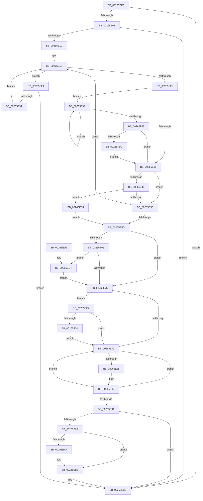

# ExfTryToWakePushLock

- RVA: `0x00265DD0`–`0x00265F65` (길이 `405` bytes)
- VA: `0x0000000140265DD0`
- 실행 섹션: `.text`
- PDB 이름 있음: `예`; PDB Function 태그: `아니요`
- unwind 정보 RVA: `0x00064CB4`
- 디코드: `112`개 명령, `405/405` bytes 표시
- 미해석 바이트: `0` (있으면 어셈블리에 `.byte`로 보존)

> 이 문서는 커널 이미지의 기계어와 PDB 기호를 분석해 생성했습니다. 4번과 5번은 함수 원형과 자료형을 바이너리 사용 방식에서 추정한 C 해석이며 원본 소스 복구 결과는 아닙니다.

## 1. Dependencies

- 직접 호출 지점: **4**; 고유 호출 대상: **4**
- 직접 호출자로 확인된 함수: **654**
- RIP 상대 이미지 참조: **1**

### Outgoing calls
- `0x00265E8D` → [KeSetEvent](../33/KeSetEvent_function_0033F310.md) (function, `0x0033F310`)
- `0x00265EAE` → [KiLowerIrqlProcessIrqlFlags](../4F/KiLowerIrqlProcessIrqlFlags_function_004F5698.md) (function, `0x004F5698`)
- `0x00265EDD` → [KiRaiseIrqlProcessIrqlFlags](../4F/KiRaiseIrqlProcessIrqlFlags_function_004F56FC.md) (function, `0x004F56FC`)
- `0x00265F1F` → [KiAbConvertWaiterToOwnerEntry](../21/KiAbConvertWaiterToOwnerEntry_function_00219430.md) (function, `0x00219430`)

### Direct callers
- [sub_00206865](../20/Unknown_function_00206865.md) at `0x00206CE3`
- [sub_00206865](../20/Unknown_function_00206865.md) at `0x00206CF4`
- [ExpDeleteTimer](../23/ExpDeleteTimer_function_00230C40.md) at `0x00230D7E`
- [ExpSetTimerObject](../23/ExpSetTimerObject_function_00231730.md) at `0x0023255B`
- [ExReleasePushLockExclusiveEx](ExReleasePushLockExclusiveEx_function_00263510.md) at `0x0026360C`
- [sub_002648DA](Unknown_function_002648DA.md) at `0x002648DD`
- [ExpReleaseFannedOutPushLockExclusive](ExpReleaseFannedOutPushLockExclusive_function_00264F74.md) at `0x00265012`
- [StLockReleaseExclusive](StLockReleaseExclusive_function_00267050.md) at `0x00267074`
- [sub_002674A2](Unknown_function_002674A2.md) at `0x002674A2`
- [MiCreatePrototypePtes](../29/MiCreatePrototypePtes_function_002950FC.md) at `0x002955A9`
- [MiCreatePrototypePtes](../29/MiCreatePrototypePtes_function_002950FC.md) at `0x0029560F`
- [MiRemoveFromSystemSpace](../29/MiRemoveFromSystemSpace_function_002962FC.md) at `0x0029659D`
- [MiSetVadDeleted](../29/MiSetVadDeleted_function_00296E00.md) at `0x00296FE4`
- [VslpUnlockPagesForTransfer](../29/VslpUnlockPagesForTransfer_function_0029EE4C.md) at `0x0029EECC`
- [KeSwappablePageDereference](../29/KeSwappablePageDereference_function_0029F540.md) at `0x0029F614`
- [MiUnlockLoaderEntry](../2A/MiUnlockLoaderEntry_function_002A3E28.md) at `0x002A3EBD`
- [UNLOCK_ADDRESS_SPACE](../2A/UNLOCK_ADDRESS_SPACE_function_002A4844.md) at `0x002A4879`
- [MiUnlockVad](../2A/MiUnlockVad_function_002A59C8.md) at `0x002A59FB`
- [MiUnlockWsSwapExclusive](../2A/MiUnlockWsSwapExclusive_function_002A74A8.md) at `0x002A74CE`
- [KiReleaseDpcCorralLock](../2C/KiReleaseDpcCorralLock_function_002C9D20.md) at `0x002C9D3E`
- [sub_002DFB67](../2D/Unknown_function_002DFB67.md) at `0x002DFB6A`
- [PspUnlockProcessListExclusive](../2D/PspUnlockProcessListExclusive_function_002DFD18.md) at `0x002DFD3B`
- [ExReleaseCacheAwarePushLockExclusive](../2D/ExReleaseCacheAwarePushLockExclusive_function_002DFD80.md) at `0x002DFDD5`
- [SMKM_STORE&lt;SM_TRAITS&gt;::SmStReleaseStoreLockExclusive](../2D/SMKM_STORE_SM_TRAITS_SmStReleaseStoreLockExclusive_function_002DFE68.md) at `0x002DFEC4`
- [SMKM_STORE_MGR&lt;SM_TRAITS&gt;::SmFeAddComplete](../2D/SMKM_STORE_MGR_SM_TRAITS_SmFeAddComplete_function_002DFEE0.md) at `0x002E02A3`
- [sub_002E0725](../2E/Unknown_function_002E0725.md) at `0x002E072C`
- [MiUnlockControlAreaFileObjectExclusive](../2E/MiUnlockControlAreaFileObjectExclusive_function_002E22D0.md) at `0x002E2306`
- [MiManageSubsectionView](../2E/MiManageSubsectionView_function_002E2570.md) at `0x002E2789`
- [UNLOCK_PAGE_TABLE_COMMITMENT](../2E/UNLOCK_PAGE_TABLE_COMMITMENT_function_002E27D0.md) at `0x002E2803`
- [RtlpHpReleaseQueuedLockExclusive](../2E/RtlpHpReleaseQueuedLockExclusive_function_002E2A70.md) at `0x002E2BDC`
- [ExpSaAllocatorFree](../2E/ExpSaAllocatorFree_function_002E2E00.md) at `0x002E2F73`
- [sub_002E3422](../2E/Unknown_function_002E3422.md) at `0x002E3426`
- [RtlpCSparseBitmapUnlock](../2F/RtlpCSparseBitmapUnlock_function_002F0DD0.md) at `0x002F0E27`
- [sub_00324361](../32/Unknown_function_00324361.md) at `0x00324394`
- [MiAddViewsForSection](../32/MiAddViewsForSection_function_00324990.md) at `0x00324E22`
- [MiAddViewsForSection](../32/MiAddViewsForSection_function_00324990.md) at `0x00324FA2`
- [RtlpHpSegPageRangeCoalesce](../32/RtlpHpSegPageRangeCoalesce_function_00325860.md) at `0x00325BAA`
- [sub_0034A424](../34/Unknown_function_0034A424.md) at `0x0034A427`
- [MiDecommitHardwareEnclavePages](../36/MiDecommitHardwareEnclavePages_function_003688D4.md) at `0x00368C7A`
- [MiPrivateFixup](../36/MiPrivateFixup_function_003693E8.md) at `0x00369B23`
- [KeSwappablePageReference](../36/KeSwappablePageReference_function_0036A864.md) at `0x0036A95F`
- [PspUnlockQuotaExpansion](../39/PspUnlockQuotaExpansion_function_00390E68.md) at `0x00390ED1`
- [MiUpControlAreaRefs](../3B/MiUpControlAreaRefs_function_003B2BF0.md) at `0x003B2EEA`
- [MiInsertInSystemSpace](../3B/MiInsertInSystemSpace_function_003B2F5C.md) at `0x003B3552`
- [ExpSaAllocatorAllocate](../3B/ExpSaAllocatorAllocate_function_003B402C.md) at `0x003B4156`
- [ExpSaPageGroupDescriptorAllocate](../3B/ExpSaPageGroupDescriptorAllocate_function_003B4224.md) at `0x003B4458`
- [ExpSaPageGroupAllocateMemory](../3B/ExpSaPageGroupAllocateMemory_function_003B5FF0.md) at `0x003B60D0`
- [MiUnlockPartitionMappedWriter](../40/MiUnlockPartitionMappedWriter_function_004030EC.md) at `0x00403112`
- [MiFinishVadDeletion](../43/MiFinishVadDeletion_function_00430ED0.md) at `0x004310DA`
- [RtlInsertDynamicUserFunctionTable](../45/RtlInsertDynamicUserFunctionTable_function_004513C4.md) at `0x004516C6`
- [CcChangeBackingFileObject](../45/CcChangeBackingFileObject_function_00457E5C.md) at `0x00457FFF`
- [CcChangeBackingFileObject](../45/CcChangeBackingFileObject_function_00457E5C.md) at `0x0045800C`
- [CcChangeBackingFileObject](../45/CcChangeBackingFileObject_function_00457E5C.md) at `0x00458019`
- [CcChangeBackingFileObject](../45/CcChangeBackingFileObject_function_00457E5C.md) at `0x00458026`
- [ExQueryHandleExceptionsPermanency](../45/ExQueryHandleExceptionsPermanency_function_00458CE0.md) at `0x00458DBB`
- [CcAmILowPriorityWriter](../45/CcAmILowPriorityWriter_function_0045F784.md) at `0x0045F827`
- [PspUnlockProcessExclusive](../46/PspUnlockProcessExclusive_function_004601C0.md) at `0x004601E6`
- [ExpUnlockHandleTableExclusive](../46/ExpUnlockHandleTableExclusive_function_004608A8.md) at `0x004608CB`
- [RtlRemoveDynamicUserFunctionTable](../46/RtlRemoveDynamicUserFunctionTable_function_00466514.md) at `0x004666A1`
- [MI_UNLOCK_RELOCATIONS_EXCLUSIVE](../46/MI_UNLOCK_RELOCATIONS_EXCLUSIVE_function_0046965C.md) at `0x00469693`
- [MiModifiedPageWriter](../47/MiModifiedPageWriter_function_0047E5F0.md) at `0x0047E6BA`
- [MiModifiedPageWriter](../47/MiModifiedPageWriter_function_0047E5F0.md) at `0x0047EB49`
- [SshpSetCollectionActive](../48/SshpSetCollectionActive_function_0048507C.md) at `0x0048517B`
- [SshpDereferenceBlocker](../48/SshpDereferenceBlocker_function_00486960.md) at `0x00486B14`
- [SshpDereferenceBlocker](../48/SshpDereferenceBlocker_function_00486960.md) at `0x00486B21`
- [SepDeleteSessionLowboxEntries](../48/SepDeleteSessionLowboxEntries_function_0048C188.md) at `0x0048C3B3`
- [SepDeleteSessionLowboxEntries](../48/SepDeleteSessionLowboxEntries_function_0048C188.md) at `0x0048C3C0`
- [SepDeleteSessionLowboxEntries](../48/SepDeleteSessionLowboxEntries_function_0048C188.md) at `0x0048C3CA`
- [MiDereferenceExtendInfo](../48/MiDereferenceExtendInfo_function_0048EFA4.md) at `0x0048F086`
- [PfLockExclusiveRelease](../49/PfLockExclusiveRelease_function_00491D88.md) at `0x00491DA0`
- [ExpSaPageGroupFreeMemory](../49/ExpSaPageGroupFreeMemory_function_00493E8C.md) at `0x00493F41`
- [SSHSupportReleasePushLockExclusive](../49/SSHSupportReleasePushLockExclusive_function_004954EC.md) at `0x00495504`
- [FlushLookUpTableBucket](../49/FlushLookUpTableBucket_function_00497690.md) at `0x00497789`
- [PopFxClearDirectedDripsCandidateDeviceList](../49/PopFxClearDirectedDripsCandidateDeviceList_function_004988EC.md) at `0x004989F3`
- [PopFxClearDirectedDripsCandidateDeviceList](../49/PopFxClearDirectedDripsCandidateDeviceList_function_004988EC.md) at `0x004989FD`
- [PopFxBuildDirectedDripsCandidateDeviceList](../49/PopFxBuildDirectedDripsCandidateDeviceList_function_00499288.md) at `0x004993C1`
- [EtwpUpdateSelectedGroupMasks](../49/EtwpUpdateSelectedGroupMasks_function_0049B114.md) at `0x0049B4FB`
- [PopFxBuildDripsBlockingDeviceList](../49/PopFxBuildDripsBlockingDeviceList_function_0049B5B0.md) at `0x0049B98F`
- [ExpTryAcquireFannedOutPushLockExclusive](../4A/ExpTryAcquireFannedOutPushLockExclusive_function_004A1270.md) at `0x004A12F4`
- [PspStorageEmptyArrayNonReadonly](../4A/PspStorageEmptyArrayNonReadonly_function_004A3F6C.md) at `0x004A4067`
- [PspStorageEmptyArrayNonReadonly](../4A/PspStorageEmptyArrayNonReadonly_function_004A3F6C.md) at `0x004A4071`
- [PopDirectedDripsDiagTraceNotifyDevices](../4A/PopDirectedDripsDiagTraceNotifyDevices_function_004A70AC.md) at `0x004A7282`
- [ExTryAcquireAutoExpandPushLockExclusive](../4A/ExTryAcquireAutoExpandPushLockExclusive_function_004A9AA0.md) at `0x004A9B5A`
- [PopDirectedDripsNotifyResiliencyCompletionWorker](../4A/PopDirectedDripsNotifyResiliencyCompletionWorker_function_004ACAE0.md) at `0x004ACB8F`
- [KsepShimDbChanged](../4B/KsepShimDbChanged_function_004B014C.md) at `0x004B0228`
- [RtlpHpAcquireReleaseLockExclusive](../4B/RtlpHpAcquireReleaseLockExclusive_function_004B208C.md) at `0x004B2122`
- [MiUnlockDriverMappings](../4B/MiUnlockDriverMappings_function_004B4E54.md) at `0x004B4E77`
- [ExpSaPageGroupDescriptorFree](../4B/ExpSaPageGroupDescriptorFree_function_004B5EA8.md) at `0x004B5F4F`
- [PopFxInsertDevice](../4B/PopFxInsertDevice_function_004B95EC.md) at `0x004B96B1`
- [SleepstudyHelperCreateLibraryEx](../4B/SleepstudyHelperCreateLibraryEx_function_004BAE50.md) at `0x004BAF70`
- [RtlpReleaseBootStatusLock](../4C/RtlpReleaseBootStatusLock_function_004C05D4.md) at `0x004C05F2`
- [HalpIommuUnblockDevice](../4C/HalpIommuUnblockDevice_function_004C6250.md) at `0x004C6404`
- [MiUnlockSystemCacheInit](../4C/MiUnlockSystemCacheInit_function_004C81C8.md) at `0x004C81EE`
- [HalpIommuBlockDevice](../4C/HalpIommuBlockDevice_function_004CA150.md) at `0x004CA249`
- [PsGetProcessEnclaveModuleInfo](../4C/PsGetProcessEnclaveModuleInfo_function_004CA2E0.md) at `0x004CA4CD`
- [ExGetWakeTimerList](../4C/ExGetWakeTimerList_function_004CB964.md) at `0x004CBBB1`
- [PopPepInsertDevice](../4C/PopPepInsertDevice_function_004CBD58.md) at `0x004CBE0A`
- [PopPepRemoveDevice](../4C/PopPepRemoveDevice_function_004CBE38.md) at `0x004CBEDB`
- [PspUnlockQuotaListExclusive](../4D/PspUnlockQuotaListExclusive_function_004D9988.md) at `0x004D99AA`
- [PspUnlockThreadSecurityExclusive](../4E/PspUnlockThreadSecurityExclusive_function_004E97C0.md) at `0x004E97E9`
- [SmFirstTimeInit](../4E/SmFirstTimeInit_function_004EA944.md) at `0x004EADDD`
- [PopFxPrepareDevicesForShutdown](../4F/PopFxPrepareDevicesForShutdown_function_004F5DF4.md) at `0x004F5E69`
- [HalpIommuCreateDevice](../54/HalpIommuCreateDevice_function_0054ED60.md) at `0x0054F330`
- [HalpIommuDeleteDevice](../54/HalpIommuDeleteDevice_function_0054F368.md) at `0x0054F475`
- [HalpIommuInvokeInterfaceStateChangeCallbacks](../54/HalpIommuInvokeInterfaceStateChangeCallbacks_function_0054F708.md) at `0x0054F7C7`
- [IommupDeviceGetPasidDevice](../54/IommupDeviceGetPasidDevice_function_0054F82C.md) at `0x0054F8D9`
- [IommupPasidDeviceCreate](../54/IommupPasidDeviceCreate_function_0054FEEC.md) at `0x0054FFFC`
- [IommupPasidDeviceDelete](../55/IommupPasidDeviceDelete_function_00550030.md) at `0x005500CF`
- [HalpLeaveDmaDomain](../55/HalpLeaveDmaDomain_function_00552600.md) at `0x00552694`
- [HalpLeaveDmaDomain](../55/HalpLeaveDmaDomain_function_00552600.md) at `0x005526BB`
- [IommuBeginDeviceReset](../56/IommuBeginDeviceReset_function_00564A60.md) at `0x00564B70`
- [IommuFinalizeDeviceReset](../56/IommuFinalizeDeviceReset_function_005653F0.md) at `0x0056556E`
- [IommupFreeSystemContext](../56/IommupFreeSystemContext_function_00566234.md) at `0x005662D3`
- [IommupGetSystemContext](../56/IommupGetSystemContext_function_00566310.md) at `0x005663FD`
- [IommupGetSystemContext](../56/IommupGetSystemContext_function_00566310.md) at `0x0056644A`
- [IommupHvAttachPasidDevice](../56/IommupHvAttachPasidDevice_function_00566AEC.md) at `0x00566C62`
- [IommupHvAttachPasidDevice](../56/IommupHvAttachPasidDevice_function_00566AEC.md) at `0x00566D3C`
- [IommupHvAttachPasidDeviceDomain](../56/IommupHvAttachPasidDeviceDomain_function_00566E3C.md) at `0x00566F78`
- [IommupHvCreateSvmPasidSpace](../56/IommupHvCreateSvmPasidSpace_function_0056703C.md) at `0x0056711C`
- [IommupHvDetachPasidDeviceDomain](../56/IommupHvDetachPasidDeviceDomain_function_005671B4.md) at `0x00567264`
- [IommuRegisterInterfaceStateChangeCallback](../56/IommuRegisterInterfaceStateChangeCallback_function_00568200.md) at `0x005682BC`
- [IommuRegisterInterfaceStateChangeCallback](../56/IommuRegisterInterfaceStateChangeCallback_function_00568200.md) at `0x0056839A`
- [IommuRegisterInterfaceStateChangeCallback](../56/IommuRegisterInterfaceStateChangeCallback_function_00568200.md) at `0x005683BB`
- [IommuUnregisterInterfaceStateChangeCallback](../56/IommuUnregisterInterfaceStateChangeCallback_function_00568730.md) at `0x0056880C`
- [IommuUnregisterInterfaceStateChangeCallback](../56/IommuUnregisterInterfaceStateChangeCallback_function_00568730.md) at `0x0056884E`
- [CcBoostLowPriorityWorkerThread](../57/CcBoostLowPriorityWorkerThread_function_0057B704.md) at `0x0057B831`
- [EmpQueueRuleUpdateState](../58/EmpQueueRuleUpdateState_function_005809B0.md) at `0x00580A98`
- [EmpRuleUpdateWorkerThread](../58/EmpRuleUpdateWorkerThread_function_00580B20.md) at `0x00580BAB`
- [EmpRuleUpdateWorkerThread](../58/EmpRuleUpdateWorkerThread_function_00580B20.md) at `0x00580C0C`
- [EmpRuleUpdateWorkerThread](../58/EmpRuleUpdateWorkerThread_function_00580B20.md) at `0x00580C7A`
- [KasaniReportTelemetry](../5A/KasaniReportTelemetry_function_005AB1D0.md) at `0x005AB2A4`
- [sub_005AF44B](../5A/Unknown_function_005AF44B.md) at `0x005AF59C`
- [KeUpdateDpcWatchdogConfiguration](../5B/KeUpdateDpcWatchdogConfiguration_function_005B5A34.md) at `0x005B5BFE`
- [PopFxInsertAcpiDevice](../5D/PopFxInsertAcpiDevice_function_005D2C08.md) at `0x005D2CB1`
- [PopFxRegisterPluginEx](../5D/PopFxRegisterPluginEx_function_005D31B8.md) at `0x005D338F`
- [PopFxRemoveAcpiDevice](../5D/PopFxRemoveAcpiDevice_function_005D3468.md) at `0x005D34FF`
- [PopFxRemoveDevice](../5D/PopFxRemoveDevice_function_005D3534.md) at `0x005D35C4`
- [PspReleaseSyscallProviderRegistrationLockExclusive](../5E/PspReleaseSyscallProviderRegistrationLockExclusive_function_005E2438.md) at `0x005E2456`
- [PspUnlockSyscallProviderExclusive](../5E/PspUnlockSyscallProviderExclusive_function_005E2478.md) at `0x005E2494`
- [PspEnqueueProcessQosChangeNotification](../5E/PspEnqueueProcessQosChangeNotification_function_005E2ED0.md) at `0x005E2FA4`
- [PspRefreshProcessUserPresencePpmPolicyCallback](../5E/PspRefreshProcessUserPresencePpmPolicyCallback_function_005E3100.md) at `0x005E31AF`
- [PspReleasePushLockExclusive](../5E/PspReleasePushLockExclusive_function_005E4040.md) at `0x005E405E`
- [PsAdjustBasicEnclaveThreadList](../5E/PsAdjustBasicEnclaveThreadList_function_005E4BD8.md) at `0x005E4D12`
- [PsLoadVsmEnclaveData](../5E/PsLoadVsmEnclaveData_function_005E4D5C.md) at `0x005E4E94`
- [NormalizationList__Unlock](../5F/NormalizationList__Unlock_function_005F1F18.md) at `0x005F1F36`
- [SepDeleteSessionAntiTamperEntries](../60/SepDeleteSessionAntiTamperEntries_function_0060AAF8.md) at `0x0060ABDE`
- [SepDeleteSessionAntiTamperEntries](../60/SepDeleteSessionAntiTamperEntries_function_0060AAF8.md) at `0x0060ACD5`
- [SepDeleteSessionAntiTamperEntries](../60/SepDeleteSessionAntiTamperEntries_function_0060AAF8.md) at `0x0060AD11`
- [SepSetTokenAntiTamperEntry](../60/SepSetTokenAntiTamperEntry_function_0060B28C.md) at `0x0060B46A`
- [SepSetTokenAntiTamperEntry](../60/SepSetTokenAntiTamperEntry_function_0060B28C.md) at `0x0060B50D`
- [SepSetTokenAntiTamperEntry](../60/SepSetTokenAntiTamperEntry_function_0060B28C.md) at `0x0060B53F`
- [SepSetTokenLowboxNumberEntry](../60/SepSetTokenLowboxNumberEntry_function_0060B594.md) at `0x0060B76D`
- [SepSetTokenLowboxNumberEntry](../60/SepSetTokenLowboxNumberEntry_function_0060B594.md) at `0x0060B80C`
- [SepSetTokenLowboxNumberEntry](../60/SepSetTokenLowboxNumberEntry_function_0060B594.md) at `0x0060B83E`
- [SmKmVirtualLockContextIncreaseWsMin](../60/SmKmVirtualLockContextIncreaseWsMin_function_0060FE94.md) at `0x0060FFC4`
- [SmKmVirtualLockCtxMemoryUnlocked](../61/SmKmVirtualLockCtxMemoryUnlocked_function_0061015C.md) at `0x00610282`
- [SmHwAcceleratorMgrHotRemoveAccelerator](../61/SmHwAcceleratorMgrHotRemoveAccelerator_function_006115FC.md) at `0x0061186E`
- [SmHwAcceleratorMgrHotRemoveAccelerator](../61/SmHwAcceleratorMgrHotRemoveAccelerator_function_006115FC.md) at `0x00611898`
- [SmHwAcceleratorMgrHotRemoveAccelerator](../61/SmHwAcceleratorMgrHotRemoveAccelerator_function_006115FC.md) at `0x00611915`
- [SmHwAcceleratorPartitionMgrInsertAccelerator](../61/SmHwAcceleratorPartitionMgrInsertAccelerator_function_00611944.md) at `0x00611A0F`
- [DifExfTryToWakePushLockWrapper](../62/DifExfTryToWakePushLockWrapper_function_00624060.md) at `0x00624126`
- [EtwpBufferingModeCompressionFlush](../65/EtwpBufferingModeCompressionFlush_function_00652D24.md) at `0x00652D95`
- [EtwpCompressPendingBuffers](../65/EtwpCompressPendingBuffers_function_00653140.md) at `0x00653268`
- [EtwpCompressionProc](../65/EtwpCompressionProc_function_00653300.md) at `0x0065339F`
- [EtwpDisableCompression](../65/EtwpDisableCompression_function_006534F8.md) at `0x00653582`
- [EtwpSetCompressionSettings](../65/EtwpSetCompressionSettings_function_00653910.md) at `0x006539BC`
- [ExpQueryBootLoaderMetadata](../65/ExpQueryBootLoaderMetadata_function_00654E8C.md) at `0x00654F5C`
- [ExpSetBootLoaderMetadata](../65/ExpSetBootLoaderMetadata_function_00654F98.md) at `0x006550A0`
- [ExTryAcquireCacheAwarePushLockExclusiveEx](../65/ExTryAcquireCacheAwarePushLockExclusiveEx_function_00657F20.md) at `0x00657FA4`
- [ExWakeTimersResume](../65/ExWakeTimersResume_function_00659270.md) at `0x00659350`
- [ExInitializeDeviceAts](../65/ExInitializeDeviceAts_function_00659B80.md) at `0x00659CEA`
- [ExUninitializeDeviceAts](../65/ExUninitializeDeviceAts_function_00659D6C.md) at `0x00659E10`
- [ExSvmBeginDeviceReset](../65/ExSvmBeginDeviceReset_function_0065ACE0.md) at `0x0065ADAC`
- [ExSvmFinalizeDeviceReset](../65/ExSvmFinalizeDeviceReset_function_0065AE00.md) at `0x0065AEC2`
- [ExpShareAddressSpaceWithDevice](../65/ExpShareAddressSpaceWithDevice_function_0065B528.md) at `0x0065B817`
- [ExpShareAddressSpaceWithDevice](../65/ExpShareAddressSpaceWithDevice_function_0065B528.md) at `0x0065B876`
- [ExpShareAddressSpaceWithDevice](../65/ExpShareAddressSpaceWithDevice_function_0065B528.md) at `0x0065BAE5`
- [ExpSvmDereferenceDevice](../65/ExpSvmDereferenceDevice_function_0065BBCC.md) at `0x0065BD11`
- [ExpReleasePoolListLockExclusive](../65/ExpReleasePoolListLockExclusive_function_0065D868.md) at `0x0065D886`
- [WheaSelLogError](../65/WheaSelLogError_function_0065D8A8.md) at `0x0065D952`
- [WheaSelLogSetNtSchedulerAvailability](../65/WheaSelLogSetNtSchedulerAvailability_function_0065DB18.md) at `0x0065DB8B`
- [WheaRegisterErrorSourceOverride](../66/WheaRegisterErrorSourceOverride_function_00660EE0.md) at `0x006610AF`
- [WheaUnregisterErrorSourceOverride](../66/WheaUnregisterErrorSourceOverride_function_00661140.md) at `0x00661229`
- [MiUnlockDynamicMemoryExclusive](../67/MiUnlockDynamicMemoryExclusive_function_00673C5C.md) at `0x00673C82`
- [MiUnlockDynamicMemoryNestedExclusive](../67/MiUnlockDynamicMemoryNestedExclusive_function_00673CC0.md) at `0x00673CDE`
- [MiCreateSlabIdentity](../68/MiCreateSlabIdentity_function_0068D2D4.md) at `0x0068D3A9`
- [MiDeletePendingSlabIdentities](../68/MiDeletePendingSlabIdentities_function_0068DA3C.md) at `0x0068DD68`
- [MiReturnPartitionPagesToParent](../69/MiReturnPartitionPagesToParent_function_00691B5C.md) at `0x00691D19`
- [sub_006D7372](../6D/Unknown_function_006D7372.md) at `0x006D73A9`
- [sub_006D969C](../6D/Unknown_function_006D969C.md) at `0x006D9860`
- [sub_006D969C](../6D/Unknown_function_006D969C.md) at `0x006D998F`
- [sub_006DAA04](../6D/Unknown_function_006DAA04.md) at `0x006DAA4C`
- [sub_006E19B0](../6E/Unknown_function_006E19B0.md) at `0x006E1ADB`
- [sub_006E5986](../6E/Unknown_function_006E5986.md) at `0x006E59C3`
- [sub_006EED3B](../6E/Unknown_function_006EED3B.md) at `0x006EED62`
- [sub_006F31F0](../6F/Unknown_function_006F31F0.md) at `0x006F3213`
- [sub_006F810A](../6F/Unknown_function_006F810A.md) at `0x006F8132`
- [sub_006F937E](../6F/Unknown_function_006F937E.md) at `0x006F9483`
- [EtwpCovSampContextCleanup](../../page/6F/EtwpCovSampContextCleanup_function_006FDF84.md) at `0x006FE208`
- [PopBootStatUnlock](../../page/6F/PopBootStatUnlock_function_006FE704.md) at `0x006FE779`
- [CmFcpManagerOnFeatureUsageDataTransferComplete](../../page/6F/CmFcpManagerOnFeatureUsageDataTransferComplete_function_006FF830.md) at `0x006FF915`
- [EtwQueryProcessTelemetryCoverage](../../page/70/EtwQueryProcessTelemetryCoverage_function_00701B8C.md) at `0x00701DB6`
- [EtwpCoverageEnsureContext](../../page/70/EtwpCoverageEnsureContext_function_007028E4.md) at `0x00702CB7`
- [HalpDmaAllocateChildAdapterV3](../../page/70/HalpDmaAllocateChildAdapterV3_function_007066A0.md) at `0x00706DDE`
- [HalpNotifyActorIfPmuAvailable](../../page/70/HalpNotifyActorIfPmuAvailable_function_00707880.md) at `0x007079D1`
- [HalpNotifyActorIfPmuAvailable](../../page/70/HalpNotifyActorIfPmuAvailable_function_00707880.md) at `0x00707B15`
- [HalpPmuArbiterPeriodicWorkItem](../../page/70/HalpPmuArbiterPeriodicWorkItem_function_00707B90.md) at `0x00707C21`
- [HalpPmuArbiterPeriodicWorkItem](../../page/70/HalpPmuArbiterPeriodicWorkItem_function_00707B90.md) at `0x00707C8C`
- [HalpPmuArbiterPeriodicWorkItem](../../page/70/HalpPmuArbiterPeriodicWorkItem_function_00707B90.md) at `0x00707CCD`
- [IommupDeviceDisableSvm](../../page/70/IommupDeviceDisableSvm_function_00708A28.md) at `0x00708B3D`
- [HalpRegisterPmuNotification](../../page/70/HalpRegisterPmuNotification_function_0070C38C.md) at `0x0070C502`
- [HalpRegisterPmuNotification](../../page/70/HalpRegisterPmuNotification_function_0070C38C.md) at `0x0070C58A`
- [IommuDeviceDelete](../../page/70/IommuDeviceDelete_function_0070D0D0.md) at `0x0070D156`
- [IommuDeviceDelete](../../page/70/IommuDeviceDelete_function_0070D0D0.md) at `0x0070D214`
- [DbgkpRemoveErrorPort](../../page/71/DbgkpRemoveErrorPort_function_00711038.md) at `0x007110F0`
- [EmClientRuleDeregisterNotification](../../page/71/EmClientRuleDeregisterNotification_function_00712CB0.md) at `0x00712D88`
- [EmpClientRuleRegisterNotification](../../page/71/EmpClientRuleRegisterNotification_function_00712DE4.md) at `0x0071301E`
- [EmProviderDeregister](../../page/71/EmProviderDeregister_function_00713060.md) at `0x007131FF`
- [EmProviderDeregisterEntry](../../page/71/EmProviderDeregisterEntry_function_00713230.md) at `0x00713296`
- [EmProviderRegisterEntry](../../page/71/EmProviderRegisterEntry_function_00713300.md) at `0x007134D5`
- [HvlQuerySetBootPagesInfo](../../page/71/HvlQuerySetBootPagesInfo_function_00717D7C.md) at `0x00717EE6`
- [IoRegisterIoTracking](../../page/71/IoRegisterIoTracking_function_0071F600.md) at `0x0071F6E5`
- [IoUnregisterIoTracking](../../page/71/IoUnregisterIoTracking_function_0071F750.md) at `0x0071F7F4`
- [KeRegisterAvailableCpusChangeNotification](../../page/74/KeRegisterAvailableCpusChangeNotification_function_00745D7C.md) at `0x00745E89`
- [KeRegisterAvailableCpusChangeNotification](../../page/74/KeRegisterAvailableCpusChangeNotification_function_00745D7C.md) at `0x00745F10`
- [KeUnregisterAvailableCpusChangeNotification](../../page/74/KeUnregisterAvailableCpusChangeNotification_function_00745FB4.md) at `0x00746056`
- [KeUnregisterAvailableCpusChangeNotification](../../page/74/KeUnregisterAvailableCpusChangeNotification_function_00745FB4.md) at `0x007460E0`
- [KeSetSystemServiceCallback](../../page/74/KeSetSystemServiceCallback_function_00747A10.md) at `0x00747BA2`
- [KeSetTracepoint](../../page/74/KeSetTracepoint_function_00747F80.md) at `0x0074857D`
- [KiTpIsExcludedKernelTracepointLocation](../../page/74/KiTpIsExcludedKernelTracepointLocation_function_007487D0.md) at `0x00748861`
- [KseRegisterShimEx](../../page/74/KseRegisterShimEx_function_007494D0.md) at `0x00749661`
- [KseRegisterShimEx](../../page/74/KseRegisterShimEx_function_007494D0.md) at `0x00749743`
- [KseUnregisterShim](../../page/74/KseUnregisterShim_function_00749800.md) at `0x00749A5A`
- [KsepResolveApplicableShimsForDriver](../../page/74/KsepResolveApplicableShimsForDriver_function_0074A168.md) at `0x0074A255`
- [KsepResolveApplicableShimsForDriver](../../page/74/KsepResolveApplicableShimsForDriver_function_0074A168.md) at `0x0074A39D`
- [KsepResolveApplicableShimsForDriver](../../page/74/KsepResolveApplicableShimsForDriver_function_0074A168.md) at `0x0074A440`
- [KsepResolveApplicableShimsForDriver](../../page/74/KsepResolveApplicableShimsForDriver_function_0074A168.md) at `0x0074A508`
- [KsepResolveApplicableShimsForDriver](../../page/74/KsepResolveApplicableShimsForDriver_function_0074A168.md) at `0x0074A596`
- [AlpcRegisterLogRoutine](../../page/74/AlpcRegisterLogRoutine_function_0074CE5C.md) at `0x0074CF52`
- [AlpcUnregisterLogRoutine](../../page/74/AlpcUnregisterLogRoutine_function_0074CF84.md) at `0x0074D03B`
- [ObpCreateSymbolicLinkName](../../page/74/ObpCreateSymbolicLinkName_function_0074EB80.md) at `0x0074EF21`
- [ObDisableEtwReferenceTrace](../../page/74/ObDisableEtwReferenceTrace_function_0074F394.md) at `0x0074F409`
- [ObEnableEtwReferenceTrace](../../page/74/ObEnableEtwReferenceTrace_function_0074F434.md) at `0x0074F4A9`
- [ObQueryRefTraceInformation](../../page/74/ObQueryRefTraceInformation_function_0074F4D4.md) at `0x0074F751`
- [ObpFreeWorkItemBlock](../../page/74/ObpFreeWorkItemBlock_function_0074F940.md) at `0x0074F9ED`
- [ObpPushRefDerefInfo](../../page/74/ObpPushRefDerefInfo_function_0074FEC4.md) at `0x0075006E`
- [ObpStartRuntimeStackTrace](../../page/75/ObpStartRuntimeStackTrace_function_00750134.md) at `0x007504D8`
- [ObpStartRuntimeStackTrace](../../page/75/ObpStartRuntimeStackTrace_function_00750134.md) at `0x00750510`
- [ObpStopRuntimeStackTrace](../../page/75/ObpStopRuntimeStackTrace_function_00750574.md) at `0x007505F9`
- [ObpStopRuntimeStackTrace](../../page/75/ObpStopRuntimeStackTrace_function_00750574.md) at `0x007506AF`
- [ObpStopRuntimeStackTrace](../../page/75/ObpStopRuntimeStackTrace_function_00750574.md) at `0x0075072D`
- [PopFxNotifySxTransitionState](../../page/75/PopFxNotifySxTransitionState_function_007593B0.md) at `0x00759411`
- [PopFxNotifySxTransitionState](../../page/75/PopFxNotifySxTransitionState_function_007593B0.md) at `0x007594C5`
- [PopPowerButtonBugcheckConfigure](../../page/76/PopPowerButtonBugcheckConfigure_function_00768F84.md) at `0x00769057`
- [PopDirectedDripsDiagBroadcastTreeEnd](../../page/77/PopDirectedDripsDiagBroadcastTreeEnd_function_00770E10.md) at `0x00770EB2`
- [PopDirectedDripsDiagTraceBroadcastFailureDevice](../../page/77/PopDirectedDripsDiagTraceBroadcastFailureDevice_function_0077127C.md) at `0x00771331`
- [PopDirectedDripsDiagTraceProblemDevice](../../page/77/PopDirectedDripsDiagTraceProblemDevice_function_0077135C.md) at `0x0077149C`
- [PspDxgExtensionHostCallback](../../page/78/PspDxgExtensionHostCallback_function_00781670.md) at `0x0078170B`
- [PspProcessQosChangeNotificationWorker](../../page/78/PspProcessQosChangeNotificationWorker_function_00781740.md) at `0x0078180C`
- [PspProcessQosChangeNotificationWorker](../../page/78/PspProcessQosChangeNotificationWorker_function_00781740.md) at `0x007819C6`
- [PsUpdateActiveProcessAffinity](../../page/78/PsUpdateActiveProcessAffinity_function_00781DA8.md) at `0x00781EBD`
- [PspEnableProcessOptionalXStateFeatures](../../page/78/PspEnableProcessOptionalXStateFeatures_function_00781EF0.md) at `0x007822E9`
- [PspProcessDynamicEHContinuationTargets](../../page/78/PspProcessDynamicEHContinuationTargets_function_00782348.md) at `0x007825B9`
- [PspProcessDynamicEnforcedAddressRanges](../../page/78/PspProcessDynamicEnforcedAddressRanges_function_00782624.md) at `0x00782869`
- [NtChangeProcessState](../../page/78/NtChangeProcessState_function_00782C00.md) at `0x00782DC6`
- [PsCreateCpuPartition](../../page/78/PsCreateCpuPartition_function_00783A8C.md) at `0x00783BFF`
- [PspDeleteCpuPartition](../../page/78/PspDeleteCpuPartition_function_00784310.md) at `0x007843C1`
- [PspApplyWorkingSetLimits](../../page/78/PspApplyWorkingSetLimits_function_00784C00.md) at `0x00784D08`
- [PspTeardownPartition](../../page/78/PspTeardownPartition_function_00788480.md) at `0x0078856B`
- [PsDeleteVsmEnclave](../../page/78/PsDeleteVsmEnclave_function_007885F0.md) at `0x0078872B`
- [PsInitializeVsmEnclave](../../page/78/PsInitializeVsmEnclave_function_0078875C.md) at `0x007888EB`
- [PsIsVsmEnclaveTerminated](../../page/78/PsIsVsmEnclaveTerminated_function_00788934.md) at `0x007889C6`
- [PsTerminateVsmEnclave](../../page/78/PsTerminateVsmEnclave_function_00788A64.md) at `0x00788BC1`
- [PspRemoveEnclaveThreadWait](../../page/78/PspRemoveEnclaveThreadWait_function_00788CB0.md) at `0x00788D4B`
- [PspStorageAllocSlot](../../page/78/PspStorageAllocSlot_function_00789B68.md) at `0x00789C24`
- [PspStorageFreeSlot](../../page/78/PspStorageFreeSlot_function_00789C64.md) at `0x00789D31`
- [PspStorageRemoveObject](../../page/78/PspStorageRemoveObject_function_00789D68.md) at `0x00789E4A`
- [PspStorageReplaceObject](../../page/78/PspStorageReplaceObject_function_00789EA0.md) at `0x00789F5E`
- [RtlpFlsAlloc](../../page/79/RtlpFlsAlloc_function_00795074.md) at `0x007951B8`
- [RtlpFlsAlloc](../../page/79/RtlpFlsAlloc_function_00795074.md) at `0x007951E7`
- [RtlpFlsFree](../../page/79/RtlpFlsFree_function_0079521C.md) at `0x007953C4`
- [RtlpFlsFree](../../page/79/RtlpFlsFree_function_0079521C.md) at `0x0079542E`
- [SepDeReferenceSharedSidEntries](../../page/7A/SepDeReferenceSharedSidEntries_function_007A2D40.md) at `0x007A2E1C`
- [SepDereferenceAntiTamperEntry](../../page/7A/SepDereferenceAntiTamperEntry_function_007A2E50.md) at `0x007A2F9B`
- [SepDereferenceAntiTamperEntry](../../page/7A/SepDereferenceAntiTamperEntry_function_007A2E50.md) at `0x007A3016`
- [SepInsertOrReferenceSharedSidEntries](../../page/7A/SepInsertOrReferenceSharedSidEntries_function_007A32A8.md) at `0x007A3484`
- [SepIsParentOfChildAppContainer](../../page/7A/SepIsParentOfChildAppContainer_function_007A34C0.md) at `0x007A362D`
- [SepRmCapUpdateWrkr](../../page/7A/SepRmCapUpdateWrkr_function_007A46D0.md) at `0x007A47D6`
- [SepRmCapUpdateWrkr](../../page/7A/SepRmCapUpdateWrkr_function_007A46D0.md) at `0x007A4861`
- [SmDeletePartition](../../page/7A/SmDeletePartition_function_007A59C0.md) at `0x007A5A74`
- [SmGetRegistrationInfo](../../page/7A/SmGetRegistrationInfo_function_007A5AC4.md) at `0x007A5B72`
- [SmPartitionJobPaired](../../page/7A/SmPartitionJobPaired_function_007A5E34.md) at `0x007A5EB6`
- [SmProcessConfigRequest](../../page/7A/SmProcessConfigRequest_function_007A62E4.md) at `0x007A64C7`
- [SmcCacheCreatePrepare](../../page/7A/SmcCacheCreatePrepare_function_007A754C.md) at `0x007A7613`
- [SmpSystemStoreCreate](../../page/7A/SmpSystemStoreCreate_function_007A8024.md) at `0x007A80D7`
- [SmKmKeyGenKeyDelete](../../page/7A/SmKmKeyGenKeyDelete_function_007A870C.md) at `0x007A8798`
- [SmKmKeyGenNewKey](../../page/7A/SmKmKeyGenNewKey_function_007A8990.md) at `0x007A8B48`
- [SmHwAcceleratorMgrPartitionRegister](../../page/7A/SmHwAcceleratorMgrPartitionRegister_function_007AADDC.md) at `0x007AAEB4`
- [SmHwAcceleratorMgrPartitionUnregister](../../page/7A/SmHwAcceleratorMgrPartitionUnregister_function_007AAEFC.md) at `0x007AAFA3`
- [SmcCacheAdd](../../page/7A/SmcCacheAdd_function_007AB670.md) at `0x007AB753`
- [SmcCacheRemove](../../page/7A/SmcCacheRemove_function_007ABB68.md) at `0x007ABC10`
- [SmcStoreDelete](../../page/7A/SmcStoreDelete_function_007AC214.md) at `0x007AC2DA`
- [SmcStoreDelete](../../page/7A/SmcStoreDelete_function_007AC214.md) at `0x007AC372`
- [SmcStoreResize](../../page/7A/SmcStoreResize_function_007AC500.md) at `0x007AC6B3`
- [SmcStoreResize](../../page/7A/SmcStoreResize_function_007AC500.md) at `0x007AC784`
- [SmcStoreSlotAbort](../../page/7A/SmcStoreSlotAbort_function_007AC7DC.md) at `0x007AC86C`
- [SmcStoreSlotCommit](../../page/7A/SmcStoreSlotCommit_function_007AC8A8.md) at `0x007AC943`
- [SmcStoreSlotReserve](../../page/7A/SmcStoreSlotReserve_function_007AC978.md) at `0x007ACAA6`
- [PerfDiagpProxyWorker](../../page/7A/PerfDiagpProxyWorker_function_007AEF20.md) at `0x007AF0B9`
- [EtwpCoverageCheckCP](../../page/7B/EtwpCoverageCheckCP_function_007B9BC4.md) at `0x007B9CA8`
- [EtwpCoverageFlushWorkItemCallback](../../page/7B/EtwpCoverageFlushWorkItemCallback_function_007B9D90.md) at `0x007B9E6F`
- [EtwpCoverageReset](../../page/7B/EtwpCoverageReset_function_007B9F4C.md) at `0x007BA121`
- [EtwpCoverageResetCP](../../page/7B/EtwpCoverageResetCP_function_007BA154.md) at `0x007BA3FD`
- [EtwpFlushCoverage](../../page/7B/EtwpFlushCoverage_function_007BA478.md) at `0x007BA50F`
- [EtwpSendDbgId](../../page/7B/EtwpSendDbgId_function_007BC1C0.md) at `0x007BC2A7`
- [EtwpUpdatePeriodicCaptureState](../../page/7B/EtwpUpdatePeriodicCaptureState_function_007BCC4C.md) at `0x007BCE71`
- [SendCaptureStateNotificationsWorker](../../page/7B/SendCaptureStateNotificationsWorker_function_007BCF30.md) at `0x007BD03F`
- [SendCaptureStateNotificationsWorker](../../page/7B/SendCaptureStateNotificationsWorker_function_007BCF30.md) at `0x007BD2AB`
- [EtwpCoverageSamplerClose](../../page/7C/EtwpCoverageSamplerClose_function_007C1F40.md) at `0x007C1FF9`
- [EtwpCoverageSamplerSetBloomFilter](../../page/7C/EtwpCoverageSamplerSetBloomFilter_function_007C2070.md) at `0x007C21F1`
- [EtwpCoverageSamplerStart](../../page/7C/EtwpCoverageSamplerStart_function_007C2248.md) at `0x007C252A`
- [EtwpCoverageSamplerStop](../../page/7C/EtwpCoverageSamplerStop_function_007C2564.md) at `0x007C2625`
- [EtwpCoverageSamplerStop](../../page/7C/EtwpCoverageSamplerStop_function_007C2564.md) at `0x007C27C2`
- [EtwpCoverageSamplerStop](../../page/7C/EtwpCoverageSamplerStop_function_007C2564.md) at `0x007C282E`
- [ExNotifyPlatformBinaryExecuted](../../page/7C/ExNotifyPlatformBinaryExecuted_function_007C3A18.md) at `0x007C3A9A`
- [ExpGetSystemPlatformBinary](../../page/7C/ExpGetSystemPlatformBinary_function_007C3C18.md) at `0x007C3EE6`
- [ExpReadLeapSecondData](../../page/7C/ExpReadLeapSecondData_function_007C5EAC.md) at `0x007C6122`
- [ExSetLicenseTamperState](../../page/7C/ExSetLicenseTamperState_function_007C7B60.md) at `0x007C7C4B`
- [sub_007C7FB0](../../page/7C/Unknown_function_007C7FB0.md) at `0x007C8161`
- [sub_007C87A4](../../page/7C/Unknown_function_007C87A4.md) at `0x007C8A10`
- [SLGetSubscriptionPfn](../../page/7C/SLGetSubscriptionPfn_function_007C9108.md) at `0x007C92B4`
- [SLQueryLicenseValueInternal](../../page/7C/SLQueryLicenseValueInternal_function_007C93EC.md) at `0x007C9A81`
- [SLUpdateLicenseDataInternal](../../page/7C/SLUpdateLicenseDataInternal_function_007C9C04.md) at `0x007CA072`
- [SLUpdateLicenseDataInternal](../../page/7C/SLUpdateLicenseDataInternal_function_007C9C04.md) at `0x007CA7EC`
- [SLUpdateLicenseDataInternal](../../page/7C/SLUpdateLicenseDataInternal_function_007C9C04.md) at `0x007CA95C`
- [SLUpdateLicenseDataInternal](../../page/7C/SLUpdateLicenseDataInternal_function_007C9C04.md) at `0x007CAA65`
- [ExRegisterExtension](../../page/7D/ExRegisterExtension_function_007D0420.md) at `0x007D0647`
- [ExRegisterExtension](../../page/7D/ExRegisterExtension_function_007D0420.md) at `0x007D068C`
- [ExRegisterHost](../../page/7D/ExRegisterHost_function_007D06CC.md) at `0x007D082A`
- [ExUnregisterExtension](../../page/7D/ExUnregisterExtension_function_007D0870.md) at `0x007D0957`
- [NtSetUuidSeed](../../page/7D/NtSetUuidSeed_function_007D0DD0.md) at `0x007D111A`
- [ExpKdPullRemoteFileForUser](../../page/7D/ExpKdPullRemoteFileForUser_function_007D15AC.md) at `0x007D1A54`
- [ExpWnfDeleteScopeInstances](../../page/7D/ExpWnfDeleteScopeInstances_function_007D63A0.md) at `0x007D644D`
- [ExpWnfDestroyPermanentDataStore](../../page/7D/ExpWnfDestroyPermanentDataStore_function_007D6484.md) at `0x007D650F`
- [ExpWnfDestroyPermanentDataStore](../../page/7D/ExpWnfDestroyPermanentDataStore_function_007D6484.md) at `0x007D655F`
- [WheaSelLogCheckPoint](../../page/7D/WheaSelLogCheckPoint_function_007D6800.md) at `0x007D68AA`
- [WheaRegisterInUsePageOfflineNotification](../../page/7D/WheaRegisterInUsePageOfflineNotification_function_007D76F0.md) at `0x007D77D5`
- [WheaUnregisterInUsePageOfflineNotification](../../page/7D/WheaUnregisterInUsePageOfflineNotification_function_007D7890.md) at `0x007D7964`
- [WheapCallInUsePageNotificationCallbacks](../../page/7D/WheapCallInUsePageNotificationCallbacks_function_007D7C28.md) at `0x007D7DB7`
- [WheapPfaReset](../../page/7D/WheapPfaReset_function_007D93F4.md) at `0x007D94A5`
- [CmpVolumeContextUnlockExclusive](../../page/7E/CmpVolumeContextUnlockExclusive_function_007E8A34.md) at `0x007E8A50`
- [CmFcManagerDrainAllFeatureUsageNotifications](../../page/7F/CmFcManagerDrainAllFeatureUsageNotifications_function_007F439C.md) at `0x007F4426`
- [CmFcManagerOverwriteFeatureConfigurationSection](../../page/7F/CmFcManagerOverwriteFeatureConfigurationSection_function_007F4450.md) at `0x007F4610`
- [CmFcManagerOverwriteFeatureConfigurationSection](../../page/7F/CmFcManagerOverwriteFeatureConfigurationSection_function_007F4450.md) at `0x007F4887`
- [CmFcManagerOverwriteFeatureConfigurationSection](../../page/7F/CmFcManagerOverwriteFeatureConfigurationSection_function_007F4450.md) at `0x007F48AC`
- [CmFcManagerRegisterFeatureUsageProvider](../../page/7F/CmFcManagerRegisterFeatureUsageProvider_function_007F48D4.md) at `0x007F4992`
- [CmFcManagerUnregisterFeatureConfigurationChangeNotification](../../page/7F/CmFcManagerUnregisterFeatureConfigurationChangeNotification_function_007F49CC.md) at `0x007F4A5C`
- [CmFcManagerUnregisterFeatureUsageProvider](../../page/7F/CmFcManagerUnregisterFeatureUsageProvider_function_007F4ABC.md) at `0x007F4B83`
- [CmFcManagerUnregisterFeatureUsageProvider](../../page/7F/CmFcManagerUnregisterFeatureUsageProvider_function_007F4ABC.md) at `0x007F4CB8`
- [CmFcManagerUpdateFeatureConfigurations](../../page/7F/CmFcManagerUpdateFeatureConfigurations_function_007F4CF4.md) at `0x007F510F`
- [CmFcManagerUpdateFeatureConfigurations](../../page/7F/CmFcManagerUpdateFeatureConfigurations_function_007F4CF4.md) at `0x007F523D`
- [CmFcManagerUpdateFeatureConfigurations](../../page/7F/CmFcManagerUpdateFeatureConfigurations_function_007F4CF4.md) at `0x007F5262`
- [CmFcpManagerPublishFeatureUsageDataIfNearCapacity](../../page/7F/CmFcpManagerPublishFeatureUsageDataIfNearCapacity_function_007F5548.md) at `0x007F567B`
- [CmFcpManagerRetryUsageNotificationsWorker](../../page/7F/CmFcpManagerRetryUsageNotificationsWorker_function_007F56D0.md) at `0x007F575D`
- [CmFcpManagerSoftwareHiveReady](../../page/7F/CmFcpManagerSoftwareHiveReady_function_007F5790.md) at `0x007F582B`
- [CmpHiveCacheEntryLockRelease](../../page/7F/CmpHiveCacheEntryLockRelease_function_007F5D3C.md) at `0x007F5D5B`
- [MiAllocatePartitionId](../../page/7F/MiAllocatePartitionId_function_007FD040.md) at `0x007FD0E3`
- [MiAllocatePartitionId](../../page/7F/MiAllocatePartitionId_function_007FD040.md) at `0x007FD13E`
- [MiFreePartitionId](../../page/7F/MiFreePartitionId_function_007FD300.md) at `0x007FD3A1`
- [MiInitializePartition](../../page/7F/MiInitializePartition_function_007FD3E8.md) at `0x007FDA2C`
- [MiCreatePagingFile](../../page/7F/MiCreatePagingFile_function_007FEFF4.md) at `0x007FF987`
- [MiInsertPageFileInList](../../page/7F/MiInsertPageFileInList_function_007FFF80.md) at `0x00800050`
- [MiInsertPageFileInList](../../page/7F/MiInsertPageFileInList_function_007FFF80.md) at `0x008000BA`
- [MiInsertPageFileInList](../../page/7F/MiInsertPageFileInList_function_007FFF80.md) at `0x00800312`
- [MiInsertPageFileInList](../../page/7F/MiInsertPageFileInList_function_007FFF80.md) at `0x0080036A`
- [MiInsertPageFileInList](../../page/7F/MiInsertPageFileInList_function_007FFF80.md) at `0x008003D5`
- [MmGetPageFileForCrashDump](../../page/80/MmGetPageFileForCrashDump_function_00800770.md) at `0x0080084C`
- [MiUnlockFileExtentsExclusive](../../page/80/MiUnlockFileExtentsExclusive_function_00801318.md) at `0x00801341`
- [MiApplyImageHotPatchRequest](../../page/80/MiApplyImageHotPatchRequest_function_008025AC.md) at `0x00802F4F`
- [MiDeleteHotPatchEntry](../../page/80/MiDeleteHotPatchEntry_function_008033C0.md) at `0x0080347A`
- [MiInsertHotPatchRecord](../../page/80/MiInsertHotPatchRecord_function_008041D4.md) at `0x00804311`
- [MmCreateShadowMapping](../../page/80/MmCreateShadowMapping_function_00807AB0.md) at `0x00807C7C`
- [MmDeleteShadowMapping](../../page/80/MmDeleteShadowMapping_function_00807D00.md) at `0x00807E5D`
- [MiCreateHardwareEnclave](../../page/80/MiCreateHardwareEnclave_function_00808500.md) at `0x00808639`
- [MmManagePartitionMoveMemory](../../page/80/MmManagePartitionMoveMemory_function_0080E1F4.md) at `0x0080E3DB`
- [MiFindSpecialPurposeMemoryTypeByPartition](../../page/80/MiFindSpecialPurposeMemoryTypeByPartition_function_0080F5D8.md) at `0x0080F6A8`
- [MiInitializePartitionSpecialPurposeMemory](../../page/80/MiInitializePartitionSpecialPurposeMemory_function_0080F704.md) at `0x0080F849`
- [MiInitializePartitionSpecialPurposeMemory](../../page/80/MiInitializePartitionSpecialPurposeMemory_function_0080F704.md) at `0x0080F89A`
- [MiSpecialPurposeMemoryChangePrepare](../../page/80/MiSpecialPurposeMemoryChangePrepare_function_0080FED0.md) at `0x0080FF84`
- [MiSpecialPurposeMemoryRemoved](../../page/80/MiSpecialPurposeMemoryRemoved_function_0080FFD8.md) at `0x008100D0`
- [MiSpecialPurposeMemoryTypeDereference](../../page/81/MiSpecialPurposeMemoryTypeDereference_function_00810154.md) at `0x0081020F`
- [MiUpdateSpecialPurposeMemoryCacheEligibility](../../page/81/MiUpdateSpecialPurposeMemoryCacheEligibility_function_00810270.md) at `0x00810311`
- [MiCopyLargeVad](../../page/81/MiCopyLargeVad_function_008118A4.md) at `0x00811990`
- [VrpHandleIoctlLoadDifferencingHiveForHost](../../page/83/VrpHandleIoctlLoadDifferencingHiveForHost_function_0083B464.md) at `0x0083B657`
- [VrpHandleIoctlUnloadDifferencingHiveForHost](../../page/83/VrpHandleIoctlUnloadDifferencingHiveForHost_function_0083B7A4.md) at `0x0083B8EA`
- [VrpHandleIoctlUnloadDifferencingHiveForHost](../../page/83/VrpHandleIoctlUnloadDifferencingHiveForHost_function_0083B7A4.md) at `0x0083B986`
- [CmUnlockHive](../../page/85/CmUnlockHive_function_00851D6C.md) at `0x00851D8B`
- [sub_008581ED](../../page/85/Unknown_function_008581ED.md) at `0x008581FB`
- [HvUnlockHiveWriter](../../page/85/HvUnlockHiveWriter_function_008598E4.md) at `0x00859900`
- [sub_0085EE4E](../../page/85/Unknown_function_0085EE4E.md) at `0x0085EF6C`
- [sub_00865538](../../page/86/Unknown_function_00865538.md) at `0x00865567`
- [sub_00865538](../../page/86/Unknown_function_00865538.md) at `0x00865571`
- [ObCloseHandleTableEntry](../../page/86/ObCloseHandleTableEntry_function_00869E20.md) at `0x0086A5D6`
- [sub_0086AEAF](../../page/86/Unknown_function_0086AEAF.md) at `0x0086B08A`
- [sub_0086B0A5](../../page/86/Unknown_function_0086B0A5.md) at `0x0086B0B9`
- [sub_0086B0A5](../../page/86/Unknown_function_0086B0A5.md) at `0x0086B15D`
- [ObpCreateHandle](../../page/86/ObpCreateHandle_function_0086B950.md) at `0x0086CDC7`
- [ObpCreateHandle](../../page/86/ObpCreateHandle_function_0086B950.md) at `0x0086CF90`
- [ObpCreateHandle](../../page/86/ObpCreateHandle_function_0086B950.md) at `0x0086D993`
- [sub_008741C8](../../page/87/Unknown_function_008741C8.md) at `0x008741F7`
- [sub_008741C8](../../page/87/Unknown_function_008741C8.md) at `0x00874201`
- [sub_0087D3F2](../../page/87/Unknown_function_0087D3F2.md) at `0x0087D3F5`
- [PspUnlockJobsAndProcessExclusive](../../page/87/PspUnlockJobsAndProcessExclusive_function_0087D750.md) at `0x0087D7F6`
- [PspUnlockJobAssignment](../../page/87/PspUnlockJobAssignment_function_0087DBB4.md) at `0x0087DBD7`
- [PspApplyWorkingSetLimitsToProcess](../../page/87/PspApplyWorkingSetLimitsToProcess_function_0087DE9C.md) at `0x0087E09E`
- [sub_0087F45A](../../page/87/Unknown_function_0087F45A.md) at `0x0087F461`
- [sub_0087F46B](../../page/87/Unknown_function_0087F46B.md) at `0x0087F472`
- [sub_0087F650](../../page/87/Unknown_function_0087F650.md) at `0x0087F653`
- [MiLockVadRange](../../page/87/MiLockVadRange_function_0087F670.md) at `0x0087F941`
- [MiCoalescePlaceholderAllocations](../../page/88/MiCoalescePlaceholderAllocations_function_0088095C.md) at `0x00880B55`
- [MiReserveUserMemory](../../page/88/MiReserveUserMemory_function_00884498.md) at `0x00884C9F`
- [sub_008859DF](../../page/88/Unknown_function_008859DF.md) at `0x00885AC0`
- [sub_008859DF](../../page/88/Unknown_function_008859DF.md) at `0x00885AD1`
- [sub_00885AED](../../page/88/Unknown_function_00885AED.md) at `0x00885B90`
- [sub_008874E4](../../page/88/Unknown_function_008874E4.md) at `0x00887528`
- [sub_008874E4](../../page/88/Unknown_function_008874E4.md) at `0x00887536`
- [MiInitializePartialVad](../../page/88/MiInitializePartialVad_function_00887954.md) at `0x00887AF1`
- [MmLinkJobProcess](../../page/88/MmLinkJobProcess_function_00887C48.md) at `0x00887EA9`
- [AlpcDeleteBlobByHandle](../../page/88/AlpcDeleteBlobByHandle_function_008882A4.md) at `0x0088835D`
- [AlpcpRemoveResourcePort](../../page/88/AlpcpRemoveResourcePort_function_0088836C.md) at `0x0088840C`
- [sub_00888B41](../../page/88/Unknown_function_00888B41.md) at `0x00888C59`
- [sub_00888B41](../../page/88/Unknown_function_00888B41.md) at `0x00888C67`
- [MiDeleteVad](../../page/88/MiDeleteVad_function_00888C80.md) at `0x00889143`
- [ExDestroyHandle](../../page/88/ExDestroyHandle_function_00889430.md) at `0x00889568`
- [AlpcpInsertResourcePort](../../page/88/AlpcpInsertResourcePort_function_008898DC.md) at `0x00889982`
- [AlpcpDeleteBlob](../../page/88/AlpcpDeleteBlob_function_0088A11C.md) at `0x0088A1C8`
- [AlpcpDeleteBlob](../../page/88/AlpcpDeleteBlob_function_0088A11C.md) at `0x0088A1E5`
- [AlpcpCreateView](../../page/88/AlpcpCreateView_function_0088A9B8.md) at `0x0088AECC`
- [AlpcViewDestroyProcedure](../../page/88/AlpcViewDestroyProcedure_function_0088B080.md) at `0x0088B308`
- [AlpcViewDestroyProcedure](../../page/88/AlpcViewDestroyProcedure_function_0088B080.md) at `0x0088B315`
- [AlpcSecurityDestroyProcedure](../../page/88/AlpcSecurityDestroyProcedure_function_0088B330.md) at `0x0088B4DA`
- [AlpcSecurityDestroyProcedure](../../page/88/AlpcSecurityDestroyProcedure_function_0088B330.md) at `0x0088B4E7`
- [AlpcpEnterAllocationEventMessageLog](../../page/88/AlpcpEnterAllocationEventMessageLog_function_0088B840.md) at `0x0088B913`
- [sub_0088BB34](../../page/88/Unknown_function_0088BB34.md) at `0x0088BB38`
- [sub_0088BB56](../../page/88/Unknown_function_0088BB56.md) at `0x0088BB5A`
- [sub_0088DBCA](../../page/88/Unknown_function_0088DBCA.md) at `0x0088DBCD`
- [sub_0088DBCA](../../page/88/Unknown_function_0088DBCA.md) at `0x0088DBDA`
- [sub_0088EC77](../../page/88/Unknown_function_0088EC77.md) at `0x0088EC7A`
- [sub_0088EC77](../../page/88/Unknown_function_0088EC77.md) at `0x0088EDE7`
- [sub_0088EC77](../../page/88/Unknown_function_0088EC77.md) at `0x0088EEAF`
- [sub_0088EC77](../../page/88/Unknown_function_0088EC77.md) at `0x0088F16F`
- [sub_0088EC77](../../page/88/Unknown_function_0088EC77.md) at `0x0088F18D`
- [sub_0088EC77](../../page/88/Unknown_function_0088EC77.md) at `0x0088F282`
- [sub_0088EC77](../../page/88/Unknown_function_0088EC77.md) at `0x0088F2BB`
- [sub_0088EC77](../../page/88/Unknown_function_0088EC77.md) at `0x0088F2DB`
- [sub_0088EC77](../../page/88/Unknown_function_0088EC77.md) at `0x0088F2ED`
- [sub_0088EC77](../../page/88/Unknown_function_0088EC77.md) at `0x0088F343`
- [AlpcpDispatchReplyToPort](../../page/88/AlpcpDispatchReplyToPort_function_0088F880.md) at `0x0088FCA8`
- [AlpcpRemoveMessageFromPendingQueue](../../page/88/AlpcpRemoveMessageFromPendingQueue_function_0088FD70.md) at `0x0088FE1F`
- [AlpcAddHandleTableEntry](../../page/89/AlpcAddHandleTableEntry_function_00892140.md) at `0x008921E2`
- [sub_008922EC](../../page/89/Unknown_function_008922EC.md) at `0x008922F0`
- [sub_008922EC](../../page/89/Unknown_function_008922EC.md) at `0x008922FB`
- [sub_00892933](../../page/89/Unknown_function_00892933.md) at `0x00892941`
- [AlpcpCancelMessage](../../page/89/AlpcpCancelMessage_function_00894120.md) at `0x00894667`
- [AlpcpReceiveDirectMessagePort](../../page/89/AlpcpReceiveDirectMessagePort_function_008950B4.md) at `0x008952A2`
- [sub_008968C3](../../page/89/Unknown_function_008968C3.md) at `0x00896957`
- [sub_00896999](../../page/89/Unknown_function_00896999.md) at `0x008969BA`
- [AlpcpReceiveMessagePort](../../page/89/AlpcpReceiveMessagePort_function_00896B40.md) at `0x008971C3`
- [AlpcpReceiveMessagePort](../../page/89/AlpcpReceiveMessagePort_function_00896B40.md) at `0x008971D0`
- [AlpcpReceiveMessagePort](../../page/89/AlpcpReceiveMessagePort_function_00896B40.md) at `0x008971DD`
- [AlpcpReceiveMessagePort](../../page/89/AlpcpReceiveMessagePort_function_00896B40.md) at `0x008971EA`
- [AlpcpReceiveMessagePort](../../page/89/AlpcpReceiveMessagePort_function_00896B40.md) at `0x008971F7`
- [AlpcpReceiveMessagePort](../../page/89/AlpcpReceiveMessagePort_function_00896B40.md) at `0x00897204`
- [AlpcpReceiveMessagePort](../../page/89/AlpcpReceiveMessagePort_function_00896B40.md) at `0x00897211`
- [AlpcpReceiveMessagePort](../../page/89/AlpcpReceiveMessagePort_function_00896B40.md) at `0x0089721E`
- [AlpcpReceiveMessagePort](../../page/89/AlpcpReceiveMessagePort_function_00896B40.md) at `0x0089723C`
- [AlpcpReceiveMessagePort](../../page/89/AlpcpReceiveMessagePort_function_00896B40.md) at `0x0089734E`
- [AlpcpReceiveMessagePort](../../page/89/AlpcpReceiveMessagePort_function_00896B40.md) at `0x0089735B`
- [AlpcpReceiveMessagePort](../../page/89/AlpcpReceiveMessagePort_function_00896B40.md) at `0x00897365`
- [AlpcpReceiveMessagePort](../../page/89/AlpcpReceiveMessagePort_function_00896B40.md) at `0x008973A3`
- [sub_00897C92](../../page/89/Unknown_function_00897C92.md) at `0x00897C96`
- [sub_00897CB4](../../page/89/Unknown_function_00897CB4.md) at `0x00897CB8`
- [AlpcpEnterStateChangeEventMessageLog](../../page/89/AlpcpEnterStateChangeEventMessageLog_function_00897CF8.md) at `0x00897EA7`
- [SepAppendAceToTokenObjectAcl](../../page/8B/SepAppendAceToTokenObjectAcl_function_008B6430.md) at `0x008B6C12`
- [SepAppendAceToTokenObjectAcl](../../page/8B/SepAppendAceToTokenObjectAcl_function_008B6430.md) at `0x008B6C58`
- [sub_008BAC50](../../page/8B/Unknown_function_008BAC50.md) at `0x008BAC53`
- [sub_008BAC65](../../page/8B/Unknown_function_008BAC65.md) at `0x008BAC68`
- [sub_008BAC72](../../page/8B/Unknown_function_008BAC72.md) at `0x008BAC75`
- [sub_008BAC72](../../page/8B/Unknown_function_008BAC72.md) at `0x008BAC8B`
- [ObSetSecurityDescriptorInfo](../../page/8B/ObSetSecurityDescriptorInfo_function_008BAE20.md) at `0x008BB4A6`
- [ObSetSecurityDescriptorInfo](../../page/8B/ObSetSecurityDescriptorInfo_function_008BAE20.md) at `0x008BB4BC`
- [ExpWnfAllocateNextPersistentNameSequence](../../page/8B/ExpWnfAllocateNextPersistentNameSequence_function_008BDE84.md) at `0x008BE0C8`
- [EtwpGetLoggerInfoFromContext](../../page/8B/EtwpGetLoggerInfoFromContext_function_008BEF90.md) at `0x008BF342`
- [ExpWnfCreateNameInstance](../../page/8B/ExpWnfCreateNameInstance_function_008BF590.md) at `0x008BF7FE`
- [ExpWnfCreateNameInstance](../../page/8B/ExpWnfCreateNameInstance_function_008BF590.md) at `0x008BF808`
- [ExpWnfCreateNameInstance](../../page/8B/ExpWnfCreateNameInstance_function_008BF590.md) at `0x008BF89D`
- [sub_008BFE00](../../page/8B/Unknown_function_008BFE00.md) at `0x008BFE03`
- [sub_008BFE54](../../page/8B/Unknown_function_008BFE54.md) at `0x008BFEF5`
- [EtwpDeleteRegistrationObject](../../page/8C/EtwpDeleteRegistrationObject_function_008C1F30.md) at `0x008C223B`
- [sub_008C33F4](../../page/8C/Unknown_function_008C33F4.md) at `0x008C343F`
- [ObDuplicateObject](../../page/8C/ObDuplicateObject_function_008C4FA0.md) at `0x008C5D0D`
- [ObDuplicateObject](../../page/8C/ObDuplicateObject_function_008C4FA0.md) at `0x008C5DA5`
- [ObDuplicateObject](../../page/8C/ObDuplicateObject_function_008C4FA0.md) at `0x008C5F49`
- [MmCommitSessionMappedView](../../page/8C/MmCommitSessionMappedView_function_008CEA60.md) at `0x008CEB5C`
- [MmCommitSessionMappedView](../../page/8C/MmCommitSessionMappedView_function_008CEA60.md) at `0x008CEC6D`
- [MmCommitSessionMappedView](../../page/8C/MmCommitSessionMappedView_function_008CEA60.md) at `0x008CEC7A`
- [MiChargeSegmentCommit](../../page/8C/MiChargeSegmentCommit_function_008CEDE4.md) at `0x008CF0A3`
- [MiChargeSegmentCommit](../../page/8C/MiChargeSegmentCommit_function_008CEDE4.md) at `0x008CF0B0`
- [MiChargeSegmentCommit](../../page/8C/MiChargeSegmentCommit_function_008CEDE4.md) at `0x008CF0BD`
- [sub_008D0600](../../page/8D/Unknown_function_008D0600.md) at `0x008D06FA`
- [sub_008D0720](../../page/8D/Unknown_function_008D0720.md) at `0x008D07EE`
- [MiMarkSharedImageCfgBits](../../page/8D/MiMarkSharedImageCfgBits_function_008D0CC4.md) at `0x008D0F71`
- [MiMarkSharedImageCfgBits](../../page/8D/MiMarkSharedImageCfgBits_function_008D0CC4.md) at `0x008D0F7E`
- [MiPopulateCfgBitMap](../../page/8D/MiPopulateCfgBitMap_function_008D0FA4.md) at `0x008D1126`
- [MiPopulateCfgBitMap](../../page/8D/MiPopulateCfgBitMap_function_008D0FA4.md) at `0x008D1130`
- [sub_008D18D4](../../page/8D/Unknown_function_008D18D4.md) at `0x008D19E2`
- [sub_008D2F2C](../../page/8D/Unknown_function_008D2F2C.md) at `0x008D3292`
- [sub_008D379C](../../page/8D/Unknown_function_008D379C.md) at `0x008D3A78`
- [sub_008D3CC4](../../page/8D/Unknown_function_008D3CC4.md) at `0x008D3DAC`
- [sub_008D3F58](../../page/8D/Unknown_function_008D3F58.md) at `0x008D40AE`
- [sub_008D3F58](../../page/8D/Unknown_function_008D3F58.md) at `0x008D40B8`
- [EtwpCovSampCaptureBufferMapAddressesAndQueue](../../page/8D/EtwpCovSampCaptureBufferMapAddressesAndQueue_function_008D7430.md) at `0x008D775F`
- [EtwpCovSampProcessMapAddresses](../../page/8D/EtwpCovSampProcessMapAddresses_function_008D7A38.md) at `0x008D7C81`
- [EtwpCovSampContextAddSamples](../../page/8D/EtwpCovSampContextAddSamples_function_008D7C9C.md) at `0x008D7EEF`
- [EtwpCovSampContextGetModule](../../page/8D/EtwpCovSampContextGetModule_function_008D7FEC.md) at `0x008D8DE2`
- [EtwpCovSampContextGetModule](../../page/8D/EtwpCovSampContextGetModule_function_008D7FEC.md) at `0x008D8E4D`
- [EtwpCovSampProcessAddModule](../../page/8D/EtwpCovSampProcessAddModule_function_008D8F58.md) at `0x008D9066`
- [EtwpCovSampProcessAddModule](../../page/8D/EtwpCovSampProcessAddModule_function_008D8F58.md) at `0x008D91AD`
- [EtwpCovSampHashMakeRoomAndAcquireLock](../../page/8D/EtwpCovSampHashMakeRoomAndAcquireLock_function_008D91F8.md) at `0x008D9425`
- [EtwpCovSampContextPruneModules](../../page/8D/EtwpCovSampContextPruneModules_function_008DA03C.md) at `0x008DA547`
- [ExpRemoveHandleTable](../../page/90/ExpRemoveHandleTable_function_00903A90.md) at `0x00903B62`
- [PspTerminateProcess](../../page/90/PspTerminateProcess_function_00903FFC.md) at `0x0090413C`
- [ExSweepHandleTable](../../page/90/ExSweepHandleTable_function_00904D3C.md) at `0x00904EF6`
- [PspSchedulerSharedDataRegionSlotFree](../../page/90/PspSchedulerSharedDataRegionSlotFree_function_00905AD4.md) at `0x00905C36`
- [ObClearProcessDeviceMap](../../page/90/ObClearProcessDeviceMap_function_00907688.md) at `0x00907758`
- [sub_00907768](../../page/90/Unknown_function_00907768.md) at `0x00907910`
- [AlpcpCleanupProcessViews](../../page/90/AlpcpCleanupProcessViews_function_00907964.md) at `0x00907A2A`
- [ExpWnfDeleteScopeById](../../page/90/ExpWnfDeleteScopeById_function_00908168.md) at `0x00908263`
- [ExpWnfDeleteProcessContext](../../page/90/ExpWnfDeleteProcessContext_function_00908270.md) at `0x009084E7`
- [ExpWnfDeleteProcessContext](../../page/90/ExpWnfDeleteProcessContext_function_00908270.md) at `0x009084F4`
- [ExpWnfDeleteProcessContext](../../page/90/ExpWnfDeleteProcessContext_function_00908270.md) at `0x00908501`
- [ExpWnfDeleteProcessContext](../../page/90/ExpWnfDeleteProcessContext_function_00908270.md) at `0x0090850E`
- [ExpWnfDeleteProcessContext](../../page/90/ExpWnfDeleteProcessContext_function_00908270.md) at `0x00908518`
- [ExpWnfDeleteSubscription](../../page/90/ExpWnfDeleteSubscription_function_00908528.md) at `0x00908849`
- [ExpWnfDeleteSubscription](../../page/90/ExpWnfDeleteSubscription_function_00908528.md) at `0x00908856`
- [ExpWnfDeleteSubscription](../../page/90/ExpWnfDeleteSubscription_function_00908528.md) at `0x00908863`
- [ExpWnfDeleteSubscription](../../page/90/ExpWnfDeleteSubscription_function_00908528.md) at `0x00908870`
- [ExpWnfDeleteNameInstance](../../page/90/ExpWnfDeleteNameInstance_function_009088C8.md) at `0x00908B35`
- [ExpWnfDeleteNameInstance](../../page/90/ExpWnfDeleteNameInstance_function_009088C8.md) at `0x00908C1C`
- [ExpWnfDeleteNameInstance](../../page/90/ExpWnfDeleteNameInstance_function_009088C8.md) at `0x00908C29`
- [ExpWnfDeleteNameInstance](../../page/90/ExpWnfDeleteNameInstance_function_009088C8.md) at `0x00908C36`
- [ExpWnfDeleteNameInstance](../../page/90/ExpWnfDeleteNameInstance_function_009088C8.md) at `0x00908C43`
- [ExpWnfDeleteNameInstance](../../page/90/ExpWnfDeleteNameInstance_function_009088C8.md) at `0x00908C50`
- [ExpWnfDeleteNameInstance](../../page/90/ExpWnfDeleteNameInstance_function_009088C8.md) at `0x00908C5A`
- [ExpWnfDeliverThreadNotifications](../../page/90/ExpWnfDeliverThreadNotifications_function_00909630.md) at `0x00909934`
- [ExpWnfDeliverThreadNotifications](../../page/90/ExpWnfDeliverThreadNotifications_function_00909630.md) at `0x009099E7`
- [ExpWnfCompleteThreadSubscriptions](../../page/90/ExpWnfCompleteThreadSubscriptions_function_00909A10.md) at `0x00909C34`
- [sub_0090B43E](../../page/90/Unknown_function_0090B43E.md) at `0x0090B732`
- [sub_0090B43E](../../page/90/Unknown_function_0090B43E.md) at `0x0090B794`
- [ExpWnfWriteStateData](../../page/90/ExpWnfWriteStateData_function_0090B7B0.md) at `0x0090BBB2`
- [ExpWnfWriteStateData](../../page/90/ExpWnfWriteStateData_function_0090B7B0.md) at `0x0090BC76`
- [ExpWnfWriteStateData](../../page/90/ExpWnfWriteStateData_function_0090B7B0.md) at `0x0090BCEF`
- [ExpWnfNotifyNameSubscribers](../../page/90/ExpWnfNotifyNameSubscribers_function_0090C160.md) at `0x0090C406`
- [ExpWnfNotifyNameSubscribers](../../page/90/ExpWnfNotifyNameSubscribers_function_0090C160.md) at `0x0090C467`
- [ExpWnfDispatchKernelSubscription](../../page/90/ExpWnfDispatchKernelSubscription_function_0090C520.md) at `0x0090C8BE`
- [ExpWnfDispatchKernelSubscription](../../page/90/ExpWnfDispatchKernelSubscription_function_0090C520.md) at `0x0090C8CB`
- [PspJobClose](../../page/91/PspJobClose_function_00916FE0.md) at `0x009170EE`
- [ExUuidCreate](../../page/91/ExUuidCreate_function_00917500.md) at `0x00917646`
- [ExUuidCreate](../../page/91/ExUuidCreate_function_00917500.md) at `0x0091769D`
- [AlpcpInsertMessagePendingQueue](../../page/92/AlpcpInsertMessagePendingQueue_function_00922830.md) at `0x009228F8`
- [AlpcpSendLegacySynchronousRequest](../../page/92/AlpcpSendLegacySynchronousRequest_function_0092376C.md) at `0x00923E18`
- [AlpcpInsertMessageMainQueue](../../page/92/AlpcpInsertMessageMainQueue_function_00923EB0.md) at `0x00923F78`
- [AlpcpCancelMessagesByRequestor](../../page/92/AlpcpCancelMessagesByRequestor_function_00924170.md) at `0x009242C8`
- [AlpcConnectionDestroyProcedure](../../page/92/AlpcConnectionDestroyProcedure_function_00924310.md) at `0x0092440F`
- [AlpcpDisconnectPort](../../page/92/AlpcpDisconnectPort_function_00924A68.md) at `0x00924D91`
- [AlpcpDisconnectPort](../../page/92/AlpcpDisconnectPort_function_00924A68.md) at `0x00924DC4`
- [AlpcpDoPortCleanup](../../page/92/AlpcpDoPortCleanup_function_00924E54.md) at `0x00924FDF`
- [AlpcpDoPortCleanup](../../page/92/AlpcpDoPortCleanup_function_00924E54.md) at `0x00924FEC`
- [AlpcpDestroyPort](../../page/92/AlpcpDestroyPort_function_0092517C.md) at `0x0092523F`
- [AlpcpUnlockBlobUncachedExclusive](../../page/92/AlpcpUnlockBlobUncachedExclusive_function_0092536C.md) at `0x00925388`
- [AlpcpFlushResourcesPort](../../page/92/AlpcpFlushResourcesPort_function_009253F4.md) at `0x0092552D`
- [AlpcpFlushResourcesPort](../../page/92/AlpcpFlushResourcesPort_function_009253F4.md) at `0x00925541`
- [AlpcpFlushMessagesPort](../../page/92/AlpcpFlushMessagesPort_function_00925554.md) at `0x00925B2E`
- [AlpcpFlushMessagesPort](../../page/92/AlpcpFlushMessagesPort_function_00925554.md) at `0x00925B3B`
- [AlpcpFlushMessagesPort](../../page/92/AlpcpFlushMessagesPort_function_00925554.md) at `0x00925B48`
- [AlpcpFlushMessagesPort](../../page/92/AlpcpFlushMessagesPort_function_00925554.md) at `0x00925B55`
- [AlpcpFlushMessagesPort](../../page/92/AlpcpFlushMessagesPort_function_00925554.md) at `0x00925B96`
- [AlpcpFlushMessagesPort](../../page/92/AlpcpFlushMessagesPort_function_00925554.md) at `0x00925BA3`
- [AlpcpFlushMessagesPort](../../page/92/AlpcpFlushMessagesPort_function_00925554.md) at `0x00925BB0`
- [AlpcpFlushMessagesPort](../../page/92/AlpcpFlushMessagesPort_function_00925554.md) at `0x00925BBD`
- [AlpcpFlushMessagesPort](../../page/92/AlpcpFlushMessagesPort_function_00925554.md) at `0x00925BCA`
- [AlpcpFlushMessagesPort](../../page/92/AlpcpFlushMessagesPort_function_00925554.md) at `0x00925BD7`
- [AlpcpFlushMessagesPort](../../page/92/AlpcpFlushMessagesPort_function_00925554.md) at `0x00925BE4`
- [AlpcpFlushMessagesPort](../../page/92/AlpcpFlushMessagesPort_function_00925554.md) at `0x00925CF6`
- [AlpcpFlushMessagesPort](../../page/92/AlpcpFlushMessagesPort_function_00925554.md) at `0x00925D03`
- [AlpcpFlushMessagesPort](../../page/92/AlpcpFlushMessagesPort_function_00925554.md) at `0x00925D10`
- [AlpcpInitializePort](../../page/92/AlpcpInitializePort_function_00925DC4.md) at `0x00925F67`
- [AlpcpCreateClientPort](../../page/92/AlpcpCreateClientPort_function_009270AC.md) at `0x009275A2`
- [VrpUnlockJobContextExclusive](../../page/93/VrpUnlockJobContextExclusive_function_009354FC.md) at `0x00935518`
- [VrpUnlockDiffHiveEntry](../../page/93/VrpUnlockDiffHiveEntry_function_0093700C.md) at `0x00937028`
- [VrpIncrementSiloCount](../../page/93/VrpIncrementSiloCount_function_00937594.md) at `0x0093763D`
- [ExCreateHandleTable](../../page/94/ExCreateHandleTable_function_0094C7E8.md) at `0x0094C8E2`
- [sub_0094D04A](../../page/94/Unknown_function_0094D04A.md) at `0x0094D051`
- [ExpInsertLowLevelTableIntoFreeList](../../page/94/ExpInsertLowLevelTableIntoFreeList_function_0094D470.md) at `0x0094D59D`
- [KsepIsModuleShimmed](../../page/95/KsepIsModuleShimmed_function_00958F70.md) at `0x0095906C`
- [KseShimDatabaseBootRelease](../../page/95/KseShimDatabaseBootRelease_function_00959174.md) at `0x00959228`
- [KsepCacheUnlock](../../page/95/KsepCacheUnlock_function_00959ECC.md) at `0x00959EE4`
- [KseShimDatabaseClose](../../page/95/KseShimDatabaseClose_function_0095ABCC.md) at `0x0095ACE1`
- [KseShimDatabaseClose](../../page/95/KseShimDatabaseClose_function_0095ABCC.md) at `0x0095ACEB`
- [KseShimDatabaseOpen](../../page/95/KseShimDatabaseOpen_function_0095AD7C.md) at `0x0095AE7B`
- [EtwpCoverageSamplerQuery](../../page/95/EtwpCoverageSamplerQuery_function_0095C4A0.md) at `0x0095CB65`
- [EtwpCoverageSamplerQuery](../../page/95/EtwpCoverageSamplerQuery_function_0095C4A0.md) at `0x0095CC35`
- [EtwpCoverageSamplerQuery](../../page/95/EtwpCoverageSamplerQuery_function_0095C4A0.md) at `0x0095CF33`
- [EtwpCoverageSamplerQuery](../../page/95/EtwpCoverageSamplerQuery_function_0095C4A0.md) at `0x0095D176`
- [EtwpCoverageSamplerQuery](../../page/95/EtwpCoverageSamplerQuery_function_0095C4A0.md) at `0x0095D28C`
- [EtwpCoverageSamplerQuery](../../page/95/EtwpCoverageSamplerQuery_function_0095C4A0.md) at `0x0095D2AF`
- [sub_009669C4](../../page/96/Unknown_function_009669C4.md) at `0x00966AD8`
- [sub_009669C4](../../page/96/Unknown_function_009669C4.md) at `0x00966B40`
- [sub_009669C4](../../page/96/Unknown_function_009669C4.md) at `0x00966BD6`
- [sub_009669C4](../../page/96/Unknown_function_009669C4.md) at `0x00966CB4`
- [sub_009669C4](../../page/96/Unknown_function_009669C4.md) at `0x00966D77`
- [sub_00966DF0](../../page/96/Unknown_function_00966DF0.md) at `0x00966FE1`
- [ObpSetCurrentProcessDeviceMap](../../page/96/ObpSetCurrentProcessDeviceMap_function_0096CF6C.md) at `0x0096D0CC`
- [EtwpCoverageEnsureUserModeView](../../page/98/EtwpCoverageEnsureUserModeView_function_00980584.md) at `0x0098077E`
- [EtwpCoverageRecord](../../page/98/EtwpCoverageRecord_function_009821BC.md) at `0x0098241F`
- [MmExtendSection](../../page/98/MmExtendSection_function_00982C38.md) at `0x00982F91`
- [MiCreatePagingFileMap](../../page/98/MiCreatePagingFileMap_function_009852F8.md) at `0x009859D9`
- [sub_00988C97](../../page/98/Unknown_function_00988C97.md) at `0x00988C9E`
- [MiObtainRelocationBits](../../page/98/MiObtainRelocationBits_function_0098997C.md) at `0x00989A7E`
- [MiCreateFileOnlyImageFixupList](../../page/98/MiCreateFileOnlyImageFixupList_function_00989AD0.md) at `0x00989CE0`
- [RtlLookupAtomInAtomTable](../../page/99/RtlLookupAtomInAtomTable_function_00992DF0.md) at `0x009933A3`
- [sub_0099FC70](../../page/99/Unknown_function_0099FC70.md) at `0x0099FE36`
- [sub_009A01EC](../../page/9A/Unknown_function_009A01EC.md) at `0x009A02B2`
- [sub_009A02CC](../../page/9A/Unknown_function_009A02CC.md) at `0x009A0392`
- [sub_009A051C](../../page/9A/Unknown_function_009A051C.md) at `0x009A067F`
- [sub_009A09B8](../../page/9A/Unknown_function_009A09B8.md) at `0x009A0BE1`
- [sub_009A17F0](../../page/9A/Unknown_function_009A17F0.md) at `0x009A197F`
- [SepSetTokenCachedHandles](../../page/9A/SepSetTokenCachedHandles_function_009A939C.md) at `0x009A956D`
- [PspSetQuotaLimits](../../page/9B/PspSetQuotaLimits_function_009BA8A8.md) at `0x009BAD36`
- [EtwpRealtimeNotifyConsumers](../../page/9C/EtwpRealtimeNotifyConsumers_function_009C019C.md) at `0x009C031F`
- [EtwpCreateLogFile](../../page/9C/EtwpCreateLogFile_function_009C035C.md) at `0x009C0783`
- [EtwpCreateLogFile](../../page/9C/EtwpCreateLogFile_function_009C035C.md) at `0x009C0790`
- [EtwpAddDebugInfoEvents](../../page/9C/EtwpAddDebugInfoEvents_function_009C22D0.md) at `0x009C247E`
- [EtwpAddBinaryInfoEvents](../../page/9C/EtwpAddBinaryInfoEvents_function_009C25A4.md) at `0x009C2734`
- [RtlQueryAtomInAtomTable](../../page/9C/RtlQueryAtomInAtomTable_function_009C4690.md) at `0x009C49F7`
- [RtlpUnlockAtomTable](../../page/9C/RtlpUnlockAtomTable_function_009C4A8C.md) at `0x009C4AA8`
- [NtSetTimerResolution](../../page/9C/NtSetTimerResolution_function_009C5170.md) at `0x009C53C0`
- [ExReleaseTimeRefreshLockExclusive](../../page/9C/ExReleaseTimeRefreshLockExclusive_function_009C5874.md) at `0x009C5892`
- [ExpWnfSubscribeNameInstance](../../page/9D/ExpWnfSubscribeNameInstance_function_009D50E8.md) at `0x009D556D`
- [ExpWnfSubscribeNameInstance](../../page/9D/ExpWnfSubscribeNameInstance_function_009D50E8.md) at `0x009D5577`
- [ExpWnfSubscribeNameInstance](../../page/9D/ExpWnfSubscribeNameInstance_function_009D50E8.md) at `0x009D5581`
- [ExpWnfSubscribeNameInstance](../../page/9D/ExpWnfSubscribeNameInstance_function_009D50E8.md) at `0x009D558E`
- [ExpWnfSubscribeNameInstance](../../page/9D/ExpWnfSubscribeNameInstance_function_009D50E8.md) at `0x009D559B`
- [ExpWnfSubscribeNameInstance](../../page/9D/ExpWnfSubscribeNameInstance_function_009D50E8.md) at `0x009D55A8`
- [sub_009D5792](../../page/9D/Unknown_function_009D5792.md) at `0x009D57A8`
- [ExpWnfInsertSubscriptionInPendingQueue](../../page/9D/ExpWnfInsertSubscriptionInPendingQueue_function_009D5970.md) at `0x009D5AA1`
- [ExpWnfInsertSubscriptionInPendingQueue](../../page/9D/ExpWnfInsertSubscriptionInPendingQueue_function_009D5970.md) at `0x009D5AC5`
- [sub_009D7920](../../page/9D/Unknown_function_009D7920.md) at `0x009D7947`
- [sub_009D795B](../../page/9D/Unknown_function_009D795B.md) at `0x009D795E`
- [ObpDeregisterObject](../../page/9D/ObpDeregisterObject_function_009D7F78.md) at `0x009D8067`
- [ObpDeregisterObject](../../page/9D/ObpDeregisterObject_function_009D7F78.md) at `0x009D80BC`
- [PspStorageMakeSlotReadOnly](../../page/9E/PspStorageMakeSlotReadOnly_function_009E8350.md) at `0x009E8411`
- [PspStorageInsertObject](../../page/9E/PspStorageInsertObject_function_009E8420.md) at `0x009E8529`
- [EtwpUpdateDisallowedGuids](../../page/9E/EtwpUpdateDisallowedGuids_function_009EA8FC.md) at `0x009EAC3E`
- [PspAllocateThread](../../page/9E/PspAllocateThread_function_009EF72C.md) at `0x009F0260`
- [PspInsertThread](../../page/9F/PspInsertThread_function_009F0314.md) at `0x009F05BF`
- [PspInsertThread](../../page/9F/PspInsertThread_function_009F0314.md) at `0x009F05E3`
- [PspInsertThread](../../page/9F/PspInsertThread_function_009F0314.md) at `0x009F07E4`
- [PspInsertThread](../../page/9F/PspInsertThread_function_009F0314.md) at `0x009F0828`
- [PspInsertThread](../../page/9F/PspInsertThread_function_009F0314.md) at `0x009F0A84`
- [PspInsertThread](../../page/9F/PspInsertThread_function_009F0314.md) at `0x009F0AA4`
- [ExReferenceHandleDebugInfo](../../page/9F/ExReferenceHandleDebugInfo_function_009F1E18.md) at `0x009F1EC7`
- [PspSetJobIoRateControl](../../page/9F/PspSetJobIoRateControl_function_009F78EC.md) at `0x009F7B8D`
- [NtSetInformationJobObject](../../page/9F/NtSetInformationJobObject_function_009F84C0.md) at `0x009F93BA`
- [NtSetInformationJobObject](../../page/9F/NtSetInformationJobObject_function_009F84C0.md) at `0x009FA73A`
- [SepSetTokenUserAndGroups](../../page/9F/SepSetTokenUserAndGroups_function_009FDCD0.md) at `0x009FDE2F`
- [PspSetProcessDefaultHardErrorMode](../../page/A0/PspSetProcessDefaultHardErrorMode_function_00A041A8.md) at `0x00A0426E`
- [PsCallEnclave](../../page/A0/PsCallEnclave_function_00A0CF50.md) at `0x00A0D501`
- [PsCallEnclave](../../page/A0/PsCallEnclave_function_00A0CF50.md) at `0x00A0D50E`
- [PsCallEnclave](../../page/A0/PsCallEnclave_function_00A0CF50.md) at `0x00A0D51B`
- [PsCallEnclave](../../page/A0/PsCallEnclave_function_00A0CF50.md) at `0x00A0D57C`
- [CmSiRWLockReleaseExclusive](../../page/A0/CmSiRWLockReleaseExclusive_function_00A0DAB0.md) at `0x00A0DAC8`
- [SmProcessCompressionInfoRequest](../../page/A0/SmProcessCompressionInfoRequest_function_00A0E980.md) at `0x00A0ED3D`
- [EtwpTrackDebugIdForSession](../../page/A0/EtwpTrackDebugIdForSession_function_00A0EDD4.md) at `0x00A0EEF9`
- [EtwpTrackBinaryForSession](../../page/A1/EtwpTrackBinaryForSession_function_00A11708.md) at `0x00A11835`
- [SepDereferenceCachedHandlesEntryInternal](../../page/A1/SepDereferenceCachedHandlesEntryInternal_function_00A19424.md) at `0x00A1950C`
- [SepDereferenceCachedHandlesEntryInternal](../../page/A1/SepDereferenceCachedHandlesEntryInternal_function_00A19424.md) at `0x00A19587`
- [NtAlpcSetInformation](../../page/A1/NtAlpcSetInformation_function_00A19DC0.md) at `0x00A1A173`
- [NtAlpcSetInformation](../../page/A1/NtAlpcSetInformation_function_00A19DC0.md) at `0x00A1A180`
- [AlpcpAssociateIoCompletionPort](../../page/A1/AlpcpAssociateIoCompletionPort_function_00A1A28C.md) at `0x00A1A451`
- [AlpcpAssociateIoCompletionPort](../../page/A1/AlpcpAssociateIoCompletionPort_function_00A1A28C.md) at `0x00A1A47B`
- [AlpcpAssociateIoCompletionPort](../../page/A1/AlpcpAssociateIoCompletionPort_function_00A1A28C.md) at `0x00A1A4AB`
- [AlpcpAssociateIoCompletionPort](../../page/A1/AlpcpAssociateIoCompletionPort_function_00A1A28C.md) at `0x00A1A4B5`
- [AlpcpInitializeCompletionList](../../page/A1/AlpcpInitializeCompletionList_function_00A1A6D0.md) at `0x00A1AB9D`
- [AlpcpRegisterCompletionListDatabase](../../page/A1/AlpcpRegisterCompletionListDatabase_function_00A1AC0C.md) at `0x00A1ACE1`
- [AlpcpUnregisterCompletionListDatabase](../../page/A1/AlpcpUnregisterCompletionListDatabase_function_00A1AD64.md) at `0x00A1ADE1`
- [RtlpFlsDataCleanup](../../page/A1/RtlpFlsDataCleanup_function_00A1D998.md) at `0x00A1DBAD`
- [AlpcpEndInitialization](../../page/A2/AlpcpEndInitialization_function_00A20C78.md) at `0x00A20C9D`
- [EtwpCoverageSamplerUnloadImage](../../page/A2/EtwpCoverageSamplerUnloadImage_function_00A22400.md) at `0x00A224E1`
- [PspAssignProcessToJob](../../page/A2/PspAssignProcessToJob_function_00A23370.md) at `0x00A23726`
- [RtlpFlsSetValueSlot](../../page/A2/RtlpFlsSetValueSlot_function_00A25AB4.md) at `0x00A25C5B`
- [PopBlackBoxUpdate](../../page/A2/PopBlackBoxUpdate_function_00A26078.md) at `0x00A262FE`
- [PspSchedulerSharedDataRegionSlotAllocate](../../page/A2/PspSchedulerSharedDataRegionSlotAllocate_function_00A268C8.md) at `0x00A26B4F`
- [PspSchedulerSharedDataRegionSlotAllocate](../../page/A2/PspSchedulerSharedDataRegionSlotAllocate_function_00A268C8.md) at `0x00A26B59`
- [MiUnlockNestedVad](../../page/A2/MiUnlockNestedVad_function_00A26BC4.md) at `0x00A26BE0`
- [AlpcpFlushCancelQueue](../../page/A2/AlpcpFlushCancelQueue_function_00A270CC.md) at `0x00A271B2`
- [MiDereferencePerSessionProtos](../../page/A2/MiDereferencePerSessionProtos_function_00A2EDE8.md) at `0x00A2EED4`
- [AlpcpInsertMessageLargeMessageQueue](../../page/A2/AlpcpInsertMessageLargeMessageQueue_function_00A2F0A8.md) at `0x00A2F16D`
- [PopDirectedDripsIdleResiliencyCallback](../../page/A3/PopDirectedDripsIdleResiliencyCallback_function_00A31884.md) at `0x00A31963`
- [AlpcpAcceptConnectPort](../../page/A3/AlpcpAcceptConnectPort_function_00A34290.md) at `0x00A348D9`
- [AlpcpFlushMessagesByRequestor](../../page/A3/AlpcpFlushMessagesByRequestor_function_00A352F0.md) at `0x00A35408`
- [AlpcpFlushMessagesByRequestor](../../page/A3/AlpcpFlushMessagesByRequestor_function_00A352F0.md) at `0x00A354FC`
- [SepAddLuidToIndexEntry](../../page/A4/SepAddLuidToIndexEntry_function_00A425C0.md) at `0x00A427B8`
- [CmFcManagerUpdateFeatureUsageSubscriptions](../../page/A4/CmFcManagerUpdateFeatureUsageSubscriptions_function_00A4490C.md) at `0x00A44B69`
- [CmFcManagerUpdateFeatureUsageSubscriptions](../../page/A4/CmFcManagerUpdateFeatureUsageSubscriptions_function_00A4490C.md) at `0x00A44B7A`
- [CmFcpManagerDrainUsageNotificationsWorker](../../page/A4/CmFcpManagerDrainUsageNotificationsWorker_function_00A45110.md) at `0x00A451AF`
- [AlpcpReferenceMessageByWaitingThread](../../page/A4/AlpcpReferenceMessageByWaitingThread_function_00A47DFC.md) at `0x00A47F11`
- [AlpcpReferenceMessageByWaitingThread](../../page/A4/AlpcpReferenceMessageByWaitingThread_function_00A47DFC.md) at `0x00A47F5F`
- [AlpcpReferenceMessageByWaitingThreadPort](../../page/A4/AlpcpReferenceMessageByWaitingThreadPort_function_00A47F7C.md) at `0x00A48182`
- [AlpcpReferenceMessageByWaitingThreadPort](../../page/A4/AlpcpReferenceMessageByWaitingThreadPort_function_00A47F7C.md) at `0x00A4818F`
- [AlpcpReferenceMessageByWaitingThreadPort](../../page/A4/AlpcpReferenceMessageByWaitingThreadPort_function_00A47F7C.md) at `0x00A4819C`
- [ExpWnfCreateProcessContext](../../page/A4/ExpWnfCreateProcessContext_function_00A48B54.md) at `0x00A48C91`
- [ExpWnfDeleteStateData](../../page/A4/ExpWnfDeleteStateData_function_00A4AC3C.md) at `0x00A4ACCA`
- [MiReleaseKernelCfgLock](../../page/A4/MiReleaseKernelCfgLock_function_00A4B8BC.md) at `0x00A4B8E5`
- [PopBootStatGet](../../page/A4/PopBootStatGet_function_00A4C398.md) at `0x00A4C750`
- [PopBootStatSet](../../page/A4/PopBootStatSet_function_00A4C77C.md) at `0x00A4CA26`
- [PopDirectedDripsHandleResiliencyNotification](../../page/A4/PopDirectedDripsHandleResiliencyNotification_function_00A4DC3C.md) at `0x00A4DD5E`
- [PopDirectedDripsHandleResiliencyNotification](../../page/A4/PopDirectedDripsHandleResiliencyNotification_function_00A4DC3C.md) at `0x00A4DD6B`
- [SmKmStoreAdd](../../page/A5/SmKmStoreAdd_function_00A512D0.md) at `0x00A515C4`
- [SmKmStoreAdd](../../page/A5/SmKmStoreAdd_function_00A512D0.md) at `0x00A515D2`
- [SmKmStoreAdd](../../page/A5/SmKmStoreAdd_function_00A512D0.md) at `0x00A515DF`
- [SmKmStoreAdd](../../page/A5/SmKmStoreAdd_function_00A512D0.md) at `0x00A515EC`
- [SmKmStoreAdd](../../page/A5/SmKmStoreAdd_function_00A512D0.md) at `0x00A515F7`
- [SepDereferenceLowBoxNumberEntry](../../page/A5/SepDereferenceLowBoxNumberEntry_function_00A55DBC.md) at `0x00A55F3F`
- [SepSetTokenLowboxNumber](../../page/A6/SepSetTokenLowboxNumber_function_00A64D6C.md) at `0x00A64FD6`
- [SepSetTokenLowboxNumber](../../page/A6/SepSetTokenLowboxNumber_function_00A64D6C.md) at `0x00A64FE7`
- [MiCreatePerSessionProtos](../../page/A6/MiCreatePerSessionProtos_function_00A666D8.md) at `0x00A66812`
- [WbHeapExecutionUnloadModule](../../page/A6/WbHeapExecutionUnloadModule_function_00A67D74.md) at `0x00A67E73`
- [sub_00A67E80](../../page/A6/Unknown_function_00A67E80.md) at `0x00A67F60`
- [SmKmStoreDelete](../../page/A6/SmKmStoreDelete_function_00A6D7D0.md) at `0x00A6D9D2`
- [SmKmStoreDelete](../../page/A6/SmKmStoreDelete_function_00A6D7D0.md) at `0x00A6D9E0`
- [SmKmStoreDelete](../../page/A6/SmKmStoreDelete_function_00A6D7D0.md) at `0x00A6D9ED`
- [AlpcpInsertMessageCanceledQueue](../../page/A6/AlpcpInsertMessageCanceledQueue_function_00A6DC38.md) at `0x00A6DCE4`
- [PspStorageEmptyArray](../../page/A6/PspStorageEmptyArray_function_00A6DFF4.md) at `0x00A6E0C8`
- [PspUnlockJobListExclusive](../../page/A6/PspUnlockJobListExclusive_function_00A6E354.md) at `0x00A6E377`
- [NtReleaseKeyedEvent](../../page/A7/NtReleaseKeyedEvent_function_00A70AF0.md) at `0x00A70D0B`
- [NtWaitForKeyedEvent](../../page/A7/NtWaitForKeyedEvent_function_00A71D50.md) at `0x00A72020`
- [NtWaitForKeyedEvent](../../page/A7/NtWaitForKeyedEvent_function_00A71D50.md) at `0x00A7202D`
- [EtwpTrackDecodeGuidForSession](../../page/A7/EtwpTrackDecodeGuidForSession_function_00A79B24.md) at `0x00A79C0A`
- [PspThreadDelete](../../page/A7/PspThreadDelete_function_00A79C20.md) at `0x00A79FFF`
- [ExpWnfAcquirePermanentDataStoreHandle](../../page/A7/ExpWnfAcquirePermanentDataStoreHandle_function_00A7A210.md) at `0x00A7A343`
- [ObpDeleteSymbolicLinkName](../../page/A7/ObpDeleteSymbolicLinkName_function_00A7BC80.md) at `0x00A7BDC3`
- [PopDirectedDripsNotify](../../page/A8/PopDirectedDripsNotify_function_00A80850.md) at `0x00A809D5`
- [PopDirectedDripsNotify](../../page/A8/PopDirectedDripsNotify_function_00A80850.md) at `0x00A809E2`
- [PopDirectedDripsDiagNotifySessionStop](../../page/A8/PopDirectedDripsDiagNotifySessionStop_function_00A80ACC.md) at `0x00A80C1E`
- [EtwpAcquireTokenAccessInformation](../../page/A8/EtwpAcquireTokenAccessInformation_function_00A83AC0.md) at `0x00A83B8D`
- [PopDirectedDripsDiagDestroyDeviceDiagnostic](../../page/A8/PopDirectedDripsDiagDestroyDeviceDiagnostic_function_00A8AC40.md) at `0x00A8ACE3`
- [EtwpCreateUmReplyObject](../../page/A8/EtwpCreateUmReplyObject_function_00A8DBE4.md) at `0x00A8DDC8`
- [PspPostFreezeOperationWorker](../../page/A9/PspPostFreezeOperationWorker_function_00A94CB0.md) at `0x00A94FA4`
- [PspPostFreezeOperationWorker](../../page/A9/PspPostFreezeOperationWorker_function_00A94CB0.md) at `0x00A94FB1`
- [PspPostFreezeOperationWorker](../../page/A9/PspPostFreezeOperationWorker_function_00A94CB0.md) at `0x00A94FBE`
- [PopDirectedDripsDiagBroadcastTreeBegin](../../page/A9/PopDirectedDripsDiagBroadcastTreeBegin_function_00A955E8.md) at `0x00A95733`
- [NtAllocateUuids](../../page/A9/NtAllocateUuids_function_00A963E0.md) at `0x00A965D3`
- [NtAllocateUuids](../../page/A9/NtAllocateUuids_function_00A963E0.md) at `0x00A965E4`
- [CmFcpManagerPublishFeatureUsageDataBuffers](../../page/A9/CmFcpManagerPublishFeatureUsageDataBuffers_function_00A9677C.md) at `0x00A9694E`
- [CmFcpManagerPublishFeatureUsageDataBuffers](../../page/A9/CmFcpManagerPublishFeatureUsageDataBuffers_function_00A9677C.md) at `0x00A9695B`
- [PopDirectedDripsDiagTraceMarkDevice](../../page/A9/PopDirectedDripsDiagTraceMarkDevice_function_00A97DE0.md) at `0x00A97E87`
- [PsCreateVsmEnclave](../../page/A9/PsCreateVsmEnclave_function_00A9BCCC.md) at `0x00A9BDEF`
- [PsCreateVsmEnclave](../../page/A9/PsCreateVsmEnclave_function_00A9BCCC.md) at `0x00A9C145`
- [DbgkRegisterErrorPort](../../page/A9/DbgkRegisterErrorPort_function_00A9C39C.md) at `0x00A9C6A1`
- [EtwpCoverageProvEnableCallback](../../page/A9/EtwpCoverageProvEnableCallback_function_00A9C6F0.md) at `0x00A9C84E`
- [MiSelectOverflowDllBase](../../page/A9/MiSelectOverflowDllBase_function_00A9E8E0.md) at `0x00A9EA39`
- [MiApplyImportOptimizationToRuntimeDriver](../../page/A9/MiApplyImportOptimizationToRuntimeDriver_function_00A9F93C.md) at `0x00A9FAD6`
- [PopPdcCsDeviceNotification](../../page/AA/PopPdcCsDeviceNotification_function_00AA1B28.md) at `0x00AA1C2C`
- [PspPostFreezeOperationWorkEnqueue](../../page/AA/PspPostFreezeOperationWorkEnqueue_function_00AA6DFC.md) at `0x00AA6EC5`
- [PopFxUpdateVetoMaskWork](../../page/AB/PopFxUpdateVetoMaskWork_function_00AB2800.md) at `0x00AB28B8`
- [PopFxUpdateVetoMaskWork](../../page/AB/PopFxUpdateVetoMaskWork_function_00AB2800.md) at `0x00AB2983`
- [MiLoadHotPatchForUserSid](../../page/AB/MiLoadHotPatchForUserSid_function_00AB4F08.md) at `0x00AB50A3`
- [MiLoadHotPatchForUserSid](../../page/AB/MiLoadHotPatchForUserSid_function_00AB4F08.md) at `0x00AB515B`
- [ExpWnfInvalidateDataStores](../../page/AB/ExpWnfInvalidateDataStores_function_00AB6E08.md) at `0x00AB6EEC`
- [CmFcManagerRegisterFeatureConfigurationChangeNotification](../../page/AB/CmFcManagerRegisterFeatureConfigurationChangeNotification_function_00AB91CC.md) at `0x00AB928A`
- [CmFcpManagerPublishFeatureUsageData](../../page/AB/CmFcpManagerPublishFeatureUsageData_function_00ABC468.md) at `0x00ABC5DE`
- [TlgAggregateInternalProviderCallback](../../page/AC/TlgAggregateInternalProviderCallback_function_00AC1A80.md) at `0x00AC1AF6`
- [VrpDecrementSiloCount](../../page/AC/VrpDecrementSiloCount_function_00AC33C8.md) at `0x00AC344B`
- [PopBootStatRestoreDefaults](../../page/AC/PopBootStatRestoreDefaults_function_00AC38E8.md) at `0x00AC3AAC`
- [PopDirectedDripsDiagTraceBroadcastVisit](../../page/AC/PopDirectedDripsDiagTraceBroadcastVisit_function_00ACA95C.md) at `0x00ACAAFA`
- [HalpUnregisterPmuNotification](../../page/AC/HalpUnregisterPmuNotification_function_00ACAB7C.md) at `0x00ACACB3`
- [HalpUnregisterPmuNotification](../../page/AC/HalpUnregisterPmuNotification_function_00ACAB7C.md) at `0x00ACAD7E`
- [HalpUnregisterPmuNotification](../../page/AC/HalpUnregisterPmuNotification_function_00ACAB7C.md) at `0x00ACADBE`
- [EmpProviderRegister](../../page/AC/EmpProviderRegister_function_00ACC5D0.md) at `0x00ACC9A0`
- [AlpcpEnterFreeEventMessageLog](../../page/AC/AlpcpEnterFreeEventMessageLog_function_00ACCBB8.md) at `0x00ACCC2F`
- [SepDeleteCachedHandlesTable](../../page/AC/SepDeleteCachedHandlesTable_function_00ACCE28.md) at `0x00ACCF21`
- [PopBlackBoxDirectAccess](../../page/AC/PopBlackBoxDirectAccess_function_00ACD824.md) at `0x00ACD944`
- [PopBootStatCheckIntegrity](../../page/AC/PopBootStatCheckIntegrity_function_00ACDF4C.md) at `0x00ACE180`
- [EmPowerPagingEnabled](../../page/AC/EmPowerPagingEnabled_function_00ACE36C.md) at `0x00ACE41F`
- [EmPowerPagingEnabled](../../page/AC/EmPowerPagingEnabled_function_00ACE36C.md) at `0x00ACE495`
- [PopDirectedDripsDiagNotifySessionStart](../../page/AC/PopDirectedDripsDiagNotifySessionStart_function_00ACE540.md) at `0x00ACE5D2`
- [ObpRegisterObject](../../page/AC/ObpRegisterObject_function_00ACF3EC.md) at `0x00ACF5B7`
- [HalpRequestPmuAccess](../../page/AD/HalpRequestPmuAccess_function_00ADB340.md) at `0x00ADB448`
- [HalpRequestPmuAccess](../../page/AD/HalpRequestPmuAccess_function_00ADB340.md) at `0x00ADB533`
- [TlgRegisterAggregateProviderEx](../../page/AD/TlgRegisterAggregateProviderEx_function_00ADBA94.md) at `0x00ADBBAC`
- [PspSetProcessPpmPolicy](../../page/AE/PspSetProcessPpmPolicy_function_00AE34F0.md) at `0x00AE35B9`
- [NtChangeThreadState](../../page/AE/NtChangeThreadState_function_00AEA210.md) at `0x00AEA45E`
- [NtChangeThreadState](../../page/AE/NtChangeThreadState_function_00AEA210.md) at `0x00AEA535`
- [NtChangeThreadState](../../page/AE/NtChangeThreadState_function_00AEA210.md) at `0x00AEA5F6`
- [NtTerminateProcess](../../page/AE/NtTerminateProcess_function_00AEC320.md) at `0x00AEC52A`
- [NtSetSystemInformation](../../page/AF/NtSetSystemInformation_function_00AF4A60.md) at `0x00AF5D52`
- [ExpWnfWriteStateData$fin$0](../../page/B0/ExpWnfWriteStateData_fin_0_function_00B0F3B0.md) at `0x00B0F3D5`
- [ExpSetKernelDataProtection$fin$0](../../page/B0/ExpSetKernelDataProtection_fin_0_function_00B0FD96.md) at `0x00B0FDBE`
- [ExpLoadAndSortLicensingCacheDescriptors$fin$0](../../page/B1/ExpLoadAndSortLicensingCacheDescriptors_fin_0_function_00B14F40.md) at `0x00B14F6B`
- [SLGetSubscriptionPfn$fin$0](../../page/B1/SLGetSubscriptionPfn_fin_0_function_00B14FDC.md) at `0x00B15007`
- [sub_00B17686](../../page/B1/Unknown_function_00B17686.md) at `0x00B176C0`
- [sub_00B18A2E](../../page/B1/Unknown_function_00B18A2E.md) at `0x00B18A75`
- [sub_00B197CC](../../page/B1/Unknown_function_00B197CC.md) at `0x00B197EA`
- [sub_00B197CC](../../page/B1/Unknown_function_00B197CC.md) at `0x00B1984B`
- [sub_00B197CC](../../page/B1/Unknown_function_00B197CC.md) at `0x00B1986E`
- [sub_00B197CC](../../page/B1/Unknown_function_00B197CC.md) at `0x00B19972`
- [sub_00B197CC](../../page/B1/Unknown_function_00B197CC.md) at `0x00B19A70`
- [sub_00B197CC](../../page/B1/Unknown_function_00B197CC.md) at `0x00B19A92`
- [sub_00B1BC18](../../page/B1/Unknown_function_00B1BC18.md) at `0x00B1BE39`
- [sub_00B1BF5E](../../page/B1/Unknown_function_00B1BF5E.md) at `0x00B1C18A`
- [sub_00B20E92](../../page/B2/Unknown_function_00B20E92.md) at `0x00B20ED2`
- [sub_00B20EEE](../../page/B2/Unknown_function_00B20EEE.md) at `0x00B20F42`
- [sub_00B22892](../../page/B2/Unknown_function_00B22892.md) at `0x00B228B3`
- [sub_00B22892](../../page/B2/Unknown_function_00B22892.md) at `0x00B22A2B`
- [sub_00B22B6A](../../page/B2/Unknown_function_00B22B6A.md) at `0x00B22BD6`
- [sub_00B22BF8](../../page/B2/Unknown_function_00B22BF8.md) at `0x00B22C1B`
- [sub_00B257D0](../../page/B2/Unknown_function_00B257D0.md) at `0x00B25898`
- [sub_00B26BF6](../../page/B2/Unknown_function_00B26BF6.md) at `0x00B26D54`
- [sub_00B26EEC](../../page/B2/Unknown_function_00B26EEC.md) at `0x00B26F93`
- [sub_00B28A26](../../page/B2/Unknown_function_00B28A26.md) at `0x00B28A6E`
- [sub_00B29F0E](../../page/B2/Unknown_function_00B29F0E.md) at `0x00B29F46`
- [sub_00B2A59A](../../page/B2/Unknown_function_00B2A59A.md) at `0x00B2A6C2`
- [sub_00B2AB7A](../../page/B2/Unknown_function_00B2AB7A.md) at `0x00B2AC11`
- [sub_00B2AB7A](../../page/B2/Unknown_function_00B2AB7A.md) at `0x00B2ACE0`
- [sub_00B2B51A](../../page/B2/Unknown_function_00B2B51A.md) at `0x00B2B634`
- [sub_00B2EB18](../../page/B2/Unknown_function_00B2EB18.md) at `0x00B2EBBE`
- [sub_00B30C5A](../../page/B3/Unknown_function_00B30C5A.md) at `0x00B30DA0`
- [sub_00B36710](../../page/B3/Unknown_function_00B36710.md) at `0x00B368CA`
- [sub_00B36710](../../page/B3/Unknown_function_00B36710.md) at `0x00B36981`
- [sub_00B369FE](../../page/B3/Unknown_function_00B369FE.md) at `0x00B36A01`
- [sub_00B3976A](../../page/B3/Unknown_function_00B3976A.md) at `0x00B39798`
- [sub_00B3ADEC](../../page/B3/Unknown_function_00B3ADEC.md) at `0x00B3AE88`
- [sub_00B3AEBA](../../page/B3/Unknown_function_00B3AEBA.md) at `0x00B3AFC4`
- [sub_00B3B680](../../page/B3/Unknown_function_00B3B680.md) at `0x00B3B71E`
- [sub_00B3B882](../../page/B3/Unknown_function_00B3B882.md) at `0x00B3B9B9`
- [sub_00B3C780](../../page/B3/Unknown_function_00B3C780.md) at `0x00B3C814`
- [sub_00B3D6E4](../../page/B3/Unknown_function_00B3D6E4.md) at `0x00B3D710`
- [sub_00B3D756](../../page/B3/Unknown_function_00B3D756.md) at `0x00B3D7C0`
- [sub_00B3E69E](../../page/B3/Unknown_function_00B3E69E.md) at `0x00B3E6CC`
- [sub_00B3E706](../../page/B3/Unknown_function_00B3E706.md) at `0x00B3E731`
- [sub_00B3F52A](../../page/B3/Unknown_function_00B3F52A.md) at `0x00B3F5BE`
- [sub_00B4018A](../../page/B4/Unknown_function_00B4018A.md) at `0x00B40298`
- [sub_00B414D2](../../page/B4/Unknown_function_00B414D2.md) at `0x00B415B5`
- [sub_00B4309E](../../page/B4/Unknown_function_00B4309E.md) at `0x00B430C7`
- [sub_00B47284](../../page/B4/Unknown_function_00B47284.md) at `0x00B473C6`
- [sub_00B47726](../../page/B4/Unknown_function_00B47726.md) at `0x00B47779`
- [sub_00B47726](../../page/B4/Unknown_function_00B47726.md) at `0x00B47806`
- [sub_00B49312](../../page/B4/Unknown_function_00B49312.md) at `0x00B495FA`
- [sub_00B49AA2](../../page/B4/Unknown_function_00B49AA2.md) at `0x00B49BA8`
- [sub_00B49FE4](../../page/B4/Unknown_function_00B49FE4.md) at `0x00B4A0DD`
- [KiStartSavingSupervisorState](../../pagelk/B6/KiStartSavingSupervisorState_function_00B67700.md) at `0x00B67775`
- [PfpScenCtxPrefetchAbortSet](../../pagelk/B6/PfpScenCtxPrefetchAbortSet_function_00B6B3B0.md) at `0x00B6B46B`
- [PfpScenCtxPrefetchStateSet](../../pagelk/B6/PfpScenCtxPrefetchStateSet_function_00B6B4A8.md) at `0x00B6B579`
- [PfpScenCtxPrefetchWait](../../pagelk/B6/PfpScenCtxPrefetchWait_function_00B6B5B0.md) at `0x00B6B6AE`
- [PfpScenCtxPrefetchWait](../../pagelk/B6/PfpScenCtxPrefetchWait_function_00B6B5B0.md) at `0x00B6B7A1`
- [PfpScenCtxServiceThreadSet](../../pagelk/B6/PfpScenCtxServiceThreadSet_function_00B6B7D8.md) at `0x00B6B876`
- [WheaConfigureErrorSource](../../pagelk/B7/WheaConfigureErrorSource_function_00B733A0.md) at `0x00B734FD`
- [WheaUnconfigureErrorSource](../../pagelk/B7/WheaUnconfigureErrorSource_function_00B73560.md) at `0x00B73640`
- [MiShutdownSystem](../../pagelk/B7/MiShutdownSystem_function_00B73934.md) at `0x00B739DA`
- [MiZeroAllPageFiles](../../pagelk/B7/MiZeroAllPageFiles_function_00B73B2C.md) at `0x00B73BE9`
- [MiDeleteAllHardwareEnclaves](../../pagelk/B7/MiDeleteAllHardwareEnclaves_function_00B74CAC.md) at `0x00B74D8E`
- [MiDeleteAllHardwareEnclaves](../../pagelk/B7/MiDeleteAllHardwareEnclaves_function_00B74CAC.md) at `0x00B74E78`
- [EmClientQueryRuleState](../../pagelk/B7/EmClientQueryRuleState_function_00B77D70.md) at `0x00B77E6D`
- [EmClientRuleEvaluate](../../pagelk/B7/EmClientRuleEvaluate_function_00B77E90.md) at `0x00B77FA6`
- [EmpAcquirePagingReference](../../pagelk/B7/EmpAcquirePagingReference_function_00B77FC8.md) at `0x00B78066`
- [EmpReleasePagingReference](../../pagelk/B7/EmpReleasePagingReference_function_00B78074.md) at `0x00B7810B`
- [PfpScenCtxScenarioSet](../../pagelk/B7/PfpScenCtxScenarioSet_function_00B7CFF0.md) at `0x00B7D126`
- [PfpScenCtxQueryScenarioInformation](../../pagelk/B7/PfpScenCtxQueryScenarioInformation_function_00B7D400.md) at `0x00B7D48E`
- [MiDeleteEnclavePages](../../pagelk/B7/MiDeleteEnclavePages_function_00B7E228.md) at `0x00B7E398`
- [BgkpLockBgfxCodeSection](../../pagebgfx/BC/BgkpLockBgfxCodeSection_function_00BC04F0.md) at `0x00BC0589`
- [BgkpUnlockBgfxCodeSection](../../pagebgfx/BC/BgkpUnlockBgfxCodeSection_function_00BC4910.md) at `0x00BC49A5`
- [sub_00BC9FF0](../../pagecmrc/BC/Unknown_function_00BC9FF0.md) at `0x00BCA01E`
- [EmpParseInfDatabase](../../init/C2/EmpParseInfDatabase_function_00C26934.md) at `0x00C26A45`
- [WheaInitialize](../../init/C5/WheaInitialize_function_00C54C08.md) at `0x00C5513E`
- [MiInitializePagedPoolEvents](../../init/C6/MiInitializePagedPoolEvents_function_00C64C44.md) at `0x00C64CFF`

### Static image references
- `0x00265E6D` → RVA `0x00FC6D20` (`ALMOSTRO`; read)

## 2. Other-region calls and transfers

- 다른 실행 섹션으로 향하는 call: **0**
- 별도 외부 분기/꼬리 이동을 확인하지 못했습니다.

## 3. Assembly (complete function range)

```asm
00265DD0  48 8B C4                        mov rax, rsp
00265DD3  48 89 58 08                     mov qword ptr [rax + 8], rbx
00265DD7  48 89 68 10                     mov qword ptr [rax + 0x10], rbp
00265DDB  48 89 70 18                     mov qword ptr [rax + 0x18], rsi
00265DDF  48 89 78 20                     mov qword ptr [rax + 0x20], rdi
00265DE3  41 56                           push r14
00265DE5  48 83 EC 20                     sub rsp, 0x20
00265DE9  48 8B 01                        mov rax, qword ptr [rcx]
00265DEC  41 BE 02 00 00 00               mov r14d, 2
00265DF2  8A D0                           mov dl, al
00265DF4  4C 8B C1                        mov r8, rcx
00265DF7  80 E2 07                        and dl, 7
00265DFA  41 3A D6                        cmp dl, r14b
00265DFD  0F 85 B8 00 00 00               jne 0x140265ebb
00265E03  48 8D 50 04                     lea rdx, [rax + 4]
00265E07  F0 48 0F B1 11                  lock cmpxchg qword ptr [rcx], rdx
00265E0C  0F 85 A9 00 00 00               jne 0x140265ebb
00265E12  41 8D 76 FF                     lea esi, [r14 - 1]
00265E16  33 ED                           xor ebp, ebp
00265E18  40 84 D6                        test sil, dl
00265E1B  0F 85 08 01 00 00               jne 0x140265f29
00265E21  4C 8B CA                        mov r9, rdx
00265E24  49 83 E1 F0                     and r9, 0xfffffffffffffff0
00265E28  49 8B C9                        mov rcx, r9
00265E2B  49 8B 59 20                     mov rbx, qword ptr [r9 + 0x20]
00265E2F  48 85 DB                        test rbx, rbx
00265E32  0F 84 07 01 00 00               je 0x140265f3f
00265E38  8B 43 34                        mov eax, dword ptr [rbx + 0x34]
00265E3B  48 8D 4B 28                     lea rcx, [rbx + 0x28]
00265E3F  40 84 C6                        test sil, al
00265E42  74 0C                           je 0x140265e50
00265E44  48 8B 01                        mov rax, qword ptr [rcx]
00265E47  48 85 C0                        test rax, rax
00265E4A  0F 85 94 00 00 00               jne 0x140265ee4
00265E50  48 8B C2                        mov rax, rdx
00265E53  F0 49 0F B1 28                  lock cmpxchg qword ptr [r8], rbp
00265E58  48 8B D0                        mov rdx, rax
00265E5B  75 BB                           jne 0x140265e18
00265E5D  41 8A FE                        mov dil, r14b
00265E60  48 39 29                        cmp qword ptr [rcx], rbp
00265E63  74 10                           je 0x140265e75
00265E65  44 0F 20 C7                     mov rdi, cr8
00265E69  45 0F 22 C6                     mov cr8, r14
00265E6D  39 2D AD 0E D6 00               cmp dword ptr [rip + 0xd60ead], ebp
00265E73  75 62                           jne 0x140265ed7
00265E75  85 F6                           test esi, esi
00265E77  74 7E                           je 0x140265ef7
00265E79  48 8B 73 28                     mov rsi, qword ptr [rbx + 0x28]
00265E7D  F0 0F BA 73 34 01               lock btr dword ptr [rbx + 0x34], 1
00265E83  72 0D                           jb 0x140265e92
00265E85  45 33 C0                        xor r8d, r8d
00265E88  33 D2                           xor edx, edx
00265E8A  48 8B CB                        mov rcx, rbx
00265E8D  E8 7E 94 0D 00                  call 0x14033f310
00265E92  48 8B DE                        mov rbx, rsi
00265E95  48 85 F6                        test rsi, rsi
00265E98  75 DF                           jne 0x140265e79
00265E9A  41 3A FE                        cmp dil, r14b
00265E9D  74 1C                           je 0x140265ebb
00265E9F  39 2D 7B 0E D6 00               cmp dword ptr [rip + 0xd60e7b], ebp
00265EA5  74 0C                           je 0x140265eb3
00265EA7  44 0F 20 C1                     mov rcx, cr8
00265EAB  40 8A D7                        mov dl, dil
00265EAE  E8 E5 F7 28 00                  call 0x1404f5698
00265EB3  40 0F B6 C7                     movzx eax, dil
00265EB7  44 0F 22 C0                     mov cr8, rax
00265EBB  48 8B 5C 24 30                  mov rbx, qword ptr [rsp + 0x30]
00265EC0  48 8B 6C 24 38                  mov rbp, qword ptr [rsp + 0x38]
00265EC5  48 8B 74 24 40                  mov rsi, qword ptr [rsp + 0x40]
00265ECA  48 8B 7C 24 48                  mov rdi, qword ptr [rsp + 0x48]
00265ECF  48 83 C4 20                     add rsp, 0x20
00265ED3  41 5E                           pop r14
00265ED5  C3                              ret
00265ED6  CC                              int3
00265ED7  41 8A D6                        mov dl, r14b
00265EDA  40 8A CF                        mov cl, dil
00265EDD  E8 1A F8 28 00                  call 0x1404f56fc
00265EE2  EB 91                           jmp 0x140265e75
00265EE4  49 89 41 20                     mov qword ptr [r9 + 0x20], rax
00265EE8  48 89 29                        mov qword ptr [rcx], rbp
00265EEB  F0 49 83 20 FB                  lock and qword ptr [r8], 0xfffffffffffffffb
00265EF0  8B F5                           mov esi, ebp
00265EF2  E9 66 FF FF FF                  jmp 0x140265e5d
00265EF7  48 8B 53 38                     mov rdx, qword ptr [rbx + 0x38]
00265EFB  48 85 D2                        test rdx, rdx
00265EFE  0F 84 75 FF FF FF               je 0x140265e79
00265F04  48 8B 02                        mov rax, qword ptr [rdx]
00265F07  48 8B CA                        mov rcx, rdx
00265F0A  0F B6 42 08                     movzx eax, byte ptr [rdx + 8]
00265F0E  83 E0 3F                        and eax, 0x3f
00265F11  4C 6B C0 58                     imul r8, rax, 0x58
00265F15  49 2B C8                        sub rcx, r8
00265F18  45 33 C0                        xor r8d, r8d
00265F1B  48 8B 49 F0                     mov rcx, qword ptr [rcx - 0x10]
00265F1F  E8 0C 35 FB FF                  call 0x140219430
00265F24  E9 50 FF FF FF                  jmp 0x140265e79
00265F29  48 8D 4A FC                     lea rcx, [rdx - 4]
00265F2D  48 8B C2                        mov rax, rdx
00265F30  F0 49 0F B1 08                  lock cmpxchg qword ptr [r8], rcx
00265F35  48 8B D0                        mov rdx, rax
00265F38  74 81                           je 0x140265ebb
00265F3A  E9 D9 FE FF FF                  jmp 0x140265e18
00265F3F  48 8B C1                        mov rax, rcx
00265F42  48 8B 49 18                     mov rcx, qword ptr [rcx + 0x18]
00265F46  48 89 41 28                     mov qword ptr [rcx + 0x28], rax
00265F4A  48 8B 59 20                     mov rbx, qword ptr [rcx + 0x20]
00265F4E  48 85 DB                        test rbx, rbx
00265F51  74 EC                           je 0x140265f3f
00265F53  49 3B C9                        cmp rcx, r9
00265F56  0F 84 DC FE FF FF               je 0x140265e38
00265F5C  49 89 59 20                     mov qword ptr [r9 + 0x20], rbx
00265F60  E9 D3 FE FF FF                  jmp 0x140265e38
```

## 4. C-style interpretation (structured pseudocode)

```c
__int64 __fastcall ExfTryToWakePushLock(__int64 a1)
{
    __int64 result;
    __int64 v_rbp;
    __int64 v_rsp;
    unsigned __int64 v_stack_p10;
    unsigned __int64 v_stack_p18;
    unsigned __int64 v_stack_p20;
    unsigned __int64 v_stack_p8;

    *(unsigned __int64 *)(v_rsp + 8) = v_rbx;
    *(unsigned __int64 *)(v_rsp + 16) = v_rbp;
    *(unsigned __int64 *)(v_rsp + 24) = v_rsi;
    *(unsigned __int64 *)(v_rsp + 32) = v_rdi;
    v_rsp = (v_rsp) - (32);
    a2 = (unsigned __int8)(((unsigned __int8)(*(unsigned __int64 *)(a1))) & (7));
    if (((unsigned __int8)(a2)) != 2) goto loc_00265EBB;
    if (((unsigned __int8)(a2)) != 2) goto loc_00265EBB;
    v_rbp = 0;
loc_00265E18:
    if ((((unsigned __int8)(2 - 1)) & ((unsigned __int8)(*(unsigned __int64 *)(a1) + 4))) != 0) goto loc_00265F29;
    a4 = (*(unsigned __int64 *)(a1) + 4) & (-16);
    if (*(unsigned __int64 *)(a4 + 32) == 0) goto loc_00265F3F;
loc_00265E38:
    if ((((unsigned __int8)(2 - 1)) & ((unsigned __int8)((unsigned int)(*(unsigned int *)(*(unsigned __int64 *)(a4 + 32) + 52))))) == 0) goto loc_00265E50;
    if (*(unsigned __int64 *)(*(unsigned __int64 *)(a4 + 32) + 40) != 0) goto loc_00265EE4;
loc_00265E50:
    if (*(unsigned __int64 *)(*(unsigned __int64 *)(a4 + 32) + 40) != 0) goto loc_00265E18;
loc_00265E5D:
    if ((*(unsigned __int64 *)(*(unsigned __int64 *)(a4 + 32) + 40)) == 0) goto loc_00265E75;
    if ((*(unsigned int *)(v_rip + 14028461)) != 0) goto loc_00265ED7;
loc_00265E75:
    if ((unsigned int)(2 - 1) == 0) goto loc_00265EF7;
loc_00265E79:
    result = *(unsigned __int64 *)(a1) + 4;
    if (!(condition_is_below)) {
        a3 = 0;
        a2 = 0;
        a1 = *(unsigned __int64 *)(a4 + 32);
        result = KeSetEvent(a1, a2, a3, a4);
    }
    if (*(unsigned __int64 *)(*(unsigned __int64 *)(a4 + 32) + 40) != 0) goto loc_00265E79;
    if (((unsigned __int8)(v_cr8)) == 2) goto loc_00265EBB;
    if ((*(unsigned int *)(v_rip + 14028411)) != 0) {
        a1 = 2;
        a2 = (unsigned __int8)(v_cr8);
        result = KiLowerIrqlProcessIrqlFlags(a1, a2, a3, a4);
    }
loc_00265EBB:
    v_rsp = (v_rsp) + (32);
    return (unsigned __int8)(v_cr8);
loc_00265ED7:
    result = KiRaiseIrqlProcessIrqlFlags((unsigned __int8)(v_stack_p20), 2, a3, a4);
    goto loc_00265E75;
loc_00265EE4:
    *(unsigned __int64 *)(a4 + 32) = result;
    *(unsigned __int64 *)((unsigned __int8)(v_stack_p20)) = v_stack_p10;
    goto loc_00265E5D;
loc_00265EF7:
    if (*(unsigned __int64 *)(v_stack_p8 + 56) == 0) goto loc_00265E79;
    result = (unsigned int)((*(unsigned __int8 *)(*(unsigned __int64 *)(v_stack_p8 + 56) + 8)) & (63));
    a3 = (a3) * (result);
    a1 = (*(unsigned __int64 *)(v_stack_p8 + 56)) - (a3);
    a3 = 0;
    result = KiAbConvertWaiterToOwnerEntry(*(unsigned __int64 *)(a1 - 16), *(unsigned __int64 *)(v_stack_p8 + 56), a3, a4);
    goto loc_00265E79;
loc_00265F29:
    if (condition_is_equal) goto loc_00265EBB;
    goto loc_00265E18;
loc_00265F3F:
    *(unsigned __int64 *)(*(unsigned __int64 *)(*(unsigned __int64 *)(v_stack_p8 + 56) - 4 + 24) + 40) = *(unsigned __int64 *)(v_stack_p8 + 56) - 4;
    if (*(unsigned __int64 *)(*(unsigned __int64 *)(*(unsigned __int64 *)(v_stack_p8 + 56) - 4 + 24) + 32) == 0) goto loc_00265F3F;
    if ((*(unsigned __int64 *)(*(unsigned __int64 *)(v_stack_p8 + 56) - 4 + 24)) == a4) goto loc_00265E38;
    *(unsigned __int64 *)(a4 + 32) = *(unsigned __int64 *)(*(unsigned __int64 *)(*(unsigned __int64 *)(v_stack_p8 + 56) - 4 + 24) + 32);
    goto loc_00265E38;
}
```

## 5. (Beta) C Style

```c
int64_t ExfTryToWakePushLock(void *Arg1)
{
    uint8_t *arg1 = (uint8_t *)Arg1;

    int64_t result;
    int64_t local_rbp;
    int64_t local_rsp;
    uint64_t v_stack_p10;
    uint64_t v_stack_p18;
    uint64_t v_stack_p20;
    uint64_t v_stack_p8;

    *(uint64_t *)(local_rsp + 0x8) = local_rbx;
    *(uint64_t *)(local_rsp + 0x10) = local_rbp;
    *(uint64_t *)(local_rsp + 0x18) = local_rsi;
    *(uint64_t *)(local_rsp + 0x20) = local_rdi;
    local_rsp = (local_rsp) - (32);
    a2 = (uint8_t)(((uint8_t)(*(uint64_t *)(arg1))) & (7));
    if (((uint8_t)(a2)) != 2) goto loc_00265EBB;
    if (((uint8_t)(a2)) != 2) goto loc_00265EBB;
    local_rbp = 0;
loc_00265E18:
    if ((((uint8_t)(2 - 1)) & ((uint8_t)(*(uint64_t *)(arg1) + 4))) != 0) goto loc_00265F29;
    a4 = (*(uint64_t *)(arg1) + 4) & (-16);
    if (*(uint64_t *)(a4 + 0x20) == 0) goto loc_00265F3F;
loc_00265E38:
    if ((((uint8_t)(2 - 1)) & ((uint8_t)((uint32_t)(*(uint32_t *)(*(uint64_t *)(a4 + 0x20) + 0x34))))) == 0) goto loc_00265E50;
    if (*(uint64_t *)(*(uint64_t *)(a4 + 0x20) + 0x28) != 0) goto loc_00265EE4;
loc_00265E50:
    if (*(uint64_t *)(*(uint64_t *)(a4 + 0x20) + 0x28) != 0) goto loc_00265E18;
loc_00265E5D:
    if ((*(uint64_t *)(*(uint64_t *)(a4 + 0x20) + 0x28)) == 0) goto loc_00265E75;
    if ((*(uint32_t *)(v_rip + 0xD60EAD)) != 0) goto loc_00265ED7;
loc_00265E75:
    if ((uint32_t)(2 - 1) == 0) goto loc_00265EF7;
loc_00265E79:
    result = *(uint64_t *)(arg1) + 4;
    if (!(condition_is_below)) {
        a3 = 0;
        a2 = 0;
        Arg1 = *(uint64_t *)(a4 + 0x20);
        result = KeSetEvent(Arg1, a2, a3, a4);
    }
    if (*(uint64_t *)(*(uint64_t *)(a4 + 0x20) + 0x28) != 0) goto loc_00265E79;
    if (((uint8_t)(v_cr8)) == 2) goto loc_00265EBB;
    if ((*(uint32_t *)(v_rip + 0xD60E7B)) != 0) {
        Arg1 = 2;
        a2 = (uint8_t)(v_cr8);
        result = KiLowerIrqlProcessIrqlFlags(Arg1, a2, a3, a4);
    }
loc_00265EBB:
    local_rsp = (local_rsp) + (32);
    return (uint8_t)(v_cr8);
loc_00265ED7:
    result = KiRaiseIrqlProcessIrqlFlags((uint8_t)(v_stack_p20), 2, a3, a4);
    goto loc_00265E75;
loc_00265EE4:
    *(uint64_t *)(a4 + 0x20) = result;
    *(uint64_t *)((uint8_t)(v_stack_p20)) = v_stack_p10;
    goto loc_00265E5D;
loc_00265EF7:
    if (*(uint64_t *)(v_stack_p8 + 0x38) == 0) goto loc_00265E79;
    result = (uint32_t)((*(uint8_t *)(*(uint64_t *)(v_stack_p8 + 0x38) + 0x8)) & (63));
    a3 = (a3) * (result);
    Arg1 = (*(uint64_t *)(v_stack_p8 + 0x38)) - (a3);
    a3 = 0;
    result = KiAbConvertWaiterToOwnerEntry(*(uint64_t *)(arg1 - 0x10), *(uint64_t *)(v_stack_p8 + 0x38), a3, a4);
    goto loc_00265E79;
loc_00265F29:
    if (condition_is_equal) goto loc_00265EBB;
    goto loc_00265E18;
loc_00265F3F:
    *(uint64_t *)(*(uint64_t *)(*(uint64_t *)(v_stack_p8 + 0x38) - 0x4 + 0x18) + 0x28) = *(uint64_t *)(v_stack_p8 + 0x38) - 4;
    if (*(uint64_t *)(*(uint64_t *)(*(uint64_t *)(v_stack_p8 + 0x38) - 0x4 + 0x18) + 0x20) == 0) goto loc_00265F3F;
    if ((*(uint64_t *)(*(uint64_t *)(v_stack_p8 + 0x38) - 0x4 + 0x18)) == a4) goto loc_00265E38;
    *(uint64_t *)(a4 + 0x20) = *(uint64_t *)(*(uint64_t *)(*(uint64_t *)(v_stack_p8 + 0x38) - 0x4 + 0x18) + 0x20);
    goto loc_00265E38;
}
```

### 관측된 메모리 오프셋

구조체 형식이 확인되지 않은 접근은 인자 기준의 오프셋으로만 기록했습니다.

| 기준 인자 | 오프셋 표현 | 폭 (bit) | 접근 |
|---|---:|---:|---|
| `Arg1` | `+ 0x0` | `64` | `R` |
| `Arg1` | `+ 0x0` | `64` | `R/W` |

## 6. Execution-region graph

[열기: 2D/3D 그래프와 함수 탐색 컨트롤 패널](../../../control-panel.html?section=text&rva=0x00265DD0&view=graph)

- 2D 그래프는 위에서 아래로 흐르고, 3D 그래프는 빈 공간을 드래그해 회전합니다. Shift+드래그는 이동, 휠은 확대·축소, 함수 노드 선택은 대상 보고서 이동입니다.

### Static fallback


