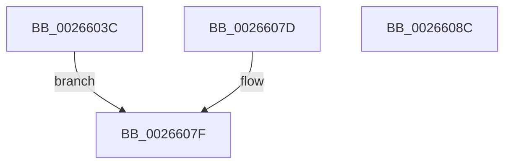

# ExpGetSystemEmulationProcessorInformation

- RVA: `0x0026603C`–`0x0026608D` (길이 `81` bytes)
- VA: `0x000000014026603C`
- 실행 섹션: `.text`
- PDB 이름 있음: `예`; PDB Function 태그: `아니요`
- unwind 정보 RVA: `0x00064CE4`
- 디코드: `23`개 명령, `81/81` bytes 표시
- 미해석 바이트: `0` (있으면 어셈블리에 `.byte`로 보존)

> 이 문서는 커널 이미지의 기계어와 PDB 기호를 분석해 생성했습니다. 4번과 5번은 함수 원형과 자료형을 바이너리 사용 방식에서 추정한 C 해석이며 원본 소스 복구 결과는 아닙니다.

## 1. Dependencies

- 직접 호출 지점: **1**; 고유 호출 대상: **1**
- 직접 호출자로 확인된 함수: **1**
- RIP 상대 이미지 참조: **3**

### Outgoing calls
- `0x00266069` → [KeQueryMaximumProcessorCountEx](KeQueryMaximumProcessorCountEx_function_00264D60.md) (function, `0x00264D60`)

### Direct callers
- [ExpQuerySystemInformation](../../page/A5/ExpQuerySystemInformation_function_00A57858.md) at `0x00A58979`

### Static image references
- `0x0026604E` → RVA `0x00FC6BE8` (`ALMOSTRO`; read)
- `0x00266059` → RVA `0x00FC6BF4` (`ALMOSTRO`; read)
- `0x00266072` → RVA `0x00FC6B30` (`ALMOSTRO`; read)

## 2. Other-region calls and transfers

- 다른 실행 섹션으로 향하는 call: **0**
- 별도 외부 분기/꼬리 이동을 확인하지 못했습니다.

## 3. Assembly (complete function range)

```asm
0026603C  48 89 5C 24 08                  mov qword ptr [rsp + 8], rbx
00266041  57                              push rdi
00266042  48 83 EC 20                     sub rsp, 0x20
00266046  48 8B F9                        mov rdi, rcx
00266049  33 DB                           xor ebx, ebx
0026604B  66 89 19                        mov word ptr [rcx], bx
0026604E  0F B7 05 93 0B D6 00            movzx eax, word ptr [rip + 0xd60b93]
00266055  66 89 41 02                     mov word ptr [rcx + 2], ax
00266059  0F B7 05 94 0B D6 00            movzx eax, word ptr [rip + 0xd60b94]
00266060  66 89 41 04                     mov word ptr [rcx + 4], ax
00266064  B9 FF FF 00 00                  mov ecx, 0xffff
00266069  E8 F2 EC FF FF                  call 0x140264d60
0026606E  66 89 47 06                     mov word ptr [rdi + 6], ax
00266072  8B 05 B8 0A D6 00               mov eax, dword ptr [rip + 0xd60ab8]
00266078  89 47 08                        mov dword ptr [rdi + 8], eax
0026607B  EB 02                           jmp 0x14026607f
0026607D  8B D8                           mov ebx, eax
0026607F  8B C3                           mov eax, ebx
00266081  48 8B 5C 24 30                  mov rbx, qword ptr [rsp + 0x30]
00266086  48 83 C4 20                     add rsp, 0x20
0026608A  5F                              pop rdi
0026608B  C3                              ret
0026608C  CC                              int3
```

## 4. C-style interpretation (structured pseudocode)

```c
__int64 __fastcall ExpGetSystemEmulationProcessorInformation(__int64 a1)
{
    __int64 result;
    __int64 v_rbx;
    __int64 v_rsp;
    unsigned __int64 v_stack_p8;

    v_stack_p8 = v_rbx;
    v_rsp = (v_rsp) - (32);
    v_rbx = 0;
    *(unsigned __int16 *)(a1) = 0;
    *(unsigned __int16 *)(a1 + 2) = (unsigned __int16)(*(unsigned __int16 *)(v_rip + 14027667));
    *(unsigned __int16 *)(a1 + 4) = (unsigned __int16)(*(unsigned __int16 *)(v_rip + 14027668));
    result = KeQueryMaximumProcessorCountEx((unsigned int)(0xFFFFULL), a2, a3, a4);
    *(unsigned __int16 *)(a1 + 6) = (unsigned __int16)(result);
    *(unsigned int *)(a1 + 8) = (unsigned int)((unsigned int)(*(unsigned int *)(v_rip + 14027448)));
    goto loc_0026607F;
loc_0026607F:
    v_rsp = (v_rsp) + (32);
    return 0;
}
```

## 5. (Beta) C Style

```c
int64_t ExpGetSystemEmulationProcessorInformation(void *Arg1)
{
    uint8_t *arg1 = (uint8_t *)Arg1;

    int64_t result;
    int64_t local_rbx;
    int64_t local_rsp;
    uint64_t v_stack_p8;

    v_stack_p8 = local_rbx;
    local_rsp = (local_rsp) - (32);
    local_rbx = 0;
    *(uint16_t *)(arg1) = 0;
    *(uint16_t *)(arg1 + 0x2) = (uint16_t)(*(uint16_t *)(v_rip + 0xD60B93));
    *(uint16_t *)(arg1 + 0x4) = (uint16_t)(*(uint16_t *)(v_rip + 0xD60B94));
    result = KeQueryMaximumProcessorCountEx((uint32_t)(0xFFFFULL), a2, a3, a4);
    *(uint16_t *)(arg1 + 0x6) = (uint16_t)(result);
    *(uint32_t *)(arg1 + 0x8) = (uint32_t)((uint32_t)(*(uint32_t *)(v_rip + 0xD60AB8)));
    goto loc_0026607F;
loc_0026607F:
    local_rsp = (local_rsp) + (32);
    return 0;
}
```

### 관측된 메모리 오프셋

구조체 형식이 확인되지 않은 접근은 인자 기준의 오프셋으로만 기록했습니다.

| 기준 인자 | 오프셋 표현 | 폭 (bit) | 접근 |
|---|---:|---:|---|
| `Arg1` | `+ 0x0` | `16` | `W` |
| `Arg1` | `+ 0x2` | `16` | `W` |
| `Arg1` | `+ 0x4` | `16` | `W` |
| `Arg1` | `+ 0x6` | `16` | `W` |
| `Arg1` | `+ 0x8` | `32` | `W` |

## 6. Execution-region graph

[열기: 2D/3D 그래프와 함수 탐색 컨트롤 패널](../../../control-panel.html?section=text&rva=0x0026603C&view=graph)

- 2D 그래프는 위에서 아래로 흐르고, 3D 그래프는 빈 공간을 드래그해 회전합니다. Shift+드래그는 이동, 휠은 확대·축소, 함수 노드 선택은 대상 보고서 이동입니다.

### Static fallback


