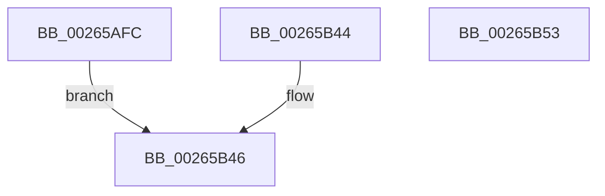

# ExpGetSystemProcessorInformation

- RVA: `0x00265AFC`–`0x00265B54` (길이 `88` bytes)
- VA: `0x0000000140265AFC`
- 실행 섹션: `.text`
- PDB 이름 있음: `예`; PDB Function 태그: `아니요`
- unwind 정보 RVA: `0x00064C34`
- 디코드: `24`개 명령, `88/88` bytes 표시
- 미해석 바이트: `0` (있으면 어셈블리에 `.byte`로 보존)

> 이 문서는 커널 이미지의 기계어와 PDB 기호를 분석해 생성했습니다. 4번과 5번은 함수 원형과 자료형을 바이너리 사용 방식에서 추정한 C 해석이며 원본 소스 복구 결과는 아닙니다.

## 1. Dependencies

- 직접 호출 지점: **1**; 고유 호출 대상: **1**
- 직접 호출자로 확인된 함수: **1**
- RIP 상대 이미지 참조: **4**

### Outgoing calls
- `0x00265B30` → [KeQueryMaximumProcessorCountEx](KeQueryMaximumProcessorCountEx_function_00264D60.md) (function, `0x00264D60`)

### Direct callers
- [ExpQuerySystemInformation](../../page/A5/ExpQuerySystemInformation_function_00A57858.md) at `0x00A57F36`

### Static image references
- `0x00265B0B` → RVA `0x00FC5078` (`ALMOSTRO`; read)
- `0x00265B15` → RVA `0x00FC6BE8` (`ALMOSTRO`; read)
- `0x00265B20` → RVA `0x00FC6BF4` (`ALMOSTRO`; read)
- `0x00265B39` → RVA `0x00FC6B30` (`ALMOSTRO`; read)

## 2. Other-region calls and transfers

- 다른 실행 섹션으로 향하는 call: **0**
- 별도 외부 분기/꼬리 이동을 확인하지 못했습니다.

## 3. Assembly (complete function range)

```asm
00265AFC  48 89 5C 24 08                  mov qword ptr [rsp + 8], rbx
00265B01  57                              push rdi
00265B02  48 83 EC 20                     sub rsp, 0x20
00265B06  48 8B F9                        mov rdi, rcx
00265B09  33 DB                           xor ebx, ebx
00265B0B  0F B7 05 66 F5 D5 00            movzx eax, word ptr [rip + 0xd5f566]
00265B12  66 89 01                        mov word ptr [rcx], ax
00265B15  0F B7 05 CC 10 D6 00            movzx eax, word ptr [rip + 0xd610cc]
00265B1C  66 89 41 02                     mov word ptr [rcx + 2], ax
00265B20  0F B7 05 CD 10 D6 00            movzx eax, word ptr [rip + 0xd610cd]
00265B27  66 89 41 04                     mov word ptr [rcx + 4], ax
00265B2B  B9 FF FF 00 00                  mov ecx, 0xffff
00265B30  E8 2B F2 FF FF                  call 0x140264d60
00265B35  66 89 47 06                     mov word ptr [rdi + 6], ax
00265B39  8B 05 F1 0F D6 00               mov eax, dword ptr [rip + 0xd60ff1]
00265B3F  89 47 08                        mov dword ptr [rdi + 8], eax
00265B42  EB 02                           jmp 0x140265b46
00265B44  8B D8                           mov ebx, eax
00265B46  8B C3                           mov eax, ebx
00265B48  48 8B 5C 24 30                  mov rbx, qword ptr [rsp + 0x30]
00265B4D  48 83 C4 20                     add rsp, 0x20
00265B51  5F                              pop rdi
00265B52  C3                              ret
00265B53  CC                              int3
```

## 4. C-style interpretation (structured pseudocode)

```c
__int64 __fastcall ExpGetSystemProcessorInformation(__int64 a1)
{
    __int64 result;
    __int64 v_rbx;
    __int64 v_rsp;
    unsigned __int64 v_stack_p8;

    v_stack_p8 = v_rbx;
    v_rsp = (v_rsp) - (32);
    v_rbx = 0;
    *(unsigned __int16 *)(a1) = (unsigned __int16)(*(unsigned __int16 *)(v_rip + 14021990));
    *(unsigned __int16 *)(a1 + 2) = (unsigned __int16)(*(unsigned __int16 *)(v_rip + 14029004));
    *(unsigned __int16 *)(a1 + 4) = (unsigned __int16)(*(unsigned __int16 *)(v_rip + 14029005));
    result = KeQueryMaximumProcessorCountEx((unsigned int)(0xFFFFULL), a2, a3, a4);
    *(unsigned __int16 *)(a1 + 6) = (unsigned __int16)(result);
    *(unsigned int *)(a1 + 8) = (unsigned int)((unsigned int)(*(unsigned int *)(v_rip + 14028785)));
    goto loc_00265B46;
loc_00265B46:
    v_rsp = (v_rsp) + (32);
    return 0;
}
```

## 5. (Beta) C Style

```c
int64_t ExpGetSystemProcessorInformation(void *Arg1)
{
    uint8_t *arg1 = (uint8_t *)Arg1;

    int64_t result;
    int64_t local_rbx;
    int64_t local_rsp;
    uint64_t v_stack_p8;

    v_stack_p8 = local_rbx;
    local_rsp = (local_rsp) - (32);
    local_rbx = 0;
    *(uint16_t *)(arg1) = (uint16_t)(*(uint16_t *)(v_rip + 0xD5F566));
    *(uint16_t *)(arg1 + 0x2) = (uint16_t)(*(uint16_t *)(v_rip + 0xD610CC));
    *(uint16_t *)(arg1 + 0x4) = (uint16_t)(*(uint16_t *)(v_rip + 0xD610CD));
    result = KeQueryMaximumProcessorCountEx((uint32_t)(0xFFFFULL), a2, a3, a4);
    *(uint16_t *)(arg1 + 0x6) = (uint16_t)(result);
    *(uint32_t *)(arg1 + 0x8) = (uint32_t)((uint32_t)(*(uint32_t *)(v_rip + 0xD60FF1)));
    goto loc_00265B46;
loc_00265B46:
    local_rsp = (local_rsp) + (32);
    return 0;
}
```

### 관측된 메모리 오프셋

구조체 형식이 확인되지 않은 접근은 인자 기준의 오프셋으로만 기록했습니다.

| 기준 인자 | 오프셋 표현 | 폭 (bit) | 접근 |
|---|---:|---:|---|
| `Arg1` | `+ 0x0` | `16` | `W` |
| `Arg1` | `+ 0x2` | `16` | `W` |
| `Arg1` | `+ 0x4` | `16` | `W` |
| `Arg1` | `+ 0x6` | `16` | `W` |
| `Arg1` | `+ 0x8` | `32` | `W` |

## 6. Execution-region graph

[열기: 2D/3D 그래프와 함수 탐색 컨트롤 패널](../../../control-panel.html?section=text&rva=0x00265AFC&view=graph)

- 2D 그래프는 위에서 아래로 흐르고, 3D 그래프는 빈 공간을 드래그해 회전합니다. Shift+드래그는 이동, 휠은 확대·축소, 함수 노드 선택은 대상 보고서 이동입니다.

### Static fallback


