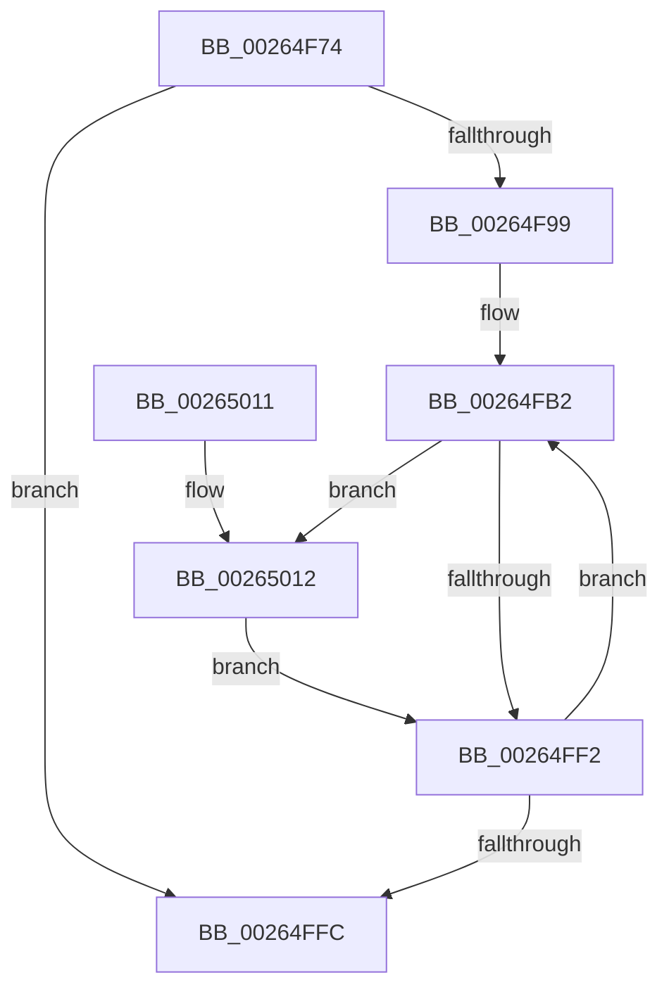

# ExpReleaseFannedOutPushLockExclusive

- RVA: `0x00264F74`–`0x00265019` (길이 `165` bytes)
- VA: `0x0000000140264F74`
- 실행 섹션: `.text`
- PDB 이름 있음: `예`; PDB Function 태그: `아니요`
- unwind 정보 RVA: `0x00064A38`
- 디코드: `47`개 명령, `165/165` bytes 표시
- 미해석 바이트: `0` (있으면 어셈블리에 `.byte`로 보존)

> 이 문서는 커널 이미지의 기계어와 PDB 기호를 분석해 생성했습니다. 4번과 5번은 함수 원형과 자료형을 바이너리 사용 방식에서 추정한 C 해석이며 원본 소스 복구 결과는 아닙니다.

## 1. Dependencies

- 직접 호출 지점: **2**; 고유 호출 대상: **2**
- 직접 호출자로 확인된 함수: **2**
- RIP 상대 이미지 참조: **1**

### Outgoing calls
- `0x00264F90` → [KeQueryMaximumProcessorCountEx](KeQueryMaximumProcessorCountEx_function_00264D60.md) (function, `0x00264D60`)
- `0x00265012` → [ExfTryToWakePushLock](ExfTryToWakePushLock_function_00265DD0.md) (function, `0x00265DD0`)

### Direct callers
- [ExReleaseAutoExpandPushLockExclusive](ExReleaseAutoExpandPushLockExclusive_function_00264DE0.md) at `0x00264EE5`
- [FsRtlReleaseAutoExpandPushLockExclusive](FsRtlReleaseAutoExpandPushLockExclusive_function_00265B5C.md) at `0x00265BD1`

### Static image references
- `0x00264FB2` → RVA `0x00EFA278` (`.data`; read)

## 2. Other-region calls and transfers

- 다른 실행 섹션으로 향하는 call: **0**
- 별도 외부 분기/꼬리 이동을 확인하지 못했습니다.

## 3. Assembly (complete function range)

```asm
00264F74  48 89 5C 24 08                  mov qword ptr [rsp + 8], rbx
00264F79  48 89 6C 24 18                  mov qword ptr [rsp + 0x18], rbp
00264F7E  48 89 74 24 20                  mov qword ptr [rsp + 0x20], rsi
00264F83  57                              push rdi
00264F84  48 83 EC 20                     sub rsp, 0x20
00264F88  48 8B D9                        mov rbx, rcx
00264F8B  B9 FF FF 00 00                  mov ecx, 0xffff
00264F90  E8 CB FD FF FF                  call 0x140264d60
00264F95  85 C0                           test eax, eax
00264F97  74 63                           je 0x140264ffc
00264F99  8B FB                           mov edi, ebx
00264F9B  8B E8                           mov ebp, eax
00264F9D  C1 EF 0D                        shr edi, 0xd
00264FA0  48 C1 EB 04                     shr rbx, 4
00264FA4  81 E7 FF FF 03 00               and edi, 0x3ffff
00264FAA  81 E3 FF 01 00 00               and ebx, 0x1ff
00264FB0  33 F6                           xor esi, esi
00264FB2  48 8B 05 BF 52 C9 00            mov rax, qword ptr [rip + 0xc952bf]
00264FB9  0F BD CF                        bsr ecx, edi
00264FBC  48 8B 14 06                     mov rdx, qword ptr [rsi + rax]
00264FC0  B8 01 00 00 00                  mov eax, 1
00264FC5  D3 E0                           shl eax, cl
00264FC7  89 4C 24 38                     mov dword ptr [rsp + 0x38], ecx
00264FCB  44 8D 41 FE                     lea r8d, [rcx - 2]
00264FCF  8B C8                           mov ecx, eax
00264FD1  8B C7                           mov eax, edi
00264FD3  48 33 C8                        xor rcx, rax
00264FD6  4A 8B 04 C2                     mov rax, qword ptr [rdx + r8*8]
00264FDA  48 8B 4C C8 08                  mov rcx, qword ptr [rax + rcx*8 + 8]
00264FDF  48 83 C8 FF                     or rax, 0xffffffffffffffff
00264FE3  48 8D 0C D9                     lea rcx, [rcx + rbx*8]
00264FE7  F0 48 0F C1 01                  lock xadd qword ptr [rcx], rax
00264FEC  24 06                           and al, 6
00264FEE  3C 02                           cmp al, 2
00264FF0  74 20                           je 0x140265012
00264FF2  48 83 C6 08                     add rsi, 8
00264FF6  48 83 ED 01                     sub rbp, 1
00264FFA  75 B6                           jne 0x140264fb2
00264FFC  48 8B 5C 24 30                  mov rbx, qword ptr [rsp + 0x30]
00265001  48 8B 6C 24 40                  mov rbp, qword ptr [rsp + 0x40]
00265006  48 8B 74 24 48                  mov rsi, qword ptr [rsp + 0x48]
0026500B  48 83 C4 20                     add rsp, 0x20
0026500F  5F                              pop rdi
00265010  C3                              ret
00265011  CC                              int3
00265012  E8 B9 0D 00 00                  call 0x140265dd0
00265017  EB D9                           jmp 0x140264ff2
```

## 4. C-style interpretation (structured pseudocode)

```c
__int64 __fastcall ExpReleaseFannedOutPushLockExclusive(__int64 a1)
{
    __int64 result;
    __int64 v_rbp;
    __int64 v_rbx;
    __int64 v_rdi;
    __int64 v_rsi;
    __int64 v_rsp;
    unsigned int v_stack_p10;
    unsigned __int64 v_stack_p18;
    unsigned __int64 v_stack_p20;
    unsigned __int64 v_stack_p8;

    v_stack_p8 = v_rbx;
    v_stack_p18 = v_rbp;
    v_stack_p20 = v_rsi;
    v_rsp = (v_rsp) - (32);
    result = KeQueryMaximumProcessorCountEx((unsigned int)(0xFFFFULL), a2, a3, a4);
    if ((unsigned int)(result) == 0) goto loc_00264FFC;
    v_rdi = (unsigned int)(((unsigned int)((unsigned int)(a1))) >> (13));
    v_rbx = (a1) >> (4);
    v_rdi = (unsigned int)((v_rdi) & (0x3FFFFULL));
    v_rbx = (unsigned int)((v_rbx) & (511));
    v_rsi = 0;
loc_00264FB2:
    result = (unsigned int)((1) << ((unsigned __int8)((unsigned int)(0xFFFFULL))));
    v_stack_p10 = (unsigned int)((unsigned int)(0xFFFFULL));
    a1 = ((unsigned int)((unsigned int)(result))) ^ ((unsigned int)((unsigned int)(v_rdi)));
    result = (*(unsigned __int64 *)(*(unsigned __int64 *)(v_rsi + *(unsigned __int64 *)(v_rip + 13193919) * 1) + (unsigned int)(0xFFFFULL) - 2 * 8)) | (-1);
    result = (unsigned __int8)((result) & (6));
    if (((unsigned __int8)(result)) == 2) goto loc_00265012;
loc_00264FF2:
    v_rsi = (v_rsi) + (8);
    v_rbp = ((unsigned int)((unsigned int)(result))) - (1);
    if (condition_is_not_equal) goto loc_00264FB2;
loc_00264FFC:
    v_rsp = (v_rsp) + (32);
    return result;
loc_00265012:
    result = ExfTryToWakePushLock(*(unsigned __int64 *)(*(unsigned __int64 *)(*(unsigned __int64 *)(v_rsi + *(unsigned __int64 *)(v_rip + 13193919) * 1) + (unsigned int)(0xFFFFULL) - 2 * 8) + a1 * 8 + 8) + v_rbx * 8, *(unsigned __int64 *)(v_rsi + *(unsigned __int64 *)(v_rip + 13193919) * 1), (unsigned int)(0xFFFFULL) - 2, a4);
    goto loc_00264FF2;
}
```

## 5. (Beta) C Style

```c
int64_t ExpReleaseFannedOutPushLockExclusive(int64_t Arg1)
{
    int64_t result;
    int64_t local_rbp;
    int64_t local_rbx;
    int64_t local_rdi;
    int64_t local_rsi;
    int64_t local_rsp;
    uint32_t v_stack_p10;
    uint64_t v_stack_p18;
    uint64_t v_stack_p20;
    uint64_t v_stack_p8;

    v_stack_p8 = local_rbx;
    v_stack_p18 = local_rbp;
    v_stack_p20 = local_rsi;
    local_rsp = (local_rsp) - (32);
    result = KeQueryMaximumProcessorCountEx((uint32_t)(0xFFFFULL), a2, a3, a4);
    if ((uint32_t)(result) == 0) goto loc_00264FFC;
    local_rdi = (uint32_t)(((uint32_t)((uint32_t)(Arg1))) >> (13));
    local_rbx = (Arg1) >> (4);
    local_rdi = (uint32_t)((local_rdi) & (0x3FFFFULL));
    local_rbx = (uint32_t)((local_rbx) & (511));
    local_rsi = 0;
loc_00264FB2:
    result = (uint32_t)((1) << ((uint8_t)((uint32_t)(0xFFFFULL))));
    v_stack_p10 = (uint32_t)((uint32_t)(0xFFFFULL));
    Arg1 = ((uint32_t)((uint32_t)(result))) ^ ((uint32_t)((uint32_t)(local_rdi)));
    result = (*(uint64_t *)(*(uint64_t *)(local_rsi + *(uint64_t *)(v_rip + 0xC952BF) * 1) + (uint32_t)(0xFFFFULL) - 0x2 * 8)) | (-1);
    result = (uint8_t)((result) & (6));
    if (((uint8_t)(result)) == 2) goto loc_00265012;
loc_00264FF2:
    local_rsi = (local_rsi) + (8);
    local_rbp = ((uint32_t)((uint32_t)(result))) - (1);
    if (condition_is_not_equal) goto loc_00264FB2;
loc_00264FFC:
    local_rsp = (local_rsp) + (32);
    return result;
loc_00265012:
    result = ExfTryToWakePushLock(*(uint64_t *)(*(uint64_t *)(*(uint64_t *)(local_rsi + *(uint64_t *)(v_rip + 0xC952BF) * 1) + (uint32_t)(0xFFFFULL) - 0x2 * 8) + Arg1 * 8 + 0x8) + local_rbx * 8, *(uint64_t *)(local_rsi + *(uint64_t *)(v_rip + 0xC952BF) * 1), (uint32_t)(0xFFFFULL) - 2, a4);
    goto loc_00264FF2;
}
```

## 6. Execution-region graph

[열기: 2D/3D 그래프와 함수 탐색 컨트롤 패널](../../../control-panel.html?section=text&rva=0x00264F74&view=graph)

- 2D 그래프는 위에서 아래로 흐르고, 3D 그래프는 빈 공간을 드래그해 회전합니다. Shift+드래그는 이동, 휠은 확대·축소, 함수 노드 선택은 대상 보고서 이동입니다.

### Static fallback


