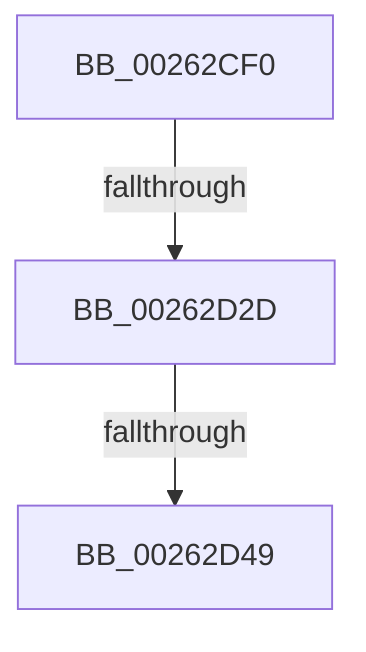

# ExpReleaseFastResourceExclusiveSlow

- RVA: `0x00262CF0`–`0x00262D5A` (길이 `106` bytes)
- VA: `0x0000000140262CF0`
- 실행 섹션: `.text`
- PDB 이름 있음: `예`; PDB Function 태그: `아니요`
- unwind 정보 RVA: `0x00064600`
- 디코드: `27`개 명령, `106/106` bytes 표시
- 미해석 바이트: `0` (있으면 어셈블리에 `.byte`로 보존)

> 이 문서는 커널 이미지의 기계어와 PDB 기호를 분석해 생성했습니다. 4번과 5번은 함수 원형과 자료형을 바이너리 사용 방식에서 추정한 C 해석이며 원본 소스 복구 결과는 아닙니다.

## 1. Dependencies

- 직접 호출 지점: **0**; 고유 호출 대상: **0**
- 직접 호출자로 확인된 함수: **2**
- RIP 상대 이미지 참조: **2**

### Outgoing calls
- 직접 디코드된 call 명령이 없습니다.

### Direct callers
- [ExReleaseFastResource](ExReleaseFastResource_function_002613D0.md) at `0x00261B1B`
- [sub_00262C9F](Unknown_function_00262C9F.md) at `0x00262CA6`

### Static image references
- `0x00262D21` → RVA `0x00FC6D20` (`ALMOSTRO`; read)
- `0x00262D3C` → RVA `0x00FC6B06` (`ALMOSTRO`; read)

## 2. Other-region calls and transfers

- 다른 실행 섹션으로 향하는 call: **0**
- call이 아닌 외부 분기/꼬리 이동: **3**
  - `0x00262D27` → [sub_00262F6E](Unknown_function_00262F6E.md) (`tail-transfer`)
  - `0x00262D43` → [sub_00262F2A](Unknown_function_00262F2A.md) (`tail-transfer`)
  - `0x00262D54` → [sub_002630B7](Unknown_function_002630B7.md) (`tail-transfer`)

## 3. Assembly (complete function range)

```asm
00262CF0  88 54 24 10                     mov byte ptr [rsp + 0x10], dl
00262CF4  53                              push rbx
00262CF5  55                              push rbp
00262CF6  56                              push rsi
00262CF7  57                              push rdi
00262CF8  41 56                           push r14
00262CFA  48 83 EC 70                     sub rsp, 0x70
00262CFE  33 ED                           xor ebp, ebp
00262D00  0F B6 F2                        movzx esi, dl
00262D03  48 89 6C 24 48                  mov qword ptr [rsp + 0x48], rbp
00262D08  48 8B D9                        mov rbx, rcx
00262D0B  44 0F 20 C7                     mov rdi, cr8
00262D0F  48 89 BC 24 B8 00 00 00         mov qword ptr [rsp + 0xb8], rdi
00262D17  41 BE 02 00 00 00               mov r14d, 2
00262D1D  45 0F 22 C6                     mov cr8, r14
00262D21  39 2D F9 3F D6 00               cmp dword ptr [rip + 0xd63ff9], ebp
00262D27  0F 85 41 02 00 00               jne 0x140262f6e
00262D2D  48 8D 4B 30                     lea rcx, [rbx + 0x30]
00262D31  48 89 6C 24 38                  mov qword ptr [rsp + 0x38], rbp
00262D36  48 89 4C 24 40                  mov qword ptr [rsp + 0x40], rcx
00262D3B  90                              nop
00262D3C  F6 05 C3 3D D6 00 21            test byte ptr [rip + 0xd63dc3], 0x21
00262D43  0F 85 E1 01 00 00               jne 0x140262f2a
00262D49  48 8D 54 24 38                  lea rdx, [rsp + 0x38]
00262D4E  48 87 11                        xchg qword ptr [rcx], rdx
00262D51  48 85 D2                        test rdx, rdx
00262D54  0F 85 5D 03 00 00               jne 0x1402630b7
```

## 4. C-style interpretation (structured pseudocode)

```c
void __fastcall ExpReleaseFastResourceExclusiveSlow(__int64 a1, unsigned __int8 a2)
{
    __int64 v_rbp;
    __int64 v_rsp;
    unsigned __int64 v_stack_m50;
    unsigned __int64 v_stack_m58;
    unsigned __int64 v_stack_m60;
    unsigned __int8 v_stack_p10;
    unsigned __int64 v_stack_p20;

    v_stack_p10 = a2;
    v_rsp = (v_rsp) - (112);
    v_rbp = 0;
    v_stack_m50 = 0;
    v_stack_p20 = v_cr8;
    v_stack_m60 = 0;
    v_stack_m58 = a1 + 48;
}
```

## 5. (Beta) C Style

```c
void ExpReleaseFastResourceExclusiveSlow(void *Arg1, uint8_t Arg2)
{
    uint8_t *arg1 = (uint8_t *)Arg1;

    int64_t local_rbp;
    int64_t local_rsp;
    uint64_t v_stack_m50;
    uint64_t v_stack_m58;
    uint64_t v_stack_m60;
    uint8_t v_stack_p10;
    uint64_t v_stack_p20;

    v_stack_p10 = Arg2;
    local_rsp = (local_rsp) - (112);
    local_rbp = 0;
    v_stack_m50 = 0;
    v_stack_p20 = v_cr8;
    v_stack_m60 = 0;
    v_stack_m58 = Arg1 + 48;
}
```

### 관측된 메모리 오프셋

구조체 형식이 확인되지 않은 접근은 인자 기준의 오프셋으로만 기록했습니다.

| 기준 인자 | 오프셋 표현 | 폭 (bit) | 접근 |
|---|---:|---:|---|
| `Arg1` | `+ 0x0` | `64` | `R/W` |
| `Arg1` | `+ 0x30` | `64` | `R` |

## 6. Execution-region graph

[열기: 2D/3D 그래프와 함수 탐색 컨트롤 패널](../../../control-panel.html?section=text&rva=0x00262CF0&view=graph)

- 2D 그래프는 위에서 아래로 흐르고, 3D 그래프는 빈 공간을 드래그해 회전합니다. Shift+드래그는 이동, 휠은 확대·축소, 함수 노드 선택은 대상 보고서 이동입니다.

### Static fallback


