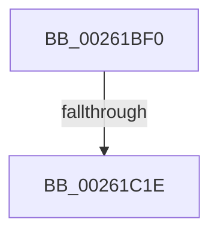

# ExpReleaseFastResourceShared

- RVA: `0x00261BF0`–`0x00261C24` (길이 `52` bytes)
- VA: `0x0000000140261BF0`
- 실행 섹션: `.text`
- PDB 이름 있음: `예`; PDB Function 태그: `아니요`
- unwind 정보 RVA: `0x000644E0`
- 디코드: `16`개 명령, `52/52` bytes 표시
- 미해석 바이트: `0` (있으면 어셈블리에 `.byte`로 보존)

> 이 문서는 커널 이미지의 기계어와 PDB 기호를 분석해 생성했습니다. 4번과 5번은 함수 원형과 자료형을 바이너리 사용 방식에서 추정한 C 해석이며 원본 소스 복구 결과는 아닙니다.

## 1. Dependencies

- 직접 호출 지점: **0**; 고유 호출 대상: **0**
- 직접 호출자로 확인된 함수: **1**
- RIP 상대 이미지 참조: **0**

### Outgoing calls
- 직접 디코드된 call 명령이 없습니다.

### Direct callers
- [ExReleaseFastResourceShared](../4F/ExReleaseFastResourceShared_function_004F59C0.md) at `0x004F5AED`

### Static image references
- 디코드된 RIP-relative 메모리 참조가 없습니다.

## 2. Other-region calls and transfers

- 다른 실행 섹션으로 향하는 call: **0**
- call이 아닌 외부 분기/꼬리 이동: **1**
  - `0x00261C18` → [sub_00261DF3](Unknown_function_00261DF3.md) (`tail-transfer`)

## 3. Assembly (complete function range)

```asm
00261BF0  4C 8B DC                        mov r11, rsp
00261BF3  53                              push rbx
00261BF4  56                              push rsi
00261BF5  48 81 EC 88 00 00 00            sub rsp, 0x88
00261BFC  FF 4A 20                        dec dword ptr [rdx + 0x20]
00261BFF  33 C0                           xor eax, eax
00261C01  0F 57 C0                        xorps xmm0, xmm0
00261C04  48 8B DA                        mov rbx, rdx
00261C07  0F 11 44 24 40                  movups xmmword ptr [rsp + 0x40], xmm0
00261C0C  49 89 43 B8                     mov qword ptr [r11 - 0x48], rax
00261C10  48 8B F1                        mov rsi, rcx
00261C13  8B 42 20                        mov eax, dword ptr [rdx + 0x20]
00261C16  85 C0                           test eax, eax
00261C18  0F 8F D5 01 00 00               jg 0x140261df3
00261C1E  0F 0D 09                        prefetchw byte ptr [rcx]
00261C21  48 8B 01                        mov rax, qword ptr [rcx]
```

## 4. C-style interpretation (structured pseudocode)

```c
__int64 __fastcall ExpReleaseFastResourceShared(__int64 a1, __int64 a2)
{
    __int64 result;
    __int64 v_rsp;
    unsigned __int64 v_stack_m58;

    v_rsp = (v_rsp) - (136);
    result = 0;
    v_stack_m58 = v_xmm0;
    *(unsigned __int64 *)(v_rsp - 72) = 0;
    return *(unsigned __int64 *)(a1);
}
```

## 5. (Beta) C Style

```c
int64_t ExpReleaseFastResourceShared(void *Arg1, void *Arg2)
{
    uint8_t *arg1 = (uint8_t *)Arg1;
    uint8_t *arg2 = (uint8_t *)Arg2;

    int64_t result;
    int64_t local_rsp;
    uint64_t v_stack_m58;

    local_rsp = (local_rsp) - (136);
    result = 0;
    v_stack_m58 = v_xmm0;
    *(uint64_t *)(local_rsp - 0x48) = 0;
    return *(uint64_t *)(arg1);
}
```

### 관측된 메모리 오프셋

구조체 형식이 확인되지 않은 접근은 인자 기준의 오프셋으로만 기록했습니다.

| 기준 인자 | 오프셋 표현 | 폭 (bit) | 접근 |
|---|---:|---:|---|
| `Arg1` | `+ 0x0` | `8` | `R` |
| `Arg1` | `+ 0x0` | `64` | `R` |
| `Arg2` | `+ 0x20` | `32` | `R` |
| `Arg2` | `+ 0x20` | `32` | `R/W` |

## 6. Execution-region graph

[열기: 2D/3D 그래프와 함수 탐색 컨트롤 패널](../../../control-panel.html?section=text&rva=0x00261BF0&view=graph)

- 2D 그래프는 위에서 아래로 흐르고, 3D 그래프는 빈 공간을 드래그해 회전합니다. Shift+드래그는 이동, 휠은 확대·축소, 함수 노드 선택은 대상 보고서 이동입니다.

### Static fallback


