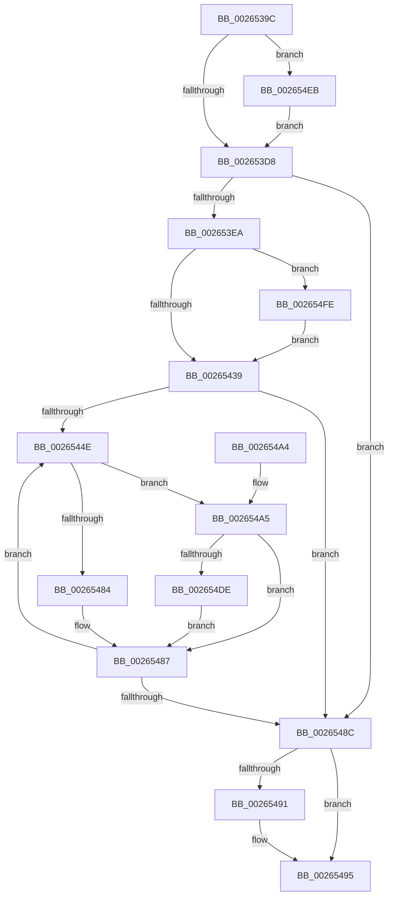

# FsRtlAcquireAutoExpandPushLockExclusive

- RVA: `0x0026539C`–`0x0026550E` (길이 `370` bytes)
- VA: `0x000000014026539C`
- 실행 섹션: `.text`
- PDB 이름 있음: `예`; PDB Function 태그: `아니요`
- unwind 정보 RVA: `0x00064B60`
- 디코드: `104`개 명령, `370/370` bytes 표시
- 미해석 바이트: `0` (있으면 어셈블리에 `.byte`로 보존)

> 이 문서는 커널 이미지의 기계어와 PDB 기호를 분석해 생성했습니다. 4번과 5번은 함수 원형과 자료형을 바이너리 사용 방식에서 추정한 C 해석이며 원본 소스 복구 결과는 아닙니다.

## 1. Dependencies

- 직접 호출 지점: **5**; 고유 호출 대상: **3**
- 직접 호출자로 확인된 함수: **8**
- RIP 상대 이미지 참조: **1**

### Outgoing calls
- `0x002653C4` → [KeAbPreAcquire](../21/KeAbPreAcquire_function_00210230.md) (function, `0x00210230`)
- `0x00265441` → [KeQueryMaximumProcessorCountEx](KeQueryMaximumProcessorCountEx_function_00264D60.md) (function, `0x00264D60`)
- `0x002654E4` → [ExfAcquirePushLockExclusiveEx](../20/ExfAcquirePushLockExclusiveEx_function_0020FC90.md) (function, `0x0020FC90`)
- `0x002654F4` → [ExfAcquirePushLockExclusiveEx](../20/ExfAcquirePushLockExclusiveEx_function_0020FC90.md) (function, `0x0020FC90`)
- `0x00265504` → [ExfAcquirePushLockExclusiveEx](../20/ExfAcquirePushLockExclusiveEx_function_0020FC90.md) (function, `0x0020FC90`)

### Direct callers
- [sub_0026515E](Unknown_function_0026515E.md) at `0x002651DF`
- [sub_002652E5](Unknown_function_002652E5.md) at `0x002652EF`
- [FsRtlInsertPerStreamContext](FsRtlInsertPerStreamContext_function_00265F70.md) at `0x00265FA6`
- [FsRtlRemovePerStreamContext](FsRtlRemovePerStreamContext_function_00267760.md) at `0x002677AB`
- [FsRtlInsertPerFileContextWithReserve](../46/FsRtlInsertPerFileContextWithReserve_function_004657F0.md) at `0x004658D4`
- [FsRtlRemovePerFileContext](../58/FsRtlRemovePerFileContext_function_00581670.md) at `0x005816A7`
- [FsRtlTeardownPerStreamContexts](../../page/9A/FsRtlTeardownPerStreamContexts_function_009A5CD0.md) at `0x009A5D3A`
- [FsRtlTeardownPerStreamContexts](../../page/9A/FsRtlTeardownPerStreamContexts_function_009A5CD0.md) at `0x009A5DB4`
- [FsRtlTeardownPerFileContexts](../../page/A0/FsRtlTeardownPerFileContexts_function_00A0CDD0.md) at `0x00A0CE22`
- [FsRtlTeardownPerFileContexts](../../page/A0/FsRtlTeardownPerFileContexts_function_00A0CDD0.md) at `0x00A0CE66`

### Static image references
- `0x002653EA` → RVA `0x00EFA278` (`.data`; read)

## 2. Other-region calls and transfers

- 다른 실행 섹션으로 향하는 call: **0**
- 별도 외부 분기/꼬리 이동을 확인하지 못했습니다.

## 3. Assembly (complete function range)

```asm
0026539C  40 53                           push rbx
0026539E  55                              push rbp
0026539F  56                              push rsi
002653A0  57                              push rdi
002653A1  41 54                           push r12
002653A3  41 56                           push r14
002653A5  41 57                           push r15
002653A7  48 83 EC 20                     sub rsp, 0x20
002653AB  65 48 8B 04 25 88 01 00 00      mov rax, qword ptr gs:[0x188]
002653B4  45 33 C0                        xor r8d, r8d
002653B7  33 D2                           xor edx, edx
002653B9  48 8B D9                        mov rbx, rcx
002653BC  66 FF 88 E4 01 00 00            dec word ptr [rax + 0x1e4]
002653C3  90                              nop
002653C4  E8 67 AE FA FF                  call 0x140210230
002653C9  F0 48 0F BA 2B 00               lock bts qword ptr [rbx], 0
002653CF  48 8B F8                        mov rdi, rax
002653D2  0F 82 13 01 00 00               jb 0x1402654eb
002653D8  8B 6B 08                        mov ebp, dword ptr [rbx + 8]
002653DB  41 BC 01 00 00 00               mov r12d, 1
002653E1  41 84 EC                        test r12b, bpl
002653E4  0F 84 A2 00 00 00               je 0x14026548c
002653EA  48 8B 05 87 4E C9 00            mov rax, qword ptr [rip + 0xc94e87]
002653F1  44 8B FD                        mov r15d, ebp
002653F4  41 C1 EF 0D                     shr r15d, 0xd
002653F8  45 8B C4                        mov r8d, r12d
002653FB  41 81 E7 FF FF 03 00            and r15d, 0x3ffff
00265402  48 C1 ED 04                     shr rbp, 4
00265406  41 0F BD CF                     bsr ecx, r15d
0026540A  81 E5 FF 01 00 00               and ebp, 0x1ff
00265410  41 D3 E0                        shl r8d, cl
00265413  89 4C 24 68                     mov dword ptr [rsp + 0x68], ecx
00265417  4D 33 C7                        xor r8, r15
0026541A  8D 51 FE                        lea edx, [rcx - 2]
0026541D  48 8B 08                        mov rcx, qword ptr [rax]
00265420  48 8B 04 D1                     mov rax, qword ptr [rcx + rdx*8]
00265424  4A 8B 4C C0 08                  mov rcx, qword ptr [rax + r8*8 + 8]
00265429  48 8D 0C E9                     lea rcx, [rcx + rbp*8]
0026542D  F0 48 0F BA 29 00               lock bts qword ptr [rcx], 0
00265433  0F 82 C5 00 00 00               jb 0x1402654fe
00265439  B9 FF FF 00 00                  mov ecx, 0xffff
0026543E  41 8B F4                        mov esi, r12d
00265441  E8 1A F9 FF FF                  call 0x140264d60
00265446  44 8B F0                        mov r14d, eax
00265449  41 3B C4                        cmp eax, r12d
0026544C  76 3E                           jbe 0x14026548c
0026544E  48 8B 05 23 4E C9 00            mov rax, qword ptr [rip + 0xc94e23]
00265455  41 0F BD CF                     bsr ecx, r15d
00265459  44 8B C6                        mov r8d, esi
0026545C  89 4C 24 70                     mov dword ptr [rsp + 0x70], ecx
00265460  4A 8B 14 C0                     mov rdx, qword ptr [rax + r8*8]
00265464  44 8D 49 FE                     lea r9d, [rcx - 2]
00265468  41 8B C4                        mov eax, r12d
0026546B  D3 E0                           shl eax, cl
0026546D  8B C8                           mov ecx, eax
0026546F  4A 8B 04 CA                     mov rax, qword ptr [rdx + r9*8]
00265473  49 33 CF                        xor rcx, r15
00265476  48 8B 54 C8 08                  mov rdx, qword ptr [rax + rcx*8 + 8]
0026547B  F0 48 0F BA 2C EA 00            lock bts qword ptr [rdx + rbp*8], 0
00265482  72 21                           jb 0x1402654a5
00265484  41 03 F4                        add esi, r12d
00265487  41 3B F6                        cmp esi, r14d
0026548A  72 C2                           jb 0x14026544e
0026548C  48 85 FF                        test rdi, rdi
0026548F  74 04                           je 0x140265495
00265491  44 88 67 0A                     mov byte ptr [rdi + 0xa], r12b
00265495  48 83 C4 20                     add rsp, 0x20
00265499  41 5F                           pop r15
0026549B  41 5E                           pop r14
0026549D  41 5C                           pop r12
0026549F  5F                              pop rdi
002654A0  5E                              pop rsi
002654A1  5D                              pop rbp
002654A2  5B                              pop rbx
002654A3  C3                              ret
002654A4  CC                              int3
002654A5  48 8B 05 CC 4D C9 00            mov rax, qword ptr [rip + 0xc94dcc]
002654AC  41 FF CE                        dec r14d
002654AF  41 0F BD CF                     bsr ecx, r15d
002654B3  4E 8B 04 F0                     mov r8, qword ptr [rax + r14*8]
002654B7  41 8B C4                        mov eax, r12d
002654BA  D3 E0                           shl eax, cl
002654BC  89 4C 24 78                     mov dword ptr [rsp + 0x78], ecx
002654C0  44 8D 49 FE                     lea r9d, [rcx - 2]
002654C4  8B C8                           mov ecx, eax
002654C6  4B 8B 04 C8                     mov rax, qword ptr [r8 + r9*8]
002654CA  49 33 CF                        xor rcx, r15
002654CD  48 8B 4C C8 08                  mov rcx, qword ptr [rax + rcx*8 + 8]
002654D2  48 8D 0C E9                     lea rcx, [rcx + rbp*8]
002654D6  F0 48 0F BA 29 00               lock bts qword ptr [rcx], 0
002654DC  73 A9                           jae 0x140265487
002654DE  4C 8B C3                        mov r8, rbx
002654E1  48 8B D7                        mov rdx, rdi
002654E4  E8 A7 A7 FA FF                  call 0x14020fc90
002654E9  EB 9C                           jmp 0x140265487
002654EB  4C 8B C3                        mov r8, rbx
002654EE  48 8B D7                        mov rdx, rdi
002654F1  48 8B CB                        mov rcx, rbx
002654F4  E8 97 A7 FA FF                  call 0x14020fc90
002654F9  E9 DA FE FF FF                  jmp 0x1402653d8
002654FE  4C 8B C3                        mov r8, rbx
00265501  48 8B D7                        mov rdx, rdi
00265504  E8 87 A7 FA FF                  call 0x14020fc90
00265509  E9 2B FF FF FF                  jmp 0x140265439
```

## 4. C-style interpretation (structured pseudocode)

```c
__int64 __fastcall FsRtlAcquireAutoExpandPushLockExclusive(__int64 a1, int a2, int a3)
{
    __int64 result;
    __int64 v_r14;
    __int64 v_r15;
    __int64 v_rbp;
    __int64 v_rsi;
    __int64 v_rsp;
    unsigned int v_stack_p10;
    unsigned int v_stack_p18;
    unsigned int v_stack_p78;

    v_rsp = (v_rsp) - (32);
    a3 = 0;
    a2 = 0;
    result = KeAbPreAcquire(a1, a2, a3, a4);
    if (condition_is_below) goto loc_002654EB;
loc_002653D8:
    if (((1) & ((unsigned __int8)((unsigned int)(*(unsigned int *)(a1 + 8))))) == 0) goto loc_0026548C;
    v_r15 = (unsigned int)(((unsigned int)((unsigned int)((unsigned int)(*(unsigned int *)(a1 + 8))))) >> (13));
    v_r15 = (unsigned int)((v_r15) & (0x3FFFFULL));
    v_rbp = ((unsigned int)(*(unsigned int *)(a1 + 8))) >> (4);
    v_rbp = (unsigned int)((v_rbp) & (511));
    a3 = (unsigned int)((1) << ((unsigned __int8)(a1)));
    v_stack_p10 = (unsigned int)(a1);
    a3 = (a3) ^ (v_r15);
    if (condition_is_below) goto loc_002654FE;
loc_00265439:
    result = KeQueryMaximumProcessorCountEx((unsigned int)(0xFFFFULL), a1 - 2, a3, a4);
    if (((unsigned int)(result)) <= 1) goto loc_0026548C;
loc_0026544E:
    v_stack_p18 = (unsigned int)((unsigned int)(0xFFFFULL));
    result = (unsigned int)((1) << ((unsigned __int8)((unsigned int)(0xFFFFULL))));
    a1 = ((unsigned int)((unsigned int)(result))) ^ (v_r15);
    if (condition_is_below) goto loc_002654A5;
    v_rsi = (unsigned int)((1) + (1));
loc_00265487:
    if (((unsigned int)(v_rsi)) < ((unsigned int)((unsigned int)((unsigned int)(result))))) goto loc_0026544E;
loc_0026548C:
    if (result != 0) {
        *(unsigned __int8 *)(result + 10) = 1;
    }
    v_rsp = (v_rsp) + (32);
    return *(unsigned __int64 *)(*(unsigned __int64 *)(*(unsigned __int64 *)(v_rip + 13192739) + 1 * 8) + (unsigned int)(0xFFFFULL) - 2 * 8);
loc_002654A5:
    v_r14 = (unsigned int)(((unsigned int)((unsigned int)(result))) - 1);
    result = (unsigned int)((1) << ((unsigned __int8)(a1)));
    v_stack_p78 = (unsigned int)(a1);
    a1 = ((unsigned int)((unsigned int)(result))) ^ (v_r15);
    if (condition_is_above_or_equal) goto loc_00265487;
    result = ExfAcquirePushLockExclusiveEx(*(unsigned __int64 *)(*(unsigned __int64 *)(*(unsigned __int64 *)(*(unsigned __int64 *)(v_rip + 13192652) + v_r14 * 8) + a1 - 2 * 8) + a1 * 8 + 8) + v_rbp * 8, result, a1, a1 - 2);
    goto loc_00265487;
loc_002654EB:
    result = ExfAcquirePushLockExclusiveEx(a1, result, a1, a1 - 2);
    goto loc_002653D8;
loc_002654FE:
    result = ExfAcquirePushLockExclusiveEx(a1, result, a1, a1 - 2);
    goto loc_00265439;
}
```

## 5. (Beta) C Style

```c
int64_t FsRtlAcquireAutoExpandPushLockExclusive(void *Arg1, int32_t Arg2, int32_t Arg3)
{
    uint8_t *arg1 = (uint8_t *)Arg1;

    int64_t result;
    int64_t local_r14;
    int64_t local_r15;
    int64_t local_rbp;
    int64_t local_rsi;
    int64_t local_rsp;
    uint32_t v_stack_p10;
    uint32_t v_stack_p18;
    uint32_t v_stack_p78;

    local_rsp = (local_rsp) - (32);
    Arg3 = 0;
    Arg2 = 0;
    result = KeAbPreAcquire(Arg1, Arg2, Arg3, a4);
    if (condition_is_below) goto loc_002654EB;
loc_002653D8:
    if (((1) & ((uint8_t)((uint32_t)(*(uint32_t *)(arg1 + 0x8))))) == 0) goto loc_0026548C;
    local_r15 = (uint32_t)(((uint32_t)((uint32_t)((uint32_t)(*(uint32_t *)(arg1 + 0x8))))) >> (13));
    local_r15 = (uint32_t)((local_r15) & (0x3FFFFULL));
    local_rbp = ((uint32_t)(*(uint32_t *)(arg1 + 0x8))) >> (4);
    local_rbp = (uint32_t)((local_rbp) & (511));
    Arg3 = (uint32_t)((1) << ((uint8_t)(Arg1)));
    v_stack_p10 = (uint32_t)(Arg1);
    Arg3 = (Arg3) ^ (local_r15);
    if (condition_is_below) goto loc_002654FE;
loc_00265439:
    result = KeQueryMaximumProcessorCountEx((uint32_t)(0xFFFFULL), Arg1 - 2, Arg3, a4);
    if (((uint32_t)(result)) <= 1) goto loc_0026548C;
loc_0026544E:
    v_stack_p18 = (uint32_t)((uint32_t)(0xFFFFULL));
    result = (uint32_t)((1) << ((uint8_t)((uint32_t)(0xFFFFULL))));
    Arg1 = ((uint32_t)((uint32_t)(result))) ^ (local_r15);
    if (condition_is_below) goto loc_002654A5;
    local_rsi = (uint32_t)((1) + (1));
loc_00265487:
    if (((uint32_t)(local_rsi)) < ((uint32_t)((uint32_t)((uint32_t)(result))))) goto loc_0026544E;
loc_0026548C:
    if (result != 0) {
        *(uint8_t *)(result + 0xA) = 1;
    }
    local_rsp = (local_rsp) + (32);
    return *(uint64_t *)(*(uint64_t *)(*(uint64_t *)(v_rip + 0xC94E23) + 0x1 * 8) + (uint32_t)(0xFFFFULL) - 0x2 * 8);
loc_002654A5:
    local_r14 = (uint32_t)(((uint32_t)((uint32_t)(result))) - 1);
    result = (uint32_t)((1) << ((uint8_t)(Arg1)));
    v_stack_p78 = (uint32_t)(Arg1);
    Arg1 = ((uint32_t)((uint32_t)(result))) ^ (local_r15);
    if (condition_is_above_or_equal) goto loc_00265487;
    result = ExfAcquirePushLockExclusiveEx(*(uint64_t *)(*(uint64_t *)(*(uint64_t *)(*(uint64_t *)(v_rip + 0xC94DCC) + local_r14 * 8) + arg1 - 0x2 * 8) + arg1 * 8 + 0x8) + local_rbp * 8, result, Arg1, Arg1 - 2);
    goto loc_00265487;
loc_002654EB:
    result = ExfAcquirePushLockExclusiveEx(Arg1, result, Arg1, Arg1 - 2);
    goto loc_002653D8;
loc_002654FE:
    result = ExfAcquirePushLockExclusiveEx(Arg1, result, Arg1, Arg1 - 2);
    goto loc_00265439;
}
```

### 관측된 메모리 오프셋

구조체 형식이 확인되지 않은 접근은 인자 기준의 오프셋으로만 기록했습니다.

| 기준 인자 | 오프셋 표현 | 폭 (bit) | 접근 |
|---|---:|---:|---|
| `Arg1` | `+ 0x0` | `64` | `R/W` |
| `Arg1` | `+ 0x8` | `32` | `R` |

## 6. Execution-region graph

[열기: 2D/3D 그래프와 함수 탐색 컨트롤 패널](../../../control-panel.html?section=text&rva=0x0026539C&view=graph)

- 2D 그래프는 위에서 아래로 흐르고, 3D 그래프는 빈 공간을 드래그해 회전합니다. Shift+드래그는 이동, 휠은 확대·축소, 함수 노드 선택은 대상 보고서 이동입니다.

### Static fallback


