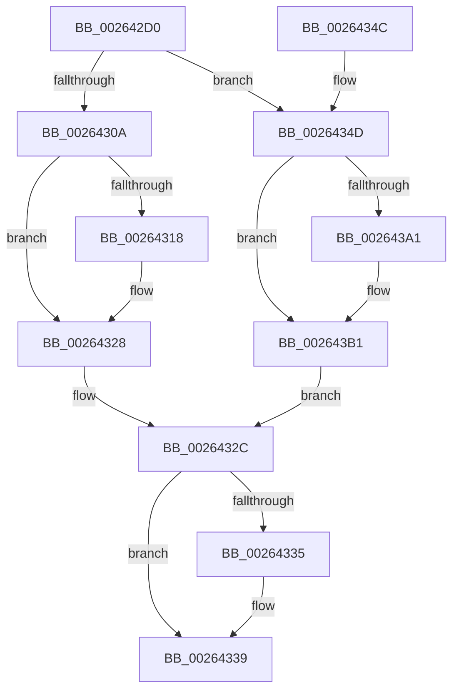

# FsRtlAcquireAutoExpandPushLockShared

- RVA: `0x002642D0`–`0x002643B9` (길이 `233` bytes)
- VA: `0x00000001402642D0`
- 실행 섹션: `.text`
- PDB 이름 있음: `예`; PDB Function 태그: `아니요`
- unwind 정보 RVA: `0x000648B4`
- 디코드: `63`개 명령, `233/233` bytes 표시
- 미해석 바이트: `0` (있으면 어셈블리에 `.byte`로 보존)

> 이 문서는 커널 이미지의 기계어와 PDB 기호를 분석해 생성했습니다. 4번과 5번은 함수 원형과 자료형을 바이너리 사용 방식에서 추정한 C 해석이며 원본 소스 복구 결과는 아닙니다.

## 1. Dependencies

- 직접 호출 지점: **3**; 고유 호출 대상: **2**
- 직접 호출자로 확인된 함수: **3**
- RIP 상대 이미지 참조: **0**

### Outgoing calls
- `0x002642F8` → [KeAbPreAcquire](../21/KeAbPreAcquire_function_00210230.md) (function, `0x00210230`)
- `0x00264323` → [ExfAcquirePushLockSharedEx](../21/ExfAcquirePushLockSharedEx_function_0021044C.md) (function, `0x0021044C`)
- `0x002643AC` → [ExfAcquirePushLockSharedEx](../21/ExfAcquirePushLockSharedEx_function_0021044C.md) (function, `0x0021044C`)

### Direct callers
- [FsRtlLookupPerFileObjectContext](FsRtlLookupPerFileObjectContext_function_002641F0.md) at `0x00264246`
- [FsRtlLookupPerStreamContextInternal](FsRtlLookupPerStreamContextInternal_function_00265020.md) at `0x0026505B`
- [sub_0041FB22](../41/Unknown_function_0041FB22.md) at `0x0041FB27`

### Static image references
- 디코드된 RIP-relative 메모리 참조가 없습니다.

## 2. Other-region calls and transfers

- 다른 실행 섹션으로 향하는 call: **0**
- 별도 외부 분기/꼬리 이동을 확인하지 못했습니다.

## 3. Assembly (complete function range)

```asm
002642D0  48 89 5C 24 08                  mov qword ptr [rsp + 8], rbx
002642D5  48 89 74 24 18                  mov qword ptr [rsp + 0x18], rsi
002642DA  57                              push rdi
002642DB  48 83 EC 20                     sub rsp, 0x20
002642DF  65 48 8B 04 25 88 01 00 00      mov rax, qword ptr gs:[0x188]
002642E8  45 33 C0                        xor r8d, r8d
002642EB  33 D2                           xor edx, edx
002642ED  48 8B D9                        mov rbx, rcx
002642F0  66 FF 88 E4 01 00 00            dec word ptr [rax + 0x1e4]
002642F7  90                              nop
002642F8  E8 33 BF FA FF                  call 0x140210230
002642FD  44 8B 4B 08                     mov r9d, dword ptr [rbx + 8]
00264301  48 8B F8                        mov rdi, rax
00264304  41 F6 C1 01                     test r9b, 1
00264308  75 43                           jne 0x14026434d
0026430A  B9 11 00 00 00                  mov ecx, 0x11
0026430F  33 C0                           xor eax, eax
00264311  F0 48 0F B1 0B                  lock cmpxchg qword ptr [rbx], rcx
00264316  74 10                           je 0x140264328
00264318  4C 8B CB                        mov r9, rbx
0026431B  4C 8B C7                        mov r8, rdi
0026431E  33 D2                           xor edx, edx
00264320  48 8B CB                        mov rcx, rbx
00264323  E8 24 C1 FA FF                  call 0x14021044c
00264328  48 83 CB 01                     or rbx, 1
0026432C  48 83 CB 02                     or rbx, 2
00264330  48 85 FF                        test rdi, rdi
00264333  74 04                           je 0x140264339
00264335  C6 47 0A 01                     mov byte ptr [rdi + 0xa], 1
00264339  48 8B 74 24 40                  mov rsi, qword ptr [rsp + 0x40]
0026433E  48 8B C3                        mov rax, rbx
00264341  48 8B 5C 24 30                  mov rbx, qword ptr [rsp + 0x30]
00264346  48 83 C4 20                     add rsp, 0x20
0026434A  5F                              pop rdi
0026434B  C3                              ret
0026434C  CC                              int3
0026434D  65 4C 8B 04 25 20 00 00 00      mov r8, qword ptr gs:[0x20]
00264356  41 8B C1                        mov eax, r9d
00264359  C1 E8 0D                        shr eax, 0xd
0026435C  BA 01 00 00 00                  mov edx, 1
00264361  25 FF FF 03 00                  and eax, 0x3ffff
00264366  49 C1 E9 04                     shr r9, 4
0026436A  0F BD C8                        bsr ecx, eax
0026436D  41 81 E1 FF 01 00 00            and r9d, 0x1ff
00264374  D3 E2                           shl edx, cl
00264376  33 D0                           xor edx, eax
00264378  89 4C 24 38                     mov dword ptr [rsp + 0x38], ecx
0026437C  49 8B 80 B0 8B 00 00            mov rax, qword ptr [r8 + 0x8bb0]
00264383  83 C1 FE                        add ecx, -2
00264386  48 8B 04 C8                     mov rax, qword ptr [rax + rcx*8]
0026438A  B9 11 00 00 00                  mov ecx, 0x11
0026438F  48 8B 44 D0 08                  mov rax, qword ptr [rax + rdx*8 + 8]
00264394  4A 8D 34 C8                     lea rsi, [rax + r9*8]
00264398  33 C0                           xor eax, eax
0026439A  F0 48 0F B1 0E                  lock cmpxchg qword ptr [rsi], rcx
0026439F  74 10                           je 0x1402643b1
002643A1  4C 8B CB                        mov r9, rbx
002643A4  4C 8B C7                        mov r8, rdi
002643A7  33 D2                           xor edx, edx
002643A9  48 8B CE                        mov rcx, rsi
002643AC  E8 9B C0 FA FF                  call 0x14021044c
002643B1  48 8B DE                        mov rbx, rsi
002643B4  E9 73 FF FF FF                  jmp 0x14026432c
```

## 4. C-style interpretation (structured pseudocode)

```c
__int64 __fastcall FsRtlAcquireAutoExpandPushLockShared(__int64 a1, int a2, int a3)
{
    __int64 result;
    __int64 v_rbx;
    __int64 v_rsp;
    unsigned __int64 v_stack_p18;
    unsigned int v_stack_p38;
    unsigned __int64 v_stack_p8;

    v_stack_p8 = v_rbx;
    v_stack_p18 = v_rsi;
    v_rsp = (v_rsp) - (32);
    a3 = 0;
    a2 = 0;
    result = KeAbPreAcquire(a1, a2, a3, a4);
    if ((((unsigned __int8)((unsigned int)(*(unsigned int *)(a1 + 8)))) & (1)) != 0) goto loc_0026434D;
    result = 0;
    if (!(condition_is_equal)) {
        a4 = a1;
        a3 = 0;
        a2 = 0;
        a1 = a1;
        result = ExfAcquirePushLockSharedEx(a1, a2, a3, a4);
    }
    v_rbx = (a1) | (1);
loc_0026432C:
    v_rbx = (v_rbx) | (2);
    if (result != 0) {
        *(unsigned __int8 *)(result + 10) = 1;
    }
    v_rsp = (v_rsp) + (32);
    return v_rbx;
loc_0026434D:
    result = (unsigned int)(((unsigned int)((unsigned int)(a4))) >> (13));
    result = (unsigned int)((result) & (0x3FFFFULL));
    a4 = (a4) >> (4);
    a4 = (unsigned int)((a4) & (511));
    a2 = (unsigned int)((1) << ((unsigned __int8)(a1)));
    a2 = (unsigned int)((a2) ^ ((unsigned int)(result)));
    v_stack_p38 = (unsigned int)(a1);
    a1 = (unsigned int)((a1) + (-2));
    result = 0;
    if (!(condition_is_equal)) {
        a4 = v_stack_p8;
        a3 = 0;
        a2 = 0;
        a1 = *(unsigned __int64 *)(*(unsigned __int64 *)(*(unsigned __int64 *)(*(unsigned __int64 *)(gs_base + (0 + 32)) + 35760) + a1 * 8) + a2 * 8 + 8) + a4 * 8;
        result = ExfAcquirePushLockSharedEx(a1, a2, a3, a4);
    }
    goto loc_0026432C;
}
```

## 5. (Beta) C Style

```c
int64_t FsRtlAcquireAutoExpandPushLockShared(void *Arg1, int32_t Arg2, int32_t Arg3)
{
    uint8_t *arg1 = (uint8_t *)Arg1;

    int64_t result;
    int64_t local_rbx;
    int64_t local_rsp;
    uint64_t v_stack_p18;
    uint32_t v_stack_p38;
    uint64_t v_stack_p8;

    v_stack_p8 = local_rbx;
    v_stack_p18 = local_rsi;
    local_rsp = (local_rsp) - (32);
    Arg3 = 0;
    Arg2 = 0;
    result = KeAbPreAcquire(Arg1, Arg2, Arg3, a4);
    if ((((uint8_t)((uint32_t)(*(uint32_t *)(arg1 + 0x8)))) & (1)) != 0) goto loc_0026434D;
    result = 0;
    if (!(condition_is_equal)) {
        a4 = Arg1;
        Arg3 = 0;
        Arg2 = 0;
        Arg1 = Arg1;
        result = ExfAcquirePushLockSharedEx(Arg1, Arg2, Arg3, a4);
    }
    local_rbx = (Arg1) | (1);
loc_0026432C:
    local_rbx = (local_rbx) | (2);
    if (result != 0) {
        *(uint8_t *)(result + 0xA) = 1;
    }
    local_rsp = (local_rsp) + (32);
    return local_rbx;
loc_0026434D:
    result = (uint32_t)(((uint32_t)((uint32_t)(a4))) >> (13));
    result = (uint32_t)((result) & (0x3FFFFULL));
    a4 = (a4) >> (4);
    a4 = (uint32_t)((a4) & (511));
    Arg2 = (uint32_t)((1) << ((uint8_t)(Arg1)));
    Arg2 = (uint32_t)((Arg2) ^ ((uint32_t)(result)));
    v_stack_p38 = (uint32_t)(Arg1);
    Arg1 = (uint32_t)((Arg1) + (-2));
    result = 0;
    if (!(condition_is_equal)) {
        a4 = v_stack_p8;
        Arg3 = 0;
        Arg2 = 0;
        Arg1 = *(uint64_t *)(*(uint64_t *)(*(uint64_t *)(*(uint64_t *)(gs_base + (0 + 0x20)) + 0x8BB0) + arg1 * 8) + Arg2 * 8 + 0x8) + a4 * 8;
        result = ExfAcquirePushLockSharedEx(Arg1, Arg2, Arg3, a4);
    }
    goto loc_0026432C;
}
```

### 관측된 메모리 오프셋

구조체 형식이 확인되지 않은 접근은 인자 기준의 오프셋으로만 기록했습니다.

| 기준 인자 | 오프셋 표현 | 폭 (bit) | 접근 |
|---|---:|---:|---|
| `Arg1` | `+ 0x0` | `64` | `R` |
| `Arg1` | `+ 0x8` | `32` | `R` |

## 6. Execution-region graph

[열기: 2D/3D 그래프와 함수 탐색 컨트롤 패널](../../../control-panel.html?section=text&rva=0x002642D0&view=graph)

- 2D 그래프는 위에서 아래로 흐르고, 3D 그래프는 빈 공간을 드래그해 회전합니다. Shift+드래그는 이동, 휠은 확대·축소, 함수 노드 선택은 대상 보고서 이동입니다.

### Static fallback


