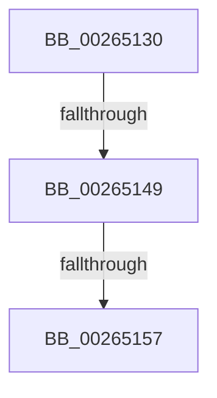

# FsRtlInsertPerFileObjectContext

- RVA: `0x00265130`–`0x0026515E` (길이 `46` bytes)
- VA: `0x0000000140265130`
- 실행 섹션: `.text`
- PDB 이름 있음: `예`; PDB Function 태그: `아니요`
- unwind 정보 RVA: `0x00064A68`
- 디코드: `10`개 명령, `46/46` bytes 표시
- 미해석 바이트: `0` (있으면 어셈블리에 `.byte`로 보존)

> 이 문서는 커널 이미지의 기계어와 PDB 기호를 분석해 생성했습니다. 4번과 5번은 함수 원형과 자료형을 바이너리 사용 방식에서 추정한 C 해석이며 원본 소스 복구 결과는 아닙니다.

## 1. Dependencies

- 직접 호출 지점: **0**; 고유 호출 대상: **0**
- 직접 호출자로 확인된 함수: **0**
- RIP 상대 이미지 참조: **0**

### Outgoing calls
- 직접 디코드된 call 명령이 없습니다.

### Direct callers
- 이 함수 시작 RVA로 연결되는 직접 call은 확인되지 않았습니다. 간접 호출은 완전히 역산할 수 없습니다.

### Static image references
- 디코드된 RIP-relative 메모리 참조가 없습니다.

## 2. Other-region calls and transfers

- 다른 실행 섹션으로 향하는 call: **0**
- call이 아닌 외부 분기/꼬리 이동: **2**
  - `0x00265143` → [sub_00265256](Unknown_function_00265256.md) (`tail-transfer`)
  - `0x00265151` → [sub_00265216 + 0xC](Unknown_function_00265216.md) (`tail-transfer`)

## 3. Assembly (complete function range)

```asm
00265130  48 89 5C 24 20                  mov qword ptr [rsp + 0x20], rbx
00265135  56                              push rsi
00265136  48 83 EC 20                     sub rsp, 0x20
0026513A  48 8B F2                        mov rsi, rdx
0026513D  48 8B D9                        mov rbx, rcx
00265140  48 85 C9                        test rcx, rcx
00265143  0F 84 0D 01 00 00               je 0x140265256
00265149  48 83 B9 D0 00 00 00 00         cmp qword ptr [rcx + 0xd0], 0
00265151  0F 84 CB 00 00 00               je 0x140265222
00265157  48 8B 83 D0 00 00 00            mov rax, qword ptr [rbx + 0xd0]
```

## 4. C-style interpretation (structured pseudocode)

```c
__int64 __fastcall FsRtlInsertPerFileObjectContext(__int64 a1, __int64 a2)
{
    __int64 v_rsp;
    unsigned __int64 v_stack_p20;

    v_stack_p20 = v_rbx;
    v_rsp = (v_rsp) - (32);
    return *(unsigned __int64 *)(a1 + 208);
}
```

## 5. (Beta) C Style

```c
int64_t FsRtlInsertPerFileObjectContext(void *Arg1, int64_t Arg2)
{
    uint8_t *arg1 = (uint8_t *)Arg1;

    int64_t local_rsp;
    uint64_t v_stack_p20;

    v_stack_p20 = local_rbx;
    local_rsp = (local_rsp) - (32);
    return *(uint64_t *)(arg1 + 0xD0);
}
```

### 관측된 메모리 오프셋

구조체 형식이 확인되지 않은 접근은 인자 기준의 오프셋으로만 기록했습니다.

| 기준 인자 | 오프셋 표현 | 폭 (bit) | 접근 |
|---|---:|---:|---|
| `Arg1` | `+ 0xD0` | `64` | `R` |

## 6. Execution-region graph

[열기: 2D/3D 그래프와 함수 탐색 컨트롤 패널](../../../control-panel.html?section=text&rva=0x00265130&view=graph)

- 2D 그래프는 위에서 아래로 흐르고, 3D 그래프는 빈 공간을 드래그해 회전합니다. Shift+드래그는 이동, 휠은 확대·축소, 함수 노드 선택은 대상 보고서 이동입니다.

### Static fallback


