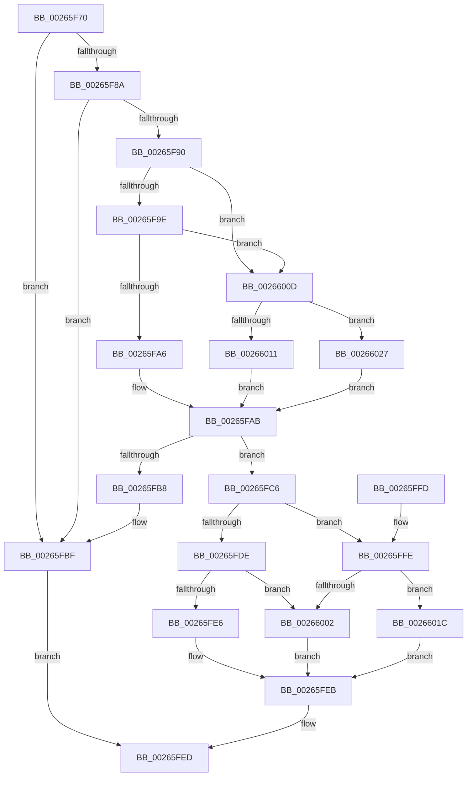

# FsRtlInsertPerStreamContext

- RVA: `0x00265F70`–`0x00266035` (길이 `197` bytes)
- VA: `0x0000000140265F70`
- 실행 섹션: `.text`
- PDB 이름 있음: `예`; PDB Function 태그: `아니요`
- unwind 정보 RVA: `0x00064CD0`
- 디코드: `62`개 명령, `197/197` bytes 표시
- 미해석 바이트: `0` (있으면 어셈블리에 `.byte`로 보존)

> 이 문서는 커널 이미지의 기계어와 PDB 기호를 분석해 생성했습니다. 4번과 5번은 함수 원형과 자료형을 바이너리 사용 방식에서 추정한 C 해석이며 원본 소스 복구 결과는 아닙니다.

## 1. Dependencies

- 직접 호출 지점: **6**; 고유 호출 대상: **6**
- 직접 호출자로 확인된 함수: **0**
- RIP 상대 이미지 참조: **0**

### Outgoing calls
- `0x00265FA6` → [FsRtlAcquireAutoExpandPushLockExclusive](FsRtlAcquireAutoExpandPushLockExclusive_function_0026539C.md) (function, `0x0026539C`)
- `0x00265FE6` → [FsRtlReleaseAutoExpandPushLockExclusive](FsRtlReleaseAutoExpandPushLockExclusive_function_00265B5C.md) (function, `0x00265B5C`)
- `0x00266006` → [FsRtlReleasePushLock](FsRtlReleasePushLock_function_00265D7C.md) (function, `0x00265D7C`)
- `0x00266015` → [FsRtlAcquirePushLockExclusive](../4A/FsRtlAcquirePushLockExclusive_function_004A05F4.md) (function, `0x004A05F4`)
- `0x00266020` → [ExReleaseFastMutex](../25/ExReleaseFastMutex_function_002519C0.md) (function, `0x002519C0`)
- `0x0026602B` → [ExAcquireFastMutex](../20/ExAcquireFastMutex_function_0020E5A0.md) (function, `0x0020E5A0`)

### Direct callers
- 이 함수 시작 RVA로 연결되는 직접 call은 확인되지 않았습니다. 간접 호출은 완전히 역산할 수 없습니다.

### Static image references
- 디코드된 RIP-relative 메모리 참조가 없습니다.

## 2. Other-region calls and transfers

- 다른 실행 섹션으로 향하는 call: **0**
- 별도 외부 분기/꼬리 이동을 확인하지 못했습니다.

## 3. Assembly (complete function range)

```asm
00265F70  48 89 5C 24 08                  mov qword ptr [rsp + 8], rbx
00265F75  48 89 74 24 10                  mov qword ptr [rsp + 0x10], rsi
00265F7A  57                              push rdi
00265F7B  48 83 EC 20                     sub rsp, 0x20
00265F7F  48 8B F2                        mov rsi, rdx
00265F82  48 8B D9                        mov rbx, rcx
00265F85  48 85 C9                        test rcx, rcx
00265F88  74 35                           je 0x140265fbf
00265F8A  F6 41 06 02                     test byte ptr [rcx + 6], 2
00265F8E  74 2F                           je 0x140265fbf
00265F90  8A 41 07                        mov al, byte ptr [rcx + 7]
00265F93  48 8D 79 60                     lea rdi, [rcx + 0x60]
00265F97  C0 E8 04                        shr al, 4
00265F9A  3C 03                           cmp al, 3
00265F9C  72 6F                           jb 0x14026600d
00265F9E  48 8B 0F                        mov rcx, qword ptr [rdi]
00265FA1  48 85 C9                        test rcx, rcx
00265FA4  74 67                           je 0x14026600d
00265FA6  E8 F1 F3 FF FF                  call 0x14026539c
00265FAB  48 8D 43 38                     lea rax, [rbx + 0x38]
00265FAF  48 8B 10                        mov rdx, qword ptr [rax]
00265FB2  48 39 42 08                     cmp qword ptr [rdx + 8], rax
00265FB6  74 0E                           je 0x140265fc6
00265FB8  B9 03 00 00 00                  mov ecx, 3
00265FBD  CD 29                           int 0x29
00265FBF  B8 10 00 00 C0                  mov eax, 0xc0000010
00265FC4  EB 27                           jmp 0x140265fed
00265FC6  48 89 46 08                     mov qword ptr [rsi + 8], rax
00265FCA  48 89 16                        mov qword ptr [rsi], rdx
00265FCD  48 89 72 08                     mov qword ptr [rdx + 8], rsi
00265FD1  48 89 30                        mov qword ptr [rax], rsi
00265FD4  8A 43 07                        mov al, byte ptr [rbx + 7]
00265FD7  C0 E8 04                        shr al, 4
00265FDA  3C 03                           cmp al, 3
00265FDC  72 20                           jb 0x140265ffe
00265FDE  48 8B 0F                        mov rcx, qword ptr [rdi]
00265FE1  48 85 C9                        test rcx, rcx
00265FE4  74 1C                           je 0x140266002
00265FE6  E8 71 FB FF FF                  call 0x140265b5c
00265FEB  33 C0                           xor eax, eax
00265FED  48 8B 5C 24 30                  mov rbx, qword ptr [rsp + 0x30]
00265FF2  48 8B 74 24 38                  mov rsi, qword ptr [rsp + 0x38]
00265FF7  48 83 C4 20                     add rsp, 0x20
00265FFB  5F                              pop rdi
00265FFC  C3                              ret
00265FFD  CC                              int3
00265FFE  3C 01                           cmp al, 1
00266000  72 1A                           jb 0x14026601c
00266002  48 8D 4B 48                     lea rcx, [rbx + 0x48]
00266006  E8 71 FD FF FF                  call 0x140265d7c
0026600B  EB DE                           jmp 0x140265feb
0026600D  3C 01                           cmp al, 1
0026600F  72 16                           jb 0x140266027
00266011  48 8D 4B 48                     lea rcx, [rbx + 0x48]
00266015  E8 DA A5 23 00                  call 0x1404a05f4
0026601A  EB 8F                           jmp 0x140265fab
0026601C  48 8B 4B 30                     mov rcx, qword ptr [rbx + 0x30]
00266020  E8 9B B9 FE FF                  call 0x1402519c0
00266025  EB C4                           jmp 0x140265feb
00266027  48 8B 4B 30                     mov rcx, qword ptr [rbx + 0x30]
0026602B  E8 70 85 FA FF                  call 0x14020e5a0
00266030  E9 76 FF FF FF                  jmp 0x140265fab
```

## 4. C-style interpretation (structured pseudocode)

```c
__int64 __fastcall FsRtlInsertPerStreamContext(__int64 a1, __int64 a2)
{
    __int64 result;
    __int64 v_rsp;
    unsigned __int64 v_stack_p10;
    unsigned __int64 v_stack_p8;

    v_stack_p8 = v_rbx;
    v_stack_p10 = v_rsi;
    v_rsp = (v_rsp) - (32);
    if (a1 == 0) goto loc_00265FBF;
    if (((*(unsigned __int8 *)(a1 + 6)) & (2)) == 0) goto loc_00265FBF;
    result = (unsigned __int8)((*(unsigned __int8 *)(a1 + 7)) >> (4));
    if (((unsigned __int8)(result)) < 3) goto loc_0026600D;
    if (*(unsigned __int64 *)(a1 + 96) == 0) goto loc_0026600D;
    result = FsRtlAcquireAutoExpandPushLockExclusive(*(unsigned __int64 *)(a1 + 96), a2, a3, a4);
loc_00265FAB:
    if ((*(unsigned __int64 *)(*(unsigned __int64 *)(a1 + 56) + 8)) == (a1 + 56)) goto loc_00265FC6;
loc_00265FBF:
    goto loc_00265FED;
loc_00265FC6:
    *(unsigned __int64 *)(a2 + 8) = (unsigned int)(0xC0000010ULL);
    *(unsigned __int64 *)(a2) = *(unsigned __int64 *)(a1 + 56);
    *(unsigned __int64 *)(*(unsigned __int64 *)(a1 + 56) + 8) = a2;
    *(unsigned __int64 *)((unsigned int)(0xC0000010ULL)) = a2;
    result = (unsigned __int8)((*(unsigned __int8 *)(a1 + 7)) >> (4));
    if (((unsigned __int8)(result)) < 3) goto loc_00265FFE;
    if (*(unsigned __int64 *)(a1 + 96) == 0) goto loc_00266002;
    result = FsRtlReleaseAutoExpandPushLockExclusive(*(unsigned __int64 *)(a1 + 96), *(unsigned __int64 *)(a1 + 56), a3, a4);
loc_00265FEB:
    result = 0;
loc_00265FED:
    v_rsp = (v_rsp) + (32);
    return result;
loc_00265FFE:
    if (0 < 1) goto loc_0026601C;
loc_00266002:
    result = FsRtlReleasePushLock(v_stack_p8 + 72, *(unsigned __int64 *)(a1 + 56), a3, a4);
    goto loc_00265FEB;
loc_0026600D:
    if (((unsigned __int8)(result)) < 1) goto loc_00266027;
    result = FsRtlAcquirePushLockExclusive(v_stack_p8 + 72, *(unsigned __int64 *)(a1 + 56), a3, a4);
    goto loc_00265FAB;
loc_0026601C:
    result = ExReleaseFastMutex(*(unsigned __int64 *)(v_stack_p8 + 48), *(unsigned __int64 *)(a1 + 56), a3, a4);
    goto loc_00265FEB;
loc_00266027:
    result = ExAcquireFastMutex(*(unsigned __int64 *)(v_stack_p8 + 48), *(unsigned __int64 *)(a1 + 56), a3, a4);
    goto loc_00265FAB;
}
```

## 5. (Beta) C Style

```c
int64_t FsRtlInsertPerStreamContext(void *Arg1, void *Arg2)
{
    uint8_t *arg1 = (uint8_t *)Arg1;
    uint8_t *arg2 = (uint8_t *)Arg2;

    int64_t result;
    int64_t local_rsp;
    uint64_t v_stack_p10;
    uint64_t v_stack_p8;

    v_stack_p8 = local_rbx;
    v_stack_p10 = local_rsi;
    local_rsp = (local_rsp) - (32);
    if (Arg1 == NULL) goto loc_00265FBF;
    if (((*(uint8_t *)(arg1 + 0x6)) & (2)) == 0) goto loc_00265FBF;
    result = (uint8_t)((*(uint8_t *)(arg1 + 0x7)) >> (4));
    if (((uint8_t)(result)) < 3) goto loc_0026600D;
    if (*(uint64_t *)(arg1 + 0x60) == 0) goto loc_0026600D;
    result = FsRtlAcquireAutoExpandPushLockExclusive(*(uint64_t *)(arg1 + 0x60), Arg2, a3, a4);
loc_00265FAB:
    if ((*(uint64_t *)(*(uint64_t *)(arg1 + 0x38) + 0x8)) == (Arg1 + 56)) goto loc_00265FC6;
loc_00265FBF:
    goto loc_00265FED;
loc_00265FC6:
    *(uint64_t *)(arg2 + 0x8) = (uint32_t)(0xC0000010ULL);
    *(uint64_t *)(arg2) = *(uint64_t *)(arg1 + 0x38);
    *(void **)(*(uint64_t *)(arg1 + 0x38) + 0x8) = Arg2;
    *(void **)((uint32_t)(0xC0000010ULL)) = Arg2;
    result = (uint8_t)((*(uint8_t *)(arg1 + 0x7)) >> (4));
    if (((uint8_t)(result)) < 3) goto loc_00265FFE;
    if (*(uint64_t *)(arg1 + 0x60) == 0) goto loc_00266002;
    result = FsRtlReleaseAutoExpandPushLockExclusive(*(uint64_t *)(arg1 + 0x60), *(uint64_t *)(arg1 + 0x38), a3, a4);
loc_00265FEB:
    result = 0;
loc_00265FED:
    local_rsp = (local_rsp) + (32);
    return result;
loc_00265FFE:
    if (0 < 1) goto loc_0026601C;
loc_00266002:
    result = FsRtlReleasePushLock(v_stack_p8 + 72, *(uint64_t *)(arg1 + 0x38), a3, a4);
    goto loc_00265FEB;
loc_0026600D:
    if (((uint8_t)(result)) < 1) goto loc_00266027;
    result = FsRtlAcquirePushLockExclusive(v_stack_p8 + 72, *(uint64_t *)(arg1 + 0x38), a3, a4);
    goto loc_00265FAB;
loc_0026601C:
    result = ExReleaseFastMutex(*(uint64_t *)(v_stack_p8 + 0x30), *(uint64_t *)(arg1 + 0x38), a3, a4);
    goto loc_00265FEB;
loc_00266027:
    result = ExAcquireFastMutex(*(uint64_t *)(v_stack_p8 + 0x30), *(uint64_t *)(arg1 + 0x38), a3, a4);
    goto loc_00265FAB;
}
```

### 관측된 메모리 오프셋

구조체 형식이 확인되지 않은 접근은 인자 기준의 오프셋으로만 기록했습니다.

| 기준 인자 | 오프셋 표현 | 폭 (bit) | 접근 |
|---|---:|---:|---|
| `Arg1` | `+ 0x0` | `64` | `R` |
| `Arg1` | `+ 0x0` | `64` | `W` |
| `Arg1` | `+ 0x7` | `8` | `R` |
| `Arg1` | `+ 0x30` | `64` | `R` |
| `Arg1` | `+ 0x38` | `64` | `R` |
| `Arg1` | `+ 0x48` | `64` | `R` |
| `Arg2` | `+ 0x0` | `64` | `W` |
| `Arg2` | `+ 0x8` | `64` | `W` |

## 6. Execution-region graph

[열기: 2D/3D 그래프와 함수 탐색 컨트롤 패널](../../../control-panel.html?section=text&rva=0x00265F70&view=graph)

- 2D 그래프는 위에서 아래로 흐르고, 3D 그래프는 빈 공간을 드래그해 회전합니다. Shift+드래그는 이동, 휠은 확대·축소, 함수 노드 선택은 대상 보고서 이동입니다.

### Static fallback


