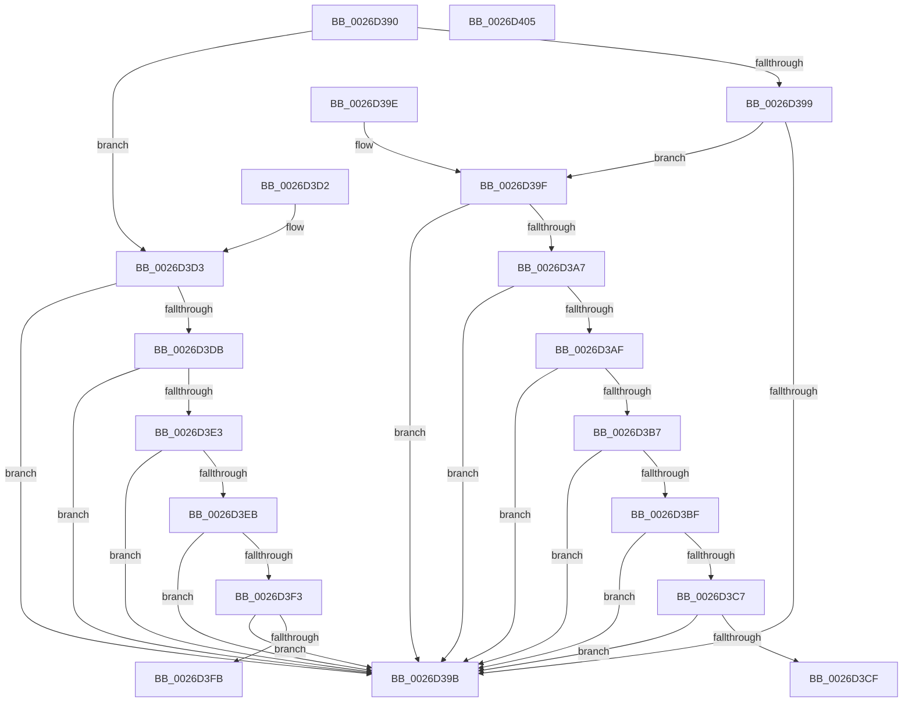

# FsRtlIsNtstatusExpected

- RVA: `0x0026D390`–`0x0026D406` (길이 `118` bytes)
- VA: `0x000000014026D390`
- 실행 섹션: `.text`
- PDB 이름 있음: `예`; PDB Function 태그: `아니요`
- unwind 정보 RVA: `0x000DB714`
- 디코드: `36`개 명령, `118/118` bytes 표시
- 미해석 바이트: `0` (있으면 어셈블리에 `.byte`로 보존)

> 이 문서는 커널 이미지의 기계어와 PDB 기호를 분석해 생성했습니다. 4번과 5번은 함수 원형과 자료형을 바이너리 사용 방식에서 추정한 C 해석이며 원본 소스 복구 결과는 아닙니다.

## 1. Dependencies

- 직접 호출 지점: **0**; 고유 호출 대상: **0**
- 직접 호출자로 확인된 함수: **21**
- RIP 상대 이미지 참조: **0**

### Outgoing calls
- 직접 디코드된 call 명령이 없습니다.

### Direct callers
- [CcSetFileSizesEx](CcSetFileSizesEx_function_0026D070.md) at `0x0026D301`
- [FsRtlNormalizeNtstatus](FsRtlNormalizeNtstatus_function_0026D360.md) at `0x0026D36E`
- [CcGetVacbMiss](../27/CcGetVacbMiss_function_00272900.md) at `0x00272CC9`
- [CcMdlWriteComplete2](../3C/CcMdlWriteComplete2_function_003CA36C.md) at `0x003CA4A1`
- [CcMapAndCopyInToCache](../3C/CcMapAndCopyInToCache_function_003CA7F0.md) at `0x003CAE04`
- [CcMapAndCopyInToCache](../3C/CcMapAndCopyInToCache_function_003CA7F0.md) at `0x003CAF11`
- [CcMapAndCopyInToCache](../3C/CcMapAndCopyInToCache_function_003CA7F0.md) at `0x003CB04C`
- [CcMapAndCopyInToCache](../3C/CcMapAndCopyInToCache_function_003CA7F0.md) at `0x003CB232`
- [CcCopyBytesToUserBuffer](../3C/CcCopyBytesToUserBuffer_function_003CC3D0.md) at `0x003CC479`
- [CcLockSystemCacheBuffer](../3C/CcLockSystemCacheBuffer_function_003CC5B8.md) at `0x003CC61E`
- [CcInitializeCacheMapInternal](../3C/CcInitializeCacheMapInternal_function_003CC720.md) at `0x003CD254`
- [CcAsyncReadPrefetch](../45/CcAsyncReadPrefetch_function_0045E540.md) at `0x0045E5D0`
- [CcMapAndCopyInToCache$fin$1](../6D/CcMapAndCopyInToCache_fin_1_function_006D2AF9.md) at `0x006D2C9D`
- [CcAcquireByteRangeForWrite$filt$0](../6D/CcAcquireByteRangeForWrite_filt_0_function_006D3040.md) at `0x006D3067`
- [CcAcquireByteRangeForWrite$filt$1](../6D/CcAcquireByteRangeForWrite_filt_1_function_006D3086.md) at `0x006D30AD`
- [CcPerformReadAhead$filt$0](../6D/CcPerformReadAhead_filt_0_function_006D38E3.md) at `0x006D390A`
- [FsRtlCancelNotify$filt$0](../6D/FsRtlCancelNotify_filt_0_function_006D54C6.md) at `0x006D54E4`
- [sub_006E86B0](../6E/Unknown_function_006E86B0.md) at `0x006E86F2`
- [RawDispatch$filt$0](../../page/B1/RawDispatch_filt_0_function_00B1024E.md) at `0x00B1025C`
- [FsRtlNotifyFilterReportChange$filt$0](../../page/B1/FsRtlNotifyFilterReportChange_filt_0_function_00B111CE.md) at `0x00B111F5`
- [FsRtlNotifyFilterReportChangeLiteEx$filt$0](../../page/B1/FsRtlNotifyFilterReportChangeLiteEx_filt_0_function_00B11238.md) at `0x00B11256`
- [FsRtlCopyRead$filt$0](../../page/B1/FsRtlCopyRead_filt_0_function_00B114E2.md) at `0x00B114F0`
- [FsRtlCopyWrite$filt$0](../../page/B1/FsRtlCopyWrite_filt_0_function_00B116BD.md) at `0x00B116CB`
- [FsRtlMdlReadDev$filt$0](../../page/B1/FsRtlMdlReadDev_filt_0_function_00B13CBA.md) at `0x00B13CC8`

### Static image references
- 디코드된 RIP-relative 메모리 참조가 없습니다.

## 2. Other-region calls and transfers

- 다른 실행 섹션으로 향하는 call: **0**
- 별도 외부 분기/꼬리 이동을 확인하지 못했습니다.

## 3. Assembly (complete function range)

```asm
0026D390  B8 47 00 00 C0                  mov eax, 0xc0000047
0026D395  3B C8                           cmp ecx, eax
0026D397  7F 3A                           jg 0x14026d3d3
0026D399  75 04                           jne 0x14026d39f
0026D39B  32 C0                           xor al, al
0026D39D  C3                              ret
0026D39E  CC                              int3
0026D39F  81 F9 01 00 00 80               cmp ecx, 0x80000001
0026D3A5  74 F4                           je 0x14026d39b
0026D3A7  81 F9 02 00 00 80               cmp ecx, 0x80000002
0026D3AD  74 EC                           je 0x14026d39b
0026D3AF  81 F9 03 00 00 80               cmp ecx, 0x80000003
0026D3B5  74 E4                           je 0x14026d39b
0026D3B7  81 F9 05 00 00 C0               cmp ecx, 0xc0000005
0026D3BD  74 DC                           je 0x14026d39b
0026D3BF  81 F9 1D 00 00 C0               cmp ecx, 0xc000001d
0026D3C5  74 D4                           je 0x14026d39b
0026D3C7  81 F9 46 00 00 C0               cmp ecx, 0xc0000046
0026D3CD  74 CC                           je 0x14026d39b
0026D3CF  B0 01                           mov al, 1
0026D3D1  C3                              ret
0026D3D2  CC                              int3
0026D3D3  81 F9 8C 00 00 C0               cmp ecx, 0xc000008c
0026D3D9  74 C0                           je 0x14026d39b
0026D3DB  81 F9 94 00 00 C0               cmp ecx, 0xc0000094
0026D3E1  74 B8                           je 0x14026d39b
0026D3E3  81 F9 96 00 00 C0               cmp ecx, 0xc0000096
0026D3E9  74 B0                           je 0x14026d39b
0026D3EB  81 F9 AA 00 00 C0               cmp ecx, 0xc00000aa
0026D3F1  74 A8                           je 0x14026d39b
0026D3F3  81 F9 09 04 00 C0               cmp ecx, 0xc0000409
0026D3F9  74 A0                           je 0x14026d39b
0026D3FB  81 F9 20 04 00 C0               cmp ecx, 0xc0000420
0026D401  0F 95 C0                        setne al
0026D404  C3                              ret
0026D405  CC                              int3
```

## 4. C-style interpretation (structured pseudocode)

```c
__int64 __fastcall FsRtlIsNtstatusExpected(int a1)
{
    __int64 result;

    if (a1 > ((unsigned int)((unsigned int)(0xC0000047ULL)))) goto loc_0026D3D3;
    if (a1 != ((unsigned int)((unsigned int)(0xC0000047ULL)))) goto loc_0026D39F;
loc_0026D39B:
    result = 0;
    return result;
loc_0026D39F:
    if (a1 == 0x80000001ULL) goto loc_0026D39B;
    if (a1 == 0x80000002ULL) goto loc_0026D39B;
    if (a1 == 0x80000003ULL) goto loc_0026D39B;
    if (a1 == 0xC0000005ULL) goto loc_0026D39B;
    if (a1 == 0xC000001DULL) goto loc_0026D39B;
    if (a1 == 0xC0000046ULL) goto loc_0026D39B;
    return 1;
loc_0026D3D3:
    if (a1 == 0xC000008CULL) goto loc_0026D39B;
    if (a1 == 0xC0000094ULL) goto loc_0026D39B;
    if (a1 == 0xC0000096ULL) goto loc_0026D39B;
    if (a1 == 0xC00000AAULL) goto loc_0026D39B;
    if (a1 == 0xC0000409ULL) goto loc_0026D39B;
    result = (a1 != 0xC0000420ULL) ? 1 : 0;
    return result;
}
```

## 5. (Beta) C Style

```c
int64_t FsRtlIsNtstatusExpected(int32_t Arg1)
{
    int64_t result;

    if (Arg1 > ((uint32_t)((uint32_t)(0xC0000047ULL)))) goto loc_0026D3D3;
    if (Arg1 != ((uint32_t)((uint32_t)(0xC0000047ULL)))) goto loc_0026D39F;
loc_0026D39B:
    result = 0;
    return result;
loc_0026D39F:
    if (Arg1 == 0x80000001ULL) goto loc_0026D39B;
    if (Arg1 == 0x80000002ULL) goto loc_0026D39B;
    if (Arg1 == 0x80000003ULL) goto loc_0026D39B;
    if (Arg1 == 0xC0000005ULL) goto loc_0026D39B;
    if (Arg1 == 0xC000001DULL) goto loc_0026D39B;
    if (Arg1 == 0xC0000046ULL) goto loc_0026D39B;
    return 1;
loc_0026D3D3:
    if (Arg1 == 0xC000008CULL) goto loc_0026D39B;
    if (Arg1 == 0xC0000094ULL) goto loc_0026D39B;
    if (Arg1 == 0xC0000096ULL) goto loc_0026D39B;
    if (Arg1 == 0xC00000AAULL) goto loc_0026D39B;
    if (Arg1 == 0xC0000409ULL) goto loc_0026D39B;
    result = (Arg1 != 0xC0000420ULL) ? 1 : 0;
    return result;
}
```

## 6. Execution-region graph

[열기: 2D/3D 그래프와 함수 탐색 컨트롤 패널](../../../control-panel.html?section=text&rva=0x0026D390&view=graph)

- 2D 그래프는 위에서 아래로 흐르고, 3D 그래프는 빈 공간을 드래그해 회전합니다. Shift+드래그는 이동, 휠은 확대·축소, 함수 노드 선택은 대상 보고서 이동입니다.

### Static fallback


