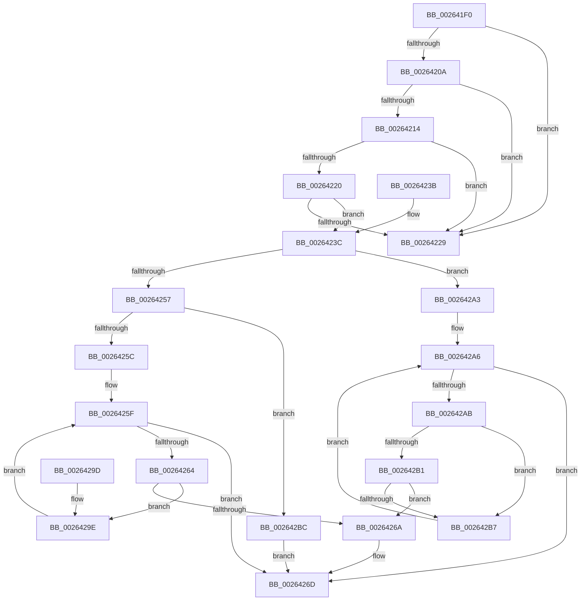

# FsRtlLookupPerFileObjectContext

- RVA: `0x002641F0`–`0x002642C8` (길이 `216` bytes)
- VA: `0x00000001402641F0`
- 실행 섹션: `.text`
- PDB 이름 있음: `예`; PDB Function 태그: `아니요`
- unwind 정보 RVA: `0x00064898`
- 디코드: `67`개 명령, `216/216` bytes 표시
- 미해석 바이트: `0` (있으면 어셈블리에 `.byte`로 보존)

> 이 문서는 커널 이미지의 기계어와 PDB 기호를 분석해 생성했습니다. 4번과 5번은 함수 원형과 자료형을 바이너리 사용 방식에서 추정한 C 해석이며 원본 소스 복구 결과는 아닙니다.

## 1. Dependencies

- 직접 호출 지점: **3**; 고유 호출 대상: **3**
- 직접 호출자로 확인된 함수: **0**
- RIP 상대 이미지 참조: **0**

### Outgoing calls
- `0x00264246` → [FsRtlAcquireAutoExpandPushLockShared](FsRtlAcquireAutoExpandPushLockShared_function_002642D0.md) (function, `0x002642D0`)
- `0x00264272` → [ExReleaseAutoExpandPushLockShared](ExReleaseAutoExpandPushLockShared_function_00263660.md) (function, `0x00263660`)
- `0x00264280` → [KeLeaveCriticalRegionThread](../25/KeLeaveCriticalRegionThread_function_0025EFF0.md) (function, `0x0025EFF0`)

### Direct callers
- 이 함수 시작 RVA로 연결되는 직접 call은 확인되지 않았습니다. 간접 호출은 완전히 역산할 수 없습니다.

### Static image references
- 디코드된 RIP-relative 메모리 참조가 없습니다.

## 2. Other-region calls and transfers

- 다른 실행 섹션으로 향하는 call: **0**
- 별도 외부 분기/꼬리 이동을 확인하지 못했습니다.

## 3. Assembly (complete function range)

```asm
002641F0  48 89 5C 24 10                  mov qword ptr [rsp + 0x10], rbx
002641F5  48 89 74 24 18                  mov qword ptr [rsp + 0x18], rsi
002641FA  57                              push rdi
002641FB  48 83 EC 20                     sub rsp, 0x20
002641FF  49 8B F0                        mov rsi, r8
00264202  48 8B FA                        mov rdi, rdx
00264205  48 85 C9                        test rcx, rcx
00264208  74 1F                           je 0x140264229
0026420A  48 83 B9 D0 00 00 00 00         cmp qword ptr [rcx + 0xd0], 0
00264212  74 15                           je 0x140264229
00264214  48 8B 81 D0 00 00 00            mov rax, qword ptr [rcx + 0xd0]
0026421B  48 85 C0                        test rax, rax
0026421E  74 09                           je 0x140264229
00264220  48 8B 58 20                     mov rbx, qword ptr [rax + 0x20]
00264224  48 85 DB                        test rbx, rbx
00264227  75 13                           jne 0x14026423c
00264229  33 C0                           xor eax, eax
0026422B  48 8B 5C 24 38                  mov rbx, qword ptr [rsp + 0x38]
00264230  48 8B 74 24 40                  mov rsi, qword ptr [rsp + 0x40]
00264235  48 83 C4 20                     add rsp, 0x20
00264239  5F                              pop rdi
0026423A  C3                              ret
0026423B  CC                              int3
0026423C  48 89 6C 24 30                  mov qword ptr [rsp + 0x30], rbp
00264241  48 8B CB                        mov rcx, rbx
00264244  33 ED                           xor ebp, ebp
00264246  E8 85 00 00 00                  call 0x1402642d0
0026424B  48 83 C3 10                     add rbx, 0x10
0026424F  4C 8B C0                        mov r8, rax
00264252  48 85 F6                        test rsi, rsi
00264255  75 4C                           jne 0x1402642a3
00264257  48 85 FF                        test rdi, rdi
0026425A  74 60                           je 0x1402642bc
0026425C  48 8B 03                        mov rax, qword ptr [rbx]
0026425F  48 3B C3                        cmp rax, rbx
00264262  74 09                           je 0x14026426d
00264264  48 39 78 10                     cmp qword ptr [rax + 0x10], rdi
00264268  75 34                           jne 0x14026429e
0026426A  48 8B E8                        mov rbp, rax
0026426D  33 D2                           xor edx, edx
0026426F  49 8B C8                        mov rcx, r8
00264272  E8 E9 F3 FF FF                  call 0x140263660
00264277  65 48 8B 0C 25 88 01 00 00      mov rcx, qword ptr gs:[0x188]
00264280  E8 6B AD FF FF                  call 0x14025eff0
00264285  48 8B 5C 24 38                  mov rbx, qword ptr [rsp + 0x38]
0026428A  48 8B C5                        mov rax, rbp
0026428D  48 8B 6C 24 30                  mov rbp, qword ptr [rsp + 0x30]
00264292  48 8B 74 24 40                  mov rsi, qword ptr [rsp + 0x40]
00264297  48 83 C4 20                     add rsp, 0x20
0026429B  5F                              pop rdi
0026429C  C3                              ret
0026429D  CC                              int3
0026429E  48 8B 00                        mov rax, qword ptr [rax]
002642A1  EB BC                           jmp 0x14026425f
002642A3  48 8B 03                        mov rax, qword ptr [rbx]
002642A6  48 3B C3                        cmp rax, rbx
002642A9  74 C2                           je 0x14026426d
002642AB  48 39 78 10                     cmp qword ptr [rax + 0x10], rdi
002642AF  75 06                           jne 0x1402642b7
002642B1  48 39 70 18                     cmp qword ptr [rax + 0x18], rsi
002642B5  74 B3                           je 0x14026426a
002642B7  48 8B 00                        mov rax, qword ptr [rax]
002642BA  EB EA                           jmp 0x1402642a6
002642BC  48 8B 0B                        mov rcx, qword ptr [rbx]
002642BF  48 3B CB                        cmp rcx, rbx
002642C2  48 0F 45 E9                     cmovne rbp, rcx
002642C6  EB A5                           jmp 0x14026426d
```

## 4. C-style interpretation (structured pseudocode)

```c
__int64 __fastcall FsRtlLookupPerFileObjectContext(__int64 a1, __int64 a2, __int64 a3)
{
    __int64 result;
    __int64 v_rbp;
    __int64 v_rbx;
    __int64 v_rsp;
    unsigned __int64 v_stack_p10;
    unsigned __int64 v_stack_p18;
    unsigned __int64 v_stack_p30;
    unsigned __int64 v_stack_p38;
    unsigned __int64 v_stack_p40;

    v_stack_p10 = v_rbx;
    v_stack_p18 = v_rsi;
    v_rsp = (v_rsp) - (32);
    if (a1 == 0) goto loc_00264229;
    if ((*(unsigned __int64 *)(a1 + 208)) == 0) goto loc_00264229;
    if (*(unsigned __int64 *)(a1 + 208) == 0) goto loc_00264229;
    if (*(unsigned __int64 *)(*(unsigned __int64 *)(a1 + 208) + 32) != 0) goto loc_0026423C;
loc_00264229:
    result = 0;
    v_rsp = (v_rsp) + (32);
    return result;
loc_0026423C:
    v_stack_p30 = v_rbp;
    v_rbp = 0;
    result = FsRtlAcquireAutoExpandPushLockShared(v_stack_p10, a2, a3, a4);
    v_rbx = (v_stack_p10) + (16);
    if (v_stack_p18 != 0) goto loc_002642A3;
    if (a2 == 0) goto loc_002642BC;
loc_0026425F:
    if ((*(unsigned __int64 *)(v_rbx)) == v_rbx) goto loc_0026426D;
    if ((*(unsigned __int64 *)(*(unsigned __int64 *)(v_rbx) + 16)) != a2) goto loc_0026429E;
loc_0026426A:
loc_0026426D:
    a2 = 0;
    result = ExReleaseAutoExpandPushLockShared(result, a2, result, a4);
    result = KeLeaveCriticalRegionThread(*(unsigned __int64 *)(gs_base + (0 + 392)), a2, result, a4);
    v_rsp = (v_rsp) + (32);
    return *(unsigned __int64 *)(v_rbx);
loc_0026429E:
    goto loc_0026425F;
loc_002642A3:
loc_002642A6:
    if ((*(unsigned __int64 *)(v_stack_p38)) == v_stack_p38) goto loc_0026426D;
    if ((*(unsigned __int64 *)(*(unsigned __int64 *)(v_stack_p38) + 16)) != 0) goto loc_002642B7;
    if ((*(unsigned __int64 *)(*(unsigned __int64 *)(v_stack_p38) + 24)) == v_stack_p40) goto loc_0026426A;
loc_002642B7:
    goto loc_002642A6;
loc_002642BC:
    v_rbp = v_stack_p30;
    if ((*(unsigned __int64 *)(v_stack_p38)) != v_stack_p38) { v_rbp = *(unsigned __int64 *)(v_stack_p38); }
    goto loc_0026426D;
}
```

## 5. (Beta) C Style

```c
int64_t FsRtlLookupPerFileObjectContext(int64_t Arg1, int64_t Arg2, int64_t Arg3)
{
    int64_t result;
    int64_t local_rbp;
    int64_t local_rbx;
    int64_t local_rsp;
    uint64_t v_stack_p10;
    uint64_t v_stack_p18;
    uint64_t v_stack_p30;
    uint64_t v_stack_p38;
    uint64_t v_stack_p40;

    v_stack_p10 = local_rbx;
    v_stack_p18 = local_rsi;
    local_rsp = (local_rsp) - (32);
    if (Arg1 == 0) goto loc_00264229;
    if ((*(uint64_t *)(Arg1 + 0xD0)) == 0) goto loc_00264229;
    if (*(uint64_t *)(Arg1 + 0xD0) == 0) goto loc_00264229;
    if (*(uint64_t *)(*(uint64_t *)(Arg1 + 0xD0) + 0x20) != 0) goto loc_0026423C;
loc_00264229:
    result = 0;
    local_rsp = (local_rsp) + (32);
    return result;
loc_0026423C:
    v_stack_p30 = local_rbp;
    local_rbp = 0;
    result = FsRtlAcquireAutoExpandPushLockShared(v_stack_p10, Arg2, Arg3, a4);
    local_rbx = (v_stack_p10) + (16);
    if (v_stack_p18 != 0) goto loc_002642A3;
    if (Arg2 == 0) goto loc_002642BC;
loc_0026425F:
    if ((*(uint64_t *)(local_rbx)) == local_rbx) goto loc_0026426D;
    if ((*(uint64_t *)(*(uint64_t *)(local_rbx) + 0x10)) != Arg2) goto loc_0026429E;
loc_0026426A:
loc_0026426D:
    Arg2 = 0;
    result = ExReleaseAutoExpandPushLockShared(result, Arg2, result, a4);
    result = KeLeaveCriticalRegionThread(*(uint64_t *)(gs_base + (0 + 0x188)), Arg2, result, a4);
    local_rsp = (local_rsp) + (32);
    return *(uint64_t *)(local_rbx);
loc_0026429E:
    goto loc_0026425F;
loc_002642A3:
loc_002642A6:
    if ((*(uint64_t *)(v_stack_p38)) == v_stack_p38) goto loc_0026426D;
    if ((*(uint64_t *)(*(uint64_t *)(v_stack_p38) + 0x10)) != 0) goto loc_002642B7;
    if ((*(uint64_t *)(*(uint64_t *)(v_stack_p38) + 0x18)) == v_stack_p40) goto loc_0026426A;
loc_002642B7:
    goto loc_002642A6;
loc_002642BC:
    local_rbp = v_stack_p30;
    if ((*(uint64_t *)(v_stack_p38)) != v_stack_p38) { local_rbp = *(uint64_t *)(v_stack_p38); }
    goto loc_0026426D;
}
```

## 6. Execution-region graph

[열기: 2D/3D 그래프와 함수 탐색 컨트롤 패널](../../../control-panel.html?section=text&rva=0x002641F0&view=graph)

- 2D 그래프는 위에서 아래로 흐르고, 3D 그래프는 빈 공간을 드래그해 회전합니다. Shift+드래그는 이동, 휠은 확대·축소, 함수 노드 선택은 대상 보고서 이동입니다.

### Static fallback


