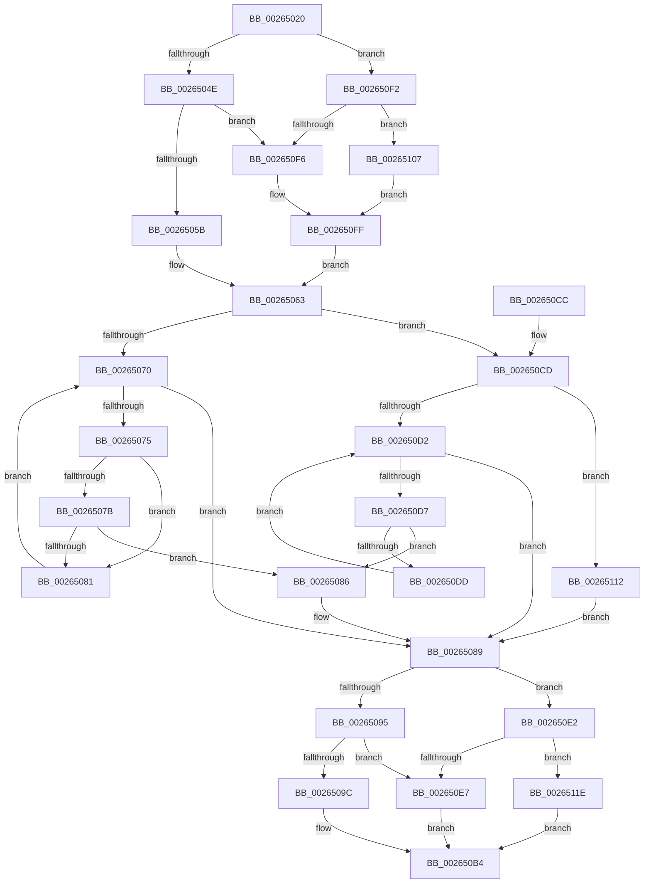

# FsRtlLookupPerStreamContextInternal

- RVA: `0x00265020`–`0x00265129` (길이 `265` bytes)
- VA: `0x0000000140265020`
- 실행 섹션: `.text`
- PDB 이름 있음: `예`; PDB Function 태그: `아니요`
- unwind 정보 RVA: `0x00064A50`
- 디코드: `78`개 명령, `265/265` bytes 표시
- 미해석 바이트: `0` (있으면 어셈블리에 `.byte`로 보존)

> 이 문서는 커널 이미지의 기계어와 PDB 기호를 분석해 생성했습니다. 4번과 5번은 함수 원형과 자료형을 바이너리 사용 방식에서 추정한 C 해석이며 원본 소스 복구 결과는 아닙니다.

## 1. Dependencies

- 직접 호출 지점: **7**; 고유 호출 대상: **7**
- 직접 호출자로 확인된 함수: **0**
- RIP 상대 이미지 참조: **0**

### Outgoing calls
- `0x0026505B` → [FsRtlAcquireAutoExpandPushLockShared](FsRtlAcquireAutoExpandPushLockShared_function_002642D0.md) (function, `0x002642D0`)
- `0x002650A1` → [ExReleaseAutoExpandPushLockShared](ExReleaseAutoExpandPushLockShared_function_00263660.md) (function, `0x00263660`)
- `0x002650AF` → [KeLeaveCriticalRegionThread](../25/KeLeaveCriticalRegionThread_function_0025EFF0.md) (function, `0x0025EFF0`)
- `0x002650EB` → [FsRtlReleasePushLock](FsRtlReleasePushLock_function_00265D7C.md) (function, `0x00265D7C`)
- `0x002650FA` → [FsRtlAcquirePushLockShared](../48/FsRtlAcquirePushLockShared_function_0048B034.md) (function, `0x0048B034`)
- `0x0026510B` → [ExAcquireFastMutex](../20/ExAcquireFastMutex_function_0020E5A0.md) (function, `0x0020E5A0`)
- `0x00265122` → [ExReleaseFastMutex](../25/ExReleaseFastMutex_function_002519C0.md) (function, `0x002519C0`)

### Direct callers
- 이 함수 시작 RVA로 연결되는 직접 call은 확인되지 않았습니다. 간접 호출은 완전히 역산할 수 없습니다.

### Static image references
- 디코드된 RIP-relative 메모리 참조가 없습니다.

## 2. Other-region calls and transfers

- 다른 실행 섹션으로 향하는 call: **0**
- 별도 외부 분기/꼬리 이동을 확인하지 못했습니다.

## 3. Assembly (complete function range)

```asm
00265020  48 89 5C 24 08                  mov qword ptr [rsp + 8], rbx
00265025  48 89 6C 24 10                  mov qword ptr [rsp + 0x10], rbp
0026502A  48 89 74 24 18                  mov qword ptr [rsp + 0x18], rsi
0026502F  57                              push rdi
00265030  48 83 EC 20                     sub rsp, 0x20
00265034  0F B6 41 07                     movzx eax, byte ptr [rcx + 7]
00265038  33 ED                           xor ebp, ebp
0026503A  C0 E8 04                        shr al, 4
0026503D  49 8B F8                        mov rdi, r8
00265040  48 8B F2                        mov rsi, rdx
00265043  48 8B D9                        mov rbx, rcx
00265046  3C 03                           cmp al, 3
00265048  0F 82 A4 00 00 00               jb 0x1402650f2
0026504E  48 8B 49 60                     mov rcx, qword ptr [rcx + 0x60]
00265052  48 85 C9                        test rcx, rcx
00265055  0F 84 9B 00 00 00               je 0x1402650f6
0026505B  E8 70 F2 FF FF                  call 0x1402642d0
00265060  4C 8B C0                        mov r8, rax
00265063  48 8B 43 38                     mov rax, qword ptr [rbx + 0x38]
00265067  48 8D 4B 38                     lea rcx, [rbx + 0x38]
0026506B  48 85 FF                        test rdi, rdi
0026506E  74 5D                           je 0x1402650cd
00265070  48 3B C1                        cmp rax, rcx
00265073  74 14                           je 0x140265089
00265075  48 39 70 10                     cmp qword ptr [rax + 0x10], rsi
00265079  75 06                           jne 0x140265081
0026507B  48 39 78 18                     cmp qword ptr [rax + 0x18], rdi
0026507F  74 05                           je 0x140265086
00265081  48 8B 00                        mov rax, qword ptr [rax]
00265084  EB EA                           jmp 0x140265070
00265086  48 8B E8                        mov rbp, rax
00265089  0F B6 4B 07                     movzx ecx, byte ptr [rbx + 7]
0026508D  C0 E9 04                        shr cl, 4
00265090  80 F9 03                        cmp cl, 3
00265093  72 4D                           jb 0x1402650e2
00265095  48 83 7B 60 00                  cmp qword ptr [rbx + 0x60], 0
0026509A  74 4B                           je 0x1402650e7
0026509C  33 D2                           xor edx, edx
0026509E  49 8B C8                        mov rcx, r8
002650A1  E8 BA E5 FF FF                  call 0x140263660
002650A6  65 48 8B 0C 25 88 01 00 00      mov rcx, qword ptr gs:[0x188]
002650AF  E8 3C 9F FF FF                  call 0x14025eff0
002650B4  48 8B 5C 24 30                  mov rbx, qword ptr [rsp + 0x30]
002650B9  48 8B C5                        mov rax, rbp
002650BC  48 8B 6C 24 38                  mov rbp, qword ptr [rsp + 0x38]
002650C1  48 8B 74 24 40                  mov rsi, qword ptr [rsp + 0x40]
002650C6  48 83 C4 20                     add rsp, 0x20
002650CA  5F                              pop rdi
002650CB  C3                              ret
002650CC  CC                              int3
002650CD  48 85 F6                        test rsi, rsi
002650D0  74 40                           je 0x140265112
002650D2  48 3B C1                        cmp rax, rcx
002650D5  74 B2                           je 0x140265089
002650D7  48 39 70 10                     cmp qword ptr [rax + 0x10], rsi
002650DB  74 A9                           je 0x140265086
002650DD  48 8B 00                        mov rax, qword ptr [rax]
002650E0  EB F0                           jmp 0x1402650d2
002650E2  80 F9 01                        cmp cl, 1
002650E5  72 37                           jb 0x14026511e
002650E7  48 8D 4B 48                     lea rcx, [rbx + 0x48]
002650EB  E8 8C 0C 00 00                  call 0x140265d7c
002650F0  EB C2                           jmp 0x1402650b4
002650F2  3C 01                           cmp al, 1
002650F4  72 11                           jb 0x140265107
002650F6  48 8D 4B 48                     lea rcx, [rbx + 0x48]
002650FA  E8 35 5F 22 00                  call 0x14048b034
002650FF  4C 8B C5                        mov r8, rbp
00265102  E9 5C FF FF FF                  jmp 0x140265063
00265107  48 8B 49 30                     mov rcx, qword ptr [rcx + 0x30]
0026510B  E8 90 94 FA FF                  call 0x14020e5a0
00265110  EB ED                           jmp 0x1402650ff
00265112  48 3B C1                        cmp rax, rcx
00265115  48 0F 45 E8                     cmovne rbp, rax
00265119  E9 6B FF FF FF                  jmp 0x140265089
0026511E  48 8B 4B 30                     mov rcx, qword ptr [rbx + 0x30]
00265122  E8 99 C8 FE FF                  call 0x1402519c0
00265127  EB 8B                           jmp 0x1402650b4
```

## 4. C-style interpretation (structured pseudocode)

```c
__int64 __fastcall FsRtlLookupPerStreamContextInternal(__int64 a1, __int64 a2, __int64 a3)
{
    __int64 result;
    __int64 v_rbp;
    __int64 v_rsp;
    unsigned __int64 v_stack_p10;
    unsigned __int64 v_stack_p18;
    unsigned __int64 v_stack_p8;

    v_stack_p8 = v_rbx;
    v_stack_p10 = v_rbp;
    v_stack_p18 = v_rsi;
    v_rsp = (v_rsp) - (32);
    v_rbp = 0;
    result = (unsigned __int8)((*(unsigned __int8 *)(a1 + 7)) >> (4));
    if (((unsigned __int8)(result)) < 3) goto loc_002650F2;
    if (*(unsigned __int64 *)(a1 + 96) == 0) goto loc_002650F6;
    result = FsRtlAcquireAutoExpandPushLockShared(*(unsigned __int64 *)(a1 + 96), a2, a3, a4);
loc_00265063:
    if (a3 == 0) goto loc_002650CD;
loc_00265070:
    if ((*(unsigned __int64 *)(a1 + 56)) == (a1 + 56)) goto loc_00265089;
    if ((*(unsigned __int64 *)(*(unsigned __int64 *)(a1 + 56) + 16)) != a2) goto loc_00265081;
    if ((*(unsigned __int64 *)(*(unsigned __int64 *)(a1 + 56) + 24)) == a3) goto loc_00265086;
loc_00265081:
    goto loc_00265070;
loc_00265086:
loc_00265089:
    a1 = (unsigned __int8)((*(unsigned __int8 *)(a1 + 7)) >> (4));
    if (((unsigned __int8)(a1)) < 3) goto loc_002650E2;
    if ((*(unsigned __int64 *)(a1 + 96)) == 0) goto loc_002650E7;
    a2 = 0;
    result = ExReleaseAutoExpandPushLockShared(result, a2, result, a4);
    result = KeLeaveCriticalRegionThread(*(unsigned __int64 *)(gs_base + (0 + 392)), a2, result, a4);
loc_002650B4:
    v_rsp = (v_rsp) + (32);
    return *(unsigned __int64 *)(*(unsigned __int64 *)(a1 + 56));
loc_002650CD:
    if (v_stack_p18 == 0) goto loc_00265112;
loc_002650D2:
    if ((*(unsigned __int64 *)(*(unsigned __int64 *)(a1 + 56))) == (*(unsigned __int64 *)(gs_base + (0 + 392)))) goto loc_00265089;
    if ((*(unsigned __int64 *)(*(unsigned __int64 *)(*(unsigned __int64 *)(a1 + 56)) + 16)) == v_stack_p18) goto loc_00265086;
    goto loc_002650D2;
loc_002650E2:
    if (((unsigned __int8)(*(unsigned __int64 *)(gs_base + (0 + 392)))) < 1) goto loc_0026511E;
loc_002650E7:
    result = FsRtlReleasePushLock(v_stack_p8 + 72, a2, result, a4);
    goto loc_002650B4;
loc_002650F2:
    if (((unsigned __int8)(result)) < 1) goto loc_00265107;
loc_002650F6:
    result = FsRtlAcquirePushLockShared(v_stack_p8 + 72, a2, result, a4);
loc_002650FF:
    goto loc_00265063;
loc_00265107:
    result = ExAcquireFastMutex(*(unsigned __int64 *)(v_stack_p8 + 72 + 48), a2, v_stack_p10, a4);
    goto loc_002650FF;
loc_00265112:
    v_rbp = v_stack_p10;
    if (result != (*(unsigned __int64 *)(v_stack_p8 + 72 + 48))) { v_rbp = result; }
    goto loc_00265089;
loc_0026511E:
    result = ExReleaseFastMutex(*(unsigned __int64 *)(v_stack_p8 + 48), a2, v_stack_p10, a4);
    goto loc_002650B4;
}
```

## 5. (Beta) C Style

```c
int64_t FsRtlLookupPerStreamContextInternal(void *Arg1, int64_t Arg2, int64_t Arg3)
{
    uint8_t *arg1 = (uint8_t *)Arg1;

    int64_t result;
    int64_t local_rbp;
    int64_t local_rsp;
    uint64_t v_stack_p10;
    uint64_t v_stack_p18;
    uint64_t v_stack_p8;

    v_stack_p8 = local_rbx;
    v_stack_p10 = local_rbp;
    v_stack_p18 = local_rsi;
    local_rsp = (local_rsp) - (32);
    local_rbp = 0;
    result = (uint8_t)((*(uint8_t *)(arg1 + 0x7)) >> (4));
    if (((uint8_t)(result)) < 3) goto loc_002650F2;
    if (*(uint64_t *)(arg1 + 0x60) == 0) goto loc_002650F6;
    result = FsRtlAcquireAutoExpandPushLockShared(*(uint64_t *)(arg1 + 0x60), Arg2, Arg3, a4);
loc_00265063:
    if (Arg3 == 0) goto loc_002650CD;
loc_00265070:
    if ((*(uint64_t *)(arg1 + 0x38)) == (Arg1 + 56)) goto loc_00265089;
    if ((*(uint64_t *)(*(uint64_t *)(arg1 + 0x38) + 0x10)) != Arg2) goto loc_00265081;
    if ((*(uint64_t *)(*(uint64_t *)(arg1 + 0x38) + 0x18)) == Arg3) goto loc_00265086;
loc_00265081:
    goto loc_00265070;
loc_00265086:
loc_00265089:
    Arg1 = (uint8_t)((*(uint8_t *)(arg1 + 0x7)) >> (4));
    if (((uint8_t)(Arg1)) < 3) goto loc_002650E2;
    if ((*(uint64_t *)(arg1 + 0x60)) == 0) goto loc_002650E7;
    Arg2 = 0;
    result = ExReleaseAutoExpandPushLockShared(result, Arg2, result, a4);
    result = KeLeaveCriticalRegionThread(*(uint64_t *)(gs_base + (0 + 0x188)), Arg2, result, a4);
loc_002650B4:
    local_rsp = (local_rsp) + (32);
    return *(uint64_t *)(*(uint64_t *)(arg1 + 0x38));
loc_002650CD:
    if (v_stack_p18 == 0) goto loc_00265112;
loc_002650D2:
    if ((*(uint64_t *)(*(uint64_t *)(arg1 + 0x38))) == (*(uint64_t *)(gs_base + (0 + 0x188)))) goto loc_00265089;
    if ((*(uint64_t *)(*(uint64_t *)(*(uint64_t *)(arg1 + 0x38)) + 0x10)) == v_stack_p18) goto loc_00265086;
    goto loc_002650D2;
loc_002650E2:
    if (((uint8_t)(*(uint64_t *)(gs_base + (0 + 0x188)))) < 1) goto loc_0026511E;
loc_002650E7:
    result = FsRtlReleasePushLock(v_stack_p8 + 72, Arg2, result, a4);
    goto loc_002650B4;
loc_002650F2:
    if (((uint8_t)(result)) < 1) goto loc_00265107;
loc_002650F6:
    result = FsRtlAcquirePushLockShared(v_stack_p8 + 72, Arg2, result, a4);
loc_002650FF:
    goto loc_00265063;
loc_00265107:
    result = ExAcquireFastMutex(*(uint64_t *)(v_stack_p8 + 0x48 + 0x30), Arg2, v_stack_p10, a4);
    goto loc_002650FF;
loc_00265112:
    local_rbp = v_stack_p10;
    if (result != (*(uint64_t *)(v_stack_p8 + 0x48 + 0x30))) { local_rbp = result; }
    goto loc_00265089;
loc_0026511E:
    result = ExReleaseFastMutex(*(uint64_t *)(v_stack_p8 + 0x30), Arg2, v_stack_p10, a4);
    goto loc_002650B4;
}
```

### 관측된 메모리 오프셋

구조체 형식이 확인되지 않은 접근은 인자 기준의 오프셋으로만 기록했습니다.

| 기준 인자 | 오프셋 표현 | 폭 (bit) | 접근 |
|---|---:|---:|---|
| `Arg1` | `+ 0x7` | `8` | `R` |
| `Arg1` | `+ 0x30` | `64` | `R` |
| `Arg1` | `+ 0x38` | `64` | `R` |
| `Arg1` | `+ 0x48` | `64` | `R` |
| `Arg1` | `+ 0x60` | `64` | `R` |

## 6. Execution-region graph

[열기: 2D/3D 그래프와 함수 탐색 컨트롤 패널](../../../control-panel.html?section=text&rva=0x00265020&view=graph)

- 2D 그래프는 위에서 아래로 흐르고, 3D 그래프는 빈 공간을 드래그해 회전합니다. Shift+드래그는 이동, 휠은 확대·축소, 함수 노드 선택은 대상 보고서 이동입니다.

### Static fallback


