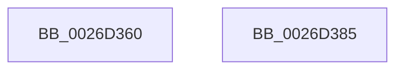

# FsRtlNormalizeNtstatus

- RVA: `0x0026D360`–`0x0026D386` (길이 `38` bytes)
- VA: `0x000000014026D360`
- 실행 섹션: `.text`
- PDB 이름 있음: `예`; PDB Function 태그: `아니요`
- unwind 정보 RVA: `0x0005CAAC`
- 디코드: `14`개 명령, `38/38` bytes 표시
- 미해석 바이트: `0` (있으면 어셈블리에 `.byte`로 보존)

> 이 문서는 커널 이미지의 기계어와 PDB 기호를 분석해 생성했습니다. 4번과 5번은 함수 원형과 자료형을 바이너리 사용 방식에서 추정한 C 해석이며 원본 소스 복구 결과는 아닙니다.

## 1. Dependencies

- 직접 호출 지점: **1**; 고유 호출 대상: **1**
- 직접 호출자로 확인된 함수: **0**
- RIP 상대 이미지 참조: **0**

### Outgoing calls
- `0x0026D36E` → [FsRtlIsNtstatusExpected](FsRtlIsNtstatusExpected_function_0026D390.md) (function, `0x0026D390`)

### Direct callers
- 이 함수 시작 RVA로 연결되는 직접 call은 확인되지 않았습니다. 간접 호출은 완전히 역산할 수 없습니다.

### Static image references
- 디코드된 RIP-relative 메모리 참조가 없습니다.

## 2. Other-region calls and transfers

- 다른 실행 섹션으로 향하는 call: **0**
- 별도 외부 분기/꼬리 이동을 확인하지 못했습니다.

## 3. Assembly (complete function range)

```asm
0026D360  48 89 5C 24 08                  mov qword ptr [rsp + 8], rbx
0026D365  57                              push rdi
0026D366  48 83 EC 20                     sub rsp, 0x20
0026D36A  8B DA                           mov ebx, edx
0026D36C  8B F9                           mov edi, ecx
0026D36E  E8 1D 00 00 00                  call 0x14026d390
0026D373  84 C0                           test al, al
0026D375  0F 44 FB                        cmove edi, ebx
0026D378  48 8B 5C 24 30                  mov rbx, qword ptr [rsp + 0x30]
0026D37D  8B C7                           mov eax, edi
0026D37F  48 83 C4 20                     add rsp, 0x20
0026D383  5F                              pop rdi
0026D384  C3                              ret
0026D385  CC                              int3
```

## 4. C-style interpretation (structured pseudocode)

```c
__int64 __fastcall FsRtlNormalizeNtstatus(int a1, int a2)
{
    __int64 result;
    __int64 v_rdi;
    __int64 v_rsp;
    unsigned __int64 v_stack_p8;

    v_stack_p8 = v_rbx;
    v_rsp = (v_rsp) - (32);
    result = FsRtlIsNtstatusExpected(a1, a2, a3, a4);
    v_rdi = (unsigned int)(a1);
    if ((unsigned __int8)(result) == 0) { v_rdi = (unsigned int)((unsigned int)(a2)); }
    v_rsp = (v_rsp) + (32);
    return (unsigned int)((unsigned int)(v_rdi));
}
```

## 5. (Beta) C Style

```c
int64_t FsRtlNormalizeNtstatus(int32_t Arg1, int32_t Arg2)
{
    int64_t result;
    int64_t local_rdi;
    int64_t local_rsp;
    uint64_t v_stack_p8;

    v_stack_p8 = local_rbx;
    local_rsp = (local_rsp) - (32);
    result = FsRtlIsNtstatusExpected(Arg1, Arg2, a3, a4);
    local_rdi = (uint32_t)(Arg1);
    if ((uint8_t)(result) == 0) { local_rdi = (uint32_t)((uint32_t)(Arg2)); }
    local_rsp = (local_rsp) + (32);
    return (uint32_t)((uint32_t)(local_rdi));
}
```

## 6. Execution-region graph

[열기: 2D/3D 그래프와 함수 탐색 컨트롤 패널](../../../control-panel.html?section=text&rva=0x0026D360&view=graph)

- 2D 그래프는 위에서 아래로 흐르고, 3D 그래프는 빈 공간을 드래그해 회전합니다. Shift+드래그는 이동, 휠은 확대·축소, 함수 노드 선택은 대상 보고서 이동입니다.

### Static fallback


