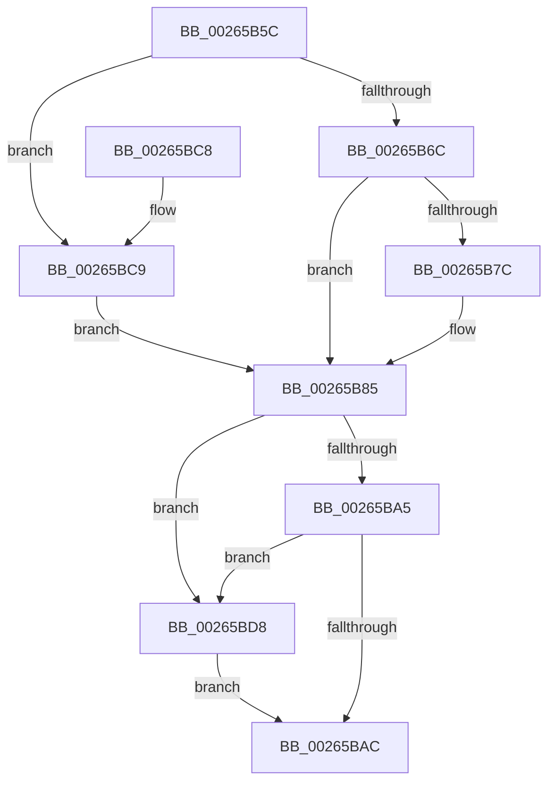

# FsRtlReleaseAutoExpandPushLockExclusive

- RVA: `0x00265B5C`–`0x00265BE2` (길이 `134` bytes)
- VA: `0x0000000140265B5C`
- 실행 섹션: `.text`
- PDB 이름 있음: `예`; PDB Function 태그: `아니요`
- unwind 정보 RVA: `0x00064C68`
- 디코드: `41`개 명령, `134/134` bytes 표시
- 미해석 바이트: `0` (있으면 어셈블리에 `.byte`로 보존)

> 이 문서는 커널 이미지의 기계어와 PDB 기호를 분석해 생성했습니다. 4번과 5번은 함수 원형과 자료형을 바이너리 사용 방식에서 추정한 C 해석이며 원본 소스 복구 결과는 아닙니다.

## 1. Dependencies

- 직접 호출 지점: **4**; 고유 호출 대상: **4**
- 직접 호출자로 확인된 함수: **10**
- RIP 상대 이미지 참조: **0**

### Outgoing calls
- `0x00265BAF` → [KeAbPostRelease](../2E/KeAbPostRelease_function_002E1600.md) (function, `0x002E1600`)
- `0x00265BBD` → [KeLeaveCriticalRegionThread](../25/KeLeaveCriticalRegionThread_function_0025EFF0.md) (function, `0x0025EFF0`)
- `0x00265BD1` → [ExpReleaseFannedOutPushLockExclusive](ExpReleaseFannedOutPushLockExclusive_function_00264F74.md) (function, `0x00264F74`)
- `0x00265BDB` → [ExfReleasePushLock](ExfReleasePushLock_function_002638D0.md) (function, `0x002638D0`)

### Direct callers
- [sub_0026515E](Unknown_function_0026515E.md) at `0x0026520A`
- [sub_002652E5](Unknown_function_002652E5.md) at `0x00265343`
- [FsRtlInsertPerStreamContext](FsRtlInsertPerStreamContext_function_00265F70.md) at `0x00265FE6`
- [FsRtlRemovePerStreamContext](FsRtlRemovePerStreamContext_function_00267760.md) at `0x0026780E`
- [FsRtlInsertPerFileContextWithReserve](../46/FsRtlInsertPerFileContextWithReserve_function_004657F0.md) at `0x004658FB`
- [FsRtlRemovePerFileContext](../58/FsRtlRemovePerFileContext_function_00581670.md) at `0x0058170A`
- [FsRtlTeardownPerStreamContexts](../../page/9A/FsRtlTeardownPerStreamContexts_function_009A5CD0.md) at `0x009A5D85`
- [FsRtlTeardownPerStreamContexts](../../page/9A/FsRtlTeardownPerStreamContexts_function_009A5CD0.md) at `0x009A5E18`
- [FsRtlTeardownPerFileContexts](../../page/A0/FsRtlTeardownPerFileContexts_function_00A0CDD0.md) at `0x00A0CE4D`
- [FsRtlTeardownPerFileContexts](../../page/A0/FsRtlTeardownPerFileContexts_function_00A0CDD0.md) at `0x00A0CE7C`
- [FsRtlTeardownPerStreamContexts$fin$0](../../page/B1/FsRtlTeardownPerStreamContexts_fin_0_function_00B10280.md) at `0x00B102A8`
- [FsRtlTeardownPerFileContexts$fin$0](../../page/B1/FsRtlTeardownPerFileContexts_fin_0_function_00B11048.md) at `0x00B1105B`

### Static image references
- 디코드된 RIP-relative 메모리 참조가 없습니다.

## 2. Other-region calls and transfers

- 다른 실행 섹션으로 향하는 call: **0**
- 별도 외부 분기/꼬리 이동을 확인하지 못했습니다.

## 3. Assembly (complete function range)

```asm
00265B5C  40 53                           push rbx
00265B5E  48 83 EC 20                     sub rsp, 0x20
00265B62  8B 41 08                        mov eax, dword ptr [rcx + 8]
00265B65  48 8B D9                        mov rbx, rcx
00265B68  A8 01                           test al, 1
00265B6A  75 5D                           jne 0x140265bc9
00265B6C  8B 49 0C                        mov ecx, dword ptr [rcx + 0xc]
00265B6F  BA 00 00 0F 00                  mov edx, 0xf0000
00265B74  8B C1                           mov eax, ecx
00265B76  23 C2                           and eax, edx
00265B78  3B C2                           cmp eax, edx
00265B7A  73 09                           jae 0x140265b85
00265B7C  81 C1 00 00 01 00               add ecx, 0x10000
00265B82  89 4B 0C                        mov dword ptr [rbx + 0xc], ecx
00265B85  0F 0D 0B                        prefetchw byte ptr [rbx]
00265B88  48 8B 03                        mov rax, qword ptr [rbx]
00265B8B  45 33 C0                        xor r8d, r8d
00265B8E  48 8B C8                        mov rcx, rax
00265B91  48 83 E1 F0                     and rcx, 0xfffffffffffffff0
00265B95  48 83 F9 10                     cmp rcx, 0x10
00265B99  48 8D 50 F0                     lea rdx, [rax - 0x10]
00265B9D  49 0F 46 D0                     cmovbe rdx, r8
00265BA1  A8 02                           test al, 2
00265BA3  75 33                           jne 0x140265bd8
00265BA5  F0 48 0F B1 13                  lock cmpxchg qword ptr [rbx], rdx
00265BAA  75 2C                           jne 0x140265bd8
00265BAC  48 8B CB                        mov rcx, rbx
00265BAF  E8 4C BA 07 00                  call 0x1402e1600
00265BB4  65 48 8B 0C 25 88 01 00 00      mov rcx, qword ptr gs:[0x188]
00265BBD  E8 2E 94 FF FF                  call 0x14025eff0
00265BC2  48 83 C4 20                     add rsp, 0x20
00265BC6  5B                              pop rbx
00265BC7  C3                              ret
00265BC8  CC                              int3
00265BC9  B9 F8 FF FF FF                  mov ecx, 0xfffffff8
00265BCE  48 23 C8                        and rcx, rax
00265BD1  E8 9E F3 FF FF                  call 0x140264f74
00265BD6  EB AD                           jmp 0x140265b85
00265BD8  48 8B CB                        mov rcx, rbx
00265BDB  E8 F0 DC FF FF                  call 0x1402638d0
00265BE0  EB CA                           jmp 0x140265bac
```

## 4. C-style interpretation (structured pseudocode)

```c
__int64 __fastcall FsRtlReleaseAutoExpandPushLockExclusive(__int64 a1, __int64 a2, int a3)
{
    __int64 result;
    __int64 v_rsp;

    v_rsp = (v_rsp) - (32);
    if ((((unsigned __int8)((unsigned int)(*(unsigned int *)(a1 + 8)))) & (1)) != 0) goto loc_00265BC9;
    result = (unsigned int)(((unsigned int)((unsigned int)((unsigned int)(*(unsigned int *)(a1 + 12))))) & ((unsigned int)((unsigned int)(0xF0000ULL))));
    if (((unsigned int)(result)) < ((unsigned int)((unsigned int)(0xF0000ULL)))) {
        a1 = (unsigned int)(((unsigned int)(*(unsigned int *)(a1 + 12))) + (0x10000ULL));
        *(unsigned int *)(a1 + 12) = (unsigned int)(a1);
    }
    a3 = 0;
    a1 = (*(unsigned __int64 *)(a1)) & (-16);
    a2 = *(unsigned __int64 *)(a1) - 16;
    if (a1 <= 16) { a2 = 0; }
    if ((((unsigned __int8)(*(unsigned __int64 *)(a1))) & (2)) != 0) goto loc_00265BD8;
    if ((((unsigned __int8)(*(unsigned __int64 *)(a1))) & (2)) != 0) goto loc_00265BD8;
loc_00265BAC:
    result = KeAbPostRelease(a1, a2, a3, a4);
    result = KeLeaveCriticalRegionThread(*(unsigned __int64 *)(gs_base + (0 + 392)), a2, a3, a4);
    v_rsp = (v_rsp) + (32);
    return result;
loc_00265BC9:
    a1 = ((unsigned int)(0xFFFFFFF8ULL)) & (result);
    result = ExpReleaseFannedOutPushLockExclusive(a1, a2, a3, a4);
    goto loc_00265B85;
loc_00265BD8:
    result = ExfReleasePushLock(a1, a2, a3, a4);
    goto loc_00265BAC;
}
```

## 5. (Beta) C Style

```c
int64_t FsRtlReleaseAutoExpandPushLockExclusive(void *Arg1, int64_t Arg2, int32_t Arg3)
{
    uint8_t *arg1 = (uint8_t *)Arg1;

    int64_t result;
    int64_t local_rsp;

    local_rsp = (local_rsp) - (32);
    if ((((uint8_t)((uint32_t)(*(uint32_t *)(arg1 + 0x8)))) & (1)) != 0) goto loc_00265BC9;
    result = (uint32_t)(((uint32_t)((uint32_t)((uint32_t)(*(uint32_t *)(arg1 + 0xC))))) & ((uint32_t)((uint32_t)(0xF0000ULL))));
    if (((uint32_t)(result)) < ((uint32_t)((uint32_t)(0xF0000ULL)))) {
        Arg1 = (uint32_t)(((uint32_t)(*(uint32_t *)(arg1 + 0xC))) + (0x10000ULL));
        *(uint32_t *)(arg1 + 0xC) = (uint32_t)(Arg1);
    }
    Arg3 = 0;
    Arg1 = (*(uint64_t *)(arg1)) & (-16);
    Arg2 = *(uint64_t *)(arg1) - 16;
    if (Arg1 <= 16) { Arg2 = 0; }
    if ((((uint8_t)(*(uint64_t *)(arg1))) & (2)) != 0) goto loc_00265BD8;
    if ((((uint8_t)(*(uint64_t *)(arg1))) & (2)) != 0) goto loc_00265BD8;
loc_00265BAC:
    result = KeAbPostRelease(Arg1, Arg2, Arg3, a4);
    result = KeLeaveCriticalRegionThread(*(uint64_t *)(gs_base + (0 + 0x188)), Arg2, Arg3, a4);
    local_rsp = (local_rsp) + (32);
    return result;
loc_00265BC9:
    Arg1 = ((uint32_t)(0xFFFFFFF8ULL)) & (result);
    result = ExpReleaseFannedOutPushLockExclusive(Arg1, Arg2, Arg3, a4);
    goto loc_00265B85;
loc_00265BD8:
    result = ExfReleasePushLock(Arg1, Arg2, Arg3, a4);
    goto loc_00265BAC;
}
```

### 관측된 메모리 오프셋

구조체 형식이 확인되지 않은 접근은 인자 기준의 오프셋으로만 기록했습니다.

| 기준 인자 | 오프셋 표현 | 폭 (bit) | 접근 |
|---|---:|---:|---|
| `Arg1` | `+ 0x0` | `8` | `R` |
| `Arg1` | `+ 0x0` | `64` | `R` |
| `Arg1` | `+ 0x8` | `32` | `R` |
| `Arg1` | `+ 0xC` | `32` | `R` |
| `Arg1` | `+ 0xC` | `32` | `W` |

## 6. Execution-region graph

[열기: 2D/3D 그래프와 함수 탐색 컨트롤 패널](../../../control-panel.html?section=text&rva=0x00265B5C&view=graph)

- 2D 그래프는 위에서 아래로 흐르고, 3D 그래프는 빈 공간을 드래그해 회전합니다. Shift+드래그는 이동, 휠은 확대·축소, 함수 노드 선택은 대상 보고서 이동입니다.

### Static fallback


