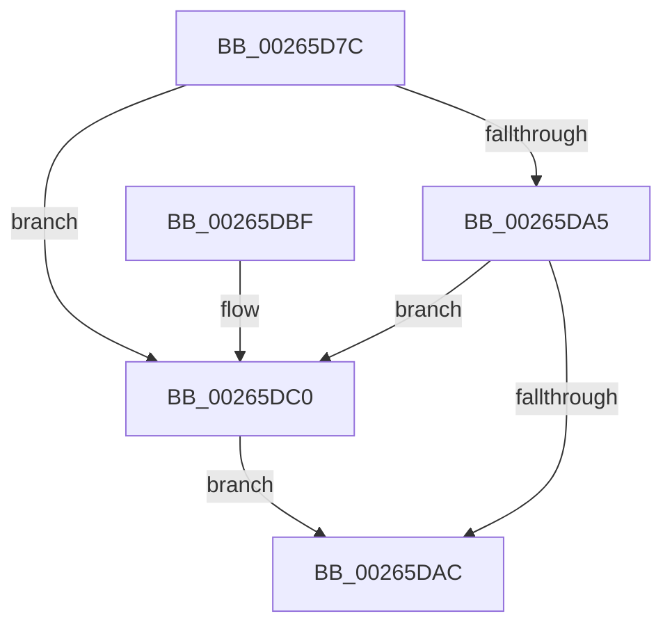

# FsRtlReleasePushLock

- RVA: `0x00265D7C`–`0x00265DCA` (길이 `78` bytes)
- VA: `0x0000000140265D7C`
- 실행 섹션: `.text`
- PDB 이름 있음: `예`; PDB Function 태그: `아니요`
- unwind 정보 RVA: `0x00064CA8`
- 디코드: `25`개 명령, `78/78` bytes 표시
- 미해석 바이트: `0` (있으면 어셈블리에 `.byte`로 보존)

> 이 문서는 커널 이미지의 기계어와 PDB 기호를 분석해 생성했습니다. 4번과 5번은 함수 원형과 자료형을 바이너리 사용 방식에서 추정한 C 해석이며 원본 소스 복구 결과는 아닙니다.

## 1. Dependencies

- 직접 호출 지점: **3**; 고유 호출 대상: **3**
- 직접 호출자로 확인된 함수: **5**
- RIP 상대 이미지 참조: **0**

### Outgoing calls
- `0x00265DAF` → [KeAbPostRelease](../2E/KeAbPostRelease_function_002E1600.md) (function, `0x002E1600`)
- `0x00265DB4` → [KeLeaveCriticalRegion](../25/KeLeaveCriticalRegion_function_0025D8B0.md) (function, `0x0025D8B0`)
- `0x00265DC3` → [ExfReleasePushLock](ExfReleasePushLock_function_002638D0.md) (function, `0x002638D0`)

### Direct callers
- [FsRtlLookupPerStreamContextInternal](FsRtlLookupPerStreamContextInternal_function_00265020.md) at `0x002650EB`
- [FsRtlInsertPerStreamContext](FsRtlInsertPerStreamContext_function_00265F70.md) at `0x00266006`
- [FsRtlRemovePerStreamContext](FsRtlRemovePerStreamContext_function_00267760.md) at `0x0026784F`
- [FsRtlTeardownPerStreamContexts](../../page/9A/FsRtlTeardownPerStreamContexts_function_009A5CD0.md) at `0x009A5DD9`
- [FsRtlTeardownPerStreamContexts](../../page/9A/FsRtlTeardownPerStreamContexts_function_009A5CD0.md) at `0x009A5E4E`
- [FsRtlTeardownPerStreamContexts$fin$0](../../page/B1/FsRtlTeardownPerStreamContexts_fin_0_function_00B10280.md) at `0x00B102BD`

### Static image references
- 디코드된 RIP-relative 메모리 참조가 없습니다.

## 2. Other-region calls and transfers

- 다른 실행 섹션으로 향하는 call: **0**
- 별도 외부 분기/꼬리 이동을 확인하지 못했습니다.

## 3. Assembly (complete function range)

```asm
00265D7C  40 53                           push rbx
00265D7E  48 83 EC 20                     sub rsp, 0x20
00265D82  48 8B D9                        mov rbx, rcx
00265D85  0F 0D 09                        prefetchw byte ptr [rcx]
00265D88  48 8B 01                        mov rax, qword ptr [rcx]
00265D8B  45 33 C0                        xor r8d, r8d
00265D8E  48 8B D0                        mov rdx, rax
00265D91  48 83 E2 F0                     and rdx, 0xfffffffffffffff0
00265D95  48 83 FA 10                     cmp rdx, 0x10
00265D99  48 8D 48 F0                     lea rcx, [rax - 0x10]
00265D9D  49 0F 46 C8                     cmovbe rcx, r8
00265DA1  A8 02                           test al, 2
00265DA3  75 1B                           jne 0x140265dc0
00265DA5  F0 48 0F B1 0B                  lock cmpxchg qword ptr [rbx], rcx
00265DAA  75 14                           jne 0x140265dc0
00265DAC  48 8B CB                        mov rcx, rbx
00265DAF  E8 4C B8 07 00                  call 0x1402e1600
00265DB4  E8 F7 7A FF FF                  call 0x14025d8b0
00265DB9  48 83 C4 20                     add rsp, 0x20
00265DBD  5B                              pop rbx
00265DBE  C3                              ret
00265DBF  CC                              int3
00265DC0  48 8B CB                        mov rcx, rbx
00265DC3  E8 08 DB FF FF                  call 0x1402638d0
00265DC8  EB E2                           jmp 0x140265dac
```

## 4. C-style interpretation (structured pseudocode)

```c
__int64 __fastcall FsRtlReleasePushLock(__int64 a1, __int64 a2, int a3)
{
    __int64 result;
    __int64 v_rsp;

    v_rsp = (v_rsp) - (32);
    a3 = 0;
    a2 = (*(unsigned __int64 *)(a1)) & (-16);
    a1 = *(unsigned __int64 *)(a1) - 16;
    if (a2 <= 16) { a1 = 0; }
    if ((((unsigned __int8)(*(unsigned __int64 *)(a1))) & (2)) != 0) goto loc_00265DC0;
    if ((((unsigned __int8)(*(unsigned __int64 *)(a1))) & (2)) != 0) goto loc_00265DC0;
loc_00265DAC:
    result = KeAbPostRelease(a1, a2, a3, a4);
    result = KeLeaveCriticalRegion(a1, a2, a3, a4);
    v_rsp = (v_rsp) + (32);
    return result;
loc_00265DC0:
    result = ExfReleasePushLock(a1, a2, a3, a4);
    goto loc_00265DAC;
}
```

## 5. (Beta) C Style

```c
int64_t FsRtlReleasePushLock(void *Arg1, int64_t Arg2, int32_t Arg3)
{
    uint8_t *arg1 = (uint8_t *)Arg1;

    int64_t result;
    int64_t local_rsp;

    local_rsp = (local_rsp) - (32);
    Arg3 = 0;
    Arg2 = (*(uint64_t *)(arg1)) & (-16);
    Arg1 = *(uint64_t *)(arg1) - 16;
    if (Arg2 <= 16) { Arg1 = 0; }
    if ((((uint8_t)(*(uint64_t *)(arg1))) & (2)) != 0) goto loc_00265DC0;
    if ((((uint8_t)(*(uint64_t *)(arg1))) & (2)) != 0) goto loc_00265DC0;
loc_00265DAC:
    result = KeAbPostRelease(Arg1, Arg2, Arg3, a4);
    result = KeLeaveCriticalRegion(Arg1, Arg2, Arg3, a4);
    local_rsp = (local_rsp) + (32);
    return result;
loc_00265DC0:
    result = ExfReleasePushLock(Arg1, Arg2, Arg3, a4);
    goto loc_00265DAC;
}
```

### 관측된 메모리 오프셋

구조체 형식이 확인되지 않은 접근은 인자 기준의 오프셋으로만 기록했습니다.

| 기준 인자 | 오프셋 표현 | 폭 (bit) | 접근 |
|---|---:|---:|---|
| `Arg1` | `+ 0x0` | `8` | `R` |
| `Arg1` | `+ 0x0` | `64` | `R` |

## 6. Execution-region graph

[열기: 2D/3D 그래프와 함수 탐색 컨트롤 패널](../../../control-panel.html?section=text&rva=0x00265D7C&view=graph)

- 2D 그래프는 위에서 아래로 흐르고, 3D 그래프는 빈 공간을 드래그해 회전합니다. Shift+드래그는 이동, 휠은 확대·축소, 함수 노드 선택은 대상 보고서 이동입니다.

### Static fallback


