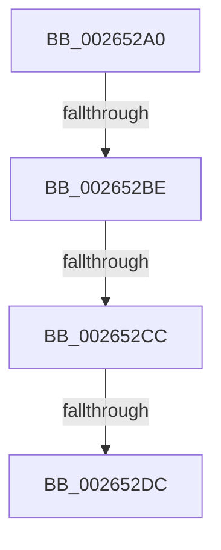

# FsRtlRemovePerFileObjectContext

- RVA: `0x002652A0`–`0x002652E5` (길이 `69` bytes)
- VA: `0x00000001402652A0`
- 실행 섹션: `.text`
- PDB 이름 있음: `예`; PDB Function 태그: `예`
- unwind 정보 RVA: `0x00064AFC`
- 디코드: `16`개 명령, `69/69` bytes 표시
- 미해석 바이트: `0` (있으면 어셈블리에 `.byte`로 보존)

> 이 문서는 커널 이미지의 기계어와 PDB 기호를 분석해 생성했습니다. 4번과 5번은 함수 원형과 자료형을 바이너리 사용 방식에서 추정한 C 해석이며 원본 소스 복구 결과는 아닙니다.

## 1. Dependencies

- 직접 호출 지점: **0**; 고유 호출 대상: **0**
- 직접 호출자로 확인된 함수: **0**
- RIP 상대 이미지 참조: **0**

### Outgoing calls
- 직접 디코드된 call 명령이 없습니다.

### Direct callers
- 이 함수 시작 RVA로 연결되는 직접 call은 확인되지 않았습니다. 간접 호출은 완전히 역산할 수 없습니다.

### Static image references
- 디코드된 RIP-relative 메모리 참조가 없습니다.

## 2. Other-region calls and transfers

- 다른 실행 섹션으로 향하는 call: **0**
- call이 아닌 외부 분기/꼬리 이동: **4**
  - `0x002652B8` → [sub_00265360 + 0x1](Unknown_function_00265360.md) (`tail-transfer`)
  - `0x002652C6` → [sub_00265360 + 0x1](Unknown_function_00265360.md) (`tail-transfer`)
  - `0x002652D6` → [sub_00265360 + 0x1](Unknown_function_00265360.md) (`tail-transfer`)
  - `0x002652E3` → [sub_00265360 + 0x1](Unknown_function_00265360.md) (`tail-transfer`)

## 3. Assembly (complete function range)

```asm
002652A0  48 89 6C 24 10                  mov qword ptr [rsp + 0x10], rbp
002652A5  48 89 74 24 18                  mov qword ptr [rsp + 0x18], rsi
002652AA  57                              push rdi
002652AB  48 83 EC 20                     sub rsp, 0x20
002652AF  49 8B E8                        mov rbp, r8
002652B2  48 8B F2                        mov rsi, rdx
002652B5  48 85 C9                        test rcx, rcx
002652B8  0F 84 A3 00 00 00               je 0x140265361
002652BE  48 83 B9 D0 00 00 00 00         cmp qword ptr [rcx + 0xd0], 0
002652C6  0F 84 95 00 00 00               je 0x140265361
002652CC  48 8B B9 D0 00 00 00            mov rdi, qword ptr [rcx + 0xd0]
002652D3  48 85 FF                        test rdi, rdi
002652D6  0F 84 85 00 00 00               je 0x140265361
002652DC  48 8B 7F 20                     mov rdi, qword ptr [rdi + 0x20]
002652E0  48 85 FF                        test rdi, rdi
002652E3  74 7C                           je 0x140265361
```

## 4. C-style interpretation (structured pseudocode)

```c
void __fastcall FsRtlRemovePerFileObjectContext(__int64 a1, __int64 a2, __int64 a3)
{
    __int64 v_rsp;
    unsigned __int64 v_stack_p10;
    unsigned __int64 v_stack_p18;

    v_stack_p10 = v_rbp;
    v_stack_p18 = v_rsi;
    v_rsp = (v_rsp) - (32);
}
```

## 5. (Beta) C Style

```c
void FsRtlRemovePerFileObjectContext(int64_t Arg1, int64_t Arg2, int64_t Arg3)
{
    int64_t local_rsp;
    uint64_t v_stack_p10;
    uint64_t v_stack_p18;

    v_stack_p10 = local_rbp;
    v_stack_p18 = local_rsi;
    local_rsp = (local_rsp) - (32);
}
```

## 6. Execution-region graph

[열기: 2D/3D 그래프와 함수 탐색 컨트롤 패널](../../../control-panel.html?section=text&rva=0x002652A0&view=graph)

- 2D 그래프는 위에서 아래로 흐르고, 3D 그래프는 빈 공간을 드래그해 회전합니다. Shift+드래그는 이동, 휠은 확대·축소, 함수 노드 선택은 대상 보고서 이동입니다.

### Static fallback


