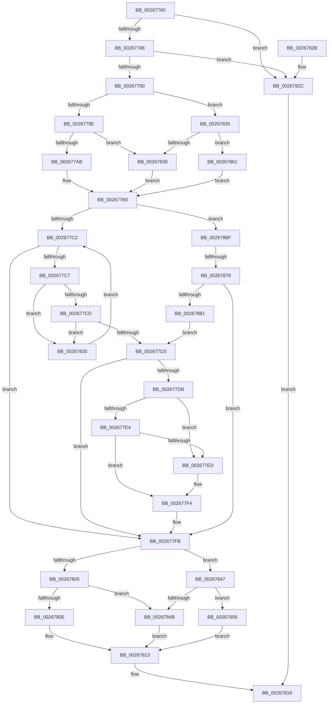

# FsRtlRemovePerStreamContext

- RVA: `0x00267760`–`0x00267886` (길이 `294` bytes)
- VA: `0x0000000140267760`
- 실행 섹션: `.text`
- PDB 이름 있음: `예`; PDB Function 태그: `예`
- unwind 정보 RVA: `0x00065050`
- 디코드: `85`개 명령, `294/294` bytes 표시
- 미해석 바이트: `0` (있으면 어셈블리에 `.byte`로 보존)

> 이 문서는 커널 이미지의 기계어와 PDB 기호를 분석해 생성했습니다. 4번과 5번은 함수 원형과 자료형을 바이너리 사용 방식에서 추정한 C 해석이며 원본 소스 복구 결과는 아닙니다.

## 1. Dependencies

- 직접 호출 지점: **6**; 고유 호출 대상: **6**
- 직접 호출자로 확인된 함수: **0**
- RIP 상대 이미지 참조: **0**

### Outgoing calls
- `0x002677AB` → [FsRtlAcquireAutoExpandPushLockExclusive](FsRtlAcquireAutoExpandPushLockExclusive_function_0026539C.md) (function, `0x0026539C`)
- `0x0026780E` → [FsRtlReleaseAutoExpandPushLockExclusive](FsRtlReleaseAutoExpandPushLockExclusive_function_00265B5C.md) (function, `0x00265B5C`)
- `0x0026783D` → [FsRtlAcquirePushLockExclusive](../4A/FsRtlAcquirePushLockExclusive_function_004A05F4.md) (function, `0x004A05F4`)
- `0x0026784F` → [FsRtlReleasePushLock](FsRtlReleasePushLock_function_00265D7C.md) (function, `0x00265D7C`)
- `0x0026785A` → [ExReleaseFastMutex](../25/ExReleaseFastMutex_function_002519C0.md) (function, `0x002519C0`)
- `0x00267865` → [ExAcquireFastMutex](../20/ExAcquireFastMutex_function_0020E5A0.md) (function, `0x0020E5A0`)

### Direct callers
- 이 함수 시작 RVA로 연결되는 직접 call은 확인되지 않았습니다. 간접 호출은 완전히 역산할 수 없습니다.

### Static image references
- 디코드된 RIP-relative 메모리 참조가 없습니다.

## 2. Other-region calls and transfers

- 다른 실행 섹션으로 향하는 call: **0**
- call이 아닌 외부 분기/꼬리 이동: **1**
  - `0x00267872` → [sub_006D8F9A](../6D/Unknown_function_006D8F9A.md) (`tail-transfer`)

## 3. Assembly (complete function range)

```asm
00267760  48 89 5C 24 08                  mov qword ptr [rsp + 8], rbx
00267765  48 89 6C 24 10                  mov qword ptr [rsp + 0x10], rbp
0026776A  48 89 74 24 18                  mov qword ptr [rsp + 0x18], rsi
0026776F  57                              push rdi
00267770  48 83 EC 20                     sub rsp, 0x20
00267774  49 8B E8                        mov rbp, r8
00267777  48 8B F2                        mov rsi, rdx
0026777A  48 8B D9                        mov rbx, rcx
0026777D  48 85 C9                        test rcx, rcx
00267780  0F 84 A6 00 00 00               je 0x14026782c
00267786  F6 41 06 02                     test byte ptr [rcx + 6], 2
0026778A  0F 84 9C 00 00 00               je 0x14026782c
00267790  8A 41 07                        mov al, byte ptr [rcx + 7]
00267793  C0 E8 04                        shr al, 4
00267796  3C 03                           cmp al, 3
00267798  0F 82 97 00 00 00               jb 0x140267835
0026779E  48 8B 49 60                     mov rcx, qword ptr [rcx + 0x60]
002677A2  48 85 C9                        test rcx, rcx
002677A5  0F 84 8E 00 00 00               je 0x140267839
002677AB  E8 EC DB FF FF                  call 0x14026539c
002677B0  33 FF                           xor edi, edi
002677B2  48 8D 4B 38                     lea rcx, [rbx + 0x38]
002677B6  48 8B 01                        mov rax, qword ptr [rcx]
002677B9  48 85 ED                        test rbp, rbp
002677BC  0F 84 AD 00 00 00               je 0x14026786f
002677C2  48 3B C1                        cmp rax, rcx
002677C5  74 34                           je 0x1402677fb
002677C7  48 39 70 10                     cmp qword ptr [rax + 0x10], rsi
002677CB  75 63                           jne 0x140267830
002677CD  48 39 68 18                     cmp qword ptr [rax + 0x18], rbp
002677D1  75 5D                           jne 0x140267830
002677D3  48 8B F8                        mov rdi, rax
002677D6  48 85 C0                        test rax, rax
002677D9  74 20                           je 0x1402677fb
002677DB  48 8B 08                        mov rcx, qword ptr [rax]
002677DE  48 39 41 08                     cmp qword ptr [rcx + 8], rax
002677E2  75 09                           jne 0x1402677ed
002677E4  48 8B 40 08                     mov rax, qword ptr [rax + 8]
002677E8  48 39 38                        cmp qword ptr [rax], rdi
002677EB  74 07                           je 0x1402677f4
002677ED  B9 03 00 00 00                  mov ecx, 3
002677F2  CD 29                           int 0x29
002677F4  48 89 08                        mov qword ptr [rax], rcx
002677F7  48 89 41 08                     mov qword ptr [rcx + 8], rax
002677FB  8A 43 07                        mov al, byte ptr [rbx + 7]
002677FE  C0 E8 04                        shr al, 4
00267801  3C 03                           cmp al, 3
00267803  72 42                           jb 0x140267847
00267805  48 8B 4B 60                     mov rcx, qword ptr [rbx + 0x60]
00267809  48 85 C9                        test rcx, rcx
0026780C  74 3D                           je 0x14026784b
0026780E  E8 49 E3 FF FF                  call 0x140265b5c
00267813  48 8B C7                        mov rax, rdi
00267816  48 8B 5C 24 30                  mov rbx, qword ptr [rsp + 0x30]
0026781B  48 8B 6C 24 38                  mov rbp, qword ptr [rsp + 0x38]
00267820  48 8B 74 24 40                  mov rsi, qword ptr [rsp + 0x40]
00267825  48 83 C4 20                     add rsp, 0x20
00267829  5F                              pop rdi
0026782A  C3                              ret
0026782B  CC                              int3
0026782C  33 C0                           xor eax, eax
0026782E  EB E6                           jmp 0x140267816
00267830  48 8B 00                        mov rax, qword ptr [rax]
00267833  EB 8D                           jmp 0x1402677c2
00267835  3C 01                           cmp al, 1
00267837  72 28                           jb 0x140267861
00267839  48 8D 4B 48                     lea rcx, [rbx + 0x48]
0026783D  E8 B2 8D 23 00                  call 0x1404a05f4
00267842  E9 69 FF FF FF                  jmp 0x1402677b0
00267847  3C 01                           cmp al, 1
00267849  72 0B                           jb 0x140267856
0026784B  48 8D 4B 48                     lea rcx, [rbx + 0x48]
0026784F  E8 28 E5 FF FF                  call 0x140265d7c
00267854  EB BD                           jmp 0x140267813
00267856  48 8B 4B 30                     mov rcx, qword ptr [rbx + 0x30]
0026785A  E8 61 A1 FE FF                  call 0x1402519c0
0026785F  EB B2                           jmp 0x140267813
00267861  48 8B 49 30                     mov rcx, qword ptr [rcx + 0x30]
00267865  E8 36 6D FA FF                  call 0x14020e5a0
0026786A  E9 41 FF FF FF                  jmp 0x1402677b0
0026786F  48 85 F6                        test rsi, rsi
00267872  0F 85 22 17 47 00               jne 0x1406d8f9a
00267878  48 3B C1                        cmp rax, rcx
0026787B  0F 84 7A FF FF FF               je 0x1402677fb
00267881  E9 4D FF FF FF                  jmp 0x1402677d3
```

## 4. C-style interpretation (structured pseudocode)

```c
__int64 __fastcall FsRtlRemovePerStreamContext(__int64 a1, __int64 a2, __int64 a3)
{
    __int64 result;
    __int64 v_rdi;
    __int64 v_rsp;
    unsigned __int64 v_stack_p10;
    unsigned __int64 v_stack_p18;
    unsigned __int64 v_stack_p8;

    v_stack_p8 = v_rbx;
    v_stack_p10 = v_rbp;
    v_stack_p18 = v_rsi;
    v_rsp = (v_rsp) - (32);
    if (a1 == 0) goto loc_0026782C;
    if (((*(unsigned __int8 *)(a1 + 6)) & (2)) == 0) goto loc_0026782C;
    result = (unsigned __int8)((*(unsigned __int8 *)(a1 + 7)) >> (4));
    if (((unsigned __int8)(result)) < 3) goto loc_00267835;
    if (*(unsigned __int64 *)(a1 + 96) == 0) goto loc_00267839;
    result = FsRtlAcquireAutoExpandPushLockExclusive(*(unsigned __int64 *)(a1 + 96), a2, a3, a4);
loc_002677B0:
    v_rdi = 0;
    if (a3 == 0) goto loc_0026786F;
loc_002677C2:
    if ((*(unsigned __int64 *)(a1 + 56)) == (a1 + 56)) goto loc_002677FB;
    if ((*(unsigned __int64 *)(*(unsigned __int64 *)(a1 + 56) + 16)) != a2) goto loc_00267830;
    if ((*(unsigned __int64 *)(*(unsigned __int64 *)(a1 + 56) + 24)) != a3) goto loc_00267830;
loc_002677D3:
    if (*(unsigned __int64 *)(a1 + 56) == 0) goto loc_002677FB;
    if ((*(unsigned __int64 *)(*(unsigned __int64 *)(*(unsigned __int64 *)(a1 + 56)) + 8)) != (*(unsigned __int64 *)(a1 + 56))) goto loc_002677ED;
    if ((*(unsigned __int64 *)(*(unsigned __int64 *)(*(unsigned __int64 *)(a1 + 56) + 8))) != (*(unsigned __int64 *)(a1 + 56))) {
        a1 = 3;
    }
    *(unsigned __int64 *)(*(unsigned __int64 *)(*(unsigned __int64 *)(a1 + 56) + 8)) = a1;
    *(unsigned __int64 *)(a1 + 8) = *(unsigned __int64 *)(*(unsigned __int64 *)(a1 + 56) + 8);
loc_002677FB:
    result = (unsigned __int8)((*(unsigned __int8 *)(a1 + 7)) >> (4));
    if (((unsigned __int8)(result)) < 3) goto loc_00267847;
    if (*(unsigned __int64 *)(a1 + 96) == 0) goto loc_0026784B;
    result = FsRtlReleaseAutoExpandPushLockExclusive(*(unsigned __int64 *)(a1 + 96), a2, a3, a4);
loc_00267813:
loc_00267816:
    v_rsp = (v_rsp) + (32);
    return *(unsigned __int64 *)(a1 + 56);
loc_0026782C:
    result = 0;
    goto loc_00267816;
loc_00267830:
    goto loc_002677C2;
loc_00267835:
    if (((unsigned __int8)(*(unsigned __int64 *)(result))) < 1) goto loc_00267861;
loc_00267839:
    result = FsRtlAcquirePushLockExclusive(v_stack_p8 + 72, a2, a3, a4);
    goto loc_002677B0;
loc_00267847:
    if (((unsigned __int8)(result)) < 1) goto loc_00267856;
loc_0026784B:
    result = FsRtlReleasePushLock(v_stack_p8 + 72, a2, a3, a4);
    goto loc_00267813;
loc_00267856:
    result = ExReleaseFastMutex(*(unsigned __int64 *)(v_stack_p8 + 48), a2, a3, a4);
    goto loc_00267813;
loc_00267861:
    result = ExAcquireFastMutex(*(unsigned __int64 *)(*(unsigned __int64 *)(v_stack_p8 + 48) + 48), a2, a3, a4);
    goto loc_002677B0;
loc_0026786F:
    if (result == (*(unsigned __int64 *)(*(unsigned __int64 *)(v_stack_p8 + 48) + 48))) goto loc_002677FB;
    goto loc_002677D3;
}
```

## 5. (Beta) C Style

```c
int64_t FsRtlRemovePerStreamContext(void *Arg1, int64_t Arg2, int64_t Arg3)
{
    uint8_t *arg1 = (uint8_t *)Arg1;

    int64_t result;
    int64_t local_rdi;
    int64_t local_rsp;
    uint64_t v_stack_p10;
    uint64_t v_stack_p18;
    uint64_t v_stack_p8;

    v_stack_p8 = local_rbx;
    v_stack_p10 = local_rbp;
    v_stack_p18 = local_rsi;
    local_rsp = (local_rsp) - (32);
    if (Arg1 == NULL) goto loc_0026782C;
    if (((*(uint8_t *)(arg1 + 0x6)) & (2)) == 0) goto loc_0026782C;
    result = (uint8_t)((*(uint8_t *)(arg1 + 0x7)) >> (4));
    if (((uint8_t)(result)) < 3) goto loc_00267835;
    if (*(uint64_t *)(arg1 + 0x60) == 0) goto loc_00267839;
    result = FsRtlAcquireAutoExpandPushLockExclusive(*(uint64_t *)(arg1 + 0x60), Arg2, Arg3, a4);
loc_002677B0:
    local_rdi = 0;
    if (Arg3 == 0) goto loc_0026786F;
loc_002677C2:
    if ((*(uint64_t *)(arg1 + 0x38)) == (Arg1 + 56)) goto loc_002677FB;
    if ((*(uint64_t *)(*(uint64_t *)(arg1 + 0x38) + 0x10)) != Arg2) goto loc_00267830;
    if ((*(uint64_t *)(*(uint64_t *)(arg1 + 0x38) + 0x18)) != Arg3) goto loc_00267830;
loc_002677D3:
    if (*(uint64_t *)(arg1 + 0x38) == 0) goto loc_002677FB;
    if ((*(uint64_t *)(*(uint64_t *)(*(uint64_t *)(arg1 + 0x38)) + 0x8)) != (*(uint64_t *)(arg1 + 0x38))) goto loc_002677ED;
    if ((*(uint64_t *)(*(uint64_t *)(*(uint64_t *)(arg1 + 0x38) + 0x8))) != (*(uint64_t *)(arg1 + 0x38))) {
        Arg1 = 3;
    }
    *(void **)(*(uint64_t *)(*(uint64_t *)(arg1 + 0x38) + 0x8)) = Arg1;
    *(uint64_t *)(arg1 + 0x8) = *(uint64_t *)(*(uint64_t *)(arg1 + 0x38) + 0x8);
loc_002677FB:
    result = (uint8_t)((*(uint8_t *)(arg1 + 0x7)) >> (4));
    if (((uint8_t)(result)) < 3) goto loc_00267847;
    if (*(uint64_t *)(arg1 + 0x60) == 0) goto loc_0026784B;
    result = FsRtlReleaseAutoExpandPushLockExclusive(*(uint64_t *)(arg1 + 0x60), Arg2, Arg3, a4);
loc_00267813:
loc_00267816:
    local_rsp = (local_rsp) + (32);
    return *(uint64_t *)(arg1 + 0x38);
loc_0026782C:
    result = 0;
    goto loc_00267816;
loc_00267830:
    goto loc_002677C2;
loc_00267835:
    if (((uint8_t)(*(uint64_t *)(result))) < 1) goto loc_00267861;
loc_00267839:
    result = FsRtlAcquirePushLockExclusive(v_stack_p8 + 72, Arg2, Arg3, a4);
    goto loc_002677B0;
loc_00267847:
    if (((uint8_t)(result)) < 1) goto loc_00267856;
loc_0026784B:
    result = FsRtlReleasePushLock(v_stack_p8 + 72, Arg2, Arg3, a4);
    goto loc_00267813;
loc_00267856:
    result = ExReleaseFastMutex(*(uint64_t *)(v_stack_p8 + 0x30), Arg2, Arg3, a4);
    goto loc_00267813;
loc_00267861:
    result = ExAcquireFastMutex(*(uint64_t *)(*(uint64_t *)(v_stack_p8 + 0x30) + 0x30), Arg2, Arg3, a4);
    goto loc_002677B0;
loc_0026786F:
    if (result == (*(uint64_t *)(*(uint64_t *)(v_stack_p8 + 0x30) + 0x30))) goto loc_002677FB;
    goto loc_002677D3;
}
```

### 관측된 메모리 오프셋

구조체 형식이 확인되지 않은 접근은 인자 기준의 오프셋으로만 기록했습니다.

| 기준 인자 | 오프셋 표현 | 폭 (bit) | 접근 |
|---|---:|---:|---|
| `Arg1` | `+ 0x0` | `64` | `R` |
| `Arg1` | `+ 0x7` | `8` | `R` |
| `Arg1` | `+ 0x30` | `64` | `R` |
| `Arg1` | `+ 0x38` | `64` | `R` |
| `Arg1` | `+ 0x48` | `64` | `R` |
| `Arg1` | `+ 0x60` | `64` | `R` |

## 6. Execution-region graph

[열기: 2D/3D 그래프와 함수 탐색 컨트롤 패널](../../../control-panel.html?section=text&rva=0x00267760&view=graph)

- 2D 그래프는 위에서 아래로 흐르고, 3D 그래프는 빈 공간을 드래그해 회전합니다. Shift+드래그는 이동, 휠은 확대·축소, 함수 노드 선택은 대상 보고서 이동입니다.

### Static fallback


