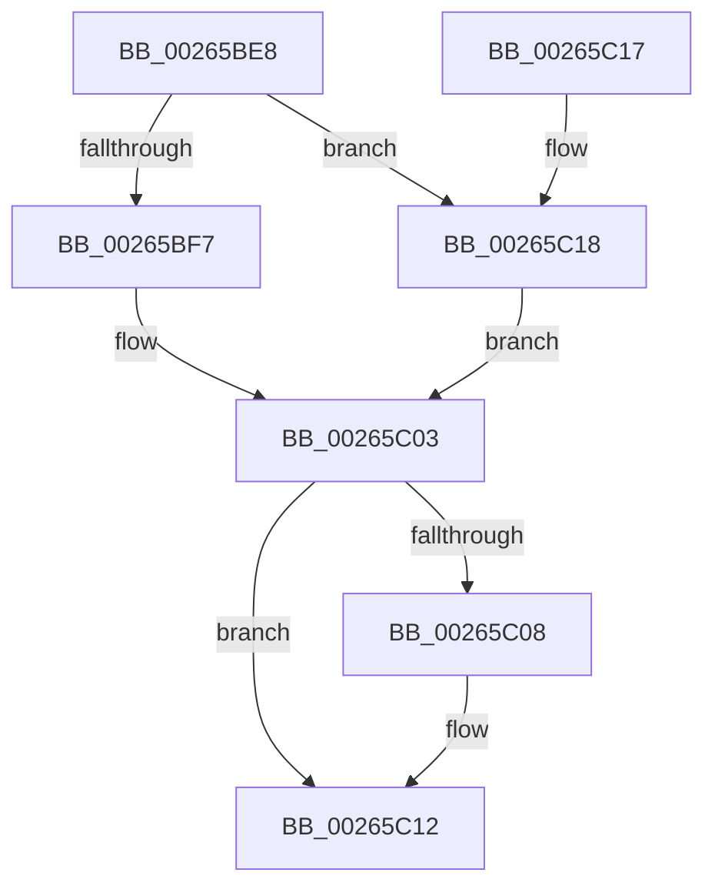

# FsRtlpClearOwner

- RVA: `0x00265BE8`–`0x00265C26` (길이 `62` bytes)
- VA: `0x0000000140265BE8`
- 실행 섹션: `.text`
- PDB 이름 있음: `예`; PDB Function 태그: `아니요`
- unwind 정보 RVA: `0x00064C74`
- 디코드: `19`개 명령, `62/62` bytes 표시
- 미해석 바이트: `0` (있으면 어셈블리에 `.byte`로 보존)

> 이 문서는 커널 이미지의 기계어와 PDB 기호를 분석해 생성했습니다. 4번과 5번은 함수 원형과 자료형을 바이너리 사용 방식에서 추정한 C 해석이며 원본 소스 복구 결과는 아닙니다.

## 1. Dependencies

- 직접 호출 지점: **1**; 고유 호출 대상: **1**
- 직접 호출자로 확인된 함수: **18**
- RIP 상대 이미지 참조: **0**

### Outgoing calls
- `0x00265C0D` → [ObDereferenceObjectDeferDeleteWithTag](ObDereferenceObjectDeferDeleteWithTag_function_00263EA0.md) (function, `0x00263EA0`)

### Direct callers
- [FsRtlpAcknowledgeOplockBreakByCacheFlags](../3F/FsRtlpAcknowledgeOplockBreakByCacheFlags_function_003F1988.md) at `0x003F1C9A`
- [FsRtlpAcknowledgeOplockBreakByCacheFlags](../3F/FsRtlpAcknowledgeOplockBreakByCacheFlags_function_003F1988.md) at `0x003F223A`
- [FsRtlpAcknowledgeOplockBreakByCacheFlags](../3F/FsRtlpAcknowledgeOplockBreakByCacheFlags_function_003F1988.md) at `0x003F2501`
- [FsRtlCheckOplockEx2](../3F/FsRtlCheckOplockEx2_function_003F2BC0.md) at `0x003F2D79`
- [FsRtlpRequestExclusiveOplock](../3F/FsRtlpRequestExclusiveOplock_function_003F3800.md) at `0x003F3922`
- [FsRtlpRequestExclusiveOplock](../3F/FsRtlpRequestExclusiveOplock_function_003F3800.md) at `0x003F39D4`
- [FsRtlpOplockCleanup](../42/FsRtlpOplockCleanup_function_00425030.md) at `0x004254F8`
- [FsRtlpOplockCleanup](../42/FsRtlpOplockCleanup_function_00425030.md) at `0x0042551E`
- [FsRtlpOplockCleanup](../42/FsRtlpOplockCleanup_function_00425030.md) at `0x0042564D`
- [FsRtlpRemoveAndCompleteRHIrp](../42/FsRtlpRemoveAndCompleteRHIrp_function_00425964.md) at `0x00425C17`
- [FsRtlpRemoveAndCompleteRHIrp](../42/FsRtlpRemoveAndCompleteRHIrp_function_00425964.md) at `0x00425CA2`
- [FsRtlpOplockBreakToII](../4B/FsRtlpOplockBreakToII_function_004BB824.md) at `0x004BB904`
- [FsRtlUninitializeOplock](../4E/FsRtlUninitializeOplock_function_004E42C0.md) at `0x004E43ED`
- [FsRtlUninitializeOplock](../4E/FsRtlUninitializeOplock_function_004E42C0.md) at `0x004E44C1`
- [FsRtlUninitializeOplock](../4E/FsRtlUninitializeOplock_function_004E42C0.md) at `0x004E4534`
- [FsRtlpOplockBreakByCacheFlags](../4E/FsRtlpOplockBreakByCacheFlags_function_004E4990.md) at `0x004E5707`
- [FsRtlpRequestShareableOplock](../4E/FsRtlpRequestShareableOplock_function_004E6EC8.md) at `0x004E7004`
- [FsRtlpRequestShareableOplock](../4E/FsRtlpRequestShareableOplock_function_004E6EC8.md) at `0x004E70B0`
- [FsRtlpOplockBreakToNone](../4F/FsRtlpOplockBreakToNone_function_004F8354.md) at `0x004F841A`
- [FsRtlpOplockBreakToNone](../4F/FsRtlpOplockBreakToNone_function_004F8354.md) at `0x004F8553`
- [FsRtlpCancelExclusiveIrp](../4F/FsRtlpCancelExclusiveIrp_function_004F96CC.md) at `0x004F973B`
- [FsRtlpAcknowledgeOplockBreak](../58/FsRtlpAcknowledgeOplockBreak_function_00582144.md) at `0x0058230D`
- [FsRtlpOpBatchBreakClosePending](../../page/71/FsRtlpOpBatchBreakClosePending_function_00714CDC.md) at `0x00714D6A`
- [FsRtlpOplockFsctrlInternal](../../page/9F/FsRtlpOplockFsctrlInternal_function_009F1640.md) at `0x009F1A9C`
- [FsRtlpOplockFsctrlInternal$fin$1](../../page/B1/FsRtlpOplockFsctrlInternal_fin_1_function_00B10D70.md) at `0x00B10D8D`
- [FsRtlpOplockFsctrlInternal$fin$0](../../page/B1/FsRtlpOplockFsctrlInternal_fin_0_function_00B10DB3.md) at `0x00B10DCF`
- [FsRtlpOplockFsctrlInternal$fin$2](../../page/B1/FsRtlpOplockFsctrlInternal_fin_2_function_00B10DE7.md) at `0x00B10E03`
- [sub_00B3115E](../../page/B3/Unknown_function_00B3115E.md) at `0x00B312B6`

### Static image references
- 디코드된 RIP-relative 메모리 참조가 없습니다.

## 2. Other-region calls and transfers

- 다른 실행 섹션으로 향하는 call: **0**
- 별도 외부 분기/꼬리 이동을 확인하지 못했습니다.

## 3. Assembly (complete function range)

```asm
00265BE8  48 83 EC 28                     sub rsp, 0x28
00265BEC  45 33 C0                        xor r8d, r8d
00265BEF  48 8B C1                        mov rax, rcx
00265BF2  48 85 D2                        test rdx, rdx
00265BF5  74 21                           je 0x140265c18
00265BF7  48 8B 4A 28                     mov rcx, qword ptr [rdx + 0x28]
00265BFB  4C 89 42 28                     mov qword ptr [rdx + 0x28], r8
00265BFF  4C 89 42 20                     mov qword ptr [rdx + 0x20], r8
00265C03  48 85 C9                        test rcx, rcx
00265C06  74 0A                           je 0x140265c12
00265C08  BA 44 66 6C 74                  mov edx, 0x746c6644
00265C0D  E8 8E E2 FF FF                  call 0x140263ea0
00265C12  48 83 C4 28                     add rsp, 0x28
00265C16  C3                              ret
00265C17  CC                              int3
00265C18  48 8B 49 18                     mov rcx, qword ptr [rcx + 0x18]
00265C1C  4C 89 40 18                     mov qword ptr [rax + 0x18], r8
00265C20  4C 89 40 10                     mov qword ptr [rax + 0x10], r8
00265C24  EB DD                           jmp 0x140265c03
```

## 4. C-style interpretation (structured pseudocode)

```c
__int64 __fastcall FsRtlpClearOwner(__int64 a1, __int64 a2, int a3)
{
    __int64 result;
    __int64 v_rsp;

    v_rsp = (v_rsp) - (40);
    a3 = 0;
    if (a2 == 0) goto loc_00265C18;
    *(unsigned __int64 *)(a2 + 40) = 0;
    *(unsigned __int64 *)(a2 + 32) = 0;
loc_00265C03:
    result = a1;
    if (*(unsigned __int64 *)(a2 + 40) != 0) {
        a2 = 0x746C6644ULL;
        result = ObDereferenceObjectDeferDeleteWithTag(*(unsigned __int64 *)(a2 + 40), a2, a3, a4);
    }
    v_rsp = (v_rsp) + (40);
    return result;
loc_00265C18:
    *(unsigned __int64 *)(result + 24) = 0;
    *(unsigned __int64 *)(result + 16) = 0;
    goto loc_00265C03;
}
```

## 5. (Beta) C Style

```c
int64_t FsRtlpClearOwner(void *Arg1, int64_t Arg2, int32_t Arg3)
{
    uint8_t *arg1 = (uint8_t *)Arg1;

    int64_t result;
    int64_t local_rsp;

    local_rsp = (local_rsp) - (40);
    Arg3 = 0;
    if (Arg2 == 0) goto loc_00265C18;
    *(uint64_t *)(Arg2 + 0x28) = 0;
    *(uint64_t *)(Arg2 + 0x20) = 0;
loc_00265C03:
    result = Arg1;
    if (*(uint64_t *)(Arg2 + 0x28) != 0) {
        Arg2 = 0x746C6644ULL;
        result = ObDereferenceObjectDeferDeleteWithTag(*(uint64_t *)(Arg2 + 0x28), Arg2, Arg3, a4);
    }
    local_rsp = (local_rsp) + (40);
    return result;
loc_00265C18:
    *(uint64_t *)(result + 0x18) = 0;
    *(uint64_t *)(result + 0x10) = 0;
    goto loc_00265C03;
}
```

### 관측된 메모리 오프셋

구조체 형식이 확인되지 않은 접근은 인자 기준의 오프셋으로만 기록했습니다.

| 기준 인자 | 오프셋 표현 | 폭 (bit) | 접근 |
|---|---:|---:|---|
| `Arg1` | `+ 0x10` | `64` | `W` |
| `Arg1` | `+ 0x18` | `64` | `R` |
| `Arg1` | `+ 0x18` | `64` | `W` |

## 6. Execution-region graph

[열기: 2D/3D 그래프와 함수 탐색 컨트롤 패널](../../../control-panel.html?section=text&rva=0x00265BE8&view=graph)

- 2D 그래프는 위에서 아래로 흐르고, 3D 그래프는 빈 공간을 드래그해 회전합니다. Shift+드래그는 이동, 휠은 확대·축소, 함수 노드 선택은 대상 보고서 이동입니다.

### Static fallback


