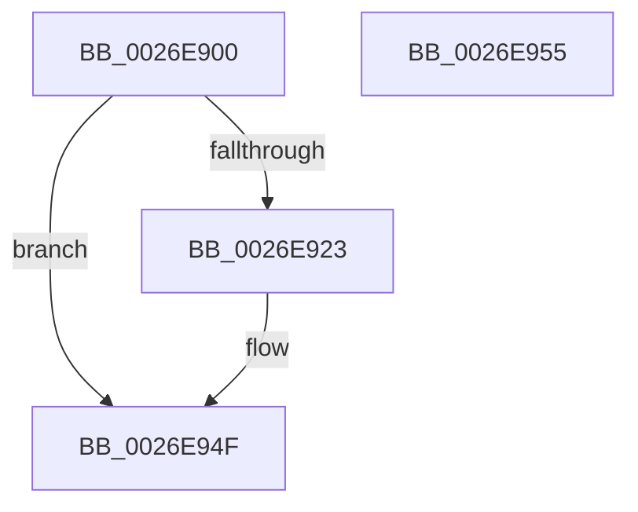

# IoAllocateWorkItem

- RVA: `0x0026E900`–`0x0026E956` (길이 `86` bytes)
- VA: `0x000000014026E900`
- 실행 섹션: `.text`
- PDB 이름 있음: `예`; PDB Function 태그: `아니요`
- unwind 정보 RVA: `0x0005CF00`
- 디코드: `23`개 명령, `86/86` bytes 표시
- 미해석 바이트: `0` (있으면 어셈블리에 `.byte`로 보존)

> 이 문서는 커널 이미지의 기계어와 PDB 기호를 분석해 생성했습니다. 4번과 5번은 함수 원형과 자료형을 바이너리 사용 방식에서 추정한 C 해석이며 원본 소스 복구 결과는 아닙니다.

## 1. Dependencies

- 직접 호출 지점: **1**; 고유 호출 대상: **1**
- 직접 호출자로 확인된 함수: **1**
- RIP 상대 이미지 참조: **1**

### Outgoing calls
- `0x0026E917` → [ExAllocatePool2](../../poolcode/B8/ExAllocatePool2_function_00B820F0.md) (function, `0x00B820F0`)

### Direct callers
- [PnpDeviceCompletionRequestDestroy](PnpDeviceCompletionRequestDestroy_function_0026E7E4.md) at `0x0026E809`

### Static image references
- `0x0026E927` → RVA `0x00393BB0` (`IopProcessWorkItem`; read)

## 2. Other-region calls and transfers

- 다른 실행 섹션으로 향하는 call: **1**
  - `0x0026E917` → [ExAllocatePool2](../../poolcode/B8/ExAllocatePool2_function_00B820F0.md) (`.text` → `POOLCODE`)
- 별도 외부 분기/꼬리 이동을 확인하지 못했습니다.

## 3. Assembly (complete function range)

```asm
0026E900  40 53                           push rbx
0026E902  48 83 EC 20                     sub rsp, 0x20
0026E906  BA 60 00 00 00                  mov edx, 0x60
0026E90B  48 8B D9                        mov rbx, rcx
0026E90E  41 B8 49 6F 57 49               mov r8d, 0x49576f49
0026E914  8D 4A E0                        lea ecx, [rdx - 0x20]
0026E917  E8 D4 37 91 00                  call 0x140b820f0
0026E91C  33 D2                           xor edx, edx
0026E91E  48 85 C0                        test rax, rax
0026E921  74 2C                           je 0x14026e94f
0026E923  48 89 58 28                     mov qword ptr [rax + 0x28], rbx
0026E927  48 8D 0D 82 52 12 00            lea rcx, [rip + 0x125282]
0026E92E  C7 40 40 01 00 00 00            mov dword ptr [rax + 0x40], 1
0026E935  48 89 50 38                     mov qword ptr [rax + 0x38], rdx
0026E939  48 89 50 58                     mov qword ptr [rax + 0x58], rdx
0026E93D  C7 40 54 07 00 00 00            mov dword ptr [rax + 0x54], 7
0026E944  48 89 48 10                     mov qword ptr [rax + 0x10], rcx
0026E948  48 89 40 18                     mov qword ptr [rax + 0x18], rax
0026E94C  48 89 10                        mov qword ptr [rax], rdx
0026E94F  48 83 C4 20                     add rsp, 0x20
0026E953  5B                              pop rbx
0026E954  C3                              ret
0026E955  CC                              int3
```

## 4. C-style interpretation (structured pseudocode)

```c
__int64 __fastcall IoAllocateWorkItem(__int64 a1)
{
    __int64 result;
    __int64 v_rsp;

    v_rsp = (v_rsp) - (32);
    result = ExAllocatePool2(96 - 32, 96, (unsigned int)(0x49576F49ULL), a4);
    a2 = 0;
    if (result != 0) {
        *(unsigned __int64 *)(result + 40) = a1;
        a1 = v_rip + 1200770;
        *(unsigned int *)(result + 64) = 1;
        *(unsigned __int64 *)(result + 56) = 0;
        *(unsigned __int64 *)(result + 88) = 0;
        *(unsigned int *)(result + 84) = 7;
        *(unsigned __int64 *)(result + 16) = a1;
        *(unsigned __int64 *)(result + 24) = result;
        *(unsigned __int64 *)(result) = 0;
    }
    v_rsp = (v_rsp) + (32);
    return result;
}
```

## 5. (Beta) C Style

```c
int64_t IoAllocateWorkItem(int64_t Arg1)
{
    int64_t result;
    int64_t local_rsp;

    local_rsp = (local_rsp) - (32);
    result = ExAllocatePool2(96 - 32, 96, (uint32_t)(0x49576F49ULL), a4);
    a2 = 0;
    if (result != 0) {
        *(uint64_t *)(result + 0x28) = Arg1;
        Arg1 = v_rip + 1200770;
        *(uint32_t *)(result + 0x40) = 1;
        *(uint64_t *)(result + 0x38) = 0;
        *(uint64_t *)(result + 0x58) = 0;
        *(uint32_t *)(result + 0x54) = 7;
        *(uint64_t *)(result + 0x10) = Arg1;
        *(uint64_t *)(result + 0x18) = result;
        *(uint64_t *)(result) = 0;
    }
    local_rsp = (local_rsp) + (32);
    return result;
}
```

## 6. Execution-region graph

[열기: 2D/3D 그래프와 함수 탐색 컨트롤 패널](../../../control-panel.html?section=text&rva=0x0026E900&view=graph)

- 2D 그래프는 위에서 아래로 흐르고, 3D 그래프는 빈 공간을 드래그해 회전합니다. Shift+드래그는 이동, 휠은 확대·축소, 함수 노드 선택은 대상 보고서 이동입니다.

### Static fallback


