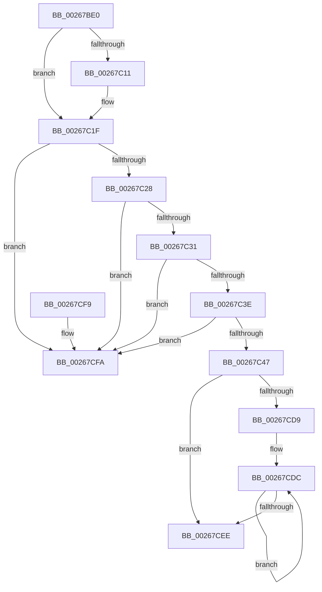

# IoBuildPartialMdl

- RVA: `0x00267BE0`–`0x00267D10` (길이 `304` bytes)
- VA: `0x0000000140267BE0`
- 실행 섹션: `.text`
- PDB 이름 있음: `예`; PDB Function 태그: `아니요`
- unwind 정보 RVA: `0x000650AC`
- 디코드: `81`개 명령, `304/304` bytes 표시
- 미해석 바이트: `0` (있으면 어셈블리에 `.byte`로 보존)

> 이 문서는 커널 이미지의 기계어와 PDB 기호를 분석해 생성했습니다. 4번과 5번은 함수 원형과 자료형을 바이너리 사용 방식에서 추정한 C 해석이며 원본 소스 복구 결과는 아닙니다.

## 1. Dependencies

- 직접 호출 지점: **1**; 고유 호출 대상: **1**
- 직접 호출자로 확인된 함수: **4**
- RIP 상대 이미지 참조: **0**

### Outgoing calls
- `0x00267D0A` → [KeBugCheckEx](../4F/KeBugCheckEx_function_004FD660.md) (function, `0x004FD660`)

### Direct callers
- [SMKM_STORE_MGR&lt;SM_TRAITS&gt;::SmCompressCtxCompleteEntry](SMKM_STORE_MGR_SM_TRAITS_SmCompressCtxCompleteEntry_function_002685C0.md) at `0x0026862A`
- [HalpDmaFlushBuffer](../3D/HalpDmaFlushBuffer_function_003DC1DC.md) at `0x003DC2B3`
- [sub_006E9F12](../6E/Unknown_function_006E9F12.md) at `0x006E9FA1`
- [IopMcCreatePartialMdl](../../page/72/IopMcCreatePartialMdl_function_00723034.md) at `0x0072308E`

### Static image references
- 디코드된 RIP-relative 메모리 참조가 없습니다.

## 2. Other-region calls and transfers

- 다른 실행 섹션으로 향하는 call: **0**
- 별도 외부 분기/꼬리 이동을 확인하지 못했습니다.

## 3. Assembly (complete function range)

```asm
00267BE0  48 89 5C 24 08                  mov qword ptr [rsp + 8], rbx
00267BE5  57                              push rdi
00267BE6  48 83 EC 30                     sub rsp, 0x30
00267BEA  4C 8B D9                        mov r11, rcx
00267BED  41 8B D9                        mov ebx, r9d
00267BF0  8B 49 2C                        mov ecx, dword ptr [rcx + 0x2c]
00267BF3  4C 8B D2                        mov r10, rdx
00267BF6  4D 8B C8                        mov r9, r8
00267BF9  49 03 4B 20                     add rcx, qword ptr [r11 + 0x20]
00267BFD  41 8B 7B 28                     mov edi, dword ptr [r11 + 0x28]
00267C01  41 0F B6 43 0A                  movzx eax, byte ptr [r11 + 0xa]
00267C06  48 8D 14 39                     lea rdx, [rcx + rdi]
00267C0A  4C 8B C2                        mov r8, rdx
00267C0D  84 C0                           test al, al
00267C0F  78 0E                           js 0x140267c1f
00267C11  49 81 C0 FF 0F 00 00            add r8, 0xfff
00267C18  49 81 E0 00 F0 FF FF            and r8, 0xfffffffffffff000
00267C1F  4C 3B C9                        cmp r9, rcx
00267C22  0F 82 D2 00 00 00               jb 0x140267cfa
00267C28  4C 3B CA                        cmp r9, rdx
00267C2B  0F 83 C9 00 00 00               jae 0x140267cfa
00267C31  49 8D 14 19                     lea rdx, [r9 + rbx]
00267C35  49 3B D1                        cmp rdx, r9
00267C38  0F 82 BC 00 00 00               jb 0x140267cfa
00267C3E  49 3B D0                        cmp rdx, r8
00267C41  0F 87 B3 00 00 00               ja 0x140267cfa
00267C47  49 8B 43 10                     mov rax, qword ptr [r11 + 0x10]
00267C4B  45 8B C1                        mov r8d, r9d
00267C4E  49 89 42 10                     mov qword ptr [r10 + 0x10], rax
00267C52  41 8B D1                        mov edx, r9d
00267C55  2B D1                           sub edx, ecx
00267C57  41 8B C0                        mov eax, r8d
00267C5A  41 0F B7 4A 0A                  movzx ecx, word ptr [r10 + 0xa]
00267C5F  2B FA                           sub edi, edx
00267C61  85 DB                           test ebx, ebx
00267C63  0F 44 DF                        cmove ebx, edi
00267C66  25 FF 0F 00 00                  and eax, 0xfff
00267C6B  41 89 42 2C                     mov dword ptr [r10 + 0x2c], eax
00267C6F  49 81 E1 00 F0 FF FF            and r9, 0xfffffffffffff000
00267C76  4D 89 4A 20                     mov qword ptr [r10 + 0x20], r9
00267C7A  66 83 E1 08                     and cx, 8
00267C7E  41 89 5A 28                     mov dword ptr [r10 + 0x28], ebx
00267C82  41 81 E0 FF 0F 00 00            and r8d, 0xfff
00267C89  45 2B 4B 20                     sub r9d, dword ptr [r11 + 0x20]
00267C8D  49 81 C0 FF 0F 00 00            add r8, 0xfff
00267C94  66 41 89 4A 0A                  mov word ptr [r10 + 0xa], cx
00267C99  BF C5 48 00 00                  mov edi, 0x48c5
00267C9E  41 0F B7 43 0A                  movzx eax, word ptr [r11 + 0xa]
00267CA3  66 23 C7                        and ax, di
00267CA6  41 C1 E9 0C                     shr r9d, 0xc
00267CAA  66 0B C1                        or ax, cx
00267CAD  66 83 C8 10                     or ax, 0x10
00267CB1  66 41 89 42 0A                  mov word ptr [r10 + 0xa], ax
00267CB6  8B C2                           mov eax, edx
00267CB8  49 03 43 18                     add rax, qword ptr [r11 + 0x18]
00267CBC  49 89 42 18                     mov qword ptr [r10 + 0x18], rax
00267CC0  41 8B C1                        mov eax, r9d
00267CC3  48 83 C0 06                     add rax, 6
00267CC7  8B D3                           mov edx, ebx
00267CC9  49 03 D0                        add rdx, r8
00267CCC  48 C1 EA 0C                     shr rdx, 0xc
00267CD0  49 8D 04 C3                     lea rax, [r11 + rax*8]
00267CD4  48 85 D2                        test rdx, rdx
00267CD7  74 15                           je 0x140267cee
00267CD9  4C 2B D0                        sub r10, rax
00267CDC  48 8B 08                        mov rcx, qword ptr [rax]
00267CDF  49 89 4C 02 30                  mov qword ptr [r10 + rax + 0x30], rcx
00267CE4  48 8D 40 08                     lea rax, [rax + 8]
00267CE8  48 83 EA 01                     sub rdx, 1
00267CEC  75 EE                           jne 0x140267cdc
00267CEE  48 8B 5C 24 40                  mov rbx, qword ptr [rsp + 0x40]
00267CF3  48 83 C4 30                     add rsp, 0x30
00267CF7  5F                              pop rdi
00267CF8  C3                              ret
00267CF9  CC                              int3
00267CFA  4D 8B C2                        mov r8, r10
00267CFD  48 89 5C 24 20                  mov qword ptr [rsp + 0x20], rbx
00267D02  49 8B D3                        mov rdx, r11
00267D05  B9 2E 01 00 00                  mov ecx, 0x12e
00267D0A  E8 51 59 29 00                  call 0x1404fd660
00267D0F  CC                              int3
```

## 4. C-style interpretation (structured pseudocode)

```c
__int64 __fastcall IoBuildPartialMdl(__int64 a1, __int64 a2, __int64 a3, int a4)
{
    __int64 result;
    __int64 v_r10;
    __int64 v_rbx;
    __int64 v_rdi;
    __int64 v_rsp;
    unsigned __int64 v_stack_p20;
    unsigned __int64 v_stack_p8;

    v_stack_p8 = v_rbx;
    v_rsp = (v_rsp) - (48);
    a1 = ((unsigned int)(*(unsigned int *)(a1 + 44))) + (*(unsigned __int64 *)(a1 + 32));
    if (!(sign_flag)) {
        a3 = (a1 + (unsigned int)(*(unsigned int *)(a1 + 40)) * 1) + (0xFFFULL);
        a3 = (a3) & (0xFFFFFFFFFFFFF000ULL);
    }
    if (a3 < a1) goto loc_00267CFA;
    if (a3 >= (a1 + (unsigned int)(*(unsigned int *)(a1 + 40)) * 1)) goto loc_00267CFA;
    if ((a3 + (unsigned int)(a4) * 1) < a3) goto loc_00267CFA;
    if ((a3 + (unsigned int)(a4) * 1) > a3) goto loc_00267CFA;
    *(unsigned __int64 *)(a2 + 16) = *(unsigned __int64 *)(a1 + 16);
    a2 = (unsigned int)(((unsigned int)((unsigned int)(a3))) - ((unsigned int)(a1)));
    v_rdi = (unsigned int)(((unsigned int)(*(unsigned int *)(a1 + 40))) - ((unsigned int)(a2)));
    v_rbx = (unsigned int)(a4);
    if ((unsigned int)((unsigned int)(a4)) == 0) { v_rbx = (unsigned int)(v_rdi); }
    result = (unsigned int)(((unsigned int)((unsigned int)((unsigned int)((unsigned int)(a3))))) & (0xFFFULL));
    *(unsigned int *)(a2 + 44) = (unsigned int)(result);
    a4 = (a3) & (0xFFFFFFFFFFFFF000ULL);
    *(unsigned __int64 *)(a2 + 32) = a4;
    a1 = (unsigned __int16)((*(unsigned __int16 *)(a2 + 10)) & (8));
    *(unsigned int *)(a2 + 40) = (unsigned int)(v_rbx);
    a3 = (unsigned int)(((unsigned int)((unsigned int)(a3))) & (0xFFFULL));
    a4 = (unsigned int)((a4) - (*(unsigned int *)(a1 + 32)));
    a3 = (a3) + (0xFFFULL);
    *(unsigned __int16 *)(a2 + 10) = (unsigned __int16)(a1);
    result = (unsigned __int16)((*(unsigned __int16 *)(a1 + 10)) & ((unsigned __int16)((unsigned int)(0x48C5ULL))));
    a4 = (unsigned int)((a4) >> (12));
    result = (unsigned __int16)((result) | ((unsigned __int16)(a1)));
    result = (unsigned __int16)((result) | (16));
    *(unsigned __int16 *)(a2 + 10) = (unsigned __int16)(result);
    result = ((unsigned int)((unsigned int)(a2))) + (*(unsigned __int64 *)(a1 + 24));
    *(unsigned __int64 *)(a2 + 24) = result;
    result = ((unsigned int)(a4)) + (6);
    a2 = ((unsigned int)((unsigned int)(v_rbx))) + (a3);
    a2 = (a2) >> (12);
    if (a2 == 0) goto loc_00267CEE;
    v_r10 = (a2) - (a1 + result * 8);
loc_00267CDC:
    *(unsigned __int64 *)(v_r10 + a1 + result * 8 * 1 + 48) = *(unsigned __int64 *)(a1 + result * 8);
    a2 = (a2) - (1);
    if (condition_is_not_equal) goto loc_00267CDC;
loc_00267CEE:
    v_rsp = (v_rsp) + (48);
    return a1 + result * 8 + 8;
loc_00267CFA:
    v_stack_p20 = v_stack_p8;
    result = KeBugCheckEx(302, a1, v_r10, a4);
    return result;
}
```

## 5. (Beta) C Style

```c
int64_t IoBuildPartialMdl(void *Arg1, void *Arg2, int64_t Arg3, int32_t Arg4)
{
    uint8_t *arg1 = (uint8_t *)Arg1;
    uint8_t *arg2 = (uint8_t *)Arg2;

    int64_t result;
    int64_t local_r10;
    int64_t local_rbx;
    int64_t local_rdi;
    int64_t local_rsp;
    uint64_t v_stack_p20;
    uint64_t v_stack_p8;

    v_stack_p8 = local_rbx;
    local_rsp = (local_rsp) - (48);
    Arg1 = ((uint32_t)(*(uint32_t *)(arg1 + 0x2C))) + (*(uint64_t *)(arg1 + 0x20));
    if (!(sign_flag)) {
        Arg3 = (Arg1 + (uint32_t)(*(uint32_t *)(arg1 + 0x28)) * 1) + (0xFFFULL);
        Arg3 = (Arg3) & (0xFFFFFFFFFFFFF000ULL);
    }
    if (Arg3 < Arg1) goto loc_00267CFA;
    if (Arg3 >= (Arg1 + (uint32_t)(*(uint32_t *)(arg1 + 0x28)) * 1)) goto loc_00267CFA;
    if ((Arg3 + (uint32_t)(Arg4) * 1) < Arg3) goto loc_00267CFA;
    if ((Arg3 + (uint32_t)(Arg4) * 1) > Arg3) goto loc_00267CFA;
    *(uint64_t *)(arg2 + 0x10) = *(uint64_t *)(arg1 + 0x10);
    Arg2 = (uint32_t)(((uint32_t)((uint32_t)(Arg3))) - ((uint32_t)(Arg1)));
    local_rdi = (uint32_t)(((uint32_t)(*(uint32_t *)(arg1 + 0x28))) - ((uint32_t)(Arg2)));
    local_rbx = (uint32_t)(Arg4);
    if ((uint32_t)((uint32_t)(Arg4)) == 0) { local_rbx = (uint32_t)(local_rdi); }
    result = (uint32_t)(((uint32_t)((uint32_t)((uint32_t)((uint32_t)(Arg3))))) & (0xFFFULL));
    *(uint32_t *)(arg2 + 0x2C) = (uint32_t)(result);
    Arg4 = (Arg3) & (0xFFFFFFFFFFFFF000ULL);
    *(uint64_t *)(arg2 + 0x20) = Arg4;
    Arg1 = (uint16_t)((*(uint16_t *)(arg2 + 0xA)) & (8));
    *(uint32_t *)(arg2 + 0x28) = (uint32_t)(local_rbx);
    Arg3 = (uint32_t)(((uint32_t)((uint32_t)(Arg3))) & (0xFFFULL));
    Arg4 = (uint32_t)((Arg4) - (*(uint32_t *)(arg1 + 0x20)));
    Arg3 = (Arg3) + (0xFFFULL);
    *(uint16_t *)(arg2 + 0xA) = (uint16_t)(Arg1);
    result = (uint16_t)((*(uint16_t *)(arg1 + 0xA)) & ((uint16_t)((uint32_t)(0x48C5ULL))));
    Arg4 = (uint32_t)((Arg4) >> (12));
    result = (uint16_t)((result) | ((uint16_t)(Arg1)));
    result = (uint16_t)((result) | (16));
    *(uint16_t *)(arg2 + 0xA) = (uint16_t)(result);
    result = ((uint32_t)((uint32_t)(Arg2))) + (*(uint64_t *)(arg1 + 0x18));
    *(uint64_t *)(arg2 + 0x18) = result;
    result = ((uint32_t)(Arg4)) + (6);
    Arg2 = ((uint32_t)((uint32_t)(local_rbx))) + (Arg3);
    Arg2 = (Arg2) >> (12);
    if (Arg2 == NULL) goto loc_00267CEE;
    local_r10 = (Arg2) - (Arg1 + result * 8);
loc_00267CDC:
    *(uint64_t *)(local_r10 + arg1 + result * 8 * 1 + 0x30) = *(uint64_t *)(arg1 + result * 8);
    Arg2 = (Arg2) - (1);
    if (condition_is_not_equal) goto loc_00267CDC;
loc_00267CEE:
    local_rsp = (local_rsp) + (48);
    return Arg1 + result * 8 + 8;
loc_00267CFA:
    v_stack_p20 = v_stack_p8;
    result = KeBugCheckEx(302, Arg1, local_r10, Arg4);
    return result;
}
```

### 관측된 메모리 오프셋

구조체 형식이 확인되지 않은 접근은 인자 기준의 오프셋으로만 기록했습니다.

| 기준 인자 | 오프셋 표현 | 폭 (bit) | 접근 |
|---|---:|---:|---|
| `Arg1` | `+ 0x0` | `64` | `R` |
| `Arg1` | `+ 0x0 + rax*8` | `64` | `R` |
| `Arg1` | `+ 0x8` | `64` | `R` |
| `Arg1` | `+ 0xA` | `8` | `R` |
| `Arg1` | `+ 0xA` | `16` | `R` |
| `Arg1` | `+ 0x10` | `64` | `R` |
| `Arg1` | `+ 0x18` | `64` | `R` |
| `Arg1` | `+ 0x20` | `32` | `R` |
| `Arg1` | `+ 0x20` | `64` | `R` |
| `Arg1` | `+ 0x28` | `32` | `R` |
| `Arg1` | `+ 0x2C` | `32` | `R` |
| `Arg2` | `+ 0xA` | `16` | `R` |
| `Arg2` | `+ 0xA` | `16` | `W` |
| `Arg2` | `+ 0x10` | `64` | `W` |
| `Arg2` | `+ 0x18` | `64` | `W` |
| `Arg2` | `+ 0x20` | `64` | `W` |
| `Arg2` | `+ 0x28` | `32` | `W` |
| `Arg2` | `+ 0x2C` | `32` | `W` |
| `Arg2` | `+ 0x30 + rax*1` | `64` | `W` |

## 6. Execution-region graph

[열기: 2D/3D 그래프와 함수 탐색 컨트롤 패널](../../../control-panel.html?section=text&rva=0x00267BE0&view=graph)

- 2D 그래프는 위에서 아래로 흐르고, 3D 그래프는 빈 공간을 드래그해 회전합니다. Shift+드래그는 이동, 휠은 확대·축소, 함수 노드 선택은 대상 보고서 이동입니다.

### Static fallback


