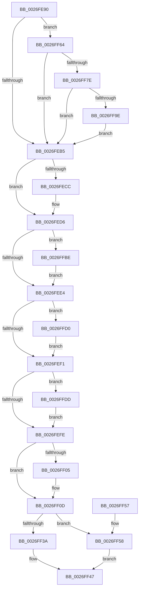

# IoDeleteDevice

- RVA: `0x0026FE90`–`0x0026FFF4` (길이 `356` bytes)
- VA: `0x000000014026FE90`
- 실행 섹션: `.text`
- PDB 이름 있음: `예`; PDB Function 태그: `아니요`
- unwind 정보 RVA: `0x0006599C`
- 디코드: `93`개 명령, `356/356` bytes 표시
- 미해석 바이트: `0` (있으면 어셈블리에 `.byte`로 보존)

> 이 문서는 커널 이미지의 기계어와 PDB 기호를 분석해 생성했습니다. 4번과 5번은 함수 원형과 자료형을 바이너리 사용 방식에서 추정한 C 해석이며 원본 소스 복구 결과는 아닙니다.

## 1. Dependencies

- 직접 호출 지점: **15**; 고유 호출 대상: **13**
- 직접 호출자로 확인된 함수: **22**
- RIP 상대 이미지 참조: **1**

### Outgoing calls
- `0x0026FEC2` → [EtwTiLogDeviceObjectLoadUnload](../../page/9A/EtwTiLogDeviceObjectLoadUnload_function_009A5234.md) (function, `0x009A5234`)
- `0x0026FED1` → [ExFreePoolWithTag](../../poolcode/B8/ExFreePoolWithTag_function_00B82870.md) (function, `0x00B82870`)
- `0x0026FF08` → [ObMakeTemporaryObject](../../page/A7/ObMakeTemporaryObject_function_00A7F860.md) (function, `0x00A7F860`)
- `0x0026FF10` → [PoRunDownDeviceObject](PoRunDownDeviceObject_function_0026FFFC.md) (function, `0x0026FFFC`)
- `0x0026FF18` → [PnpFreeInterruptInformation](../../page/A7/PnpFreeInterruptInformation_function_00A70A30.md) (function, `0x00A70A30`)
- `0x0026FF24` → [KeAcquireQueuedSpinLock](../27/KeAcquireQueuedSpinLock_function_00273D80.md) (function, `0x00273D80`)
- `0x0026FF42` → [IopCompleteUnloadOrDelete](../27/IopCompleteUnloadOrDelete_function_00270BC8.md) (function, `0x00270BC8`)
- `0x0026FF5D` → [KeReleaseQueuedSpinLock](../27/KeReleaseQueuedSpinLock_function_00272540.md) (function, `0x00272540`)
- `0x0026FF6E` → [ObQueryNameString](../../page/8A/ObQueryNameString_function_008A7EB0.md) (function, `0x008A7EB0`)
- `0x0026FF8D` → [ExAllocatePool2](../../poolcode/B8/ExAllocatePool2_function_00B820F0.md) (function, `0x00B820F0`)
- `0x0026FFAE` → [ObQueryNameString](../../page/8A/ObQueryNameString_function_008A7EB0.md) (function, `0x008A7EB0`)
- `0x0026FFC6` → [IovDeleteDevice](../../pagevrfy/B9/IovDeleteDevice_function_00B92724.md) (function, `0x00B92724`)
- `0x0026FFD3` → [IoUnregisterShutdownNotification](../../pagelk/B7/IoUnregisterShutdownNotification_function_00B7CCC0.md) (function, `0x00B7CCC0`)
- `0x0026FFE0` → [IopRemoveTimerFromTimerList](../59/IopRemoveTimerFromTimerList_function_00597F8C.md) (function, `0x00597F8C`)
- `0x0026FFEA` → [ExFreePoolWithTag](../../poolcode/B8/ExFreePoolWithTag_function_00B82870.md) (function, `0x00B82870`)

### Direct callers
- [DifIoDeleteDeviceWrapper](../62/DifIoDeleteDeviceWrapper_function_00629C20.md) at `0x00629CE6`
- [HalpAddDevice](../../page/70/HalpAddDevice_function_00708060.md) at `0x0070810F`
- [IoReportDetectedDevice](../../page/72/IoReportDetectedDevice_function_00725CD0.md) at `0x0072605A`
- [IoReportDetectedDevice](../../page/72/IoReportDetectedDevice_function_00725CD0.md) at `0x00726496`
- [IopRemoveLegacyDeviceNode](../../page/72/IopRemoveLegacyDeviceNode_function_0072E590.md) at `0x0072E65F`
- [IopCreateRootEnumeratedDeviceObject](../../page/73/IopCreateRootEnumeratedDeviceObject_function_00737D1C.md) at `0x00737D80`
- [PiInitializeDevice](../../page/73/PiInitializeDevice_function_0073EC5C.md) at `0x0073ED8E`
- [RawShutdown](../../page/78/RawShutdown_function_0078A0A0.md) at `0x0078A0D9`
- [RawShutdown](../../page/78/RawShutdown_function_0078A0A0.md) at `0x0078A0E5`
- [RawShutdown](../../page/78/RawShutdown_function_0078A0A0.md) at `0x0078A0F1`
- [VrpRegistryUnload](../../page/83/VrpRegistryUnload_function_0083B0E0.md) at `0x0083B0FA`
- [PiSwDestroyDeviceObject](../../page/94/PiSwDestroyDeviceObject_function_0094E384.md) at `0x0094E3A1`
- [IoCreateDeviceSecure](../../page/9A/IoCreateDeviceSecure_function_009A31E0.md) at `0x009A341B`
- [RawMountVolume](../../page/9A/RawMountVolume_function_009A4844.md) at `0x009A4A96`
- [RawDeleteVcb](../../page/A8/RawDeleteVcb_function_00A87C14.md) at `0x00A87C30`
- [PiSwGetChildPdo](../../page/AC/PiSwGetChildPdo_function_00AC3544.md) at `0x00AC3781`
- [IopFindLegacyDeviceNode](../../page/AC/IopFindLegacyDeviceNode_function_00AC7338.md) at `0x00AC74B7`
- [sub_00B40828](../../page/B4/Unknown_function_00B40828.md) at `0x00B40853`
- [sub_00B420B0](../../page/B4/Unknown_function_00B420B0.md) at `0x00B42415`
- [sub_00B420B0](../../page/B4/Unknown_function_00B420B0.md) at `0x00B4241F`
- [ViDdiDriverEntry](../../pagevrfy/B9/ViDdiDriverEntry_function_00B94740.md) at `0x00B94811`
- [sub_00BACE53](../../pagevrfy/BA/Unknown_function_00BACE53.md) at `0x00BACE94`
- [sub_00BAD17D](../../pagevrfy/BA/Unknown_function_00BAD17D.md) at `0x00BAD200`
- [IopInitializePlugPlayServices](../../init/C2/IopInitializePlugPlayServices_function_00C2F298.md) at `0x00C2FCDC`
- [RawInitialize](../../init/C4/RawInitialize_function_00C47090.md) at `0x00C4713D`
- [RawInitialize](../../init/C4/RawInitialize_function_00C47090.md) at `0x00C47192`
- [RawInitialize](../../init/C4/RawInitialize_function_00C47090.md) at `0x00C471B2`
- [WmipDriverEntry](../../init/C4/WmipDriverEntry_function_00C4D490.md) at `0x00C4D5A5`

### Static image references
- `0x0026FED6` → RVA `0x00F04A20` (`.data`; read)

## 2. Other-region calls and transfers

- 다른 실행 섹션으로 향하는 call: **10**
  - `0x0026FEC2` → [EtwTiLogDeviceObjectLoadUnload](../../page/9A/EtwTiLogDeviceObjectLoadUnload_function_009A5234.md) (`.text` → `PAGE`)
  - `0x0026FED1` → [ExFreePoolWithTag](../../poolcode/B8/ExFreePoolWithTag_function_00B82870.md) (`.text` → `POOLCODE`)
  - `0x0026FF08` → [ObMakeTemporaryObject](../../page/A7/ObMakeTemporaryObject_function_00A7F860.md) (`.text` → `PAGE`)
  - `0x0026FF18` → [PnpFreeInterruptInformation](../../page/A7/PnpFreeInterruptInformation_function_00A70A30.md) (`.text` → `PAGE`)
  - `0x0026FF6E` → [ObQueryNameString](../../page/8A/ObQueryNameString_function_008A7EB0.md) (`.text` → `PAGE`)
  - `0x0026FF8D` → [ExAllocatePool2](../../poolcode/B8/ExAllocatePool2_function_00B820F0.md) (`.text` → `POOLCODE`)
  - `0x0026FFAE` → [ObQueryNameString](../../page/8A/ObQueryNameString_function_008A7EB0.md) (`.text` → `PAGE`)
  - `0x0026FFC6` → [IovDeleteDevice](../../pagevrfy/B9/IovDeleteDevice_function_00B92724.md) (`.text` → `PAGEVRFY`)
  - `0x0026FFD3` → [IoUnregisterShutdownNotification](../../pagelk/B7/IoUnregisterShutdownNotification_function_00B7CCC0.md) (`.text` → `PAGELK`)
  - `0x0026FFEA` → [ExFreePoolWithTag](../../poolcode/B8/ExFreePoolWithTag_function_00B82870.md) (`.text` → `POOLCODE`)
- 별도 외부 분기/꼬리 이동을 확인하지 못했습니다.

## 3. Assembly (complete function range)

```asm
0026FE90  48 89 5C 24 10                  mov qword ptr [rsp + 0x10], rbx
0026FE95  48 89 74 24 18                  mov qword ptr [rsp + 0x18], rsi
0026FE9A  57                              push rdi
0026FE9B  48 83 EC 20                     sub rsp, 0x20
0026FE9F  8B 41 30                        mov eax, dword ptr [rcx + 0x30]
0026FEA2  33 F6                           xor esi, esi
0026FEA4  21 74 24 30                     and dword ptr [rsp + 0x30], esi
0026FEA8  33 FF                           xor edi, edi
0026FEAA  48 8B D9                        mov rbx, rcx
0026FEAD  A8 40                           test al, 0x40
0026FEAF  0F 85 AF 00 00 00               jne 0x14026ff64
0026FEB5  48 8B 53 08                     mov rdx, qword ptr [rbx + 8]
0026FEB9  4C 8B C6                        mov r8, rsi
0026FEBC  48 83 C2 38                     add rdx, 0x38
0026FEC0  33 C9                           xor ecx, ecx
0026FEC2  E8 6D 53 73 00                  call 0x1409a5234
0026FEC7  48 85 FF                        test rdi, rdi
0026FECA  74 0A                           je 0x14026fed6
0026FECC  33 D2                           xor edx, edx
0026FECE  48 8B CF                        mov rcx, rdi
0026FED1  E8 9A 29 91 00                  call 0x140b82870
0026FED6  8B 05 44 4B C9 00               mov eax, dword ptr [rip + 0xc94b44]
0026FEDC  A8 90                           test al, 0x90
0026FEDE  0F 85 DA 00 00 00               jne 0x14026ffbe
0026FEE4  F7 43 30 00 08 00 00            test dword ptr [rbx + 0x30], 0x800
0026FEEB  0F 85 DF 00 00 00               jne 0x14026ffd0
0026FEF1  48 8B 7B 28                     mov rdi, qword ptr [rbx + 0x28]
0026FEF5  48 85 FF                        test rdi, rdi
0026FEF8  0F 85 DF 00 00 00               jne 0x14026ffdd
0026FEFE  8B 43 30                        mov eax, dword ptr [rbx + 0x30]
0026FF01  A8 40                           test al, 0x40
0026FF03  74 08                           je 0x14026ff0d
0026FF05  48 8B CB                        mov rcx, rbx
0026FF08  E8 53 F9 80 00                  call 0x140a7f860
0026FF0D  48 8B CB                        mov rcx, rbx
0026FF10  E8 E7 00 00 00                  call 0x14026fffc
0026FF15  48 8B CB                        mov rcx, rbx
0026FF18  E8 13 0B 80 00                  call 0x140a70a30
0026FF1D  BF 0A 00 00 00                  mov edi, 0xa
0026FF22  8B CF                           mov ecx, edi
0026FF24  E8 57 3E 00 00                  call 0x140273d80
0026FF29  48 8B 8B 38 01 00 00            mov rcx, qword ptr [rbx + 0x138]
0026FF30  83 49 20 02                     or dword ptr [rcx + 0x20], 2
0026FF34  83 7B 04 00                     cmp dword ptr [rbx + 4], 0
0026FF38  75 1E                           jne 0x14026ff58
0026FF3A  44 8A C0                        mov r8b, al
0026FF3D  33 D2                           xor edx, edx
0026FF3F  48 8B CB                        mov rcx, rbx
0026FF42  E8 81 0C 00 00                  call 0x140270bc8
0026FF47  48 8B 5C 24 38                  mov rbx, qword ptr [rsp + 0x38]
0026FF4C  48 8B 74 24 40                  mov rsi, qword ptr [rsp + 0x40]
0026FF51  48 83 C4 20                     add rsp, 0x20
0026FF55  5F                              pop rdi
0026FF56  C3                              ret
0026FF57  CC                              int3
0026FF58  8A D0                           mov dl, al
0026FF5A  48 8B CF                        mov rcx, rdi
0026FF5D  E8 DE 25 00 00                  call 0x140272540
0026FF62  EB E3                           jmp 0x14026ff47
0026FF64  4C 8D 4C 24 30                  lea r9, [rsp + 0x30]
0026FF69  45 33 C0                        xor r8d, r8d
0026FF6C  33 D2                           xor edx, edx
0026FF6E  E8 3D 7F 63 00                  call 0x1408a7eb0
0026FF73  3D 04 00 00 C0                  cmp eax, 0xc0000004
0026FF78  0F 85 37 FF FF FF               jne 0x14026feb5
0026FF7E  8B 54 24 30                     mov edx, dword ptr [rsp + 0x30]
0026FF82  B9 00 01 00 00                  mov ecx, 0x100
0026FF87  41 B8 49 6F 4E 33               mov r8d, 0x334e6f49
0026FF8D  E8 5E 21 91 00                  call 0x140b820f0
0026FF92  48 8B F8                        mov rdi, rax
0026FF95  48 85 C0                        test rax, rax
0026FF98  0F 84 17 FF FF FF               je 0x14026feb5
0026FF9E  44 8B 44 24 30                  mov r8d, dword ptr [rsp + 0x30]
0026FFA3  4C 8D 4C 24 30                  lea r9, [rsp + 0x30]
0026FFA8  48 8B D0                        mov rdx, rax
0026FFAB  48 8B CB                        mov rcx, rbx
0026FFAE  E8 FD 7E 63 00                  call 0x1408a7eb0
0026FFB3  85 C0                           test eax, eax
0026FFB5  48 0F 49 F7                     cmovns rsi, rdi
0026FFB9  E9 F7 FE FF FF                  jmp 0x14026feb5
0026FFBE  48 8B 54 24 28                  mov rdx, qword ptr [rsp + 0x28]
0026FFC3  48 8B CB                        mov rcx, rbx
0026FFC6  E8 59 27 92 00                  call 0x140b92724
0026FFCB  E9 14 FF FF FF                  jmp 0x14026fee4
0026FFD0  48 8B CB                        mov rcx, rbx
0026FFD3  E8 E8 CC 90 00                  call 0x140b7ccc0
0026FFD8  E9 14 FF FF FF                  jmp 0x14026fef1
0026FFDD  48 8B CF                        mov rcx, rdi
0026FFE0  E8 A7 7F 32 00                  call 0x140597f8c
0026FFE5  33 D2                           xor edx, edx
0026FFE7  48 8B CF                        mov rcx, rdi
0026FFEA  E8 81 28 91 00                  call 0x140b82870
0026FFEF  E9 0A FF FF FF                  jmp 0x14026fefe
```

## 4. C-style interpretation (structured pseudocode)

```c
__int64 __fastcall IoDeleteDevice(__int64 a1)
{
    __int64 result;
    __int64 v_rdi;
    __int64 v_rsi;
    __int64 v_rsp;
    unsigned __int64 v_stack_p10;
    unsigned __int64 v_stack_p18;
    unsigned __int64 v_stack_p28;
    unsigned __int64 v_stack_p30;
    unsigned int v_stack_p8;

    v_stack_p10 = v_rbx;
    v_stack_p18 = v_rsi;
    v_rsp = (v_rsp) - (32);
    v_rsi = 0;
    v_rdi = 0;
    if ((((unsigned __int8)((unsigned int)(*(unsigned int *)(a1 + 48)))) & (64)) != 0) goto loc_0026FF64;
loc_0026FEB5:
    a2 = (*(unsigned __int64 *)(a1 + 8)) + (56);
    a1 = 0;
    result = EtwTiLogDeviceObjectLoadUnload(a1, a2, 0, a4);
    if (0 != 0) {
        a2 = 0;
        a1 = 0;
        result = ExFreePoolWithTag(a1, a2, 0, a4);
    }
    if ((((unsigned __int8)((unsigned int)(*(unsigned int *)(v_rip + 13192004)))) & (144)) != 0) goto loc_0026FFBE;
loc_0026FEE4:
    if (((*(unsigned int *)(a1 + 48)) & (0x800ULL)) != 0) goto loc_0026FFD0;
loc_0026FEF1:
    if (*(unsigned __int64 *)(a1 + 40) != 0) goto loc_0026FFDD;
loc_0026FEFE:
    result = (unsigned int)(*(unsigned int *)(a1 + 48));
    if ((((unsigned __int8)((unsigned int)(*(unsigned int *)(a1 + 48)))) & (64)) != 0) {
        a1 = a1;
        result = ObMakeTemporaryObject(a1, a2, 0, a4);
    }
    result = PoRunDownDeviceObject(a1, a2, 0, a4);
    result = PnpFreeInterruptInformation(a1, a2, 0, a4);
    result = KeAcquireQueuedSpinLock(10, a2, 0, a4);
    if ((*(unsigned int *)(a1 + 4)) != 0) goto loc_0026FF58;
    a2 = 0;
    result = IopCompleteUnloadOrDelete(a1, a2, (unsigned __int8)(result), a4);
loc_0026FF47:
    v_rsp = (v_rsp) + (32);
    return result;
loc_0026FF58:
    result = KeReleaseQueuedSpinLock(10, (unsigned __int8)(result), (unsigned __int8)(result), a4);
    goto loc_0026FF47;
loc_0026FF64:
    a3 = 0;
    a2 = 0;
    result = ObQueryNameString(10, a2, a3, v_stack_p30);
    if (((unsigned int)(result)) != 0xC0000004ULL) goto loc_0026FEB5;
    result = ExAllocatePool2(256, (unsigned int)(v_stack_p30), (unsigned int)(0x334E6F49ULL), v_stack_p30);
    if (result == 0) goto loc_0026FEB5;
    result = ObQueryNameString(v_stack_p10, result, (unsigned int)(v_stack_p30), v_stack_p30);
    v_rsi = v_stack_p18;
    if (!sign_flag) { v_rsi = result; }
    goto loc_0026FEB5;
loc_0026FFBE:
    result = IovDeleteDevice(v_stack_p10, v_stack_p28, (unsigned int)(v_stack_p30), v_stack_p30);
    goto loc_0026FEE4;
loc_0026FFD0:
    result = IoUnregisterShutdownNotification(v_stack_p10, v_stack_p28, (unsigned int)(v_stack_p30), v_stack_p30);
    goto loc_0026FEF1;
loc_0026FFDD:
    result = IopRemoveTimerFromTimerList(result, v_stack_p28, (unsigned int)(v_stack_p30), v_stack_p30);
    a2 = 0;
    result = ExFreePoolWithTag(result, a2, (unsigned int)(v_stack_p30), v_stack_p30);
    goto loc_0026FEFE;
}
```

## 5. (Beta) C Style

```c
int64_t IoDeleteDevice(void *Arg1)
{
    uint8_t *arg1 = (uint8_t *)Arg1;

    int64_t result;
    int64_t local_rdi;
    int64_t local_rsi;
    int64_t local_rsp;
    uint64_t v_stack_p10;
    uint64_t v_stack_p18;
    uint64_t v_stack_p28;
    uint64_t v_stack_p30;
    uint32_t v_stack_p8;

    v_stack_p10 = local_rbx;
    v_stack_p18 = local_rsi;
    local_rsp = (local_rsp) - (32);
    local_rsi = 0;
    local_rdi = 0;
    if ((((uint8_t)((uint32_t)(*(uint32_t *)(arg1 + 0x30)))) & (64)) != 0) goto loc_0026FF64;
loc_0026FEB5:
    a2 = (*(uint64_t *)(arg1 + 0x8)) + (56);
    Arg1 = 0;
    result = EtwTiLogDeviceObjectLoadUnload(Arg1, a2, 0, a4);
    if (0 != 0) {
        a2 = 0;
        Arg1 = 0;
        result = ExFreePoolWithTag(Arg1, a2, 0, a4);
    }
    if ((((uint8_t)((uint32_t)(*(uint32_t *)(v_rip + 0xC94B44)))) & (144)) != 0) goto loc_0026FFBE;
loc_0026FEE4:
    if (((*(uint32_t *)(arg1 + 0x30)) & (0x800ULL)) != 0) goto loc_0026FFD0;
loc_0026FEF1:
    if (*(uint64_t *)(arg1 + 0x28) != 0) goto loc_0026FFDD;
loc_0026FEFE:
    result = (uint32_t)(*(uint32_t *)(arg1 + 0x30));
    if ((((uint8_t)((uint32_t)(*(uint32_t *)(arg1 + 0x30)))) & (64)) != 0) {
        Arg1 = Arg1;
        result = ObMakeTemporaryObject(Arg1, a2, 0, a4);
    }
    result = PoRunDownDeviceObject(Arg1, a2, 0, a4);
    result = PnpFreeInterruptInformation(Arg1, a2, 0, a4);
    result = KeAcquireQueuedSpinLock(10, a2, 0, a4);
    if ((*(uint32_t *)(arg1 + 0x4)) != 0) goto loc_0026FF58;
    a2 = 0;
    result = IopCompleteUnloadOrDelete(Arg1, a2, (uint8_t)(result), a4);
loc_0026FF47:
    local_rsp = (local_rsp) + (32);
    return result;
loc_0026FF58:
    result = KeReleaseQueuedSpinLock(10, (uint8_t)(result), (uint8_t)(result), a4);
    goto loc_0026FF47;
loc_0026FF64:
    a3 = 0;
    a2 = 0;
    result = ObQueryNameString(10, a2, a3, v_stack_p30);
    if (((uint32_t)(result)) != 0xC0000004ULL) goto loc_0026FEB5;
    result = ExAllocatePool2(256, (uint32_t)(v_stack_p30), (uint32_t)(0x334E6F49ULL), v_stack_p30);
    if (result == 0) goto loc_0026FEB5;
    result = ObQueryNameString(v_stack_p10, result, (uint32_t)(v_stack_p30), v_stack_p30);
    local_rsi = v_stack_p18;
    if (!sign_flag) { local_rsi = result; }
    goto loc_0026FEB5;
loc_0026FFBE:
    result = IovDeleteDevice(v_stack_p10, v_stack_p28, (uint32_t)(v_stack_p30), v_stack_p30);
    goto loc_0026FEE4;
loc_0026FFD0:
    result = IoUnregisterShutdownNotification(v_stack_p10, v_stack_p28, (uint32_t)(v_stack_p30), v_stack_p30);
    goto loc_0026FEF1;
loc_0026FFDD:
    result = IopRemoveTimerFromTimerList(result, v_stack_p28, (uint32_t)(v_stack_p30), v_stack_p30);
    a2 = 0;
    result = ExFreePoolWithTag(result, a2, (uint32_t)(v_stack_p30), v_stack_p30);
    goto loc_0026FEFE;
}
```

### 관측된 메모리 오프셋

구조체 형식이 확인되지 않은 접근은 인자 기준의 오프셋으로만 기록했습니다.

| 기준 인자 | 오프셋 표현 | 폭 (bit) | 접근 |
|---|---:|---:|---|
| `Arg1` | `+ 0x4` | `32` | `R` |
| `Arg1` | `+ 0x8` | `64` | `R` |
| `Arg1` | `+ 0x28` | `64` | `R` |
| `Arg1` | `+ 0x30` | `32` | `R` |
| `Arg1` | `+ 0x138` | `64` | `R` |

## 6. Execution-region graph

[열기: 2D/3D 그래프와 함수 탐색 컨트롤 패널](../../../control-panel.html?section=text&rva=0x0026FE90&view=graph)

- 2D 그래프는 위에서 아래로 흐르고, 3D 그래프는 빈 공간을 드래그해 회전합니다. Shift+드래그는 이동, 휠은 확대·축소, 함수 노드 선택은 대상 보고서 이동입니다.

### Static fallback


