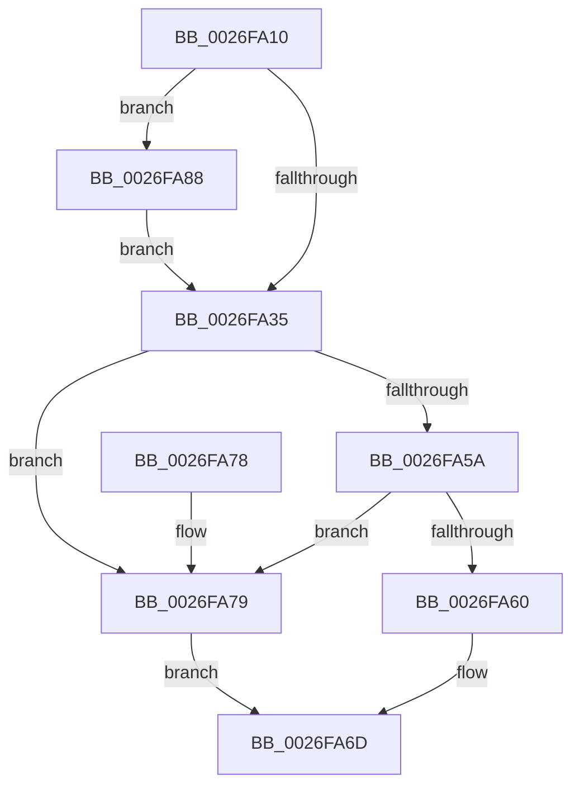

# IoDetachDevice

- RVA: `0x0026FA10`–`0x0026FA97` (길이 `135` bytes)
- VA: `0x000000014026FA10`
- 실행 섹션: `.text`
- PDB 이름 있음: `예`; PDB Function 태그: `아니요`
- unwind 정보 RVA: `0x00065944`
- 디코드: `38`개 명령, `135/135` bytes 표시
- 미해석 바이트: `0` (있으면 어셈블리에 `.byte`로 보존)

> 이 문서는 커널 이미지의 기계어와 PDB 기호를 분석해 생성했습니다. 4번과 5번은 함수 원형과 자료형을 바이너리 사용 방식에서 추정한 C 해석이며 원본 소스 복구 결과는 아닙니다.

## 1. Dependencies

- 직접 호출 지점: **4**; 고유 호출 대상: **4**
- 직접 호출자로 확인된 함수: **2**
- RIP 상대 이미지 참조: **1**

### Outgoing calls
- `0x0026FA22` → [KeAcquireQueuedSpinLock](../27/KeAcquireQueuedSpinLock_function_00273D80.md) (function, `0x00273D80`)
- `0x0026FA68` → [IopCompleteUnloadOrDelete](../27/IopCompleteUnloadOrDelete_function_00270BC8.md) (function, `0x00270BC8`)
- `0x0026FA81` → [KeReleaseQueuedSpinLock](../27/KeReleaseQueuedSpinLock_function_00272540.md) (function, `0x00272540`)
- `0x0026FA90` → [IovDetachDevice](../../pagevrfy/B9/IovDetachDevice_function_00B9273C.md) (function, `0x00B9273C`)

### Direct callers
- [DifIoDetachDeviceWrapper](../62/DifIoDetachDeviceWrapper_function_00629EF0.md) at `0x00629FB6`
- [sub_00BAD17D](../../pagevrfy/BA/Unknown_function_00BAD17D.md) at `0x00BAD1F8`

### Static image references
- `0x0026FA27` → RVA `0x00F04A20` (`.data`; read)

## 2. Other-region calls and transfers

- 다른 실행 섹션으로 향하는 call: **1**
  - `0x0026FA90` → [IovDetachDevice](../../pagevrfy/B9/IovDetachDevice_function_00B9273C.md) (`.text` → `PAGEVRFY`)
- 별도 외부 분기/꼬리 이동을 확인하지 못했습니다.

## 3. Assembly (complete function range)

```asm
0026FA10  48 89 5C 24 08                  mov qword ptr [rsp + 8], rbx
0026FA15  57                              push rdi
0026FA16  48 83 EC 20                     sub rsp, 0x20
0026FA1A  48 8B D9                        mov rbx, rcx
0026FA1D  B9 0A 00 00 00                  mov ecx, 0xa
0026FA22  E8 59 43 00 00                  call 0x140273d80
0026FA27  8B 15 F3 4F C9 00               mov edx, dword ptr [rip + 0xc94ff3]
0026FA2D  40 8A F8                        mov dil, al
0026FA30  F6 C2 10                        test dl, 0x10
0026FA33  75 53                           jne 0x14026fa88
0026FA35  48 8B 4B 18                     mov rcx, qword ptr [rbx + 0x18]
0026FA39  45 33 C0                        xor r8d, r8d
0026FA3C  48 8B 91 38 01 00 00            mov rdx, qword ptr [rcx + 0x138]
0026FA43  4C 89 42 30                     mov qword ptr [rdx + 0x30], r8
0026FA47  48 8B 83 38 01 00 00            mov rax, qword ptr [rbx + 0x138]
0026FA4E  4C 89 43 18                     mov qword ptr [rbx + 0x18], r8
0026FA52  8B 48 20                        mov ecx, dword ptr [rax + 0x20]
0026FA55  F6 C1 07                        test cl, 7
0026FA58  74 1F                           je 0x14026fa79
0026FA5A  44 39 43 04                     cmp dword ptr [rbx + 4], r8d
0026FA5E  75 19                           jne 0x14026fa79
0026FA60  44 8A C7                        mov r8b, dil
0026FA63  33 D2                           xor edx, edx
0026FA65  48 8B CB                        mov rcx, rbx
0026FA68  E8 5B 11 00 00                  call 0x140270bc8
0026FA6D  48 8B 5C 24 30                  mov rbx, qword ptr [rsp + 0x30]
0026FA72  48 83 C4 20                     add rsp, 0x20
0026FA76  5F                              pop rdi
0026FA77  C3                              ret
0026FA78  CC                              int3
0026FA79  40 8A D7                        mov dl, dil
0026FA7C  B9 0A 00 00 00                  mov ecx, 0xa
0026FA81  E8 BA 2A 00 00                  call 0x140272540
0026FA86  EB E5                           jmp 0x14026fa6d
0026FA88  48 8B 54 24 28                  mov rdx, qword ptr [rsp + 0x28]
0026FA8D  48 8B CB                        mov rcx, rbx
0026FA90  E8 A7 2C 92 00                  call 0x140b9273c
0026FA95  EB 9E                           jmp 0x14026fa35
```

## 4. C-style interpretation (structured pseudocode)

```c
__int64 __fastcall IoDetachDevice(__int64 a1, __int64 a2, int a3)
{
    __int64 result;
    __int64 v_rsp;
    unsigned __int64 v_stack_p28;
    unsigned __int64 v_stack_p8;

    v_stack_p8 = v_rbx;
    v_rsp = (v_rsp) - (32);
    result = KeAcquireQueuedSpinLock(10, a2, a3, a4);
    if ((((unsigned __int8)((unsigned int)(*(unsigned int *)(v_rip + 13193203)))) & (16)) != 0) goto loc_0026FA88;
loc_0026FA35:
    a3 = 0;
    *(unsigned __int64 *)(*(unsigned __int64 *)(*(unsigned __int64 *)(a1 + 24) + 312) + 48) = 0;
    *(unsigned __int64 *)(a1 + 24) = 0;
    if ((((unsigned __int8)((unsigned int)(*(unsigned int *)(*(unsigned __int64 *)(a1 + 312) + 32)))) & (7)) == 0) goto loc_0026FA79;
    if ((*(unsigned int *)(a1 + 4)) != 0) goto loc_0026FA79;
    a2 = 0;
    result = IopCompleteUnloadOrDelete(a1, a2, (unsigned __int8)((unsigned __int8)(result)), a4);
loc_0026FA6D:
    v_rsp = (v_rsp) + (32);
    return result;
loc_0026FA79:
    result = KeReleaseQueuedSpinLock(10, (unsigned __int8)((unsigned __int8)(result)), (unsigned __int8)((unsigned __int8)(result)), a4);
    goto loc_0026FA6D;
loc_0026FA88:
    result = IovDetachDevice(v_stack_p8, v_stack_p28, (unsigned __int8)((unsigned __int8)(result)), a4);
    goto loc_0026FA35;
}
```

## 5. (Beta) C Style

```c
int64_t IoDetachDevice(void *Arg1, int64_t Arg2, int32_t Arg3)
{
    uint8_t *arg1 = (uint8_t *)Arg1;

    int64_t result;
    int64_t local_rsp;
    uint64_t v_stack_p28;
    uint64_t v_stack_p8;

    v_stack_p8 = local_rbx;
    local_rsp = (local_rsp) - (32);
    result = KeAcquireQueuedSpinLock(10, Arg2, Arg3, a4);
    if ((((uint8_t)((uint32_t)(*(uint32_t *)(v_rip + 0xC94FF3)))) & (16)) != 0) goto loc_0026FA88;
loc_0026FA35:
    Arg3 = 0;
    *(uint64_t *)(*(uint64_t *)(*(uint64_t *)(arg1 + 0x18) + 0x138) + 0x30) = 0;
    *(uint64_t *)(arg1 + 0x18) = 0;
    if ((((uint8_t)((uint32_t)(*(uint32_t *)(*(uint64_t *)(arg1 + 0x138) + 0x20)))) & (7)) == 0) goto loc_0026FA79;
    if ((*(uint32_t *)(arg1 + 0x4)) != 0) goto loc_0026FA79;
    Arg2 = 0;
    result = IopCompleteUnloadOrDelete(Arg1, Arg2, (uint8_t)((uint8_t)(result)), a4);
loc_0026FA6D:
    local_rsp = (local_rsp) + (32);
    return result;
loc_0026FA79:
    result = KeReleaseQueuedSpinLock(10, (uint8_t)((uint8_t)(result)), (uint8_t)((uint8_t)(result)), a4);
    goto loc_0026FA6D;
loc_0026FA88:
    result = IovDetachDevice(v_stack_p8, v_stack_p28, (uint8_t)((uint8_t)(result)), a4);
    goto loc_0026FA35;
}
```

### 관측된 메모리 오프셋

구조체 형식이 확인되지 않은 접근은 인자 기준의 오프셋으로만 기록했습니다.

| 기준 인자 | 오프셋 표현 | 폭 (bit) | 접근 |
|---|---:|---:|---|
| `Arg1` | `+ 0x4` | `32` | `R` |
| `Arg1` | `+ 0x18` | `64` | `R` |
| `Arg1` | `+ 0x18` | `64` | `W` |
| `Arg1` | `+ 0x138` | `64` | `R` |

## 6. Execution-region graph

[열기: 2D/3D 그래프와 함수 탐색 컨트롤 패널](../../../control-panel.html?section=text&rva=0x0026FA10&view=graph)

- 2D 그래프는 위에서 아래로 흐르고, 3D 그래프는 빈 공간을 드래그해 회전합니다. Shift+드래그는 이동, 휠은 확대·축소, 함수 노드 선택은 대상 보고서 이동입니다.

### Static fallback


